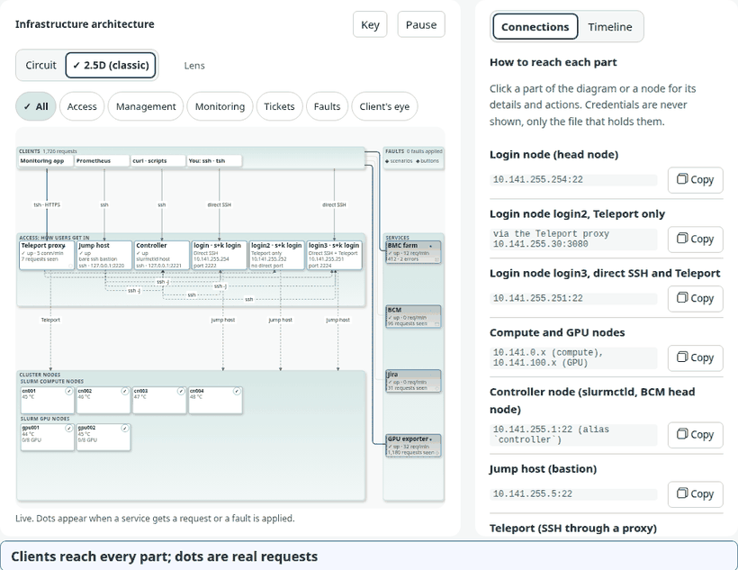
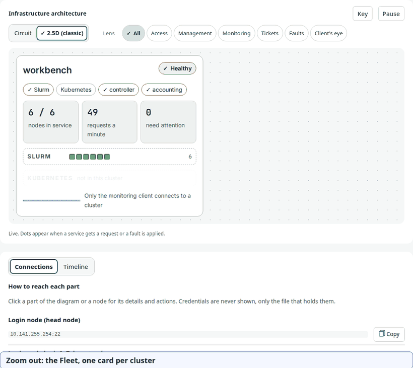

<p align="center"></p>

# workbench

<p align="center">
  <a href="https://github.com/AhmedYousriSobhi/workbench/actions/workflows/ci.yml"></a>
  <a href="https://github.com/AhmedYousriSobhi/workbench/releases/latest"></a>
  <a href="LICENSE-MIT"></a>
  
  
  
  
  
</p>

**A pretend HPC cluster for a 16 GB laptop, with a bouncer that keeps it from eating all your RAM.**

Real clusters cost a lot and break at 3 a.m. This one costs about 0.5 to 1.5 GB (the real Jira, optional, adds 2.4 GB; [what it uses](docs/guides/memory.md)), breaks when you ask, and fakes everything an
HPC monitoring app talks to: Slurm, GPUs, Grafana, Jira, BMCs. Built to test a desktop monitoring client, handy for
anyone who wants a cluster to poke without a data centre.

## See it in 20 seconds

<p align="center"><picture>
  <source media="(prefers-color-scheme: dark)" srcset="docs/manual/img/architecture-demo-dark.gif">
  
</picture></p>

*The page's Infrastructure architecture (sample data). Dots are requests, triangles are error answers, diamonds are faults; a fault outlines what a client would notice.*

<p align="center"><picture>
  <source media="(prefers-color-scheme: dark)" srcset="docs/manual/img/circuit-zoom-dark.gif">
  
</picture></p>

*Zoom and layers: Fleet, Cluster, one layer at a time, then a Pool (sample data).*

## Why you might want it

<table>
<tr>
<td width="33%" valign="top"><h3>🔌 Test a monitoring client</h3>Every service it talks to is there, with named faults to trigger on demand.</td>
<td width="33%" valign="top"><h3>🎓 Learn HPC safely</h3>Real Slurm, real jobs, a shell on a node, and nothing that can hurt a real cluster.</td>
<td width="33%" valign="top"><h3>💥 Break things on purpose</h3>Power a node off, fail a service, expire a token, then clear it all with one command.</td>
</tr>
</table>

## Start in 60 seconds (no sudo)

```bash
./scripts/benchctl start          # checks your machine, builds, starts, prints a link
```

The first run builds images, so go and get a coffee. Open the link it prints. You are looking at six nodes, four fake
services and one very watchful memory governor.

### Poke it

```bash
./scripts/benchctl get nodes                     # who is alive
./scripts/benchctl describe node gpu001          # everything about one node
./scripts/benchctl exec gpu001 -u alice          # a shell on it, tab completion included
./scripts/benchctl scenario run node-down        # now break something, politely
```

In the web page click a node, press **Power off** under *Actions*, and watch the node turn grey and the Infrastructure architecture react. **Clear faults** makes it all better.

### Build your own cluster

Want 2 CPU nodes, 4 GPU nodes and Jira? Ask what it costs first, then build only if it fits:

```bash
./scripts/benchctl plan --cpu-nodes 2 --gpu-nodes 4 --with jira
./scripts/benchctl up   --cpu-nodes 2 --gpu-nodes 4 --with jira
```

### Point your app at it

```bash
./scripts/benchctl export profile      # writes a file your monitoring client can import
./scripts/benchctl ssh-key install     # puts the login key where the client looks
```

Then follow [client setup](docs/guides/client-setup-by-component.md), one component at a time.

### Put it back

```bash
./scripts/benchctl stop                # everything you started, and nothing else
```

## What's inside

<p align="center"></p>

| Part | Real or simulated | Notes |
|---|---|---|
| Slurm | Real daemons, built from source (ADR 0002) | GPUs, cgroups and jobs are simulated ([ADR 0025](docs/adr/0025-slurm-is-real-the-rest-is-simulated.md)) |
| Compute and GPU nodes | Real `slurmd` in small containers | One shared base image |
| BMCs and GPU exporters | Simulated | One process plays many |
| Jira and BCM | Simulated (real Jira is optional) | [Client setup](docs/guides/client-setup-by-component.md) |
| Prometheus and Grafana | Real | Pre-wired dashboards |
| The governor | Real, runs on the host | Pauses, then stops, low-priority containers before RAM runs out |

Details: [architecture](docs/architecture/README.md).

## Will it fit my laptop?

<p align="center"></p>

The `min`, `std` and `full` profiles and what each part measured are in [the memory guide](docs/guides/memory.md). `./scripts/benchctl plan` tells you before anything starts.

## When it sulks

| Symptom | Try |
|---|---|
| Start refuses with `REFUSED` | Your RAM is busy (browsers, IDE). Close a few, run it again. The governor is protecting you |
| Not sure your machine qualifies | `./scripts/check-machine.sh` |
| Something odd | `./scripts/benchctl diag` writes one masked file to attach to a bug report |
| Forgot a command | `./scripts/benchctl --help`, or press Tab (`./scripts/benchctl completion install` once): it completes verbs, nodes, profiles and more |

Every command is explained, with its limits, in [the verbs guide](docs/guides/benchctl-verbs.md).

<details>
<summary><b>FAQ</b></summary>

**Is it a real Slurm?** Yes: real daemons built from source; jobs, GPUs and cgroups are simulated.

**Do I need sudo?** No. The governor runs as you; a root service is an optional upgrade.

**Does it need a GPU?** No. GPU metrics are simulated; a real card is an opt-in part.

**Can I add Kubernetes?** Yes: `./scripts/benchctl up --with k8s` ([how](docs/manual/04-nodes-and-shells.md#kubernetes-optional-part)).

**Where are the docs?** The [user manual](docs/manual/README.md) and the [guides](docs/guides/getting-started.md); the GitHub Wiki has the same pages.

</details>

## Using it from an AI agent

```bash
./scripts/benchctl describe workbench --json     # one call: state, endpoints, faults, scenarios, next steps
pip install -e '.[mcp]' && ./scripts/benchctl serve mcp    # the same verbs as typed MCP tools
```

Read [AGENTS.md](AGENTS.md) first (under 2,000 tokens); recipes are in [docs/agents/](docs/agents/README.md).

## Read more

| I want | Go to |
|---|---|
| A 10 minute walk-through | [Getting started](docs/guides/getting-started.md) |
| Everything, in order | [User manual](docs/manual/README.md) |
| What works today | [Progress](docs/PROGRESS.md) |
| The rules it must obey | [SPEC.md](SPEC.md) |
| To contribute | [CLAUDE.md](CLAUDE.md): work by issue and branch, PR into `dev` |

Dual-licensed under [Apache-2.0](LICENSE-APACHE) or [MIT](LICENSE-MIT). Slurm is built locally from its pinned upstream
source (ADR 0002) and is not redistributed.
