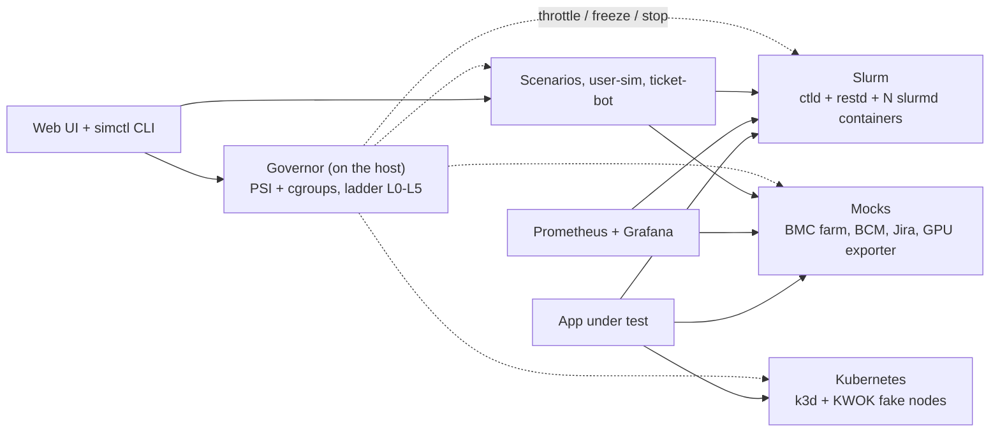

<p align="center"></p>

# opti-sim

A memory-governed simulation of an HPC/AI cluster that runs on a **16 GB Ubuntu workstation**. It gives the
"HPC AI infrastructure app" a realistic cluster to talk to (Slurm, Kubernetes, BMC, BCM, Jira, Grafana) with
users, jobs, faults and tickets, and keeps the host alive with a governor that stops low-priority parts before
memory runs out.

**Status:** in active build; see [what works today](docs/PROGRESS.md) ([diagrams](docs/progress.html)).
Memory budgets for `min` are measured, `std` and `full` are still estimates.

## The idea

Most of what the app talks to is an **API**, not a real OS. So opti-sim simulates the APIs (one process
emulates many BMCs or GPU exporters), runs Slurm in containers from one shared image, keeps a single real VM
for what containers cannot prove, and puts a **governor outside everything** that throttles, freezes and stops
containers by priority when memory pressure rises.



Containers by default, declarative topology (`sim.yaml` generates compose, `slurm.conf` and targets), profiles
with a memory budget that `benchctl up` enforces, and every fault is a named scenario. Details:
**[docs/architecture/](docs/architecture/README.md)**.

## Quick start

```bash
./scripts/benchctl start                 # checks the machine, builds and starts everything, prints the link (no sudo)
./scripts/benchctl stop                  # stops the web page and the cluster (only the hpcsim project)
```

No `sudo` anywhere: the memory governor runs as you (it pauses and stops containers through Docker). The only
prerequisite is Docker usable by your user, which `start` checks first. `./scripts/benchctl status` shows what is running and `./scripts/benchctl open` prints the login link again. The first
`start` builds images (a few minutes) and creates the Python environment. Prefer the steps one by one? They are in
the table below.

## Try it (about 10 minutes)

After the quick start above, with the stack up and the web page open:

1. **Right and left panels**: the governor (level, memory, pressure) on the left, *Needs attention* on the right. All clear means all is well.
2. **Middle of the page**: six simulated nodes and four mock services. Open *Fault actions* on `cn002`, press *Power off*: the card turns grey, and a diamond travels from *Fault injector* to the BMC. Press *Clear faults* to undo.
3. **See traffic**: in a second terminal run `for i in 1 2 3 4 5; do curl -s -o /dev/null "http://127.0.0.1:8080/rest/api/2/search?jql=project%3DOPS"; done`. Round dots travel from *Clients* to *jira-mock* and its counter rises.
4. **Scenarios** (right panel): pick `node-down`, speed 20x, press *Play*, and watch each step turn green. The strip at the top shows it running.
5. **Slurm steps** need the CLI: `./scripts/benchctl scenario run node-down --speed 10`.
6. **Look behind the scenes**: Grafana http://127.0.0.1:3000 (admin / admin), Prometheus :9090, fake BMC `curl http://127.0.0.1:8000/cn001/redfish/v1/Systems/1`.
7. **Stop**: `./scripts/benchctl stop`.

Something wrong? `./scripts/benchctl diag` writes one masked file to attach to a bug report. More detail: [docs/guides/getting-started.md](docs/guides/getting-started.md); everything about the tool: the [user manual](docs/manual/README.md).

## Build and run scopes

| I want to | Command | Needs |
|---|---|---|
| Start everything in one go | `./scripts/benchctl start` (stop: `./scripts/benchctl stop`, look: `./scripts/benchctl status`) | Docker, python 3.11+ |
| Check the machine before building | `./scripts/check-machine.sh` | system `python3` only |
| Install the CLI and test tools | `python3 -m venv .venv && . .venv/bin/activate && pip install -e '.[dev]'` | python 3.11+ |
| Check the setup in depth | `./scripts/benchctl doctor` then `./scripts/benchctl preflight --profile std` | venv, Docker |
| Run the governor | automatic with `benchctl start` (as you). Optional full protection at boot: `sudo ./scripts/install-governor.sh` | nothing |
| Build and start a profile | `./scripts/benchctl up --profile min\|std\|full` | Docker; first build takes minutes |
| Change the node count | `./scripts/benchctl scale 8` | stack running |
| Look at it | web page `python -m webui`; Grafana http://127.0.0.1:3000; Prometheus :9090 | stack running |
| Play a fault | `./scripts/benchctl scenario list`, `scenario run node-down --speed 10` | stack running |
| Run the tests | `./scripts/validate.sh` (fast, no Docker) | venv with dev extras |
| Run the tests on the live host | `./scripts/verify.sh --full` | Docker, a free ~3 GB |
| Debug the web page | `pip install -e '.[browser]'`, `python -m playwright install chromium`, `python scripts/ui_shots.py` | venv |
| Stop and clean up | `./scripts/benchctl down` | none |

| Profile | What is on | Memory budget |
|---|---|---|
| `min` | core, mocks, 4 slurmd, scenarios | 1 GB (measured 0.17 GB loaded) |
| `std` | `min` + accounting, 16 slurmd, k3d + KWOK, load sims | ~6 GB (estimate) |
| `full` | `std` + 32 slurmd, 200 KWOK nodes, fidelity VM | ~8.5 GB (estimate) |
| `jira-real` | `std` minus k3d, plus Jira Data Center | ~7.5 GB (estimate) |
| `mac-agent` | `min` + an external macOS agent | ~1 GB local |

`up` refuses a profile that does not fit in the memory free right now and names one that does. Components
not built yet are skipped with a note. The step-by-step guide is
[docs/guides/getting-started.md](docs/guides/getting-started.md).

## Map of the repository

| Path | What |
|---|---|
| `sim.yaml`, `profiles/` | the topology and the memory profiles (single source of truth) |
| `simctl/` | the CLI: machine check, doctor, up/down/scale, scenarios, measurements |
| `governor/`, `systemd/` | the memory governor (rootless by default) and its optional root service units |
| `components/`, `images/` | the mocks (BMC, BCM, Jira, GPU exporter) and the Slurm images |
| `webui/` | the web page (Starlette + one JS page, under 50 MB) |
| `scenarios/` | fault scripts in YAML |
| `docs/` | [user manual](docs/manual/README.md), [architecture](docs/architecture/README.md), [guides](docs/guides/getting-started.md), [decision records](docs/adr/), [progress](docs/PROGRESS.md) |
| [SPEC.md](SPEC.md) | the normative requirements (wins over any other doc) |

## Contributing

Work by issue, branch and PR into `dev`; read [CLAUDE.md](CLAUDE.md) for the workflow and the hard rules
(the governor runs on the host, rootless by default; the web UI never gets Docker access; no macOS VMs).

## License

Dual-licensed under [Apache-2.0](LICENSE-APACHE) or [MIT](LICENSE-MIT), at your option. Slurm is built locally from its pinned upstream source (ADR 0002) and is not redistributed here.
