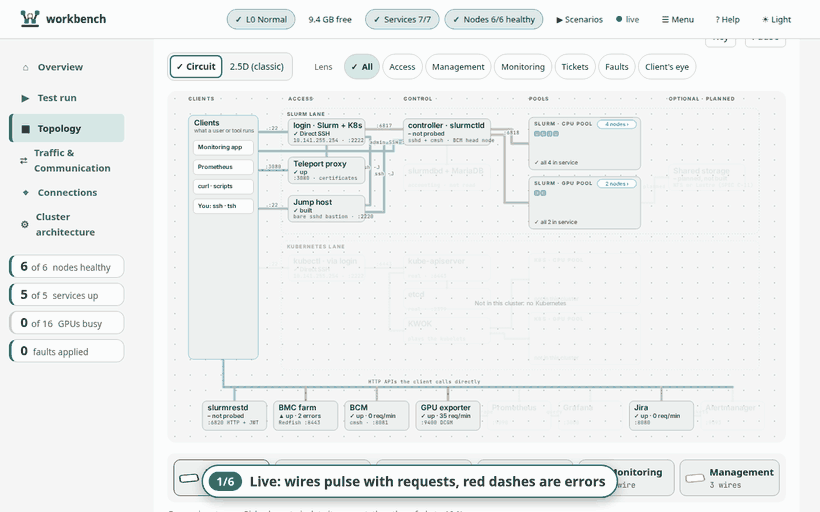
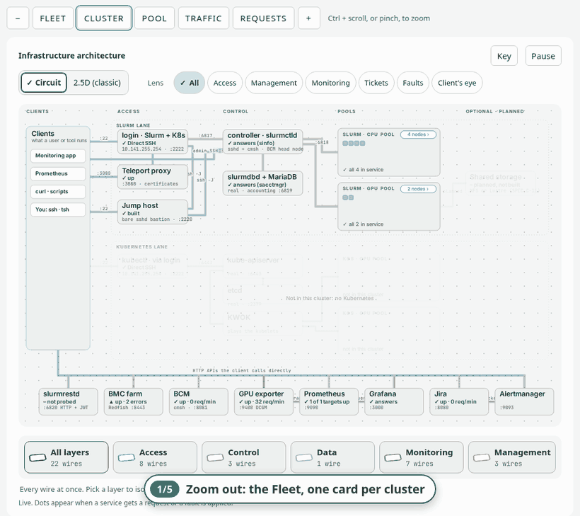
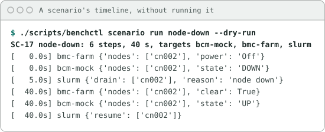
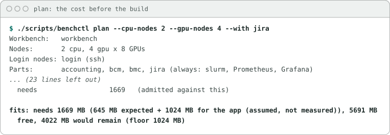

<p align="center"><picture>
  <source media="(prefers-color-scheme: dark)" srcset="docs/assets/art/readme-hero-dark.svg">
  
</picture></p>

# workbench

<p align="center">
  <a href="https://github.com/AhmedYousriSobhi/workbench/actions/workflows/ci.yml"></a>
  <a href="https://github.com/AhmedYousriSobhi/workbench/releases/latest"></a>
  <a href="LICENSE-MIT"></a>
  
  
  
  
  
</p>

**A simulated HPC and AI cluster on one 16 GB laptop, built for testing monitoring software.**

Point your monitoring client at it, then power off a node, drain it, expire a certificate or make Jira refuse, and check
that the client notices. Slurm is real; the BMCs, BCM, Jira and GPU metrics are faithful stand-ins; a memory governor
outside the cluster keeps your laptop usable. No sudo and no data centre: about 0.5 to 1.5 GB of RAM ([what it uses](docs/guides/memory.md)).

## What you get

<table>
<tr>
<td width="33%" valign="top"><b>Real Slurm</b><br>Daemons built from source, real jobs, a shell on any node, accounting and REST.</td>
<td width="33%" valign="top"><b>Faithful stand-ins</b><br>Redfish BMCs, BCM, Jira and GPU metrics, beside a real Prometheus and Grafana; Kubernetes as an option.</td>
<td width="33%" valign="top"><b>Faults on demand</b><br>Over 40 named scenarios: a node down, GPUs off the bus, an expired token. One command clears them.</td>
</tr>
<tr>
<td valign="top"><b>A live web page</b><br>The cluster's architecture with its traffic, node actions, scenarios, and the manual as help.</td>
<td valign="top"><b>A memory governor</b><br>Pauses, then stops, low-priority containers before your RAM runs out.</td>
<td valign="top"><b>Ready for agents</b><br><code>--json</code> on the read verbs, <a href="AGENTS.md">AGENTS.md</a> and an MCP server.</td>
</tr>
</table>

## See it in 20 seconds

<p align="center"><picture>
  <source media="(prefers-color-scheme: dark)" srcset="docs/manual/img/architecture-demo-dark.gif">
  
</picture></p>

*The page's Infrastructure architecture (sample data). Dots are requests, triangles are error answers, diamonds are faults; a fault outlines what a client would notice.*

<p align="center"><picture>
  <source media="(prefers-color-scheme: dark)" srcset="docs/manual/img/circuit-zoom-dark.gif">
  
</picture></p>

*Zoom and layers: Fleet, Cluster, one layer at a time, then a Pool (sample data).*

## Quick start: three commands, no sudo

```bash
./scripts/benchctl start                    # check, build once, start, print the page link
./scripts/benchctl scenario run node-down   # break a node, watch it react
./scripts/benchctl stop                     # stop what it started, nothing else
```

The first start builds the images, so it takes a while; then open the link it prints. Not sure what a scenario does?
Add `--dry-run`: it prints the timeline and changes nothing.

<picture>
  <source media="(prefers-color-scheme: dark)" srcset="docs/assets/snapshots/scenario-node-down-dark.svg">
  
</picture>

*Real output, captured by `scripts/make_snapshots.py`.*

## Build the cluster you need

Ask what a cluster costs before you build it; `up` builds it only if it fits:

```bash
./scripts/benchctl plan --cpu-nodes 2 --gpu-nodes 4 --with jira
./scripts/benchctl up   --cpu-nodes 2 --gpu-nodes 4 --with jira
```

<picture>
  <source media="(prefers-color-scheme: dark)" srcset="docs/assets/snapshots/plan-dark.svg">
  
</picture>

*Real output, shortened; the free memory is the capturing machine's.*

## Point your client at it

```bash
./scripts/benchctl export profile      # one file your monitoring client can import
./scripts/benchctl ssh-key install     # puts the login key where the client looks
```

Then follow [testing a client against workbench](docs/guides/client-testing.md), or [client setup](docs/guides/client-setup-by-component.md) one component at a time.

## How it works

<p align="center"><picture>
  <source media="(prefers-color-scheme: dark)" srcset="docs/assets/art/readme-how-it-works-dark.svg">
  
</picture></p>

| Part | Real or simulated | Notes |
|---|---|---|
| Slurm | Real daemons, built from source (ADR 0002) | GPUs, cgroups and jobs are simulated ([ADR 0025](docs/adr/0025-slurm-is-real-the-rest-is-simulated.md)) |
| Compute and GPU nodes | Real `slurmd` in small containers | One shared base image |
| BMCs and GPU exporters | Simulated | One process plays many |
| Jira and BCM | Simulated (real Jira is optional) | [Client setup](docs/guides/client-setup-by-component.md) |
| Prometheus and Grafana | Real | Pre-wired dashboards |
| The governor | Real, runs on the host | Pauses, then stops, low-priority containers before RAM runs out |

Details: [architecture](docs/architecture/README.md). Will it fit your laptop? The `min`, `std` and `full` profiles are
in [the memory guide](docs/guides/memory.md), and `./scripts/benchctl plan` tells you before anything starts.

## When it sulks

| Symptom | Try |
|---|---|
| Start refuses with `REFUSED` | Your RAM is busy (browsers, IDE). Close a few, run it again. The governor is protecting you |
| Not sure your machine qualifies | `./scripts/check-machine.sh` |
| Something odd | `./scripts/benchctl diag` writes one masked file to attach to a bug report |
| Forgot a command | `./scripts/benchctl --help`, or press Tab (`./scripts/benchctl completion install` once) |

## Using it from an AI agent

```bash
./scripts/benchctl describe workbench --json     # one call: state, endpoints, faults, scenarios, next steps
pip install -e '.[mcp]' && ./scripts/benchctl serve mcp    # the same verbs as typed MCP tools
```

Read [AGENTS.md](AGENTS.md) first (under 2,000 tokens); recipes are in [docs/agents/](docs/agents/README.md).

## Read more

| I want | Go to |
|---|---|
| A 10 minute walk-through | [Getting started](docs/guides/getting-started.md) |
| Everything, in order | [User manual](docs/manual/README.md), also on the [wiki](https://github.com/AhmedYousriSobhi/workbench/wiki) and in the web page's **? Help** |
| Every command and its limits | [The verbs guide](docs/guides/benchctl-verbs.md) |
| What works today | [Progress](docs/PROGRESS.md) |
| The rules it must obey | [SPEC.md](SPEC.md) |
| To contribute | [CLAUDE.md](CLAUDE.md): work by issue and branch, PR into `dev` |

Dual-licensed under [Apache-2.0](LICENSE-APACHE) or [MIT](LICENSE-MIT). Slurm is built locally from its pinned upstream
source (ADR 0002) and is not redistributed.
