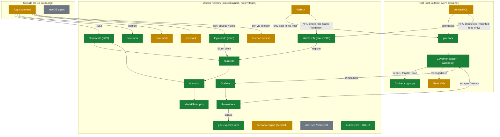

# Progress

<!-- GENERATED from docs/progress.yaml by `python -m benchctl.progress`; do not edit. -->
Last updated 2026-11-01. Legend: ✅ Done 🔍 In review 🟡 Partial ⬜ To do. Mermaid diagrams render on GitHub; for any browser open [progress.html](progress.html).

**87% built** (36 done, 55 in review, 9 partial, 5 to do, 105 items).

## Roadmap

## As built

What exists and how the parts connect. Green is verified, blue is in review, amber is partial, grey is not started.

## Phases

### Baseline (33%)

_Measure real memory so budgets stop being guesses._

| Part | Status | How it is built | Where | PR |
|---|---|---|---|---|
| Measurement tooling | ✅ Done | `benchctl measure run/report` samples host, Docker containers, PSS per process and libvirt domains (read-only), saves JSON, suggests budgets = peak x 1.2. | `benchctl/measure.py` | #28 |
| Host baseline | 🟡 Partial | Idle host and a small Slurm stack were measured (slurmd 5 MiB, slurmctld 13, MariaDB 171). No loaded run with mocks yet. | - | - |
| Budgets replaced by measured values | 🟡 Partial | min measured live (VMs off, 60 queued jobs): 0.17 GB peak across containers, budget set to 1 GB. std/full are still estimates. | `profiles/min.yaml` | #68 |

1/3 done

### Governor (86%)

_A root service that keeps the host alive by escalating through a ladder._

| Part | Status | How it is built | Where | PR |
|---|---|---|---|---|
| Signals and escalation ladder | ✅ Done | MemAvailable, PSI and swap rate feed levels L0-L5. Escalates at once, steps down one level per 60 s calm with a 10 s dwell. L4 from a PSI stall needs 5 s (ADR 0032, issue 286); low MemAvailable is immediate. | `governor/signals.py`, `governor/ladder.py` | #14 |
| Priority planner | ✅ Done | P0-P6 classes; lowest priority first, reversible actions before destructive ones; undo on de-escalation. | `governor/planner.py` | #14 |
| Executors | ✅ Done | freeze, throttle (memory.high), reclaim, stop (cgroup.kill then docker stop), managedsave for VMs, via cgroup files opened in advance. | `governor/executors.py` | #20 |
| mlockall and pre-allocated mitigation path | ✅ Done | Locks its own pages and pre-opens handles and buffers so L3/L4 performs no allocation (SPEC GV-8). | `governor/memlock.py` | #19 |
| Control socket | ✅ Done | JSON lines on /run/workbench/gov.sock with a fixed allow-list; unknown commands are rejected. | `governor/control.py` | #19 |
| NF-1 memory-hog test | ✅ Done | A real container hog is throttled, frozen then stopped in order; no host OOM. Runs as root via scripts/real-test-root.sh. | `tests/real/test_root.py` | #24 |
| Security watchdog | ✅ Done | Every 15 s flags privileged/capability/unconfined/host-namespace/docker.sock containers, missing limits and live memory.max drift. Report only; skipped from L3 up. | `governor/watchdog.py` | #34 |
| Monitored slurmrestd exception | ✅ Done | slurmrestd runs with two unshare steps disabled (ADR 0004). Any wider SLURMRESTD_SECURITY option is a violation; doctor lists the accepted exception. | `governor/watchdog.py` | #44 |
| Inventory refresh and Grafana annotations | ✅ Done | Re-discovers containers so late starters are governed; posts audit events to Grafana with a token from the environment (SPEC GV-6). | `governor/annotate.py`, `governor/core.py` | #36 |
| systemd unit installed permanently | 🟡 Partial | Unit and slice pass systemd-analyze and ran as a transient service in tests; scripts/install-governor.sh installs it as the standing service (printed unit tested; the sudo install itself is run by the user). | `systemd` | - |
| Admission and real scale / set-profile | ✅ Done | admit command (GV-9): refused at L2+ or if it would breach the floor; scale and set-profile run benchctl in the background at L0-L1 only (GV-8). benchctl up/scale ask first. Verified live through the socket. | `governor/core.py` | #48 |
| Governor /metrics endpoint | ✅ Done | Prometheus text (level, MemAvailable, PSI, swap, groups per priority, actions, admissions) bound to the docker bridge address, rendered once per step so a scrape does no work (GV-8). The Prometheus 'governor' target is up on the live stack. | `governor/metrics.py` | #60 |
| Live ladder test on the real stack | ✅ Done | Dry-run governor against the running containers: L0 to L3 and back, /metrics, Grafana annotations and the planned throttle/freeze/thaw actions. The root variant passes on the dev machine: L3 really freezes a live container's cgroup (cgroup.events frozen 1), keeps P1 services running, and thaws on recovery; it also exposed and fixed the nested-slice cgroup path bug (PR 64). | `tests/real/test_pressure_real.py` | #60 |
| Host tuning script and benchctl top | ⬜ To do | zram, swappiness and THP tuning with confirmation, and a live view of the governor. | - | - |

12/14 done

### Slurm (100%)

_A real scheduler the app can read, built from sim.yaml._

| Part | Status | How it is built | Where | PR |
|---|---|---|---|---|
| Slurm 26.05.5 images | ✅ Done | Built from the SchedMD tarball (pinned and SHA256-checked) because Ubuntu's 23.11 lacks the 2026 security fixes; no extra container privileges (ADR 0002). | `images/node-base/Dockerfile` | #32 |
| Generated Slurm config | ✅ Done | slurm.conf, gres.conf and cgroup.conf derive from sim.yaml so node names match everywhere; fake GPUs use /dev/null-backed device files. | `benchctl/slurmconf.py` | #32 |
| Compose generation | ✅ Done | `benchctl compose --profile X` renders services with mem_limit, cgroup_parent and the workbench.class label from sim.yaml and profiles. | `benchctl/compose.py` | #30 |
| slurmrestd with JWT | ✅ Done | JWT-only REST on the internal network, own user, no privileges; skips two unshare steps instead of loosening seccomp (ADR 0003, ADR 0004). Verified live: no token 401, bad tokens get no data. | `benchctl/compose.py` | #38 |
| Accounting | ✅ Done | MariaDB on a capped tmpfs plus slurmdbd; sacctmgr bootstrap creates cluster, QOS and users from sim.yaml; secrets stay in a gitignored folder. Verified live: a job as alice appears in sacct and the REST slurmdb endpoint. | `benchctl/slurmconf.py` | #38 |
| Real-Slurm decision record | 🔍 In review | One ADR: what is real (scheduler, output, REST auth, node death timing), what is simulated (GPUs, cgroups, jobs), cost and what to cut first; linked from architecture 4.1 and client-testing. Issue 218. | `docs/adr/0025-slurm-is-real-the-rest-is-simulated.md` | - |
| Faster image rebuilds | 🔍 In review | python3 moved into node-base's apt layer; login and slurm-ctl run no apt step, so a node-base change no longer re-installs packages twice: login + slurmctld rebuild 39.9 s before, 0.6 s after (one-time 22 s). Compute nodes carry an unused python3. Issue 225. | `images/node-base/Dockerfile`, `images/login/Dockerfile`, `images/slurm-ctl/Dockerfile` | - |
| benchctl up / down / scale | ✅ Done | Pre-flight, staged start (observability, slurm, nodes), skips unbuilt mocks, scale regenerates slurm.conf, Grafana token created once (0600). Verified live with min; scale really stops containers. | `benchctl/stack.py` | #45 |

6/8 done

### Mocks (83%)

_Fake BMC, BCM and Jira so the app's integrations can be exercised._

| Part | Status | How it is built | Where | PR |
|---|---|---|---|---|
| gpu-exporter-farm | ✅ Done | One process serving fake DCGM metrics for every simulated GPU (util, FB used and free, temp, power, XID) with the real exporter labels (Hostname, UUID, modelName), fault injection over /sim/inject. A read-only Grafana token for clients is made by benchctl up. Verified live through Grafana /api/ds/query. | `components/gpu-exporter-farm/exporter.py` | - |
| bmc-farm | ✅ Done | One process serves /<node>/redfish/v1 for every node: Systems, Chassis Thermal/Power, Managers, event log, Reset action, POST /sim/inject (temp, fans, power, events). Also standard Redfish over TLS on 127.0.0.1:8443 (Host picks the node, session login, collections, firmware, accounts; ADR 0012). Verified live in the stack. | `components/bmc-farm/bmc.py` | #52 |
| bcm-mock | 🟡 Partial | CMDaemon-style POST /json (cmdevice, cmstatus, cmpart) over the sim.yaml nodes, power calls and /sim/inject. Call names are an assumed subset (ADR 0005); verified live, 12 MiB. | `components/bcm-mock/bcm.py` | #71 |
| Fake cmsh on the login node | ✅ Done | cmsh -c "device; list" / "device; status" / category, jobqueue and healthchecks lists on the login node (the BCM head node), state read from bcm-mock so a scenario that takes a node down shows DOWN; mutating commands refused; read-only interactive console with modes (ADR 0013). Verified live: tests/real/test_cmsh_real.py. | `images/login/cmsh.py` | - |
| jira-mock | 🟡 Partial | Mode mock only: REST v2/v3 issues, POST search (/search/jql token paging, /search offset paging), myself, serverInfo, field, project, JQL with OR/NOT/parentheses/text search, comments (read, edit, delete), issue edit, watchers, worklog, assign, user search, workflow transitions with required-field errors, JQL subset, webhooks, 429/503/slow failures, and /sim/tickets for scenarios (ADR 0005, issue 107); node faults file one Incident per node and kind (comment on a repeat, resolve on recovery) through the scenario engine's side effects (issue 157); a background team moves, comments, reassigns, reopens and files tickets (GET|POST /sim/activity, JIRA_ACTIVITY_EVERY, `benchctl set jira-activity`, issue 158). Verified live in the container (transitions, JQL, webhook to an outside receiver, 429/503), 15 MiB. cloud/dc modes not built. Contract test (issue 229): scripts/record_jira_shapes.py records real Jira Cloud response shapes (read-only, keys and types only) and tests/test_jira_contract.py fails on drift, gaps listed in tests/fixtures/jira/known-gaps.yaml; tooling built, nothing recorded yet (needs the owner's own Jira Cloud site), docs/guides/jira-contract.md. Ticket driver (issue 262, step 1): benchctl/jira_driver.py does the node-fault, recovery and team-activity actions through the standard REST API instead of /sim/*, verified against the mock; not yet wired to jira.mode, node_watch or scenarios, and not run against real Cloud. | `components/jira-mock/jira.py` | #71 |
| SSH login node | ✅ Done | sshd + Slurm client tools on 127.0.0.1:2222, key login only, forwarding on, keys generated by benchctl up (ADR 0011). Verified live: sinfo over SSH, root and password refused, port forward to a mock. | `images/login` | - |
| sshd on compute nodes | ✅ Done | sshd in node-base, started on nodes only (WORKBENCH_SSHD): ssh cn001 from the login node with no prompt (cluster key, shared node host key), a client ProxyJump or execution target to a node, srun and srun --pty. Reached through the login node only (ADR 0014). up builds node-base first. Verified live: tests/real/test_node_ssh_real.py. | `images/node-base` | - |
| Client setup by component | 🔍 In review | One section per client component (SSH, Slurm, Grafana, storage, Jira, BCM, BMC): values, where to get them, what to expect, common failure. Values checked against the live stack; not walked in the client window. Issue 82. | `docs/guides/client-setup-by-component.md` | - |
| Normal shell on nodes | 🔍 In review | Simulated users get bash (useradd default), bash-completion, Slurm tab completion from the Slurm source tree, history, a user@node prompt and Slurm on the login-shell PATH. Verified live: tests/real/test_login_real.py. Issue 81. | `images/node-base/Dockerfile` | - |
| Client key helper | 🔍 In review | benchctl ssh-key install|remove: copies the login key to ~/.ssh/workbench_ed25519 (mode 600) for clients that only read keys under ~/.ssh; refuses to overwrite a foreign file. Issue 80. | `benchctl/stack.py`, `benchctl/cli.py` | - |
| GPU metrics follow Slurm jobs | 🔍 In review | slurmctld serves the GPU indexes running jobs hold (internal :9401); the exporter polls it every 3 s and shows those GPUs busy, the rest idle (last answer kept 30 s if the feed is down). Verified live: tests/real/test_gpu_follows_slurm_real.py. Issue 83. | `components/gpu-exporter-farm/exporter.py`, `images/slurm-ctl/alloc_feed.py` | - |
| Teleport access | 🔍 In review | Optional part (--with teleport): real Teleport auth+proxy container, agentless OpenSSH nodes trusting its CA, identity file per user, benchctl add invite for tsh login (ADR 0020). Unit-tested; live test tests/real/test_teleport_real.py. `benchctl doctor` and `up` warn in one line when the local tsh is a newer major version than the server (issue 210). Not yet: outage and cert-expiry scenarios, Web UI entry, measured memory budget. Issue 39. | `benchctl/teleport.py`, `images/node-base/teleport-ssh` | - |

5/12 done

### People and chaos (25%)

_Simulated users and engineers, scripted faults._

| Part | Status | How it is built | Where | PR |
|---|---|---|---|---|
| Scenario files | 🟡 Partial | Twelve scenarios: ib-port-down, gpu-xid-storm, node-down, fan-failure, jira-429, jira-outage, jira-flap, ticket-lifecycle, drain-ticket and ticket-wave run now; pod-crashloop and k8s-node-notready need the k8s part. | `scenarios` | #73 |
| Slurm resilience scenarios and trace | 🔍 In review | Four scenarios start a real job (and a simulated GPU job) and restart or stop slurmd, restart slurmctld or drain under it; `scenario run NAME --trace` prints job states, slurmstepd pids and the new Slurm log lines per step. slurmd now runs under slurmd-run instead of as PID 1 so it can restart without the container. Steps: submit {node, gpus, duration}, cancel, slurmd_restart|stop|start, slurmctld_restart; expect slurm.job_state, slurm.stepd. The page plays them and shows the trace (tick Slurm trace) through new governor commands slurm-step and slurm-trace (read-only `benchctl get trace`), so W-3 holds; also `benchctl set slurmd|slurmctld`, `remove jobs`. Unit tests run; live test written, NOT yet run (observed behaviour to be recorded). Issue 220. | `scenarios/slurmd-*.yaml`, `scenarios/slurmctld-restart-mid-job.yaml`, `scenarios/drain-mid-job.yaml`, `benchctl/slurmtrace.py`, `images/node-base/slurmd-run`, `governor/core.py`, `webui/app.py`, `webui/static/index.html`, `tests/real/test_slurmresilience_real.py`, `docs/guides/slurm-resilience.md` | - |
| user-sim and ticket-bot | ⬜ To do | Personas with Poisson arrivals and engineers working tickets. | - | - |
| scenario-engine | 🟡 Partial | `benchctl scenario list|run NAME|SC-nn [--speed N] [--dry-run]` (fixed reference numbers SC-01..., a summary line before a run, issue 303): steps drive bmc-farm, bcm-mock, gpu-exporter, jira-mock, Slurm (scontrol) and the login node's sshd (ssh target: down, hung, up, rotate_host_key, max_sessions, reject_auth, node_sshd + nodes, reset; scenarios ssh-host-key-changed, login-node-down, login-node-hung, ssh-session-limit, ssh-key-refused, ssh-node-sshd-down; tests/real/test_ssh_faults_real.py); ramps; expect (slurm.node_state, jira.issue_created) watched from the start; ticket-bot steps skipped; `k8s` steps (needs the k8s part) run kubectl from the official image. `jira-real` target (issue 303): real faults on the real Jira, outage/restore (docker pause), bad_logins (401 then 403 CAPTCHA), clear_logins, rate_limit/rate_limit_off (Jira's own limiter through its tables, real 429 with X-RateLimit headers, about 40 s reload); scenarios jira-real-outage, jira-real-captcha and jira-real-429, and client-stress-real (the whole client-stress run against the real Jira), verified live. Issues 305-307 (unit-tested; verified live against the real Jira with tests/real/test_jira_dc_real.py, not yet against the client): token_revoke/token_restore (a real 401 for a personal access token, scenario jira-real-token-revoked), proxy_slow/proxy_503/proxy_429/proxy_off through a stdlib fault proxy on 127.0.0.1:8084 (benchctl/jira_proxy.py, scenario jira-real-slow-503, the client must use :8084), and `tickets:` steps plus `target: real` expectations on the real Jira through the REST driver (client-stress-real files its 12 tickets there); ADR 0026 addendum. Runs in the host CLI, not a container (ADR 0006). Verified live. | `benchctl/scenario.py` | #73 |

0/4 done

### Kubernetes (100%)

_Mixed real and fake K8s nodes._

| Part | Status | How it is built | Where | PR |
|---|---|---|---|---|
| Cluster fixtures | ✅ Done | Namespaces, workloads, failure signals and a read-only RBAC role, applied with apply.sh. | `k8s/fixtures` | - |
| Kubernetes part (real control plane plus KWOK nodes) | ✅ Done | Optional part (`benchctl up --with k8s` or `--workload kubernetes`, off by default; issue 232, ADR 0034): etcd, kube-apiserver, kube-controller-manager, kube-scheduler and the KWOK controller as five unprivileged, memory-limited compose services at fixed addresses (API 10.141.255.40:6443), P3, measured about 0.3 GB (cap 0.77 GB). Nodes (kcn001..., kgpu001... with nvidia.com/gpu and GPU Feature Discovery labels) come from sim.yaml kubernetes.nodes; a PKI and read-only kubeconfigs are generated into secrets/k8s; the login node has kubectl (from the official image) and per-user ~/.kube/config (cluster-wide) and limited.yaml (namespace team-a), mode 600. Failing pods get a kubelet's status from KWOK stages (label workbench_fault: CrashLoopBackOff, OOMKilled, ImagePullBackOff, failed job). Scenario target k8s (down/up, cordon, pod, delete_pod, scale, apply; expect k8s.node_ready, k8s.pod_status): k8s-node-notready, pod-crashloop. Login nodes can be an s-login (`ssh:slurm`) or a k-login (`ssh:k8s`) (issue 380): the k-login has kubectl and the kubeconfigs and no Slurm configuration; the diagram shows the Kubernetes nodes as their own group, each login pointing at the group it serves; printed ssh commands carry -o IdentitiesOnly=yes. The Cluster architecture sheet is a wide two-column layout (Slurm card, Kubernetes card with its own CPU and GPU node counts, a card per login node with Way in and Serves choices, optional parts, a sticky summary); --k8s-cpu-nodes. The diagram has a Kubernetes API box (up or down, no request counter) and the client export puts the k8s block on the k-login's entry (checked with the client's own importer). Kubernetes nodes are machines: they get BMCs (a rule per node group, --bmc-groups), BCM entries (categories k8s-cpu, k8s-gpu; BCM managing them is an option, `bcm.manage_kubernetes`, `--no-bcm-k8s`, issue 413; with a controller node the BCM head node is the controller, ADR 0036) and GPU metrics. The Scenarios panel is a docked drawer toggled from the top strip. Verified live (verify.sh --unit k8s); the client's screens not yet tried (desktop app). Not built: a real agent node (privileged), metrics-server, Teleport access. | `benchctl/k8s.py`, `benchctl/compose.py`, `benchctl/stack.py`, `benchctl/scenario.py`, `k8s/kwok`, `k8s/fixtures`, `images/login`, `tests/test_k8s.py`, `tests/real/test_k8s_real.py`, `docs/adr/0034-kubernetes-kwok-first.md` | [#379](https://github.com/AhmedYousriSobhi/workbench/pull/379) |

2/2 done

### Fidelity VM (0%)

_One real Ubuntu VM with Redfish power control._

| Part | Status | How it is built | Where | PR |
|---|---|---|---|---|
| VM scaffold (deferred) | ⬜ To do | Vagrantfile, provisioning scripts and up/down helpers exist; not re-verified end to end since the scaffold merge. Deferred, not needed for the client test target (ADR 0033, issue 366). | `fidelity-vm` | - |

0/1 done

### Web UI and profiles (86%)

_One click from cold start to a busy cluster._

| Part | Status | How it is built | Where | PR |
|---|---|---|---|---|
| Profile pre-flight (CLI) | ✅ Done | `benchctl preflight` refuses a profile when free memory minus its budget is under the safety floor and suggests a smaller one. | `benchctl/checks.py` | #26 |
| Web UI base | 🟡 Partial | `python -m webui` on 127.0.0.1:8088 with a login token: Governor dashboard (level banner, MemAvailable/PSI sparklines, audit log over SSE) and Scenario Orchestrator (list, Play with speed, Stop, per-step timeline). Reads the governor socket only; Slurm steps are skipped in the UI. ~32 MB RSS on Starlette (ADR 0008). Reviewed in headless Chromium (desktop/phone, light/dark; no console errors or overflow; ARIA tabs, keyboard, status not by colour alone). | `webui/` | #76 |
| Help wiki in the web page | 🔍 In review | `/help/` serves the markdown under docs/ (manual, guides, architecture, ADRs) as linked pages with a sidebar, search and images; a stdlib renderer, pages read per request, same login as the UI. A ? Help link sits in the page header. New manual chapters: which command to use, glossary. | `webui/wiki.py`, `docs/manual/11-which-command.md`, `docs/manual/12-glossary.md` | #146 |
| GitHub Wiki from docs | 🔍 In review | `scripts/sync_wiki.py --out DIR` turns docs/manual, guides, architecture and ADRs into wiki pages (Home, sidebar, footer, images, rewritten links); `--push` clones the wiki repository, syncs and pushes without printing the token. docs/ stays the only source. A GitHub Actions workflow (.github/workflows/wiki.yml) runs it after every push to dev that changes the docs (issue 113). | `scripts/sync_wiki.py`, `.github/workflows/wiki.yml`, `tests/test_sync_wiki.py`, `docs/guides/github-wiki.md` | #149 |
| Cluster Canvas | 🟡 Partial | Cluster view (now an entity list, issue 129): service reachability and a card per sim.yaml node (power, CPU temp, fans, BCM state, GPU XID) refreshed every 3 s, with Power off/on, Overheat, Fan failure, GPU error and Clear actions that go through the mocks. Slurm drain and K8s faults are not offered (UI has no Docker access; K8s not built). Verified live. | `webui/cluster.py`, `webui/static/index.html` | #84 |
| App shell and layout | 🔍 In review | One dashboard page (first version, issue 46; the layout was redesigned in issue 129 and later, see Dashboard redesign): a status strip, a calm palette with a soft level banner, light/dark/auto theme, skip link and landmarks, 4 px spacing scale. Based on dashboard and navigation guidance from Splunk, Zuora, Grafana and SaaS UX guides. | `webui/static/index.html` | #91 |
| Apply a plan from the page | 🔍 In review | Plan panel Apply button (press twice to confirm): POST /api/plan/apply asks the governor (apply-plan: bounded ints and known parts only) to run `benchctl up --cpu-nodes ...`; stack.up removes unwanted nodes and recreates slurmctld. Refused above L1 or without --workdir. tests/real/test_apply_real.py shrinks then grows a live stack (issue 117). | `governor/control.py`, `governor/core.py`, `webui/app.py`, `benchctl/stack.py`, `docs/adr/0017-apply-a-plan-through-the-governor.md` | #119 |
| Governor panel | 🔍 In review | The left column is gone: the level banner and memory/pressure open as a Governor panel from the top-strip chips, so the page has two columns. Entities are a tree (Cluster, Services, Compute nodes, GPU nodes) of highlight cells. The traffic drawing is wider (760 units) with bigger text, packets and lanes (issue 125). | `webui/static/index.html` | #126 |
| Dashboard redesign (one screen) | 🔍 In review | One screen without page scrolling (1280x800, six nodes): the traffic diagram (clients, fault injector, services and every node as a tile; dots curve to services, fault diamonds travel to the node they hit) beside an entity list (Compute nodes, GPU nodes, Services; one card per line with status and quick facts: GPU utilisation meter and busy count, temperature, BCM state, requests per minute). A node opens a panel in place of the list (Actions: faults then recover; Info: connect details and describe text) so the traffic stays visible. Scenarios, Plan and Governor open as sheets from the top strip; Needs attention is a slim bar; a Connections tab lists each part's address, command and credential file path (issues 115, 118, 121, 123, 125, 127, 129; PRs 116, 120, 122, 124, 126, 128). | `webui/static/index.html`, `webui/cluster.py`, `webui/flow.py`, `webui/connections.py`, `scripts/ui_shots.py` | #130 |
| Animated workload dots | 🔍 In review | Cluster tab Traffic panel: a dot travels from Clients to a mock each time it serves a real request (the mocks count them at /sim/stats; health checks, /sim calls and the UI's own polls are excluded), a diamond from Fault injector when a fault is applied. SSE at /api/flow opened only while the tab shows; pause button; stops at governor L3+ and for reduced motion. Slurm job dots are not drawn (the UI cannot read the scheduler). ADR 0009. | `webui/flow.py`, `components/*/ (GET /sim/stats)`, `webui/static/index.html` | #89 |
| Canvas-first dashboard and fitted diagram | 🔍 In review | The Nodes tab is one grid: the Infrastructure architecture fills the left column, the node list is top right and Connections bottom right (how to reach each part with Copy, the selected part or node with its actions, a Timeline tab). The diagram is built from the measured shape of its panel (top to bottom: Clients, Access, Cluster nodes, Services column at the right) and rebuilt when the panel changes; node tiles grow to fill and show temperature and GPU load. The legend is a Key button with a popover that includes line samples. ui_shots.py checks fit, no page scroll at 1280x900 (6 nodes) and 1920x1080 (50 nodes), and the Key keyboard behaviour. Issue 319, ADR 0028; global view (issue 321), focus view (313) and 2.5D (320) follow. | `webui/static/index.html`, `scripts/ui_shots.py`, `docs/adr/0028-canvas-first-dashboard-and-fitted-diagram.md` | - |
| Declared graph of the Infrastructure architecture | 🔍 In review | /api/cluster now carries `graph`: entities and typed edges (plane, drawn kind, measured or declared) derived from the snapshot in webui/graph.py. An edge is measured only where a counter backs it (mock request counters, Teleport connections, recorded faults); SSH, jump and Teleport hops and the real Jira are declared. The diagram draws only edges named in the model (data-edge, data-plane, data-measured on each line); the fault lane to the real Jira, which no scenario can reach, is no longer drawn. Several clusters (issue 328): a snapshot with a `clusters` list gets one graph per cluster plus a merged graph with `cluster`-prefixed ids and no edge between clusters; nothing produces more than one cluster yet. Slice 1 of the depth view (issue 312, epic 317); focus view, error-shape dots, blast radius and lenses follow. | `webui/graph.py`, `webui/app.py`, `webui/static/index.html`, `tests/test_graph.py`, `scripts/ui_shots.py` | - |
| Themes and richer diagram look | 🔍 In review | The theme switch cycles Auto, Light, Dark, Midnight (deep navy, neon accents) and Dim (soft slate, low glare); tokens only, remembered in the browser. The 2.5D diagram gets gradient top faces tinted by kind and a decorative icon per service. Issue 325. | `webui/static/index.html` | - |
| Global view (levels of detail) | 🔍 In review | The Infrastructure architecture has two levels: `overview` (one card per cluster: clients, access, node groups with a health bar, services, faults) and `full`. Above 24 nodes the page opens at the overview; the Overview / Full diagram button pins a level. Hover or focus shows the design underneath; double-click, Enter or Open full design enters, a breadcrumb and Esc leave; a phone taps once. A table of clusters is in the page for screen readers. Issue 321, ADR 0029; several clusters draw as a grid of cards (issue 327; the backend field is issue 328, tested with synthetic data); the node-group level inside a large cluster follows. | `webui/static/index.html`, `scripts/ui_shots.py`, `docs/adr/0029-levels-of-detail-global-view.md` | - |
| Focus view | 🔍 In review | Double-click a part (or F on a focused part) focuses it and its direct neighbours from the declared graph: the rest dims by an attribute toggle (nothing moves), faulted parts stay visible, Connections lists its edges (plane, kind, measured or declared), a breadcrumb under the diagram and Esc leave. ui_shots checks that no part moves. Issue 313. | `webui/static/index.html`, `scripts/ui_shots.py` | - |
| Error-shaped dots | 🔍 In review | Every mock counts answers with status 400 or more in `errors` beside `requests` at /sim/stats; flow.py carries the rise as `err` on the event and the total as `errors` (absent where nothing counts it: Teleport, real Jira, older mocks = not measured). The page draws error answers as triangle dots (shape, not only colour) and says it in the Timeline and the service box. ADR 0009 addendum. Issue 314; needs a rebuilt mock image (benchctl up --build) for live data. | `components/*/ (GET /sim/stats)`, `webui/flow.py`, `webui/static/index.html`, `tests/test_flow.py`, `tests/real/test_flow_real.py` | - |
| Blast radius | 🔍 In review | One reviewed table (webui/blast.py): for each node action, the services a client reads that it changes and a plain caption; /api/cluster carries it. When a fault event arrives the page marks those services, their client lines and the node with a dashed outline and shows the caption in Connections, announced to assistive tech, labelled declared-not-measured, cleared after 45 s or by Dismiss. A test checks every action has an entry and every named service has a client edge in the declared graph. Issue 315. | `webui/blast.py`, `webui/app.py`, `webui/static/index.html`, `tests/test_graph.py`, `scripts/ui_shots.py` | - |
| View switcher | 🔍 In review | One segmented control under the diagram title (2.5D, Flat, Clusters) replaces the separate level and style buttons: same look as the Connections / Timeline switch, keyboard operable (aria-pressed), the focus and selection survive a switch; the style is remembered, the level for the session; flat is the default under reduced motion and on a phone. Issue 324. | `webui/static/index.html`, `scripts/ui_shots.py` | - |
| Plane lenses and the client's eye | 🔍 In review | A Lens menu restyles the same layout by plane (access, management, telemetry, tickets, faults) from the declared edges' plane: the rest dims by attribute, nothing moves. The Client's eye lens lists every client edge to a service with calls, errors, rate per minute and a verdict from the per-mock counters, and says not measured where nothing counts; with the stack down it shows one message. Issue 316. | `webui/static/index.html`, `scripts/ui_shots.py` | - |
| 2.5D view | 🔍 In review | The 2.5D view is the same SVG restyled with CSS only (raised slabs, gradient faces, tiled floor, glow on live and failed parts); a lens lifts its plane (deeper side face and glow, the rest dims, nothing moves). Flat is the default under reduced motion and on a phone; the view switcher turns it on. Measured in headless Chromium: 19-36 % of one core main thread while animating and a 3.5 MB heap, no measurable cost over flat (ADR 0030). A tilted layered stack and a camera into a layer are not built. Issue 320. | `webui/static/index.html`, `docs/adr/0030-2-5d-view.md` | - |
| README demo gif | 🔍 In review | The README's animation is made from sample data and shows each capability in turn with a caption: dark 2.5D with traffic, error triangles, a fault with its declared blast radius, a lens, the client's eye, focus, the flat view and the global view. Re-run scripts/doc_shots.py after a change to the page. Issue 337. | `scripts/doc_shots.py`, `docs/manual/img/architecture-demo.gif`, `README.md` | - |
| Budget manager | ⬜ To do | Profile/budget form (W-7). | - | - |

1/22 done

### macOS agent and CI (0%)

_External Mac agent and unattended scenario runs._

| Part | Status | How it is built | Where | PR |
|---|---|---|---|---|
| Mac agent profile and headless CI | ⬜ To do | External agent only (licence); scenario suite with assertions. | - | - |

0/1 done

### Platform and tooling (100%)

_What keeps every change safe and debuggable._

| Part | Status | How it is built | Where | PR |
|---|---|---|---|---|
| validate.sh gate | ✅ Done | Secrets scan, compile, ruff, shellcheck, YAML/JSON, systemd verify, pytest and a governor smoke run before every commit. | `scripts/validate.sh` | #18 |
| Public-repo privacy guard and git hooks | 🔍 In review | check-privacy.sh blocks home paths, the local username, personal emails, tokens and keys, local-only paths (.claude/, graphify-out/) and symlinks that leave the repo, and prints only file:line and the rule. Tracked hooks: pre-commit (no commits on main/dev, privacy, validate.sh), commit-msg (issue reference), pre-push (no push to main/dev, full scan); installed by install-hooks.sh. validate.sh runs the scan too. Issue 54. | `scripts/check-privacy.sh`, `.githooks/`, `scripts/install-hooks.sh`, `SECURITY.md` | #105 |
| Unit-test coverage gate | ✅ Done | validate.sh runs the unit tests under coverage and fails below 90% (override COV_FLOOR). 226 tests, 98% of benchctl, governor, webui and components. Not covered by unit tests, by design: code that needs root, a live Docker stack or a browser (tests/real). | `tests/`, `scripts/validate.sh` | #81 |
| Real-host tests | ✅ Done | User-level tests with cgroups, Docker, libvirt and a live governor; a sudo suite for root-only paths. | `scripts/real-test.sh`, `scripts/real-test-root.sh` | #20, #22 |
| Rootless governor (no sudo) | 🔍 In review | `python -m governor --user-mode` pauses/stops containers through the Docker API, skips memory.high throttle and reclaim, keeps the ladder, admission, watchdog and metrics, listens under $XDG_RUNTIME_DIR. `benchctl start` runs it when no system service is up. Live-tested: freeze/thaw of a real container, no sudo called. ADR 0010. | `governor/executors.py`, `scripts/benchctl-launch`, `benchctl/checks.py` | #98 |
| One controller command (benchctl) | 🔍 In review | `benchctl VERB [RESOURCE] [NAME]` like kubectl: get nodes|services|profiles|scenarios (-o json), exec NODE, logs NODE, start/stop/open (launcher), plus every older command; node-name tab completion; the old command and project names were removed in #111; docs and tests name only benchctl (ADR 0015). Typos get a Did-you-mean hint and are never run; errors go to stderr; docs/guides/benchctl-verbs.md lists each verb's limits (issues 90, 98). | `benchctl/cli.py`, `benchctl/inventory.py`, `scripts/benchctl` | - |
| Logo and README | 🔍 In review | A W of servers on a bench (teal nodes, a dashed amber governed node), as logo.svg, a small cut for 16 to 32 px, favicons and touch icon, all built from one script and checked by validate.sh; the web page header and tab icons use it. The README is now a short five-step guide: wake it up, poke it, build your own, point your app at it, put it back. Issue 89 (logo part; the name decision is still open). | `scripts/make_logo_assets.py`, `docs/assets/`, `docs/guides/brand-assets.md`, `README.md` | - |
| Export workbench as client profile | 🔍 In review | `benchctl export profile [--bmc] [--user] [--name] [--format] [--configured]` writes the cluster running now (Docker; parts and nodes that are not up are left out, falls back to the configured selection with a note) and the page has an ⇩ Export button (GET /api/export/profile, selection read from disk, no Docker). Writes the workbench as a profile file the client imports (SSH, Slurm, Grafana, Jira, storage, optional BMC targets; parts not built are left out; no secrets). The client's format ID is read locally (.git/export-format, env or flag), never written in the repo. Verified: the client's own parser accepts the output (1 cluster, 6 BMC targets). Issue 91. | `benchctl/export.py`, `benchctl/cli.py`, `docs/guides/export-profile.md` | - |
| Describe a node (CLI and page) | 🔍 In review | `benchctl describe node NAME [-o json]` and the Info card of a node's panel on the page show the same text from one gatherer: container (state, image, memory limit, class), Slurm state and jobs, GPUs busy/idle and XID, BMC power/temperature/fans, ssh hint. A source that is down is one note. The page omits Docker and Slurm lines (no Docker access by design). Issue 93. | `benchctl/describe.py`, `benchctl/cli.py`, `webui/app.py`, `webui/static/index.html` | - |
| Choose the workbench (plan and apply) | 🔍 In review | `benchctl plan --cpu-nodes 2 --gpu-nodes 4 --with jira` prints the memory the selection needs against free memory (exit 1 and a hint when it does not fit); `up` with the same flags, or `apply -f FILE`, admits by that estimate and builds it. Parts: jira, bmc, bcm, accounting, scenarios, load; Kubernetes refused until built. The effective sim is written to compose/generated/sim.yaml so slurm.conf, the BMC farm, the GPU exporter, get, describe and export agree. The page has a Cluster architecture sheet (was Plan, then Settings; estimate only, W-3) whose optional parts, with their memory cost, come from one registry (workbench.PART_INFO, GET /api/settings); accounting is a default part and `benchctl start --with accounting` or the sheet adds it to a running cluster (slurmctld restarts). Power off from the page also marks the node down in Slurm through the governor (node-state, `benchctl set node`; `benchctl set node on|off` does the page's whole power action). `benchctl load on|off` runs simulated users on the login node (images/login/user_sim.py: Poisson arrivals, cpu and GPU jobs, issue 153); `benchctl submit NODE` and the node panel's Workload buttons submit a sleep job pinned to a node, through the governor's submit-job (issue 156). Issues 135-137. Fixed addressing plan (ADR 0018, issue 148): every container has a fixed private IP (10.141.x.x, login 10.141.255.254), the export, Connections tab and docs use them with 127.0.0.1 as the fallback, up refuses a conflicting network; every node's BMC has its own address on the ipmi network (10.148.x.y:443): a 32 MB forwarder per BMC to the farm, which keeps the state; switch BMCs off per node in Settings or with --bmc-nodes (issue 149). Node health check: images/node-base/nhc runs as HealthCheckProgram, Prolog (fails an unhealthy node so the job requeues) and Epilog; it drains on a missing GPU, an XID, a down InfiniBand port or a flapping NIC (exporter farm models both; page actions, scenario ib-port-down) and resumes its own drain; slurmctld's node_watch.py files or comments a Jira ticket when Slurm takes a node out of service (issues 143, 160); a powered-off node stops publishing GPU metrics; up restarts slurmctld when slurm.conf changes (issues 138-141). Verified live: 2 cpu + 3 gpu nodes x 4 GPUs. ADR 0016. Issue 92. | `benchctl/workbench.py`, `benchctl/cli.py`, `benchctl/stack.py`, `benchctl/compose.py`, `webui/app.py` | - |
| Tab completion | 🔍 In review | `benchctl completion install|remove|bash|zsh|fish`: no sudo, one rc line, a ~/.local/bin/benchctl link; `start` offers it once in a terminal. Completes resources, nodes and services, --profile, scenario names, --user, --with/--without, -o, -l and --sort-by from files only (no Docker). A wrong profile, node or scenario gets Did you mean plus the valid list, exit 2. | `benchctl/completion.py`, `benchctl/cli.py`, `scripts/benchctl`, `tests/test_completion.py`, `tests/real/test_completion_real.py` | - |
| NHC checks managed three ways | 🔍 In review | The node health check is a runner over files: images/node-base/nhc.d/checks.conf plus one script per check and parameterised templates (metric-above, metric-below); each check runs isolated with a 10 s timeout and prints one line per problem. Change them from the CLI (`benchctl get|add|set|remove|validate|reload check(s)`), by editing the files then `reload checks`, or in the page's Health checks sheet (drag to reorder, toggle, parameters, remove, add from a template; arrow buttons for the keyboard; templates only, never a script). One module validates every change on a copy (grammar, parameters, bash -n, contract, a smoke run on healthy sample metrics) and writes only a valid set, then delivers it to compose/generated/nhc, which nodes mount read-only: live within 30 s, no rebuild. ADR 0019, issue 170. Tests: tests/test_nhc_manage.py, tests/real/test_nhc_browser.py (Chromium, run); tests/real/test_nhc_real.py (live node, to be run with verify.sh). | `benchctl/nhc.py`, `images/node-base/nhc.d`, `images/node-base/nhc`, `benchctl/cli.py`, `webui/app.py`, `webui/static/index.html`, `docs/guides/nhc-checks.md` | - |
| Workspace navigation and Traffic & Communication list | 🔍 In review | Left navigation (Infrastructure, Traffic & Communication, Connections, Scenarios, Cluster architecture) replaces the tab strip; the Traffic tab lists the documented links of the parts present (webui/comms.py: protocol, default port, plane), each real or simulated and observed (counter, with its real request count) or configured, plus the measured probe latency (webui/flow.py; slurmctld request counts from sdiag through the read-only governor command slurm-stats, benchctl/slurmstats.py; slurmdbd answers (one sacctmgr query, same command, #400); Prometheus scrape links with Prometheus's own timings (webui/monitoring.py), a grouped link diagram with a traffic flow inspector panel and rate chart, a dark-first default theme, a link inspector, request rate, filters by plane/software/evidence and path following; the Kubernetes API server's request total through a read-only metrics user, k8s/fixtures/45-rbac-metrics.yaml). Prometheus, Grafana, slurmdbd and storage links wait until the snapshot reports them. Fleet and cluster views wait for epic 256. Issue 394 (children 395-398). The node parts show nodes in service and follow drain, power and Kubernetes faults every 5 s, with timeline entries (issue 414; Slurm node states from sinfo in the governor's slurm-stats). | `webui/static/index.html`, `scripts/ui_shots.py`, `docs/adr/0035-workspace-navigation.md`, `webui/comms.py`, `benchctl/slurmstats.py`, `webui/monitoring.py`, `benchctl/k8s.py`, `k8s/fixtures/45-rbac-metrics.yaml`, `governor/core.py`, `tests/test_webui_comms.py`, `tests/test_slurmstats.py` | - |
| Top bar for status | 🔍 In review | The top strip keeps live status (governor, memory, services, nodes, running scenario, connection) and one Menu button; Scenarios, Cluster architecture, Health checks and Export are grouped Run / Configure / Share with a one-line hint each, so a new feature adds a menu item, not a chip. Disclosure pattern (aria-expanded, aria-controls), Esc closes and returns focus, outside click and choosing an item close it; on a phone it opens full width below the strip. scripts/ui_shots.py checks it opens, fits the screen and closes with focus back. Issue 172. | `webui/static/index.html`, `scripts/ui_shots.py` | - |
| One-command launcher | 🔍 In review | `./scripts/benchctl start` runs the machine check, creates the venv if missing, notes whether the governor is installed, brings the cluster up and starts the web page in the background, then prints the login link; `stop`, `status`, `open`. Idempotent. Live-tested start, second start, stop. | `scripts/benchctl-launch` | #95 |
| Initial machine check | 🔍 In review | `./scripts/check-machine.sh` (system python3 only, runs before any build) checks OS, cores, RAM, disk, cgroup v2, Docker daemon and compose, free ports, optional tools, and which profiles fit; READY or NOT READY with a fix per problem. Also `benchctl check`. | `benchctl/machine.py`, `scripts/check-machine.sh` | #87 |
| benchctl doctor / status / diag | ✅ Done | Environment checks with fixes, governor state, a masked diagnostics tarball, and the container security check. | `benchctl/checks.py`, `benchctl/diag.py` | #26 |
| Observability stack | ✅ Done | Prometheus (2 d, tmpfs), Grafana with provisioned dashboard, fake GPU exporter (its own image with pyyaml==6.0.3 baked in, no pip at start, runs as nobody; issue 235). | `compose/observability.yml` | - |
| Decisions as ADRs | ✅ Done | 0001 record decisions, 0002 Slurm from source with no extra privileges, 0003 slurmrestd/JWT and accounting, 0004 slurmrestd keeps its unshare steps disabled, 0011 SSH login node. | `docs/adr` | - |
| Getting-started guide | ✅ Done | Step-by-step use of the app; tests/test_docs.py fails if a documented command disappears. | `docs/guides/getting-started.md` | #52 |
| User manual | 🔍 In review | Ten chapters with screenshots of the web page and real terminal output (concepts, install, using the cluster, nodes and shells, web page, scenarios, governor, configuration, troubleshooting, reference). Commands were run against a live min stack; tests/test_docs.py checks that every command, script and node name it uses exists. The guide gained a step for getting a shell on a node (docker exec; nodes have no sshd). | `docs/manual` | - |
| Export with every login node | 🔍 In review | The client profile has one cluster entry per login node with its own auth (private-key, or a teleport block); the Teleport proxy is reached at its fixed private IP 10.141.255.30:3080 and the name teleport.workbench.test (container alias, optional /etc/hosts line), 127.0.0.1:3080 only a fallback. A Teleport route is the node name plus {proxy, user, insecure}, checked against the client's own importer. Unit-tested; live in tests/real/test_teleport_real.py. Issues 198, 199. A login node nothing answers for is drawn dashed; `up` forgets Teleport nodes and certificates the workbench no longer has (issue 205). Teleport's CA, users and passwords are saved on down/up/invite and restored into an empty data directory of the same version, so a rebuild is the same cluster (issue 223). | `benchctl/export.py`, `benchctl/teleport.py`, `benchctl/compose.py`, `webui/connections.py` | - |
| Login nodes with their own auth | 🔍 In review | sim.yaml login: / --login ssh,teleport,both defines 1 to 8 login nodes (login, login2, ...); ssh = key login on a published port, teleport = no port and no key login, both; only Teleport logins are registered in Teleport; sheet row, Connections rows, client profile uses a key login (ADR 0023). Unit-tested; live access matrix in tests/real/test_teleport_real.py. Issue 189. | `benchctl/logins.py`, `benchctl/compose.py`, `images/login/login.sh`, `webui/connections.py` | - |
| Controller node and jump host | 🔍 In review | Controller (sim.yaml controller.enabled, --controller, the sheet): the slurmctld container also runs sshd for whitelisted users and groups, is the BCM head node (cmsh moves there from the login nodes); without it the login node acts as one. Jump host (part jump, --access jump): a bare sshd bastion on 10.141.255.5 and 127.0.0.1:2220 for ssh -J to key-login nodes and the controller; Teleport nodes keep Teleport. Issues 415, 416. In the graph model, Traffic diagram and Connections. The client export adds a -jump entry per key-login node (jumpHost block, no secret). With Teleport on, the controller is a Teleport node `controller` (host certificate also names slurmctld; `benchctl up` reloads its sshd once Teleport is ready; the whitelist still applies). The Infrastructure drawing has a Jump host and a Controller box in the Access row with their lines (issue 420). Live access and Teleport checks pass (verify.sh --unit access, --unit teleport); the jump host is measured at 1.9 MB. | `benchctl/controller.py`, `benchctl/compose.py`, `images/jump`, `images/node-base/entrypoint.sh`, `images/login/login.sh`, `webui/graph.py`, `webui/static/index.html`, `webui/comms.py`, `webui/connections.py`, `docs/adr/0036-controller-node-and-jump-host.md` | - |
| Real DCGM exporter (opt-in) | 🔍 In review | Part dcgm (--with dcgm, by name only, P6, 256 MB cap, measured 125 MB): the official dcgm-exporter on NVIDIA's mock NVML (pinned commit built in the image, no driver) serves genuine DCGM series for the first GPU node on 127.0.0.1:9402. The hand-written farm stays the default for every node and writes the override file the mock re-reads (Slurm allocations, XID on GPU 0, temperature). Spike and decision in ADR 0025; SPEC C-22. Issues 231, 426. On the page: a DCGM (real) box and line in the Infrastructure diagram, dcgm-exporter in the Traffic & Communication diagram (port 9402, declared, no counter), a Connections row; the dashed hop lines under the Access row got more room. Unit-tested and checked in headless Chromium; the live test (verify.sh --unit dcgm --clean) is for the owner to run. | `benchctl/dcgm.py`, `components/dcgm-exporter`, `components/gpu-exporter-farm/exporter.py`, `compose/observability.yml`, `docs/adr/0025-slurm-is-real-the-rest-is-simulated.md` | - |
| Architecture as the main view | 🔍 In review | The Infrastructure architecture draws every login node with its way in, the Teleport proxy, the services and the nodes, each line labelled direct SSH, Teleport or jump host; hover tip and click pop-up on every part; the node list folds away; the options sheet survives a backend without logins (ADR 0024). Unit-tested; layout, tip, pop-up and fold checked in headless Chromium (ui_shots.py). Issue 192. | `webui/static/index.html`, `webui/cluster.py` | - |
| GUI access registry in Connections | 🔍 In review | Each Connections row has actions built on the host (link to a localhost web page, copy of a command, ssh:// uri for a direct login), rendered in an Open column; schemes http, https, ssh only, no secret in a value, validated by valid_action and a unit test. The node panel copies benchctl ssh USER@NODE. API links say they open JSON, Copy comes before the ssh:// action, which says it needs a handler (issues 280, 281). Step 1 of the GUI-access plan; benchctl open terminal, the Jira Cloud link and the optional webterm are later steps. Issue 273. | `webui/connections.py`, `webui/static/index.html`, `tests/test_connections_actions.py` | - |
| Real Jira Data Center as an optional part | 🔍 In review | The official Jira Data Center image with Postgres, off by default (never in --addons or all), 127.0.0.1:8083, 3 GB, class P6, next to jira-mock. benchctl setup jira-real finishes the wizard, seeds users alice to erin, project OPS, tickets and personal access tokens (localhost only, generated passwords, nothing printed); the 3-hour Atlassian test licence is a gitignored file; benchctl remove jira-real-state starts over. Data Center only, not Cloud. The setup flow is unit-tested against a fake Jira; the live round trip test needs the licence and was not run in CI. Stage 2 (built, unit-tested against the mock and a Data Center shaped fake, live test needs the licence): the ticket driver runs the same on jira-mock and the real Jira (status categories instead of names, /search without search/jql, project issue types, real user names), and `benchctl run ticket-team|ticket-watch --target mock|real` (benchctl/ticketbot.py) is the host-side team and node watcher, reusing node_watch's parsing. Issue 284, ADR 0026. The 3-hour key counts from the start of Jira (measured: restart moved the end by 65 min): `benchctl refresh jira-real-licence` restarts it, and a Connections button asks the governor to do the same, and the web page detects the licence end (shown in Connections and `benchctl status`) and renews it automatically under 15 minutes left (WORKBENCH_JIRA_AUTO_REFRESH, 0 = off, webui/licence.py; issue 293). The Infrastructure architecture draws a Jira DC box (up/down from /status, no request counter) when the part is built, with a colour legend: kind (simulated violet dashed stripe, real blue solid stripe), state (border), and combinable overlays for traffic and faults (issue 297). | `benchctl/jira_real.py`, `benchctl/jira_driver.py`, `benchctl/ticketbot.py`, `benchctl/compose.py`, `benchctl/workbench.py`, `benchctl/cli.py`, `webui/connections.py`, `docs/adr/0026-real-jira-data-center-as-an-optional-part.md`, `docs/guides/jira-real.md`, `tests/test_jira_dc.py`, `tests/test_jira_driver_dc.py`, `tests/test_ticketbot.py`, `benchctl/jira_proxy.py`, `tests/test_jira_proxy.py`, `tests/real/test_jira_dc_real.py` | - |
| Phone menu fits the screen | 🔍 In review | The phone rule for the top menu now beats the later desktop rule (it stayed right-anchored and ran off the screen), scrolls when the phone is short, and is guarded by a static test and the chromium check. ui_shots draws the sample nodes before the node-list fold check, so a stopped stack no longer fails it; the faulted-cluster live test opens the node list that a 1280 px window folds by default. Issue 182. | `webui/static/index.html`, `scripts/ui_shots.py`, `tests/test_phone_menu.py` | - |
| benchctl ssh [USER@]NODE | 🔍 In review | benchctl ssh cn001 is a root shell (docker exec); benchctl ssh alice@cn001 is a real SSH login with the generated key through the first key-login node (a ProxyCommand); a command after -- runs instead of a shell. One plain message for an unknown node, an unknown user, a stopped cluster or a Teleport-only cluster. Runs on the host, never from the page (W-3). Issue 275. | `benchctl/nodeshell.py`, `benchctl/cli.py`, `tests/test_node_ssh.py`, `tests/real/test_node_ssh_real.py` | - |
| benchctl start names what it starts | 🔍 In review | start prints one first line: the preset or default-plus-parts it starts and, when a workbench was saved by up or apply, either keeps it (nothing chosen: `start --saved` in the launcher rebuilds it from compose/generated/workbench.yaml, issue 387) or names the counts and parts a preset or parts replace (start --profile min is the plain default). Guides updated. Issues 215, 387. | `benchctl/workbench.py`, `benchctl/cli.py`, `scripts/benchctl-launch`, `tests/test_start_line.py` | - |
| Teleport and Infrastructure architecture in the page | 🔍 In review | The diagram is renamed Infrastructure architecture; Teleport is a service box and list card when built (status from its diagnostics /healthz), dots from teleport_connect_to_node_attempts_total, a Connections row, part toggle in Cluster architecture (ADR 0022). Issue 187. | `webui/static/index.html`, `webui/cluster.py`, `webui/flow.py`, `webui/connections.py` | - |
| Measured memory plan and 4 GB app reserve | 🔍 In review | plan, up and the pre-flight admit against measured use plus 15 percent (never above the cap) instead of the container caps (5.1 to 5.8 GB planned for a selection that used 3.0 GiB); plan prints expected and cap per item, a test fails when a component has no measurement; the app under test is a 4 GB reserve in the plan (--app-mb 0 or WORKBENCH_APP_MB=0 when it already runs); profile budgets are the expected use of what is built today. The real Jira limit went from 3072 to 2560 MB (heap 768 MB): the smallest that passed setup and a ticket run, 2304 MB was killed once. Measured live 2026-11-05; user guide docs/guides/memory.md. Issue 287. | `benchctl/memory.py`, `benchctl/workbench.py`, `benchctl/stack.py`, `benchctl/machine.py`, `benchctl/cli.py`, `profiles/*.yaml`, `tests/test_memory.py`, `docs/architecture/04-memory-and-profiles.md` | - |
| Measure the app-under-test reserve | 🔍 In review | `benchctl measure app --match NAME|--pid N [--duration S] [--save]` sums the PSS of the app's processes, prints peak, typical and a suggested reserve (peak + 10%, up to 100 MB); --save writes compose/generated/app_reserve.json (gitignored). Precedence: --app-mb, WORKBENCH_APP_MB, saved measurement, 4096. The plan and refusal text say given, measured on DATE or assumed. The default reserve is 1024 MB (was a 4096 MB guess), from one measured session: a desktop client with one cluster, a terminal and the real Jira peaked at 664 MB (469 MB idle) under the new client-stress scenario (scenarios/client-stress.yaml); measure app prints which programs matched and warns on a loose --match. Unit-tested with a fake process table; run once against the real client. Not exercised: several clusters or terminals; the Jira faults hit the mock, not the real Jira (issue 303). Issue 301. | `benchctl/measure.py`, `benchctl/memory.py`, `benchctl/machine.py`, `benchctl/workbench.py`, `benchctl/cli.py`, `tests/test_measure_app.py`, `docs/guides/memory.md`, `docs/adr/0027-plan-against-measured-memory-not-caps.md` | - |
| Confluence page search on the Jira mock | 🔍 In review | GET /rest/api/search and /wiki/rest/api/search with a CQL subset (type, label, title, text, space, lastmodified; AND OR NOT, ~, in, ORDER BY), start/limit paging with _links.base and next, seven seeded runbook pages, GET|POST /sim/pages to add, clear or reset, the Jira failure modes apply. The query class is shared with JQL. Checked by running the monitoring client's own Confluence client against it (Data Center and Cloud paths). Plugin trimming of the real Jira was measured and does not save memory; a trimmed JVM (Serial GC, C1-only, 512 KB stacks) does: the real Jira cap went from 2560 to 2176 MB, two clean runs (docs/guides/jira-real.md). Issue 289. | `components/jira-mock/jira.py`, `tests/test_jira_pages.py`, `docs/guides/jira-tickets.md`, `docs/adr/0005-bcm-and-jira-mock-surface.md` | - |
| Parts by category | 🔍 In review | --workload/--accounting/--monitoring/--ticketing/--hardware/--access/--simulation and --addons on start, up, apply, plan; one registry drives flags, Tab completion, errors and the sheet's grouping (ADR 0021). Issue 184. | `benchctl/workbench.py (CATEGORIES)`, `benchctl/cli.py`, `benchctl/completion.py` | - |
| Verification helpers | ✅ Done | verify.sh runs validate.sh plus real tests (--full adds the live stack lifecycle); tests/real/helpers.py starts a live governor and talks to its socket. `--unit NAME [--clean]` verifies one component (tests/test_NAME*.py then tests/real/test_NAME*.py, optional reset hook scripts/verify.d/NAME.sh; --list-units, -n). Issue 180. Issue 237: seconds per step and a TIME line; validate.sh writes a pass stamp (scripts/lib-stamp.sh, keyed by HEAD, tracked diff, untracked files and COV_FLOOR) so verify.sh skips a second run on the same tree (`--revalidate` forces it); pytest markers `live` and `browser`, `--skip-browser`. Issue 236: WORKBENCH_TEST_TIMERS=1 (opt-in, read by the slurm.conf generator) shortens SlurmdTimeout and HealthCheckInterval for the slow live modules via the test_timers fixture; the default timings stay checked in test_stack_real. | `scripts/verify.sh` | #48 |
| Progress tracker | ✅ Done | This page, generated from docs/progress.yaml (issue 19). | `benchctl/progress.py` | #42 |

9/38 done

## Next up

1. user-sim and ticket-bot (they also give the dots Slurm jobs and Jira tickets to draw).
2. Phase 0 for std/full (16-32 slurmd, k3d) once those profiles are buildable; only min is measured.

## Known gaps

- Only the min budget is measured (0.17 GB loaded with 60 queued jobs, VMs off); std/full budgets are still estimates.
- The governor's own locked memory is about 100-170 MB, slightly over its 0.15 GB budget.
