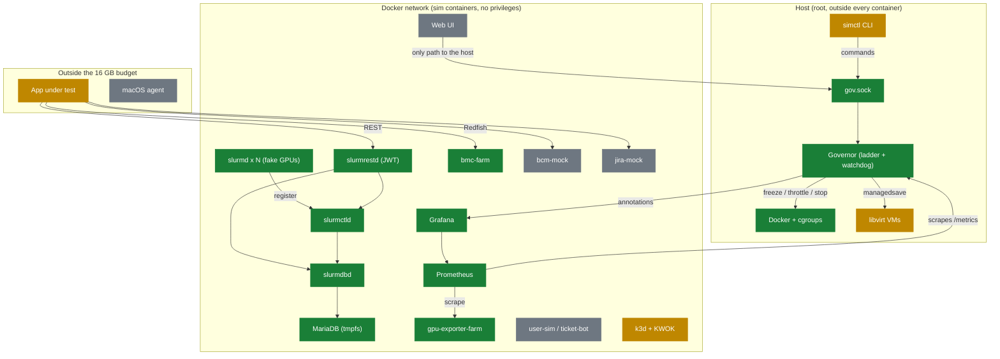

# Progress

<!-- GENERATED from docs/progress.yaml by `python -m simctl.progress`; do not edit. -->
Last updated 2026-10-29. Legend: ✅ Done 🔍 In review 🟡 Partial ⬜ To do. Mermaid diagrams render on GitHub; for any browser open [progress.html](progress.html).

**70% built** (31 done, 0 in review, 5 partial, 8 to do, 44 items).

## Roadmap

## As built

What exists and how the parts connect. Green is verified, blue is in review, amber is partial, grey is not started.

## Phases

### Baseline (33%)

_Measure real memory so budgets stop being guesses._

| Part | Status | How it is built | Where | PR |
|---|---|---|---|---|
| Measurement tooling | ✅ Done | `simctl measure run/report` samples host, Docker containers, PSS per process and libvirt domains (read-only), saves JSON, suggests budgets = peak x 1.2. | `simctl/measure.py` | [#28](https://github.com/AhmedYousriSobhi/opti-sim/pull/28) |
| Host baseline | 🟡 Partial | Idle host and a small Slurm stack were measured (slurmd 5 MiB, slurmctld 13, MariaDB 171). No loaded run with mocks yet. | - | - |
| Budgets replaced by measured values | ⬜ To do | README section 5 and profiles/*.yaml still hold planning estimates; needs a loaded run of the full stack. | - | - |

1/3 done

### Governor (86%)

_A root service that keeps the host alive by escalating through a ladder._

| Part | Status | How it is built | Where | PR |
|---|---|---|---|---|
| Signals and escalation ladder | ✅ Done | MemAvailable, PSI and swap rate feed levels L0-L5. Escalates at once, steps down one level per 60 s calm with a 10 s dwell. | `governor/signals.py`, `governor/ladder.py` | [#14](https://github.com/AhmedYousriSobhi/opti-sim/pull/14) |
| Priority planner | ✅ Done | P0-P6 classes; lowest priority first, reversible actions before destructive ones; undo on de-escalation. | `governor/planner.py` | [#14](https://github.com/AhmedYousriSobhi/opti-sim/pull/14) |
| Executors | ✅ Done | freeze, throttle (memory.high), reclaim, stop (cgroup.kill then docker stop), managedsave for VMs, via cgroup files opened in advance. | `governor/executors.py` | [#20](https://github.com/AhmedYousriSobhi/opti-sim/pull/20) |
| mlockall and pre-allocated mitigation path | ✅ Done | Locks its own pages and pre-opens handles and buffers so L3/L4 performs no allocation (SPEC GV-8). | `governor/memlock.py` | [#19](https://github.com/AhmedYousriSobhi/opti-sim/pull/19) |
| Control socket | ✅ Done | JSON lines on /run/hpcsim/gov.sock with a fixed allow-list; unknown commands are rejected. | `governor/control.py` | [#19](https://github.com/AhmedYousriSobhi/opti-sim/pull/19) |
| NF-1 memory-hog test | ✅ Done | A real container hog is throttled, frozen then stopped in order; no host OOM. Runs as root via scripts/real-test-root.sh. | `tests/real/test_root.py` | [#24](https://github.com/AhmedYousriSobhi/opti-sim/pull/24) |
| Security watchdog | ✅ Done | Every 15 s flags privileged/capability/unconfined/host-namespace/docker.sock containers, missing limits and live memory.max drift. Report only; skipped from L3 up. | `governor/watchdog.py` | [#34](https://github.com/AhmedYousriSobhi/opti-sim/pull/34) |
| Monitored slurmrestd exception | ✅ Done | slurmrestd runs with two unshare steps disabled (ADR 0004). Any wider SLURMRESTD_SECURITY option is a violation; doctor lists the accepted exception. | `governor/watchdog.py` | [#44](https://github.com/AhmedYousriSobhi/opti-sim/pull/44) |
| Inventory refresh and Grafana annotations | ✅ Done | Re-discovers containers so late starters are governed; posts audit events to Grafana with a token from the environment (SPEC GV-6). | `governor/annotate.py`, `governor/core.py` | [#36](https://github.com/AhmedYousriSobhi/opti-sim/pull/36) |
| systemd unit installed permanently | 🟡 Partial | Unit and slice pass systemd-analyze and ran as a transient service in tests; scripts/install-governor.sh installs it as the standing service (printed unit tested; the sudo install itself is run by the user). | `systemd` | - |
| Admission and real scale / set-profile | ✅ Done | admit command (GV-9): refused at L2+ or if it would breach the floor; scale and set-profile run simctl in the background at L0-L1 only (GV-8). simctl up/scale ask first. Verified live through the socket. | `governor/core.py` | [#48](https://github.com/AhmedYousriSobhi/opti-sim/pull/48) |
| Governor /metrics endpoint | ✅ Done | Prometheus text (level, MemAvailable, PSI, swap, groups per priority, actions, admissions) bound to the docker bridge address, rendered once per step so a scrape does no work (GV-8). The Prometheus 'governor' target is up on the live stack. | `governor/metrics.py` | [#60](https://github.com/AhmedYousriSobhi/opti-sim/pull/60) |
| Live ladder test on the real stack | ✅ Done | Dry-run governor against the running containers: L0 to L3 and back, /metrics, Grafana annotations and the planned throttle/freeze/thaw actions. The root variant passes on the dev machine: L3 really freezes a live container's cgroup (cgroup.events frozen 1), keeps P1 services running, and thaws on recovery; it also exposed and fixed the nested-slice cgroup path bug (PR 64). | `tests/real/test_pressure_real.py` | [#60](https://github.com/AhmedYousriSobhi/opti-sim/pull/60) |
| Host tuning script and simctl top | ⬜ To do | zram, swappiness and THP tuning with confirmation, and a live view of the governor. | - | - |

12/14 done

### Slurm (100%)

_A real scheduler the app can read, built from sim.yaml._

| Part | Status | How it is built | Where | PR |
|---|---|---|---|---|
| Slurm 26.05.5 images | ✅ Done | Built from the SchedMD tarball (pinned and SHA256-checked) because Ubuntu's 23.11 lacks the 2026 security fixes; no extra container privileges (ADR 0002). | `images/node-base/Dockerfile` | [#32](https://github.com/AhmedYousriSobhi/opti-sim/pull/32) |
| Generated Slurm config | ✅ Done | slurm.conf, gres.conf and cgroup.conf derive from sim.yaml so node names match everywhere; fake GPUs use /dev/null-backed device files. | `simctl/slurmconf.py` | [#32](https://github.com/AhmedYousriSobhi/opti-sim/pull/32) |
| Compose generation | ✅ Done | `simctl compose --profile X` renders services with mem_limit, cgroup_parent and the hpcsim.class label from sim.yaml and profiles. | `simctl/compose.py` | [#30](https://github.com/AhmedYousriSobhi/opti-sim/pull/30) |
| slurmrestd with JWT | ✅ Done | JWT-only REST on the internal network, own user, no privileges; skips two unshare steps instead of loosening seccomp (ADR 0003, ADR 0004). Verified live: no token 401, bad tokens get no data. | `simctl/compose.py` | [#38](https://github.com/AhmedYousriSobhi/opti-sim/pull/38) |
| Accounting | ✅ Done | MariaDB on a capped tmpfs plus slurmdbd; sacctmgr bootstrap creates cluster, QOS and users from sim.yaml; secrets stay in a gitignored folder. Verified live: a job as alice appears in sacct and the REST slurmdb endpoint. | `simctl/slurmconf.py` | [#38](https://github.com/AhmedYousriSobhi/opti-sim/pull/38) |
| simctl up / down / scale | ✅ Done | Pre-flight, staged start (observability, slurm, nodes), skips unbuilt mocks, scale regenerates slurm.conf, Grafana token created once (0600). Verified live with min; scale really stops containers. | `simctl/stack.py` | [#45](https://github.com/AhmedYousriSobhi/opti-sim/pull/45) |

6/6 done

### Mocks (50%)

_Fake BMC, BCM and Jira so the app's integrations can be exercised._

| Part | Status | How it is built | Where | PR |
|---|---|---|---|---|
| gpu-exporter-farm | ✅ Done | One process serving fake DCGM metrics for every simulated GPU, with fault injection over /sim/inject. | `components/gpu-exporter-farm/exporter.py` | - |
| bmc-farm | ✅ Done | One process serves /<node>/redfish/v1 for every node: Systems, Chassis Thermal/Power, Managers, event log, Reset action, POST /sim/inject (temp, fans, power, events). Verified live in the stack. | `components/bmc-farm/bmc.py` | [#52](https://github.com/AhmedYousriSobhi/opti-sim/pull/52) |
| bcm-mock | ⬜ To do | Only the BCM surface the app calls; blocked on open decision 2. | - | - |
| jira-mock | ⬜ To do | Jira REST subset with failure modes and required-field rules; modes mock/cloud/dc. | - | - |

2/4 done

### People and chaos (0%)

_Simulated users and engineers, scripted faults._

| Part | Status | How it is built | Where | PR |
|---|---|---|---|---|
| Starter scenario files | 🟡 Partial | Three YAML scenarios exist (gpu-xid-storm, pod-crashloop, k8s-node-notready); no engine runs them yet. | `scenarios` | - |
| user-sim and ticket-bot | ⬜ To do | Personas with Poisson arrivals and engineers working tickets. | - | - |
| scenario-engine | ⬜ To do | Runs scenarios with at/target/do steps and expect assertions. | - | - |

0/3 done

### Kubernetes (50%)

_Mixed real and fake K8s nodes._

| Part | Status | How it is built | Where | PR |
|---|---|---|---|---|
| Cluster fixtures | ✅ Done | Namespaces, workloads, failure signals and a read-only RBAC role, applied with apply.sh. | `k8s/fixtures` | - |
| k3d plus KWOK cluster | 🟡 Partial | Design is set but kubectl and k3d are not installed on this host, so it has not been brought up. | - | - |

1/2 done

### Fidelity VM (0%)

_One real Ubuntu VM with Redfish power control._

| Part | Status | How it is built | Where | PR |
|---|---|---|---|---|
| VM scaffold | 🟡 Partial | Vagrantfile, provisioning scripts and up/down helpers exist; not re-verified end to end since the scaffold merge. | `fidelity-vm` | - |

0/1 done

### Web UI and profiles (50%)

_One click from cold start to a busy cluster._

| Part | Status | How it is built | Where | PR |
|---|---|---|---|---|
| Profile pre-flight (CLI) | ✅ Done | `simctl preflight` refuses a profile when free memory minus its budget is under the safety floor and suggests a smaller one. | `simctl/checks.py` | [#26](https://github.com/AhmedYousriSobhi/opti-sim/pull/26) |
| Web UI | ⬜ To do | FastAPI plus HTMX over the governor socket only; canvas, dashboard, orchestrator, budget manager. | - | - |

1/2 done

### macOS agent and CI (0%)

_External Mac agent and unattended scenario runs._

| Part | Status | How it is built | Where | PR |
|---|---|---|---|---|
| Mac agent profile and headless CI | ⬜ To do | External agent only (licence); scenario suite with assertions. | - | - |

0/1 done

### Platform and tooling (100%)

_What keeps every change safe and debuggable._

| Part | Status | How it is built | Where | PR |
|---|---|---|---|---|
| validate.sh gate | ✅ Done | Secrets scan, compile, ruff, shellcheck, YAML/JSON, systemd verify, pytest and a governor smoke run before every commit. | `scripts/validate.sh` | [#18](https://github.com/AhmedYousriSobhi/opti-sim/pull/18) |
| Real-host tests | ✅ Done | User-level tests with cgroups, Docker, libvirt and a live governor; a sudo suite for root-only paths. | `scripts/real-test.sh`, `scripts/real-test-root.sh` | [#20](https://github.com/AhmedYousriSobhi/opti-sim/pull/20), [#22](https://github.com/AhmedYousriSobhi/opti-sim/pull/22) |
| simctl doctor / status / diag | ✅ Done | Environment checks with fixes, governor state, a masked diagnostics tarball, and the container security check. | `simctl/checks.py`, `simctl/diag.py` | [#26](https://github.com/AhmedYousriSobhi/opti-sim/pull/26) |
| Observability stack | ✅ Done | Prometheus (2 d, tmpfs), Grafana with provisioned dashboard, fake GPU exporter. | `compose/observability.yml` | - |
| Decisions as ADRs | ✅ Done | 0001 record decisions, 0002 Slurm from source with no extra privileges, 0003 slurmrestd/JWT and accounting, 0004 slurmrestd keeps its unshare steps disabled. | `docs/adr` | - |
| Getting-started guide | ✅ Done | Step-by-step use of the app; tests/test_docs.py fails if a documented command disappears. | `docs/guides/getting-started.md` | [#52](https://github.com/AhmedYousriSobhi/opti-sim/pull/52) |
| Verification helpers | ✅ Done | verify.sh runs validate.sh plus real tests (--full adds the live stack lifecycle); tests/real/helpers.py starts a live governor and talks to its socket. | `scripts/verify.sh` | [#48](https://github.com/AhmedYousriSobhi/opti-sim/pull/48) |
| Progress tracker | ✅ Done | This page, generated from docs/progress.yaml (issue 41). | `simctl/progress.py` | [#42](https://github.com/AhmedYousriSobhi/opti-sim/pull/42) |

8/8 done

## Next up

1. Phase 3 mocks: bcm-mock and jira-mock next (bmc-farm is done).
2. A loaded Phase 0 run of the full stack to replace the budget estimates.

## Known gaps

- Idle min stack uses about 0.4 GB against a 3.0 GB profile budget, so preflight is far too pessimistic until a loaded Phase 0 run.
- Budgets are still estimates until a loaded Phase 0 run.
- The governor's own locked memory is about 100-170 MB, slightly over its 0.15 GB budget.
- Host swap is 100% full and kubectl/k3d are missing, which blocks the Kubernetes phase here.
