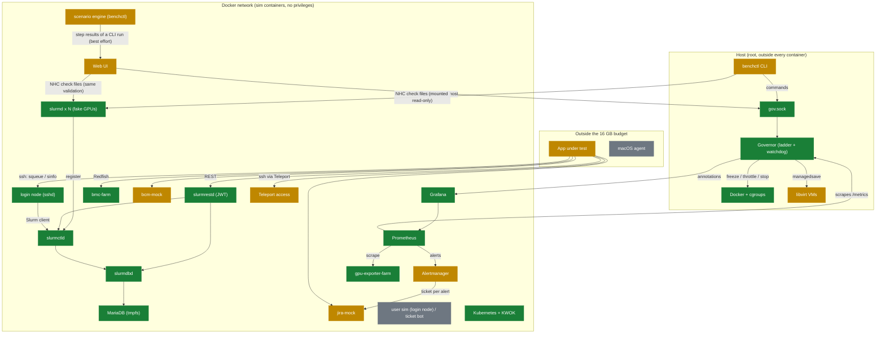

# Progress

<!-- GENERATED from docs/progress.yaml by `python -m benchctl.progress`; do not edit. -->
Last updated 2026-11-01. Legend: ✅ Done 🔍 In review 🟡 Partial ⬜ To do. Mermaid diagrams render on GitHub; for any browser open [progress.html](progress.html).

**92% built** (40 done, 132 in review, 11 partial, 4 to do, 187 items).

## Roadmap

## As built

What exists and how the parts connect. Green is verified, blue is in review, amber is partial, grey is not started.

## Phases

### Baseline (33%)

_Measure real memory so budgets stop being guesses._

| Part | Status | How it is built | Where | PR |
|---|---|---|---|---|
| Measurement tooling | ✅ Done | `benchctl measure run/report` samples host, Docker containers, PSS per process and libvirt domains (read-only), saves JSON, suggests budgets = peak x 1.2. `benchctl measure cgroup` reads a container's memory.stat (shmem, file, anon) and OOM-kill count (issue 455). | `benchctl/measure.py` | #28 |
| Host baseline | 🟡 Partial | Idle host and a small Slurm stack were measured (slurmd 5 MiB, slurmctld 13, MariaDB 171). No loaded run with mocks yet. | - | - |
| Budgets replaced by measured values | 🟡 Partial | Per-component working sets measured live on 2026-11-05 (benchctl/memory.py MEASURED_MB; the plan expects measured + 15 percent, never above the cap, issue 287); profile budgets are those component figures summed (min 0.5 GB, std 1.2, full 1.8, jira-real 3.5, tested in tests/test_memory.py); whole-profile peaks are measured for min only. Docker's own memory (containerd-shims, dockerd) is measured with `benchctl measure overhead --save` and added by the plan (issue 456); per-node parts declare a cost in PER_NODE_MB, tested. | `profiles/min.yaml` | #68 |

1/3 done

### Governor (88%)

_A root service that keeps the host alive by escalating through a ladder._

| Part | Status | How it is built | Where | PR |
|---|---|---|---|---|
| Signals and escalation ladder | ✅ Done | MemAvailable, PSI and swap rate feed levels L0-L5. Escalates at once, steps down one level per 60 s calm with a 10 s dwell. L4 from a PSI stall needs 5 s (ADR 0032, issue 286); low MemAvailable is immediate. | `governor/signals.py`, `governor/ladder.py` | #14 |
| Priority planner | ✅ Done | P0-P6 classes; lowest priority first, reversible actions before destructive ones; undo on de-escalation. | `governor/planner.py` | #14 |
| Executors | ✅ Done | freeze, throttle (memory.high), reclaim, stop (cgroup.kill then docker stop), managedsave for VMs, via cgroup files opened in advance. In rootless mode throttle and reclaim are skipped and each skip is an audit-log entry (SKIPPED ...), the page and Grafana annotation (issue 453). | `governor/executors.py` | #20 |
| mlockall and pre-allocated mitigation path | ✅ Done | Locks its own pages and pre-opens handles and buffers so L3/L4 performs no allocation (SPEC GV-8). | `governor/memlock.py` | #19 |
| Control socket | ✅ Done | JSON lines on /run/workbench/gov.sock with a fixed allow-list; unknown commands are rejected. | `governor/control.py` | #19 |
| NF-1 memory-hog test | ✅ Done | A real container hog is throttled, frozen then stopped in order; no host OOM. Runs as root via scripts/real-test-root.sh. | `tests/real/test_root.py` | #24 |
| Security watchdog | ✅ Done | Every 15 s flags privileged/capability/unconfined/host-namespace/docker.sock containers, missing limits and live memory.max drift. Report only; skipped from L3 up. | `governor/watchdog.py` | #34 |
| Monitored slurmrestd exception | ✅ Done | slurmrestd runs with two unshare steps disabled (ADR 0004). Any wider SLURMRESTD_SECURITY option is a violation; doctor lists the accepted exception. | `governor/watchdog.py` | #44 |
| Inventory refresh and Grafana annotations | ✅ Done | Re-discovers containers so late starters are governed; posts audit events to Grafana with a token from the environment (SPEC GV-6). | `governor/annotate.py`, `governor/core.py` | #36 |
| systemd unit installed permanently | 🟡 Partial | Unit and slice pass systemd-analyze and ran as a transient service in tests; scripts/install-governor.sh installs it as the standing service (printed unit tested; the sudo install itself is run by the user). | `systemd` | - |
| systemd-oomd backstop (optional) | ✅ Done | Drop-in on workbench.slice (ManagedOOMMemoryPressure=kill, limit 60%) covering the P0-P6 container slices; only with the root installer's --with-oomd, removed by --without-oomd and --uninstall, never the host oomd.conf; doctor line oomd backstop (SPEC GV-10, ADR 0010 addendum). Unit and installer dry-run tests; the root test is run by the owner. | `systemd/workbench.slice.d/50-oomd.conf`, `scripts/install-governor.sh`, `benchctl/checks.py` | [#686](https://github.com/AhmedYousriSobhi/workbench/pull/686) |
| Admission and real scale / set-profile | ✅ Done | admit command (GV-9): refused at L2+ or if it would breach the floor; scale and set-profile run benchctl in the background at L0-L1 only (GV-8). benchctl up/scale ask first. Verified live through the socket. | `governor/core.py` | #48 |
| Swap storm, memory.events and compressed swap signals (issue 463) | ✅ Done | Sustained pswpout adds one level (up to L3); per-container memory.events high/oom/oom_kill in status and /metrics, oom_kill an audit event; zswap and zram pools taken off MemAvailable. Unit tests with the signals file; live in test_pressure_real. | `governor/signals.py`, `governor/ladder.py`, `governor/core.py`, `governor/metrics.py`, `docs/adr/0059-governor-signal-model.md` | - |
| PSI trigger, pre-opened signal files, thresholds from sim.yaml (issue 464) | ✅ Done | A kernel PSI trigger (2 s window, works as a normal user) wakes the loop early, polling fallback with the reason logged; /proc files opened once and read with preadv; L1/L4/calm memory thresholds and the admission floor derive from host.reserve_gb and safety_floor_gb. Latency gain not measured. | `governor/psi.py`, `governor/hostsize.py`, `governor/signals.py`, `governor/__main__.py`, `docs/adr/0059-governor-signal-model.md` | - |
| Governor /metrics endpoint | ✅ Done | Prometheus text (level, MemAvailable, PSI, swap, groups per priority, actions, admissions) bound to the docker bridge address, rendered once per step so a scrape does no work (GV-8). The Prometheus 'governor' target is up on the live stack. | `governor/metrics.py` | #60 |
| Live ladder test on the real stack | ✅ Done | Dry-run governor against the running containers: L0 to L3 and back, /metrics, Grafana annotations and the planned throttle/freeze/thaw actions. The root variant passes on the dev machine: L3 really freezes a live container's cgroup (cgroup.events frozen 1), keeps P1 services running, and thaws on recovery; it also exposed and fixed the nested-slice cgroup path bug (PR 64). | `tests/real/test_pressure_real.py` | #60 |
| Host tuning script and benchctl top | ⬜ To do | zram, swappiness and THP tuning with confirmation, and a live view of the governor. | - | - |

15/17 done

### Slurm (100%)

_A real scheduler the app can read, built from sim.yaml._

| Part | Status | How it is built | Where | PR |
|---|---|---|---|---|
| Slurm 26.05.5 images | ✅ Done | Built from the SchedMD tarball (pinned and SHA256-checked) because Ubuntu's 23.11 lacks the 2026 security fixes; no extra container privileges (ADR 0002). | `images/node-base/Dockerfile` | #32 |
| Generated Slurm config | ✅ Done | slurm.conf, gres.conf and cgroup.conf derive from sim.yaml so node names match everywhere; fake GPUs use /dev/null-backed device files. | `benchctl/slurmconf.py` | #32 |
| Compose generation | ✅ Done | `benchctl compose --profile X` renders services with mem_limit, cgroup_parent and the workbench.class label from sim.yaml and profiles. | `benchctl/compose.py` | #30 |
| slurmrestd with JWT | ✅ Done | JWT-only REST on the internal network, own user, no privileges; skips two unshare steps instead of loosening seccomp (ADR 0003, ADR 0004). Verified live: no token 401, bad tokens get no data. | `benchctl/compose.py` | #38 |
| Accounting | ✅ Done | MariaDB on a capped tmpfs plus slurmdbd; sacctmgr bootstrap creates cluster, QOS and users from sim.yaml; secrets stay in a gitignored folder. Verified live: a job as alice appears in sacct and the REST slurmdb endpoint. | `benchctl/slurmconf.py` | #38 |
| Real-Slurm decision record | 🔍 In review | One ADR: what is real (scheduler, output, REST auth, node death timing), what is simulated (GPUs, cgroups, jobs), cost and what to cut first; linked from architecture 4.1 and client-testing. Issue 218. | `docs/adr/0025-slurm-is-real-the-rest-is-simulated.md` | - |
| Faster image rebuilds | 🔍 In review | python3 moved into node-base's apt layer; login and slurm-ctl run no apt step, so a node-base change no longer re-installs packages twice: login + slurmctld rebuild 39.9 s before, 0.6 s after (one-time 22 s). Compute nodes carry an unused python3. Issue 225. | `images/node-base/Dockerfile`, `images/login/Dockerfile`, `images/slurm-ctl/Dockerfile` | - |
| Basic Linux tools on every node | 🔍 In review | node-base's one apt layer adds ping, ip, ss, dig, nc, traceroute, tcpdump, curl, ps, lsof, strace, vi and similar, so nodes, login nodes and the controller can be troubleshot from inside. Issue 441. The live test (verify.sh --unit node_tools) is for the owner to run. | `images/node-base/Dockerfile`, `tests/test_node_tools.py`, `tests/real/test_node_tools_real.py` | - |
| NHC check for the real card | 🔍 In review | Check real-gpu-health (on by default, owner decision 2026-11-14; inert without nvidia-smi; also a template) drains rgpu001 on a missing card (nvidia-smi -L), a non-zero XID or a temperature over the card's slowdown threshold; the node's health check reads the real exporter (WORKBENCH_NHC_URL -> NHC_METRICS_URL in the node env file) because the farm has no series for it. Unit-tested with a stub; the live wiring test in tests/real/test_real_gpu_real.py is for the owner to run. Issue 437. A card that vanished completely (no series) is still checked because the runner runs checks on a node with NHC_METRICS_URL set (issue 709). | `images/node-base/nhc.d/real-gpu-health.sh`, `images/node-base/nhc.d/templates/real-gpu-health.sh`, `images/node-base/entrypoint.sh`, `benchctl/real_gpu.py`, `tests/test_nhc_real_gpu.py`, `docs/guides/nhc-checks.md`, `docs/adr/0037-real-gpu-passthrough.md` | - |
| dcgmi on every node | 🔍 In review | node-base copies the dcgmi client (5 MB) from the pinned exporter image; the wrapper points it at the node's exporter host engine (WORKBENCH_DCGM_HOST), which listens on the cluster network, so dcgmi discovery -l works on rgpu001 and on the GPU nodes of the dcgm part; other nodes have no engine. Issue 443. Live tests (verify.sh --unit dcgm, real_gpu) are for the owner to run. | `images/node-base/Dockerfile`, `images/node-base/dcgmi`, `benchctl/dcgm.py`, `benchctl/real_gpu.py`, `components/dcgm-exporter/start.sh` | - |
| benchctl up / down / scale | ✅ Done | Pre-flight, staged start (observability, slurm, nodes), skips unbuilt mocks, scale regenerates slurm.conf, Grafana token created once (0600). Verified live with min; scale really stops containers. | `benchctl/stack.py` | #45 |

6/11 done

### Mocks (86%)

_Fake BMC, BCM and Jira so the app's integrations can be exercised._

| Part | Status | How it is built | Where | PR |
|---|---|---|---|---|
| gpu-exporter-farm | ✅ Done | One process serving fake DCGM metrics for every simulated GPU (util, FB used and free, temp, power, XID) with the real exporter labels (Hostname, UUID, modelName), fault injection over /sim/inject. A read-only Grafana token for clients is made by benchctl up. Verified live through Grafana /api/ds/query. | `components/gpu-exporter-farm/exporter.py` | - |
| bmc-farm | ✅ Done | One process serves /<node>/redfish/v1 for every node: Systems, Chassis Thermal/Power, Managers, event log, Reset action, POST /sim/inject (temp, fans, power, events). Also standard Redfish over TLS on 127.0.0.1:8443 (Host picks the node, session login, collections, firmware, accounts; ADR 0012). Verified live in the stack. | `components/bmc-farm/bmc.py` | #52 |
| bcm-mock | 🟡 Partial | CMDaemon-style POST /json (cmdevice, cmstatus, cmpart) over the sim.yaml nodes, power calls and /sim/inject. Call names are an assumed subset (ADR 0005); verified live, 12 MiB. | `components/bcm-mock/bcm.py` | #71 |
| Fake cmsh on the login node | ✅ Done | cmsh -c "device; list" / "device; status" / category, jobqueue and healthchecks lists on the login node (the BCM head node), state read from bcm-mock so a scenario that takes a node down shows DOWN; the head node also keeps /var/spool/cmd/events.log (images/login/events_log.py, fed by bcm-mock's cmevents.getEvents, one line per node state change; issue 714, format not verified against a real CMDaemon); mutating commands refused; read-only interactive console with modes (ADR 0013). Verified live: tests/real/test_cmsh_real.py. | `images/login/cmsh.py` | - |
| jira-mock | 🟡 Partial | Mode mock only: REST v2/v3 issues, POST search (/search/jql token paging, /search offset paging), myself, serverInfo, field, project, JQL with OR/NOT/parentheses/text search, comments (read, edit, delete), issue edit, watchers, worklog, assign, user search, workflow transitions with required-field errors, JQL subset, webhooks, 429/503/slow failures, and /sim/tickets for scenarios (ADR 0005, issue 107); node faults file one Incident per node and kind (comment on a repeat, resolve on recovery) through the scenario engine's side effects (issue 157); a background team moves, comments, reassigns, reopens and files tickets (GET|POST /sim/activity, JIRA_ACTIVITY_EVERY, `benchctl set jira-activity`, issue 158). Verified live in the container (transitions, JQL, webhook to an outside receiver, 429/503), 15 MiB. cloud/dc modes not built. Contract test (issue 229): scripts/record_jira_shapes.py records real Jira Cloud response shapes (read-only, keys and types only) and tests/test_jira_contract.py fails on drift, gaps listed in tests/fixtures/jira/known-gaps.yaml; tooling built, nothing recorded yet (needs the owner's own Jira Cloud site), docs/guides/jira-contract.md. Ticket driver (issue 262, step 1): benchctl/jira_driver.py does the node-fault, recovery and team-activity actions through the standard REST API instead of /sim/*, verified against the mock; not yet wired to jira.mode, node_watch or scenarios, and not run against real Cloud. | `components/jira-mock/jira.py` | #71 |
| SSH login node | ✅ Done | SFTP subsystem (Subsystem sftp, openssh-sftp-server in node-base's apt layer; as the user, no chroot; unit test tests/test_login_sftp.py, live check in tests/real/test_login_real.py not yet run; issue 716). sshd + Slurm client tools on 127.0.0.1:2222, key login only, forwarding on, keys generated by benchctl up (ADR 0011). Verified live: sinfo over SSH, root and password refused, port forward to a mock. | `images/login` | - |
| sshd on compute nodes | ✅ Done | sshd in node-base, started on nodes only (WORKBENCH_SSHD): ssh cn001 from the login node with no prompt (cluster key, shared node host key), a client ProxyJump or execution target to a node, srun and srun --pty. Reached through the login node only (ADR 0014). up builds node-base first. Verified live: tests/real/test_node_ssh_real.py. | `images/node-base` | - |
| Client setup by component | 🔍 In review | One section per client component (SSH, Slurm, Grafana, storage, Jira, BCM, BMC): values, where to get them, what to expect, common failure. Values checked against the live stack; not walked in the client window. Issue 82. | `docs/guides/client-setup-by-component.md` | - |
| Normal shell on nodes | 🔍 In review | Simulated users get bash (useradd default), bash-completion, Slurm tab completion from the Slurm source tree, history, a user@node prompt and Slurm on the login-shell PATH. Verified live: tests/real/test_login_real.py. Issue 81. | `images/node-base/Dockerfile` | - |
| Client key helper | 🔍 In review | benchctl ssh-key install|remove: copies the login key to ~/.ssh/workbench_ed25519 (mode 600) for clients that only read keys under ~/.ssh; refuses to overwrite a foreign file. Issue 80. | `benchctl/stack.py`, `benchctl/cli.py` | - |
| GPU metrics follow Slurm jobs | 🔍 In review | slurmctld serves the GPU indexes running jobs hold (internal :9401); the exporter polls it every 3 s and shows those GPUs busy, the rest idle (last answer kept 30 s if the feed is down). Verified live: tests/real/test_gpu_follows_slurm_real.py. Issue 83. | `components/gpu-exporter-farm/exporter.py`, `images/slurm-ctl/alloc_feed.py` | - |
| Teleport kube audit events | 🔍 In review | Helpers that read Teleport's dir-backend audit log (one JSON line per event under /var/lib/teleport/log, via docker exec), select kube.request events by user, cluster, verb, response code and start time, and fail clearly when the folder is missing. The live module asserts a read as alice is audited (GET 200), a refused write (DELETE 403) and that a user without a Kubernetes group has no audited 200; the event types seen are recorded. Unit-tested; the live run (verify.sh --unit teleport_kube) is not done. Issue 754, ADR 0084. | `benchctl/teleportaudit.py`, `tests/test_tele_audit.py`, `tests/real/test_teleport_kube_real.py`, `docs/guides/teleport-kube.md`, `docs/adr/0084-tsh-kube-production-practice.md` | - |
| Kubernetes through Teleport (tsh kube) | 🔍 In review | With the teleport and k8s parts both on, the existing Teleport container runs a kubernetes_service registering the simulated cluster from a static kubeconfig (token user teleport, impersonation only), same web port, role workbench-user grants group workbench-k8s-viewers bound to the read-only role; Teleport stage now starts after the Kubernetes stages and is recreated when its config changes. Unit-tested; the live run (verify.sh --unit teleport_kube) is not done. Reverses the 2026-11-14 decision of ADR 0034. Issue 383, ADR 0083. | `benchctl/teleport.py`, `benchctl/k8s.py`, `benchctl/stack.py`, `k8s/fixtures/47-rbac-teleport.yaml`, `tests/test_teleport.py`, `tests/real/test_teleport_kube_real.py`, `docs/guides/teleport-kube.md`, `docs/adr/0083-kubernetes-through-teleport.md` | - |
| Teleport access | 🔍 In review | Optional part (--with teleport): real Teleport auth+proxy container, agentless OpenSSH nodes trusting its CA, identity file per user, benchctl add invite for tsh login (ADR 0020). Unit-tested; live test tests/real/test_teleport_real.py. `benchctl doctor` and `up` warn in one line when the local tsh is a newer major version than the server (issue 210). Not yet: outage and cert-expiry scenarios, Web UI entry, measured memory budget. Issue 39. | `benchctl/teleport.py`, `images/node-base/teleport-ssh` | - |

5/14 done

### People and chaos (25%)

_Simulated users and engineers, scripted faults._

| Part | Status | How it is built | Where | PR |
|---|---|---|---|---|
| Scenario files | 🟡 Partial | Twelve scenarios: ib-port-down, gpu-xid-storm, node-down, fan-failure, jira-429, jira-outage, jira-flap, ticket-lifecycle, drain-ticket and ticket-wave run now; pod-crashloop and k8s-node-notready need the k8s part. | `scenarios` | #73 |
| Slurm resilience scenarios and trace | 🔍 In review | Four scenarios start a real job (and a simulated GPU job) and restart or stop slurmd, restart slurmctld or drain under it; `scenario run NAME --trace` prints job states, slurmstepd pids and the new Slurm log lines per step. slurmd now runs under slurmd-run instead of as PID 1 so it can restart without the container. Steps: submit {node, gpus, duration}, cancel, slurmd_restart|stop|start, slurmctld_restart; expect slurm.job_state, slurm.stepd. The page plays them and shows the trace (tick Slurm trace) through new governor commands slurm-step and slurm-trace (read-only `benchctl get trace`), so W-3 holds; also `benchctl set slurmd|slurmctld`, `remove jobs`. Unit tests run; live test written, NOT yet run (observed behaviour to be recorded). Issue 220. | `scenarios/slurmd-*.yaml`, `scenarios/slurmctld-restart-mid-job.yaml`, `scenarios/drain-mid-job.yaml`, `benchctl/slurmtrace.py`, `images/node-base/slurmd-run`, `governor/core.py`, `webui/app.py`, `webui/static/index.html`, `tests/real/test_slurmresilience_real.py`, `docs/guides/slurm-resilience.md` | - |
| user-sim and ticket-bot | 🟡 Partial | Load is the login node's user_sim.py (benchctl load on|off). The placeholder containers, parts and the ticket-bot scenario target were removed (issue 473, ADR 0006 addendum). Issue 680: opt-in `--personas` (job mix per sim.yaml persona, about 10% failing and 5-10% cancelled jobs) and `--day S` (daily arrival rhythm over a compressed day), same process, same 20-pending cap, unit-tested with a seed; live test written, not yet run. Issue 681: the ticket bot (images/login/ticket_bot.py, `benchctl load on --tickets`): fake engineers assign, start, comment on, resolve and sometimes reopen the alert tickets of jira-mock only; off by default, seeded, unit-tested (tests/test_ticket_bot.py); flows and rate unconfirmed by the owner; no live test run. Issue 728: `benchctl set ticket-bot --every|--resolve|--ignore|--reopen` and `get ticket-bot` change the running bot (it re-reads /tmp/ticketbot.json each cycle; invalid values keep the last good ones); unit-tested. The page has the same in Menu > Ticket bot (webui/static/js/ticketbot.js, GET|POST /api/ticket-bot, governor verbs ticket-bot-set|get); unit-tested, not tried in a browser. | `images/login/user_sim.py`, `images/login/ticket_bot.py`, `benchctl/workload.py`, `tests/real/test_usersim_real.py`, `tests/test_ticket_bot.py` | - |
| scenario-engine | 🟡 Partial | `benchctl scenario list|run NAME|SC-nn [--speed N] [--dry-run]` (fixed reference numbers SC-01..., a summary line before a run, issue 303): steps drive bmc-farm, bcm-mock, gpu-exporter, jira-mock, Slurm (scontrol) and the login node's sshd (ssh target: down, hung, up, rotate_host_key, max_sessions, reject_auth, node_sshd + nodes, reset; scenarios ssh-host-key-changed, login-node-down, login-node-hung, ssh-session-limit, ssh-key-refused, ssh-node-sshd-down; tests/real/test_ssh_faults_real.py); ramps; expect (slurm.node_state, jira.issue_created) watched from the start, or from `after: T` / `at_end: true` (issue 839; `within` counts from then, `exact: true` for a whole node state, Jira expects count only tickets made since the run started, SC-19/20/21/39/44 assert after the fault, unit-tested, no live rerun yet); ticket-bot steps skipped; `k8s` steps (needs the k8s part) run kubectl from the official image. `jira-real` target (issue 303): real faults on the real Jira, outage/restore (docker pause), bad_logins (401 then 403 CAPTCHA), clear_logins, rate_limit/rate_limit_off (Jira's own limiter through its tables, real 429 with X-RateLimit headers, about 40 s reload); scenarios jira-real-outage, jira-real-captcha and jira-real-429, and client-stress-real (the whole client-stress run against the real Jira), verified live. Issues 305-307 (unit-tested; verified live against the real Jira with tests/real/test_jira_dc_real.py, not yet against the client): token_revoke/token_restore (a real 401 for a personal access token, scenario jira-real-token-revoked), proxy_slow/proxy_503/proxy_429/proxy_off through a stdlib fault proxy on 127.0.0.1:8084 (benchctl/jira_proxy.py, scenario jira-real-slow-503, the client must use :8084), and `tickets:` steps plus `target: real` expectations on the real Jira through the REST driver (client-stress-real files its 12 tickets there); ADR 0026 addendum. Runs in the host CLI, not a container (ADR 0006). Verified live. Issue 470 (unit-tested only, not yet played live): node selectors (`first gpu node`, `any 2 cpu nodes`; benchctl/selectors.py) replace hard-coded node names in every shipped scenario (a test enforces it), and a fault model (benchctl/faultmodel.py: gpu-fell-off-bus, fan-failure, ib-port-down, nic-flap; step `target: fault`) expands one cause into its physical effects, so gpu-xid-storm injects only the cause and asserts the NHC drain and the ticket; `fan-failure` got an `expect`; the scenarios still without one are listed with a reason in `tests/test_scenario.py` (`NO_EXPECT`, issue 732). | `benchctl/scenario.py` | #73 |

0/4 done

### Kubernetes (100%)

_Mixed real and fake K8s nodes._

| Part | Status | How it is built | Where | PR |
|---|---|---|---|---|
| Kubernetes policy objects and API throttling | 🔍 In review | PriorityClasses inference, training and best-effort, a quota of two DRA devices in team-a, an inference deployment with a PodDisruptionBudget that blocks a drain. Scenario steps pod (priority_class, node), drain and remove, expectation k8s.pods_on_node; scenarios k8s-preempt (SC-38), k8s-drain-blocked (SC-39) and k8s-api-throttled (SC-40, an APF level for the viewer user that is applied and removed by the scenario). Unit-tested; the live run (verify.sh --unit k8s) is not done. Issue 548, ADR 0077. | `k8s/fixtures/60-policy.yaml`, `k8s/scenario/70-apf.yaml`, `benchctl/k8s.py`, `benchctl/scenario.py`, `scenarios/k8s-preempt.yaml`, `scenarios/k8s-drain-blocked.yaml`, `scenarios/k8s-api-throttled.yaml`, `tests/test_k8s.py`, `tests/real/test_k8s_real.py`, `docs/adr/0077-k8s-policy-objects-and-api-throttling.md` | - |
| DRA ResourceSlices on the KWOK GPU nodes | 🔍 In review | A DeviceClass and a resource.k8s.io/v1 ResourceSlice per GPU node (driver gpu.sim.test, attributes uuid, model, index, NVLink domain; memory capacity), generated at up into compose/generated/k8s/50-dra.yaml; the fixture pod dra-train claims one GPU and the real scheduler allocates it. Device UUIDs are the UUID labels of the node's DCGM series. Written and unit-tested; the live run (verify.sh --unit k8s) is not done. Issue 547, ADR 0076. | `benchctl/dra.py`, `benchctl/k8s.py`, `k8s/fixtures/55-dra-claims.yaml`, `tests/test_k8s.py`, `tests/real/test_k8s_real.py`, `docs/adr/0076-dra-resource-slices-on-kwok-gpu-nodes.md` | - |
| Kueue queues without a controller | 🔍 In review | ClusterQueue, LocalQueue and ResourceFlavor definitions of Kueue v0.20.6 (v1beta2 only, no conversion webhook) plus fixture queues whose status (pending and admitted counts, the Active condition, one inactive queue) is written with kubectl patch --subresource=status at up. No controller, no new container; kube-state-metrics and DCGM for KWOK nodes dropped by the owner. Scenario step queue and scenario k8s-queue-inactive. Unit-tested; the live run is not done. Issue 469. | `k8s/kueue`, `k8s/fixtures/46-rbac-kueue.yaml`, `benchctl/kueue.py`, `benchctl/k8s.py`, `scenarios/k8s-queue-inactive.yaml`, `tests/test_k8s.py`, `docs/adr/0034-kubernetes-kwok-first.md` | - |
| Every Kubernetes read the client makes | 🔍 In review | A catalogue of the read-only kubectl calls a monitoring client makes (can-i, config view, readyz, version, nodes, metrics probe, pods with chunks and the one-item count, Warning events, API groups, describe, workload signals) with the outcome for the cluster-wide viewer and the limited user, and a shape check per answer; the guide table is generated from it. Live module test_k8s_reads_real runs each as both users from the k-login, the ssh hop from the s-login and a wrong host. Every KWOK node now reports the API server's version as kubeletVersion instead of kwok-v0.8.0 (issue 766 a). Unit-tested; the live run (verify.sh --unit k8s_reads) is not done. Issues 762 and 766. | `benchctl/k8sreads.py`, `benchctl/k8s.py`, `tests/test_k8sreads.py`, `tests/test_k8s.py`, `tests/real/test_k8s_reads_real.py`, `tests/real/impact.yaml`, `docs/guides/client-testing.md`, `docs/adr/0084-tsh-kube-production-practice.md` | - |
| Cluster fixtures | ✅ Done | Namespaces, workloads, failure signals and a read-only RBAC role, applied with apply.sh. | `k8s/fixtures` | - |
| Kubernetes part (real control plane plus KWOK nodes) | ✅ Done | Optional part (`benchctl up --with k8s` or `--workload kubernetes`, off by default; issue 232, ADR 0034): etcd, kube-apiserver, kube-controller-manager, kube-scheduler and the KWOK controller as five unprivileged, memory-limited compose services at fixed addresses (API 10.141.255.40:6443), P3, measured about 0.3 GB (cap 0.77 GB). Nodes (kcn001..., kgpu001... with nvidia.com/gpu and GPU Feature Discovery labels) come from sim.yaml kubernetes.nodes; a PKI and read-only kubeconfigs are generated into secrets/k8s; the login node has kubectl (from the official image) and per-user ~/.kube/config (cluster-wide) and limited.yaml (namespace team-a), mode 600. Failing pods get a kubelet's status from KWOK stages (label workbench_fault: CrashLoopBackOff, OOMKilled, ImagePullBackOff, failed job). Scenario target k8s (down/up, cordon, pod, delete_pod, scale, apply; expect k8s.node_ready, k8s.pod_status): k8s-node-notready, pod-crashloop. Login nodes can be an s-login (`ssh:slurm`) or a k-login (`ssh:k8s`) (issue 380): the k-login has kubectl and the kubeconfigs and no Slurm configuration; the diagram shows the Kubernetes nodes as their own group, each login pointing at the group it serves; printed ssh commands carry -o IdentitiesOnly=yes. The Cluster architecture sheet is a wide two-column layout (Slurm card, Kubernetes card with its own CPU and GPU node counts, a card per login node with Way in and Serves choices, optional parts, a sticky summary); --k8s-cpu-nodes. The diagram has a Kubernetes API box (up or down, no request counter) and the client export puts the k8s block on the k-login's entry (checked with the client's own importer). Kubernetes nodes are machines: they get BMCs (a rule per node group, --bmc-groups), BCM entries (categories k8s-cpu, k8s-gpu; BCM managing them is an option, `bcm.manage_kubernetes`, `--no-bcm-k8s`, issue 413; with a controller node the BCM head node is the controller, ADR 0036) and GPU metrics. The Scenarios panel is a docked drawer toggled from the top strip. Verified live (verify.sh --unit k8s); the client's screens not yet tried (desktop app). Not built: a real agent node (privileged), metrics-server, Teleport access. | `benchctl/k8s.py`, `benchctl/compose.py`, `benchctl/stack.py`, `benchctl/scenario.py`, `k8s/kwok`, `k8s/fixtures`, `images/login`, `tests/test_k8s.py`, `tests/real/test_k8s_real.py`, `docs/adr/0034-kubernetes-kwok-first.md` | [#379](https://github.com/AhmedYousriSobhi/workbench/pull/379) |

2/6 done

### Fidelity VM (0%)

_One real Ubuntu VM with Redfish power control._

| Part | Status | How it is built | Where | PR |
|---|---|---|---|---|
| VM scaffold (deferred) | ⬜ To do | Vagrantfile, provisioning scripts and up/down helpers exist; not re-verified end to end since the scaffold merge. Deferred, not needed for the client test target (ADR 0033, issue 366). | `fidelity-vm` | - |

0/1 done

### Web UI and profiles (96%)

_One click from cold start to a busy cluster._

| Part | Status | How it is built | Where | PR |
|---|---|---|---|---|
| Profile pre-flight (CLI) | ✅ Done | `benchctl preflight` refuses a profile when free memory minus its budget is under the safety floor and suggests a smaller one. | `benchctl/checks.py` | #26 |
| Web UI base | 🟡 Partial | `python -m webui` on 127.0.0.1:8088 with a login token: Governor dashboard (level banner, MemAvailable/PSI sparklines, audit log over SSE) and Scenario Orchestrator (list, Play with speed, Stop, per-step timeline). Reads the governor socket only; Slurm steps are skipped in the UI. ~32 MB RSS on Starlette (ADR 0008). Reviewed in headless Chromium (desktop/phone, light/dark; no console errors or overflow; ARIA tabs, keyboard, status not by colour alone). | `webui/` | #76 |
| Help wiki in the web page | 🔍 In review | `/help/` serves the markdown under docs/ (manual, guides, architecture, ADRs) as linked pages with a sidebar, search and images; a stdlib renderer, pages read per request, same login as the UI. A ? Help link sits in the page header. New manual chapters: which command to use, glossary. | `webui/wiki.py`, `docs/manual/11-which-command.md`, `docs/manual/12-glossary.md` | #146 |
| GitHub Wiki from docs | 🔍 In review | `scripts/sync_wiki.py --out DIR` turns docs/manual, guides, architecture and ADRs into wiki pages (Home, sidebar, footer, images, rewritten links); `--push` clones the wiki repository, syncs and pushes without printing the token. docs/ stays the only source. A GitHub Actions workflow (.github/workflows/wiki.yml) runs it after every push to dev that changes the docs (issue 113). | `scripts/sync_wiki.py`, `.github/workflows/wiki.yml`, `tests/test_sync_wiki.py`, `docs/guides/github-wiki.md` | #149 |
| Cluster Canvas | 🟡 Partial | Cluster view (now an entity list, issue 129): service reachability and a card per sim.yaml node (power, CPU temp, fans, BCM state, GPU XID) refreshed every 3 s, with Power off/on, Overheat, Fan failure, GPU error and Clear actions that go through the mocks. Slurm drain and K8s faults are not offered (UI has no Docker access; K8s not built). Verified live. | `webui/cluster.py`, `webui/static/index.html` | #84 |
| App shell and layout | 🔍 In review | One dashboard page (first version, issue 46; the layout was redesigned in issue 129 and later, see Dashboard redesign): a status strip, a calm palette with a soft level banner, light/dark/auto theme, skip link and landmarks, 4 px spacing scale. Based on dashboard and navigation guidance from Splunk, Zuora, Grafana and SaaS UX guides. | `webui/static/index.html` | #91 |
| Apply a plan from the page | 🔍 In review | Plan panel Apply button (press twice to confirm): POST /api/plan/apply asks the governor (apply-plan: bounded ints and known parts only) to run `benchctl up --cpu-nodes ...`; stack.up removes unwanted nodes and recreates slurmctld. Refused above L1 or without --workdir. tests/real/test_apply_real.py shrinks then grows a live stack (issue 117). | `governor/control.py`, `governor/core.py`, `webui/app.py`, `benchctl/stack.py`, `docs/adr/0017-apply-a-plan-through-the-governor.md` | #119 |
| Governor panel | 🔍 In review | The left column is gone: the level banner and memory/pressure open as a Governor panel from the top-strip chips, so the page has two columns. Entities are a tree (Cluster, Services, Compute nodes, GPU nodes) of highlight cells. The traffic drawing is wider (760 units) with bigger text, packets and lanes (issue 125). | `webui/static/index.html` | #126 |
| Dashboard redesign (one screen) | 🔍 In review | One screen without page scrolling (1280x800, six nodes): the traffic diagram (clients, fault injector, services and every node as a tile; dots curve to services, fault diamonds travel to the node they hit) beside an entity list (Compute nodes, GPU nodes, Services; one card per line with status and quick facts: GPU utilisation meter and busy count, temperature, BCM state, requests per minute). A node opens a panel in place of the list (Actions: faults then recover; Info: connect details and describe text) so the traffic stays visible. Scenarios, Plan and Governor open as sheets from the top strip; Needs attention is a slim bar; a Connections tab lists each part's address, command and credential file path (issues 115, 118, 121, 123, 125, 127, 129; PRs 116, 120, 122, 124, 126, 128). | `webui/static/index.html`, `webui/cluster.py`, `webui/flow.py`, `webui/connections.py`, `scripts/ui_shots.py` | #130 |
| Animated workload dots | 🔍 In review | Cluster tab Traffic panel: a dot travels from Clients to a mock each time it serves a real request (the mocks count them at /sim/stats; health checks, /sim calls and the UI's own polls are excluded), a diamond from Fault injector when a fault is applied. SSE at /api/flow opened only while the tab shows; pause button; stops at governor L3+ and for reduced motion. Slurm job dots are not drawn (the UI cannot read the scheduler). ADR 0009. | `webui/flow.py`, `components/*/ (GET /sim/stats)`, `webui/static/index.html` | #89 |
| Canvas-first dashboard and fitted diagram | 🔍 In review | The Nodes tab is one grid: the Infrastructure architecture fills the left column, the node list is top right and Connections bottom right (how to reach each part with Copy, the selected part or node with its actions, a Timeline tab). The diagram is built from the measured shape of its panel (top to bottom: Clients, Access, Cluster nodes, Services column at the right) and rebuilt when the panel changes; node tiles grow to fill and show temperature and GPU load. The legend is a Key button with a popover that includes line samples. ui_shots.py checks fit, no page scroll at 1280x900 (6 nodes) and 1920x1080 (50 nodes), and the Key keyboard behaviour. Issue 319, ADR 0028; global view (issue 321), focus view (313) and 2.5D (320) follow. | `webui/static/index.html`, `scripts/ui_shots.py`, `docs/adr/0028-canvas-first-dashboard-and-fitted-diagram.md` | - |
| Declared graph of the Infrastructure architecture | 🔍 In review | /api/cluster now carries `graph`: entities and typed edges (plane, drawn kind, measured or declared) derived from the snapshot in webui/graph.py. An edge is measured only where a counter backs it (mock request counters, Teleport connections, recorded faults); SSH, jump and Teleport hops and the real Jira are declared. The diagram draws only edges named in the model (data-edge, data-plane, data-measured on each line); the fault lane to the real Jira, which no scenario can reach, is no longer drawn. Several clusters (issue 328): a snapshot with a `clusters` list gets one graph per cluster plus a merged graph with `cluster`-prefixed ids and no edge between clusters; nothing produces more than one cluster yet. Slice 1 of the depth view (issue 312, epic 317); focus view, error-shape dots, blast radius and lenses follow. | `webui/graph.py`, `webui/app.py`, `webui/static/index.html`, `tests/test_graph.py`, `scripts/ui_shots.py` | - |
| Web UI as native ES modules (redesign step 1) | 🔍 In review | The 2,389-line page is split into markup, one stylesheet and 24 ES module files with no build step and no behaviour change: shared mutable state is one object (state.js), each module wires its own events from init(), main.js runs them in the old order. Served by a token-protected /static route (.js and .css only, no-cache). Node's own runner tests the pure logic and that every module loads (validate.sh). Browser checks reach the modules through an opt-in test hook. Screenshots from sample data match the pre-split page pixel for pixel (animation noise only). First step of the UI redesign (docs/design/ui-redesign/). | `webui/static/index.html`, `webui/static/app.css`, `webui/static/js/`, `webui/tests/js/`, `webui/app.py`, `tests/webui_src.py`, `scripts/validate.sh`, `docs/adr/0007-web-ui-frontend-and-scenario-access.md` | - |
| Canvas tokens and the shared wire (redesign step 2) | 🔍 In review | The redesign's colours, plane colours and fonts as CSS tokens (always-dark canvas, Inter and JetBrains Mono self-hosted, OFL), and one wire component: four SVG strokes plus a red error dash, or a dashed no-current stroke; pulse speed follows the request rate on a log scale; every animation moves by exactly its own dash period so loops never jump; all of it off under reduced motion and paused in a hidden tab; each wire has a text title. Nothing on the page uses it yet (screens 3 to 7 will). Contrast, dash-period and speed rules are Node tests; a browser check in ui_shots.py covers motion and fonts. | `webui/static/canvas.css`, `webui/static/js/wire.js`, `webui/static/fonts/`, `webui/tests/js/wire.test.mjs`, `webui/tests/js/tokens.test.mjs`, `scripts/ui_shots.py`, `docs/adr/0038-redesign-canvas-tokens-and-wire.md`, `docs/guides/web-ui-canvas.md` | - |
| Cluster level | 🔍 In review | A new Circuit view of one cluster: Slurm and Kubernetes lanes, pool racks (a square per node, one per 8 above 64), a services row on an HTTP bus, and a layer stack that isolates one plane. The same template for every cluster; a part or lane the cluster lacks stays in place, faded, with a note; controller variants (admin SSH wire, or a HEAD NODE badge on login). Wires come from the documented links already sent by the server: they pulse only where a request counter backs them, lit-but-still where it is declared wiring. Focus, blast radius and the lens work on it; the old diagram stays until step 6. Layout is pure data tested with node --test; a Python test ties every wire to a documented link; a browser check covers wires, greyed parts and layer isolation. Issue 730: the circuit opens on every new visit; the classic diagram is a per-visit choice (sessionStorage), an older saved choice is cleared. | `webui/static/js/circuitlayout.js`, `webui/static/js/circuit.js`, `webui/static/canvas.css`, `webui/static/js/wire.js`, `webui/tests/js/circuitlayout.test.mjs`, `scripts/ui_shots.py`, `docs/adr/0039-redesign-cluster-level-circuit.md`, `docs/guides/web-ui-canvas.md` | - |
| Pool and Fleet levels and the zoom (redesign step 4) | 🔍 In review | Circuit is the default view (Flat and Clusters removed), Traffic is the rail's last stop with a Back button, Ctrl+scroll zooms, the page keeps one width. Pool level (side panel, filters, 4 x 4 tiles with declared heartbeat wires, GPU bars, not-measured where the page has no data), Fleet level (a card per cluster from the snapshot, same structure for every cluster) and a 0.7 s zoom transition after which the old level is hidden and inert; zoom rail, breadcrumb and Escape. The canvas palette is lifted to a lighter slate. No new endpoint: the inventory endpoint waits for several running clusters. Issue 498. | `webui/static/js/zoom.js`, `webui/static/js/pool.js`, `webui/static/js/poollayout.js`, `webui/static/js/fleet.js`, `webui/static/js/fleetlayout.js`, `webui/static/canvas.css`, `webui/tests/js/poollayout.test.mjs`, `scripts/ui_shots.py`, `docs/adr/0040-redesign-pool-fleet-zoom.md`, `docs/guides/web-ui-canvas.md` | [#499](https://github.com/AhmedYousriSobhi/workbench/pull/499) |
| Per-request traffic record and its analysis (redesign step 5a) | 🔍 In review | The three mocks record per caller (User-Agent product token only) and path shape the status class, a latency histogram and the last 400 requests (GET /sim/traffic); the page merges them at /api/traffic; pure tested JavaScript turns them into rates, river bands, probe readings, repeat periods and findings. Not measured says so. The screen is step 5b. Issue 501. | `components/bmc-farm/bmc.py`, `components/bcm-mock/bcm.py`, `components/jira-mock/jira.py`, `webui/traffic.py`, `webui/app.py`, `webui/static/js/trafficanalysis.js`, `webui/tests/js/trafficanalysis.test.mjs`, `tests/test_path_shapes.py`, `tests/test_webui_traffic.py`, `tests/real/test_traffic_record_real.py`, `docs/adr/0041-per-request-traffic-record.md`, `docs/guides/client-testing.md` | - |
| Traffic analysis screen (redesign step 5b) | 🔍 In review | The Traffic tab opens with the request river, the probe, what was found and the rhythm, read from /api/traffic every 3 s only while the tab is visible; a pool tile or a #cluster-node hash opens a node's focused wire (declared wiring; its messages are not captured). Not measured says so. Message capture needs an owner scope decision. Issue 503. Sampling starts at page load while visible, so a rate shows when the tab opens (issue 538). | `webui/static/js/analysis.js`, `webui/static/js/trafficanalysis.js`, `webui/static/canvas.css`, `webui/static/index.html`, `scripts/ui_shots.py`, `docs/manual/05-web-page.md`, `docs/adr/0041-per-request-traffic-record.md` | - |
| Overview home workspace (redesign step 6a) | 🔍 In review | The page opens on Overview: Needs attention (one source with the top strip), three start cards (Run a test, Break one thing, Connect your client), one card per node (state in words; a load bar only where the GPU exporter measured it) and the services with real or simulated; a node card opens that node in Topology (the old Infrastructure). Fetches nothing of its own. Screens 2 to 4 follow as 6b to 6d. Issue 507. | `webui/static/js/home.js`, `webui/static/js/homemodel.js`, `webui/static/js/shell.js`, `webui/static/js/governor.js`, `webui/static/index.html`, `webui/static/app.css`, `webui/tests/js/homemodel.test.mjs`, `scripts/ui_shots.py`, `docs/adr/0043-overview-home.md`, `docs/manual/05-web-page.md` | - |
| Text in rem and SPEC W-17 split (review 11.4) | 🔍 In review | Every HTML font size is in rem (the browser setting scales it; running text is at least 14 px); the SVG diagrams keep px because their geometry is fixed, and a test guards the split. SPEC W-17 is one parent row plus eleven atomic requirements W-17a to W-17k with the same content. Flat as the default view is an owner decision and is not changed. Issue 521. | `webui/static/app.css`, `webui/static/canvas.css`, `SPEC.md W-17a to W-17k`, `tests/test_webui.py`, `docs/manual/05-web-page.md` | - |
| Apply progress from governor stages and a job id (redesign U5) | 🔍 In review | benchctl up prints @stage lines when the governor asks (WORKBENCH_STAGE_LINES=1); the governor streams them into status.change (job, state, stages with seconds) and apply-plan returns the job id; the Cluster architecture sheet shows a Progress list and waits for its own job, not for audit wording. Older governors without stages get the old message. Live apply and the monitoring client not run. Issue 519. | `benchctl/stack.py`, `governor/core.py`, `governor/__main__.py`, `webui/app.py`, `webui/static/js/applymodel.js`, `webui/static/js/plan.js`, `webui/static/index.html`, `webui/static/app.css`, `tests/test_stack.py`, `tests/test_governor.py`, `tests/test_governor_main.py`, `webui/tests/js/applymodel.test.mjs`, `scripts/ui_shots.py`, `docs/adr/0048-apply-progress-from-governor-stages.md`, `SPEC.md W-13` | - |
| Content-Security-Policy for the page (redesign follow-up) | 🔍 In review | The page, /static and /help (stylesheet static/help.css, issue 699) carry a strict policy (script and style from the same origin only, no unsafe-inline); inline style attributes became utility classes and CSSOM writes (paintDyn); a test and the browser check fail on a regression. The help pages are not covered yet. Issue 517. | `webui/app.py`, `webui/wiki.py`, `webui/static/help.css`, `webui/static/js/util.js`, `webui/static/js/svg.js`, `webui/static/index.html`, `webui/static/app.css`, `tests/test_webui.py`, `scripts/ui_shots.py`, `docs/adr/0047-content-security-policy.md`, `docs/manual/05-web-page.md` | - |
| Cluster setup review of changes before Apply (redesign step 6d | 🔍 In review | The Cluster architecture sheet shows Review changes (adds, removes, slurmctld restart) before Apply, and a running-jobs warning with an I understand tick when a node to be removed is allocated or mixed in Slurm; unread states are said, not guessed. The configuration cards are compact. No new route. Stage progress (U5) and job ids need governor work. Issue 515. | `webui/static/js/planmodel.js`, `webui/static/js/plan.js`, `webui/static/index.html`, `webui/static/app.css`, `webui/tests/js/planmodel.test.mjs`, `scripts/ui_shots.py`, `docs/adr/0046-cluster-setup-review.md`, `docs/manual/05-web-page.md` | - |
| Hidden tab | 🔍 In review | The governor feed closes and cluster polling stops while the tab is hidden and resume on show (W-11); status regions are written only when their text changes; the Connections cache is cleared when an applied plan finishes; node names are encoded in API URLs. Issue 513. | `webui/static/js/governor.js`, `webui/static/js/cluster.js`, `webui/static/js/shell.js`, `webui/static/js/util.js`, `webui/static/js/plan.js`, `webui/static/js/node.js`, `webui/static/js/inspector.js`, `webui/tests/js/livetext.test.mjs`, `scripts/ui_shots.py`, `docs/manual/05-web-page.md` | - |
| Topology lens chips and node summary (redesign step 6c) | 🔍 In review | The lens is a row of pressed-state chips (All, Access, Management, Monitoring, Tickets, Faults, Client's eye); the node panel opens on a Summary (reason, hardware, faults, power, address, BMC, ssh command with Copy) where a value the page cannot read says not measured. No new route or poll. A Slurm lens and a per-node ticket need an owner decision. Issue 511. | `webui/static/js/nodemodel.js`, `webui/static/js/lens.js`, `webui/static/js/node.js`, `webui/static/index.html`, `webui/static/app.css`, `webui/tests/js/nodemodel.test.mjs`, `scripts/ui_shots.py`, `docs/adr/0045-topology-lens-and-node-summary.md`, `docs/manual/05-web-page.md` | - |
| Test run workspace (redesign step 6b) | 🔍 In review | The Scenarios drawer is now the Test run workspace: library, then a chosen scenario's timeline before Play with the steps and expectations the page cannot run marked CLI only and the full-run command (GET /api/scenarios/{name}; one rule set with the engine), live expectations, Client's eye as counter differences (n/a, never zero) and a Markdown or JSON report built in the browser. A skip is never reported as a pass. Issue 509. | `webui/static/js/testrun.js`, `webui/static/js/testrunmodel.js`, `webui/static/js/scenarios.js`, `benchctl/scenario.py`, `webui/app.py`, `webui/static/index.html`, `webui/static/app.css`, `webui/tests/js/testrunmodel.test.mjs`, `tests/test_scenario.py`, `scripts/ui_shots.py`, `docs/adr/0044-test-run-workspace.md`, `docs/manual/05-web-page.md` | - |
| Scenario runs on the architecture diagram (ADR 0086 phase 1) | 🔍 In review | scenario.touches(step) names the diagram parts each planned step acts on, with its YAML step number (a test fails on a step that lands nowhere unless listed with its reason; the list only shrinks: netem's clear-all). The run state adds started, elapsed and per step and expectation the time it ran. The Circuit view draws numbered badges (number, glyph, words) on the touched parts, rings the current step's parts and pins expectations; a strip over the diagram (a bottom sheet on a phone) has Previous and Next; the inspector's Run tab is the step rail. Play stays in Test run, Watch on the diagram goes to the map. Unit-, Node- and sample-run-browser-tested (ui_shots.py); not played against a live stack. Issue 808; phases 2-4 are issues 809-811. Follow-up (issue 813): every step kind reads as a sentence (tests/test_step_words.py: shipped steps and every engine step key), and badges are sized in screen pixels (text >= 14 px, 40 px tap target, no overlap on a dense pool, checked by ui_shots.py). | `benchctl/scenario.py`, `webui/app.py`, `webui/static/js/runlayermodel.js`, `webui/static/js/runlayer.js`, `webui/static/index.html`, `webui/static/canvas.css`, `webui/static/app.css`, `webui/tests/js/runlayermodel.test.mjs`, `tests/test_scenario_touches.py`, `tests/test_step_words.py`, `tests/test_webui.py`, `scripts/ui_shots.py`, `docs/adr/0086-scenario-runs-on-the-architecture-diagram.md` | [#812](https://github.com/AhmedYousriSobhi/workbench/pull/812) |
| Scenario preview on the architecture diagram (ADR 0086 phase 2) | 🔍 In review | Before Play the scenario picked in Test run is drawn on the Circuit view as ghosts: dashed badges that say planned (or CLI only, ↷), a dotted ring on every part it will touch, the expectation pins, and ◎ on each part whose clients may see a change. Show on the diagram opens it (picking stays in Test run). webui/blast.py declares a blast entry for every target kind (a test fails on a missing one) and joins what a step implies (side_effects); the preview and the run state carry it per step. Play turns the ghosts into the live badges on the same parts; Stop or clear leaves the plain diagram. Unit-, Node- and sample-browser-tested (ui_shots.py: desktop and phone, light and dark); not played against a live stack. Issue 809. | `webui/blast.py`, `webui/app.py`, `webui/static/js/runlayermodel.js`, `webui/static/js/runlayer.js`, `webui/static/js/testrun.js`, `webui/static/js/scenarios.js`, `webui/static/index.html`, `webui/static/canvas.css`, `webui/static/app.css`, `webui/tests/js/runlayermodel.test.mjs`, `tests/test_blast_targets.py`, `tests/test_webui.py`, `scripts/ui_shots.py`, `scripts/doc_shots.py`, `docs/adr/0086-scenario-runs-on-the-architecture-diagram.md` | - |
| Scenario replay and step times (ADR 0086 phase 3) | 🔍 In review | After a run (passed, failed or stopped) the strip over the diagram is a player: a WAI-ARIA slider over the recorded steps only (arrows, Home, End, aria-valuetext naming the step and its result), Play (none under reduced motion) and End replay. It moves the badges, the ring, the pins and the Run tab's selection; node states stay live. After Stop the diagram is plain and the Run tab offers Replay the last run, from the page process's memory (no file). The Markdown and JSON report carry the start, end and length of the run and each step's and expectation's time. Expectations and part ids read as words (tests/test_step_words.py). Node- and sample-browser-tested (ui_shots.py: keyboard, desktop and phone, light and dark); not played against a live stack. Issue 810. | `webui/static/js/runlayermodel.js`, `webui/static/js/runlayer.js`, `webui/static/js/testrunmodel.js`, `webui/static/js/testrun.js`, `webui/static/js/state.js`, `webui/static/index.html`, `webui/static/app.css`, `webui/tests/js/runlayermodel.test.mjs`, `webui/tests/js/testrunmodel.test.mjs`, `tests/test_step_words.py`, `scripts/ui_shots.py`, `scripts/doc_shots.py`, `docs/adr/0086-scenario-runs-on-the-architecture-diagram.md` | - |
| Scenario runs from the CLI on the page (ADR 0086 phase 4) | 🔍 In review | benchctl scenario run posts its step results to the page (POST /api/scenarios/cli, 127.0.0.1, the page token in a header) from a background thread with a 1 s timeout: never waits for the page, silent when none listens, one notice when the page refuses or is slow. The page builds the plan from its own scenario file (a plan key must match), keeps the run in memory with source cli, one run at a time, and drops a CLI run quiet for 30 s. The run layer, the Run tab, Test run and the report say run from the CLI; its CLI-only steps show their real result. Unit- (a page that is absent, slow, busy, refuses the token; oversized and invalid events; expiry), Node- and sample-browser-tested (ui_shots.py); the live test in tests/real/test_webui_real.py was written but not run. Issue 811. | `benchctl/pagefeed.py`, `benchctl/scenario.py`, `benchctl/cli.py`, `webui/app.py`, `webui/static/js/runlayermodel.js`, `webui/static/js/runlayer.js`, `webui/static/js/testrun.js`, `webui/static/js/testrunmodel.js`, `webui/tests/js/runlayermodel.test.mjs`, `webui/tests/js/testrunmodel.test.mjs`, `tests/test_pagefeed.py`, `tests/conftest.py`, `tests/real/test_webui_real.py`, `scripts/ui_shots.py`, `docs/adr/0086-scenario-runs-on-the-architecture-diagram.md` | - |
| On-demand wire capture (redesign step 5c) | 🔍 In review | The Focused wire panel captures one node's messages while it is open (governor, class P5, L0-L1, one wire, at most 5 minutes): tcpdump inside a Slurm node with the message type decoded from the header by a parser keyed to the pinned Slurm release (the table is generated from its own msg_type.h; an unparsed header is unknown, never guessed), or the narrow metadata-only API audit log filtered to a Kubernetes node. Peers are named by fixed IP; nothing from a body is read or stored. Issue 505. | `benchctl/capture.py`, `benchctl/slurm_msgtypes.py`, `scripts/gen_slurm_msgtypes.py`, `benchctl/k8s.py`, `benchctl/cli.py`, `governor/capture.py`, `governor/control.py`, `governor/core.py`, `webui/app.py`, `webui/static/js/analysis.js`, `tests/test_capture.py`, `tests/test_governor_capture.py`, `tests/real/test_wire_capture_real.py`, `docs/adr/0042-on-demand-wire-capture.md`, `SPEC.md W-18` | - |
| Themes and richer diagram look | 🔍 In review | The theme switch cycles Auto, Light, Dark, Midnight (deep navy, neon accents) and Dim (soft slate, low glare); tokens only, remembered in the browser. The 2.5D diagram gets gradient top faces tinted by kind and a decorative icon per service. Issue 325. | `webui/static/index.html` | - |
| Global view (levels of detail) | 🔍 In review | The Infrastructure architecture has two levels: `overview` (one card per cluster: clients, access, node groups with a health bar, services, faults) and `full`. Above 24 nodes the page opens at the overview; the Overview / Full diagram button pins a level. Hover or focus shows the design underneath; double-click, Enter or Open full design enters, a breadcrumb and Esc leave; a phone taps once. A table of clusters is in the page for screen readers. Issue 321, ADR 0029; several clusters draw as a grid of cards (issue 327; the backend field is issue 328, tested with synthetic data); the node-group level inside a large cluster follows. | `webui/static/index.html`, `scripts/ui_shots.py`, `docs/adr/0029-levels-of-detail-global-view.md` | - |
| Focus view | 🔍 In review | Double-click a part (or F on a focused part) focuses it and its direct neighbours from the declared graph: the rest dims by an attribute toggle (nothing moves), faulted parts stay visible, Connections lists its edges (plane, kind, measured or declared), a breadcrumb under the diagram and Esc leave. ui_shots checks that no part moves. Issue 313. | `webui/static/index.html`, `scripts/ui_shots.py` | - |
| Error-shaped dots | 🔍 In review | Every mock counts answers with status 400 or more in `errors` beside `requests` at /sim/stats; flow.py carries the rise as `err` on the event and the total as `errors` (absent where nothing counts it: Teleport, real Jira, older mocks = not measured). The page draws error answers as triangle dots (shape, not only colour) and says it in the Timeline and the service box. ADR 0009 addendum. Issue 314; needs a rebuilt mock image (benchctl up --build) for live data. | `components/*/ (GET /sim/stats)`, `webui/flow.py`, `webui/static/index.html`, `tests/test_flow.py`, `tests/real/test_flow_real.py` | - |
| Blast radius | 🔍 In review | One reviewed table (webui/blast.py): for each node action, the services a client reads that it changes and a plain caption; /api/cluster carries it. When a fault event arrives the page marks those services, their client lines and the node with a dashed outline and shows the caption in Connections, announced to assistive tech, labelled declared-not-measured, cleared after 45 s or by Dismiss. A test checks every action has an entry and every named service has a client edge in the declared graph. Issue 315. | `webui/blast.py`, `webui/app.py`, `webui/static/index.html`, `tests/test_graph.py`, `scripts/ui_shots.py` | - |
| View switcher | 🔍 In review | One segmented control under the diagram title (2.5D, Flat, Clusters) replaces the separate level and style buttons: same look as the Connections / Timeline switch, keyboard operable (aria-pressed), the focus and selection survive a switch; the style is remembered, the level for the session; flat is the default on every device (issue 525). Issue 324. | `webui/static/index.html`, `scripts/ui_shots.py` | - |
| Plane lenses and the client's eye | 🔍 In review | A Lens menu restyles the same layout by plane (access, management, telemetry, tickets, faults) from the declared edges' plane: the rest dims by attribute, nothing moves. The Client's eye lens lists every client edge to a service with calls, errors, rate per minute and a verdict from the per-mock counters, and says not measured where nothing counts; with the stack down it shows one message. Issue 316. | `webui/static/index.html`, `scripts/ui_shots.py` | - |
| 2.5D view | 🔍 In review | The 2.5D view is the same SVG restyled with CSS only (raised slabs, gradient faces, tiled floor, glow on live and failed parts); a lens lifts its plane (deeper side face and glow, the rest dims, nothing moves). Flat is the default under reduced motion and on a phone; the view switcher turns it on. Measured in headless Chromium: 19-36 % of one core main thread while animating and a 3.5 MB heap, no measurable cost over flat (ADR 0030). A tilted layered stack and a camera into a layer are not built. Issue 320. | `webui/static/index.html`, `docs/adr/0030-2-5d-view.md` | - |
| Light and dark screenshot pairs | 🔍 In review | doc_shots.py writes every screenshot it makes as NAME-light.png and NAME-dark.png (dark is the page's Midnight theme) and the README demo as architecture-demo-light.gif and -dark.gif; manual pages use the light image. A test checks the pairs and the budgets (PNG 300 KB, GIF 3 MB). Also fixes the script under the page's CSP. The phone, node panel, fault actions, running scenario, stopped stack and help shots are redone in the circuit layout, and a new circuit-zoom GIF shows the layers and the Fleet, Cluster and Pool zoom. Issue 587. | `scripts/doc_shots.py`, `docs/manual/img/`, `tests/test_docs.py`, `docs/manual/04-nodes-and-shells.md`, `docs/manual/05-web-page.md` | - |
| Tour page | 🔍 In review | A five-minute illustrated walk of eight stops (idea, start, page, zoom, shell, governor, break, heal), one picture each, first in the manual index and the sidebar; the map above it is generated art. Issue 593. | `docs/manual/00-tour.md`, `scripts/make_doc_art.py`, `docs/assets/art/tour-hero.svg` | - |
| Wiki Home | 🔍 In review | The Wiki Home is the manual's README with the hero art, a three-step Start here and a grid of six illustrated links; the sidebar groups carry a small icon beside their text; every page ends with an Edit this page link to its source on dev. Ten icons come from make_doc_art.py. Issue 591. | `scripts/sync_wiki.py`, `scripts/make_doc_art.py`, `docs/assets/art/`, `tests/test_sync_wiki.py` | - |
| Manual chapters 1 to 3 in the page template | 🔍 In review | Each chapter gets a generated hero, an In 30 seconds line, Do it, an Under the hood section with a Source line, tips, a what-goes-wrong table and Learn more; facts and commands are kept, and chapter 1's profile budgets now match profiles/*.yaml. A test checks the template. Issue 596. | `docs/manual/01-what-it-is.md`, `02-install-and-start.md`, `03-using-the-cluster.md`, `docs/assets/art/`, `tests/test_docs.py` | - |
| Manual chapters 4 to 6 in the page template | 🔍 In review | Chapters 4 to 6 follow the page template (hero, In 30 seconds, Do it, Under the hood with a Source line, tips, a what-goes-wrong table, Learn more), facts and commands kept. Chapter 4's opening now agrees with ADR 0014: nodes run sshd, reached only through the login node. Issue 598. | `docs/manual/04-nodes-and-shells.md`, `05-web-page.md`, `06-scenarios.md`, `docs/assets/art/`, `tests/test_docs.py` | - |
| Manual chapters 7 to 12 in the page template | 🔍 In review | Chapters 7 to 9 follow the page template with an Under the hood section sourced from governor/ladder.py, governor/planner.py, benchctl/compose.py and benchctl/diag.py; chapters 10 to 12 keep their reference style and gain a hero, an In 30 seconds line and Learn more; a map of commands illustration sits in chapter 11. Issue 600. | `docs/manual/07-governor.md to 12-glossary.md`, `docs/assets/art/`, `scripts/make_doc_art.py`, `tests/test_docs.py` | - |
| Guides batch 8a in the page template | 🔍 In review | Memory, NHC checks, topology and QOS guides follow the page template (hero, In 30 seconds, Do it, a mechanism diagram and Under the hood with a Source line from benchctl/memory.py, images/node-base/nhc, benchctl/topology.py, benchctl/qos.py and ADRs 0019, 0053, 0055). Facts and commands kept. Issue 605. | `docs/guides/memory.md`, `nhc-checks.md`, `topology.md`, `qos-and-preemption.md`, `docs/assets/art/`, `tests/test_docs.py` | - |
| Guides batch 8b in the page template | 🔍 In review | Power and reboot, Slurm resilience and choose-your-workbench guides follow the page template with a mechanism diagram and a sourced Under the hood (images/slurm-ctl/power.sh, images/node-base/reboot.sh, benchctl/slurmtrace.py, benchctl/workbench.py, ADRs 0016, 0017, 0021, 0025, 0054). Facts and commands kept. Issue 607. | `docs/guides/power-and-reboot.md`, `slurm-resilience.md`, `choose-workbench.md`, `docs/assets/art/`, `tests/test_docs.py` | - |
| Guides batch 8c in the page template | 🔍 In review | The Jira, client setup, client testing, SSH testing and web UI canvas guides follow the page template with a diagram and a sourced Under the hood (ADRs 0005, 0011, 0014, 0018, 0023, 0026, 0038, 0041, 0042, benchctl/jira_driver.py, scripts/record_jira_shapes.py). Facts and commands kept. Issue 609. | `docs/guides/jira-real.md`, `jira-contract.md`, `jira-tickets.md`, `client-setup-by-component.md`, `client-testing.md`, `ssh-connection-testing.md`, `web-ui-canvas.md`, `docs/assets/art/`, `tests/test_docs.py` | - |
| Architecture How it works index and page headers | 🔍 In review | A How it works table in docs/architecture/README.md links every manual chapter and guide Under the hood section with the decisions behind it, and a test fails when one is missing; every architecture page opens with a generated header illustration. Facts unchanged. Issue 611. | `docs/architecture/`, `docs/assets/art/`, `scripts/make_doc_art.py`, `tests/test_docs.py` | - |
| Agent-ready interface (SPEC G7 and AG-1 to AG-9) | 🔍 In review | Approved by the owner on 2026-11-13 (decisions in issue 613). Issue 739 (2026-11-16): export test-report [RUN] [--json] [-o FILE] and the MCP tool report_export (sixteen tools, contract 2.3, schema export-test-report, error code WB-NO-RUN, ADR 0064 addendum): the page's last scenario run as Markdown or JSON, steps and expectations with their times, the mocks' calls and errors during the run (Runs now keeps the counters at Play and at the end, also for a CLI run with no browser), and node states, faults and firing alerts as at export; benchctl/testreport.py is the Python twin of the page's buildReport (benchctl/testwords.py has its words) and tests/test_testreport.py compares them through Node; not run live yet (tests/real/test_webui_real.py). Step 14 built (issue 628: docs/agents/README.md and the wiki group For AI agents, the Claude Code skill, the README section). Issues 633 to 639 (2026-11-14): default Prometheus alert rules (observability/rules.yml: GpuXidCritical, GpuTempHigh, InfinibandPortDown, NodeDrained, NodeDown, ExporterDown, JiraErrors; owner decision, ADR 0066 addendum), the verbs get scenario-status, clear faults and get capture --once with the MCP tools scenario_status, fault_clear and capture_once (fifteen tools, contract 1.4, ADR 0064 addendum, benchctl/agentverbs.py), get faults reads an expired Teleport certificate from the identity file, tests/real/test_agent_recipes_real.py (written; not yet run live: run ./scripts/verify.sh --unit agent_recipes), a stdio MCP client test (tests/test_mcp_stdio.py), verify.sh prints skipped tests. Not done: export lab-report (issue 614), an agent runtime check of the MCP server (issue 638), the live run of the skipped governor test (issue 639). Step 13 built (issue 627: benchctl serve mcp, optional [mcp] extra, twelve tools and resources, fifteen since issue 635, import-isolation test), step 12 built (issue 626: AGENTS.md with generated blocks, llms.txt, ten recipes, benchctl/agents.py), step 11 built (issues 624, 625: describe workbench --json, get alerts, benchctl wait), step 10a built (issue 616), 10c (issue 618: agent mode BENCHCTL_AGENT=1, the WB- error-code registry in benchctl/errors.py, --yes for destructive verbs, logs to a file) and 10b (issue 617: get endpoints|faults|traffic and scenario run --json, contract 1.1; faults also read back the Jira failure mode, BMC and Kubernetes certificate expiry, the Slurm token and a wrong munge key through new GET /sim/failure and GET /sim/tls on the mocks); 10a: `--json` and `contract_version` on get nodes|services|profiles|scenarios|checks|workbench, describe node, doctor, status, plan and scenario list, schemas in docs/agents/schemas/, tests/test_json_contract.py (benchctl/contract.py). Issue 603. ADR 0071 (default alert rules), SPEC AG-10 and the ADR status lines brought in line with the code (issue 654). Issue 678: the call stays at 6,500 characters; a scenario row is name and seconds (contract 2.0), the summary is in get scenarios --json. | `SPEC.md`, `benchctl/contract.py`, `benchctl/testreport.py`, `benchctl/testwords.py`, `docs/agents/CHANGELOG.md`, `docs/adr/0060-two-front-doors-agents-md-and-claude-md.md`, `tests/test_json_contract.py`, `tests/test_agent_mode.py`, `tests/test_error_codes.py`, `tests/test_wait.py`, `tests/test_agents_doc.py`, `tests/test_mcp.py`, `tests/test_mcp_stdio.py`, `tests/test_agentverbs.py`, `tests/real/test_agent_recipes_real.py`, `tests/test_mcp_isolation.py`, `observability/rules.yml` | - |
| README redesign | 🔍 In review | The README opens with the generated hero art, shows the demo and the zoom and layers animation as light and dark picture pairs, and adds why, what is inside, will it fit and an FAQ; every command is unchanged and checked by tests/test_docs.py, numbers link to the memory guide. Issue 589. | `README.md`, `tests/test_docs.py` | - |
| README demo gif | 🔍 In review | The README's two animations are tours of the real page with sample data: a pointer moves to each control, a ripple marks the click, scrolls are smooth and a slide (as a swipe would) moves to Traffic and Communication. Six numbered steps in about 20 s (live wires, lenses and the 2.5D view, a node's connection details, a power-off and its blast radius, the Fleet and back, Traffic), and five for the zoom and layers; light and dark twins, 14 frames a second, under 3 MB. The overlay uses the page's tokens and is never shipped. Re-run scripts/doc_shots.py after a change to the page. Issues 337, 799. | `scripts/doc_shots.py`, `scripts/demo_tour.py`, `docs/manual/img/architecture-demo-light.gif`, `docs/manual/img/circuit-zoom-light.gif`, `README.md`, `docs/guides/brand-assets.md`, `tests/test_docs.py` | - |
| Budget manager (read-only calculator) | 🔍 In review | The Cluster architecture sheet shows a read-only projected-memory calculator (budget = free memory minus the safety floor, projected need, headroom, a table of expected use and cap per part) and an Over budget warning with an icon and the shortfall. GET /api/plan gains floor_mb, budget_mb, headroom_mb and breakdown (workbench.breakdown); no new route and no write path; blocking stays the governor's admission (GV-9) and changes still go through Apply. No sim.yaml form editor, by owner decision. Docs images not regenerated (no Chromium here); browser check and the monitoring client not run. Issue 684. | `benchctl/workbench.py`, `webui/app.py`, `webui/static/js/budgetmodel.js`, `webui/static/js/plan.js`, `webui/static/index.html`, `webui/tests/js/budgetmodel.test.mjs`, `tests/test_webui.py` | - |

1/53 done

### macOS agent and CI (0%)

_External Mac agent and unattended scenario runs._

| Part | Status | How it is built | Where | PR |
|---|---|---|---|---|
| Mac agent profile and headless CI | ⬜ To do | External agent only (licence); scenario suite with assertions. | - | - |

0/1 done

### Platform and tooling (97%)

_What keeps every change safe and debuggable._

| Part | Status | How it is built | Where | PR |
|---|---|---|---|---|
| validate.sh gate | ✅ Done | Secrets scan, compile, ruff, shellcheck, YAML/JSON, systemd verify, pytest and a governor smoke run before every commit. | `scripts/validate.sh` | #18 |
| verify.sh clean start and paused-container check | ✅ Done | verify.sh --full stops the cluster and clears the saved selection before the real tests (restored on exit); an autouse fixture fails the test or module that leaves a workbench container paused and thaws it; test_real runs isolated; the scenario test unpauses cn004. Issues 530, 532, 534. | `scripts/verify.sh`, `tests/real/conftest.py`, `tests/real/test_scenario_real.py` | [#535](https://github.com/AhmedYousriSobhi/workbench/pull/535) |
| Ctrl+C stops the whole verify run | 🔍 In review | Each step of verify.sh, real-test.sh and real-test-root.sh runs in its own session with a default SIGINT (a background job of a script used to ignore it, so pytest outlived Ctrl+C). Ctrl+C, SIGTERM or SIGHUP sends pytest one SIGINT and waits up to 45 s (IR_GRACE) for its teardown, then SIGTERM and SIGKILL; a second Ctrl+C kills at once. Then a stack the run started is stopped, the selection put back, one STOPPED line printed, exit 130. Hermetic tests; not tried on a real --full run. Issue 819. | `scripts/lib-interrupt.sh`, `scripts/verify.sh`, `scripts/real-test.sh`, `scripts/real-test-root.sh`, `tests/test_interrupt.py` | - |
| Public-repo privacy guard and git hooks | 🔍 In review | check-privacy.sh blocks home paths, the local username, personal emails, tokens and keys, local-only paths (.claude/, graphify-out/) and symlinks that leave the repo, and prints only file:line and the rule. Tracked hooks: pre-commit (no commits on main/dev, privacy, validate.sh), commit-msg (issue reference), pre-push (no push to main/dev, full scan); installed by install-hooks.sh. validate.sh runs the scan too. Issue 54. | `scripts/check-privacy.sh`, `.githooks/`, `scripts/install-hooks.sh`, `SECURITY.md` | #105 |
| Unit-test coverage gate | ✅ Done | validate.sh runs the unit tests under coverage and fails below 90% (override COV_FLOOR). 226 tests, 98% of benchctl, governor, webui and components. Not covered by unit tests, by design: code that needs root, a live Docker stack or a browser (tests/real). | `tests/`, `scripts/validate.sh` | #81 |
| Real-host tests | ✅ Done | User-level tests with cgroups, Docker, libvirt and a live governor; a sudo suite for root-only paths. | `scripts/real-test.sh`, `scripts/real-test-root.sh` | #20, #22 |
| Rootless governor (no sudo) | 🔍 In review | `python -m governor --user-mode` pauses/stops containers through the Docker API, skips memory.high throttle and reclaim, keeps the ladder, admission, watchdog and metrics, listens under $XDG_RUNTIME_DIR. `benchctl start` runs it when no system service is up. Live-tested: freeze/thaw of a real container, no sudo called. ADR 0010. Issue 452: the Docker Engine API over the Unix socket on a connection opened at startup (governor/dockerapi.py) replaces forking the docker CLI for pause, unpause, kill, stop and start (CLI fallback with one warning when the socket cannot be opened); unit-tested with a fake daemon, live run for the owner. | `governor/executors.py`, `governor/dockerapi.py`, `scripts/benchctl-launch`, `benchctl/checks.py` | #98 |
| One controller command (benchctl) | 🔍 In review | `benchctl VERB [RESOURCE] [NAME]` like kubectl: get nodes|services|profiles|scenarios (-o json), exec NODE, logs NODE, start/stop/open (launcher), plus every older command; node-name tab completion; the old command and project names were removed in #111; docs and tests name only benchctl (ADR 0015). Typos get a Did-you-mean hint and are never run; errors go to stderr; docs/guides/benchctl-verbs.md lists each verb's limits (issues 90, 98). | `benchctl/cli.py`, `benchctl/inventory.py`, `scripts/benchctl` | - |
| Wiki renderer and sync for the illustrated template | 🔍 In review | The in-page help and the GitHub Wiki sync understand alerts (five GitHub kinds plus HOOD and DIDYOUKNOW), details and summary, centred images, picture, kbd and figure captions; other tags stay escaped. The sync rewrites the two project callouts, copies docs/assets/art and rewrites img and srcset paths. Issue 585. | `webui/wiki.py`, `scripts/sync_wiki.py`, `tests/test_wiki.py`, `tests/test_sync_wiki.py`, `docs/guides/github-wiki.md` | - |
| Wiki shape check | 🔍 In review | Measures every published page (lines, words, longest paragraph, longest run without a heading, tables, code, images, longest list); validate.sh fails on a paragraph over 150 words or a section over 120 lines without a subheading, with an ALLOW list (ADRs). The worst pages (getting started, the web page chapter, nodes and shells, the manual start page, choose the workbench, export a profile, memory, client testing) were restructured into short sections, tables and numbered steps. Issue 706. | `scripts/check_wiki_shape.py`, `tests/test_wiki_shape.py`, `scripts/validate.sh`, `docs/guides/github-wiki.md` | - |
| Documentation art generator | 🔍 In review | Theme-aware SVG illustrations built from one script with shared primitives (node, rack, wire with pulse, cloud of mocks, governor badge), a --check that validate.sh runs, and a test for size, title, dark scheme, reduced motion and 4.5:1 text contrast. First three: the README hero, how-it-works strip and memory bar. Issue 583. | `scripts/make_doc_art.py`, `docs/assets/art/`, `tests/test_doc_art.py`, `docs/guides/brand-assets.md` | - |
| Light-first README | 🔍 In review | Issue 797. The README leads with what workbench does for a tester, a what-you-get grid, a three-command quick start and two code snapshots; its art is shown as fixed light and dark twins in picture blocks (GitHub chooses by its theme; an SVG's own media query follows the OS). The Wiki Home hero is a new emblem (a screen with a heartbeat line over six nodes, one held by the governor); the Home tiles are clearer, sized 64 px and also twins. Code snapshots are terminal cards of real command output, captured and masked by scripts/make_snapshots.py and rendered as light and dark SVG from the palette (no stylesheet, so the help's CSP allows them), shown in the README, install and scenario chapters, getting-started and client-testing; the in-page help keeps a picture's dark source, so the cards follow its theme. validate.sh runs make_snapshots.py --check. | `README.md`, `scripts/make_snapshots.py`, `docs/assets/snapshots/`, `scripts/make_doc_art.py`, `scripts/sync_wiki.py`, `webui/wiki.py`, `tests/test_make_snapshots.py`, `tests/test_doc_art.py`, `tests/test_wiki.py`, `tests/test_sync_wiki.py`, `docs/guides/brand-assets.md` | - |
| Logo and README | 🔍 In review | A W of servers on a bench (teal nodes, a dashed amber governed node), as logo.svg, a small cut for 16 to 32 px, favicons and touch icon, all built from one script and checked by validate.sh; the web page header and tab icons use it. The README is now a short five-step guide: wake it up, poke it, build your own, point your app at it, put it back. Issue 89 (logo part; the name decision is still open). | `scripts/make_logo_assets.py`, `docs/assets/`, `docs/guides/brand-assets.md`, `README.md` | - |
| Requests zoom level and demo client | 🔍 In review | The Traffic tab shows the communication links at the Traffic stop and the request river one zoom level deeper at a new Requests stop (rail, + and -, Ctrl + scroll, Back to the links, Esc), instead of stacking both. `benchctl load on --mocks` starts an opt-in demo client on the login node that calls Jira, BCM and the BMC farm, so the links and the river have counted requests; `load off` stops it. Issue 650. | `webui/static/js/zoom.js`, `webui/static/index.html`, `images/login/mock_sim.py`, `benchctl/workload.py`, `benchctl/cli.py`, `docs/adr/0070-requests-is-the-fifth-zoom-level.md` | - |
| One colour system (palette and generator) | 🔍 In review | Step 1 of the colour programme (issue 642): one palette file anchored on the logo's teal, ink and amber, four themes plus the always-dark canvas, six plane colours with six line types, interaction states and chart colours, generated into tokens.css (a --check that validate.sh runs) and tested for contrast, colour-blind distance, line types at 1.5 px, states, prefers-contrast and determinism. Step 2 (issue 644) moved app.css, canvas.css and the help page onto it with no visible change (a temporary legacy block keeps today's values; scripts/style_dump.py compares computed colours of every element in four themes). Step 3 (issue 645): the traffic diagram, legend and chips name planes (data-plane) and tokens.css paints them, so a plane has one colour and one line type in every view; no colour literals left in the JS. Step 4 (issue 646): the new look, with the legacy block deleted: teal is accent, selection and good, amber means attention only, real and simulated differ by outline, node squares are teal (down grey), six planes with six line types, selection is a ring. Step 5 (issue 647): the logo script and the documentation art read the palette, and theme-init.js applies the saved theme before first paint (a 'self' script, CSP unchanged; ui_shots.py checks it). Step 6 (issue 648): a generated colour guide (docs/guides/colour-system.md, swatches in docs/assets/palette/) with contrast per theme and what each token is for and never for; manual, canvas guide and CLAUDE.md updated; screenshots regenerated. The Grafana overview dashboard gets threshold colours written from the palette (issue 651: XID errors, GPU temperature limit lines). Canvases (Circuit, fleet, pool, analysis) follow the page theme (issue 649): the --cv-* names are aliases of each theme's tokens, which also fixed the Circuit view having no colours outside a .canvas element. | `docs/assets/palette.yaml`, `scripts/make_palette.py`, `webui/static/tokens.css`, `tests/test_palette.py`, `tests/test_contrast.py`, `tests/test_cvd.py`, `tests/test_stylesheet_colours.py`, `scripts/style_dump.py`, `docs/adr/0069-one-colour-system-from-one-palette-file.md` | - |
| Export workbench as client profile | 🔍 In review | `benchctl export profile [--bmc] [--user] [--name] [--format] [--configured]` writes the cluster running now (Docker; parts and nodes that are not up are left out, falls back to the configured selection with a note) and the page has an ⇩ Export button (GET /api/export/profile, selection read from disk, no Docker). Writes the workbench as a profile file the client imports (SSH, Slurm, Grafana, Jira, storage, optional BMC targets; parts not built are left out; no secrets). The client's format ID is read locally (.git/export-format, env or flag), never written in the repo. Verified: the client's own parser accepts the output (1 cluster, 6 BMC targets). Issue 91. | `benchctl/export.py`, `benchctl/cli.py`, `docs/guides/export-profile.md` | - |
| Describe a node (CLI and page) | 🔍 In review | `benchctl describe node NAME [-o json]` and the Info card of a node's panel on the page show the same text from one gatherer: container (state, image, memory limit, class), Slurm state and jobs, GPUs busy/idle and XID, BMC power/temperature/fans, ssh hint. A source that is down is one note. The page omits Docker and Slurm lines (no Docker access by design). Issue 93. | `benchctl/describe.py`, `benchctl/cli.py`, `webui/app.py`, `webui/static/index.html` | - |
| Choose the workbench (plan and apply) | 🔍 In review | `benchctl plan --cpu-nodes 2 --gpu-nodes 4 --with jira` prints the memory the selection needs against free memory (exit 1 and a hint when it does not fit); `up` with the same flags, or `apply -f FILE`, admits by that estimate and builds it. Parts: jira, bmc, bcm, accounting, scenarios, load; Kubernetes refused until built. The effective sim is written to compose/generated/sim.yaml so slurm.conf, the BMC farm, the GPU exporter, get, describe and export agree. The page has a Cluster architecture sheet (was Plan, then Settings; estimate only, W-3) whose optional parts, with their memory cost, come from one registry (workbench.PART_INFO, GET /api/settings); accounting is a default part and `benchctl start --with accounting` or the sheet adds it to a running cluster (slurmctld restarts). Power off from the page also marks the node down in Slurm through the governor (node-state, `benchctl set node`; `benchctl set node on|off` does the page's whole power action). `benchctl load on|off` runs simulated users on the login node (images/login/user_sim.py: Poisson arrivals, cpu and GPU jobs, issue 153); `benchctl submit NODE` and the node panel's Workload buttons submit a sleep job pinned to a node, through the governor's submit-job (issue 156). Issues 135-137. Fixed addressing plan (ADR 0018, issue 148): every container has a fixed private IP (10.141.x.x, login 10.141.255.254), the export, Connections tab and docs use them with 127.0.0.1 as the fallback, up refuses a conflicting network; every node's BMC has its own address on the ipmi network (10.148.x.y:443): a 32 MB forwarder per BMC to the farm, which keeps the state; switch BMCs off per node in Settings or with --bmc-nodes (issue 149). Node health check: images/node-base/nhc runs as HealthCheckProgram, Prolog (fails an unhealthy node so the job requeues) and Epilog; it drains on a missing GPU, an XID, a down InfiniBand port or a flapping NIC (exporter farm models both; page actions, scenario ib-port-down) and resumes its own drain; slurmctld's node_watch.py files or comments a Jira ticket when Slurm takes a node out of service (issues 143, 160); a powered-off node stops publishing GPU metrics; up restarts slurmctld when slurm.conf changes (issues 138-141). Verified live: 2 cpu + 3 gpu nodes x 4 GPUs. ADR 0016. Issue 92. | `benchctl/workbench.py`, `benchctl/cli.py`, `benchctl/stack.py`, `benchctl/compose.py`, `webui/app.py` | - |
| Tab completion | 🔍 In review | `benchctl completion install|remove|bash|zsh|fish`: no sudo, one rc line, a ~/.local/bin/benchctl link; `start` offers it once in a terminal. Completes resources, nodes and services, --profile, scenario names, --user, --with/--without, -o, -l and --sort-by from files only (no Docker). A wrong profile, node or scenario gets Did you mean plus the valid list, exit 2. | `benchctl/completion.py`, `benchctl/cli.py`, `scripts/benchctl`, `tests/test_completion.py`, `tests/real/test_completion_real.py` | - |
| NHC checks managed three ways | 🔍 In review | The node health check is a runner over files: images/node-base/nhc.d/checks.conf plus one script per check and parameterised templates (metric-above, metric-below); each check runs isolated with a 10 s timeout and prints one line per problem. Change them from the CLI (`benchctl get|add|set|remove|validate|reload check(s)`), by editing the files then `reload checks`, or in the page's Health checks sheet (drag to reorder, toggle, parameters, remove, add from a template; arrow buttons for the keyboard; templates only, never a script). One module validates every change on a copy (grammar, parameters, bash -n, contract, a smoke run on healthy sample metrics) and writes only a valid set, then delivers it to compose/generated/nhc, which nodes mount read-only: live within 30 s, no rebuild. ADR 0019, issue 170. Tests: tests/test_nhc_manage.py, tests/real/test_nhc_browser.py (Chromium, run); tests/real/test_nhc_real.py (live node, to be run with verify.sh). | `benchctl/nhc.py`, `images/node-base/nhc.d`, `images/node-base/nhc`, `benchctl/cli.py`, `webui/app.py`, `webui/static/index.html`, `docs/guides/nhc-checks.md` | - |
| Workspace navigation and Traffic & Communication list | 🔍 In review | Left navigation (Infrastructure, Traffic & Communication, Connections, Scenarios, Cluster architecture) replaces the tab strip; the Traffic tab lists the documented links of the parts present (webui/comms.py: protocol, default port, plane), each real or simulated and observed (counter, with its real request count) or configured, plus the measured probe latency (webui/flow.py; slurmctld request counts from sdiag through the read-only governor command slurm-stats, benchctl/slurmstats.py; slurmdbd answers (one sacctmgr query, same command, #400); Prometheus scrape links with Prometheus's own timings (webui/monitoring.py), a grouped link diagram with a traffic flow inspector panel and rate chart, a dark-first default theme, a link inspector, request rate, filters by plane/software/evidence and path following; the Kubernetes API server's request total through a read-only metrics user, k8s/fixtures/45-rbac-metrics.yaml). Prometheus, Grafana, slurmdbd and storage links wait until the snapshot reports them. Fleet and cluster views wait for epic 256. Issue 394 (children 395-398). The node parts show nodes in service and follow drain, power and Kubernetes faults every 5 s, with timeline entries (issue 414; Slurm node states from sinfo in the governor's slurm-stats). | `webui/static/index.html`, `scripts/ui_shots.py`, `docs/adr/0035-workspace-navigation.md`, `webui/comms.py`, `benchctl/slurmstats.py`, `webui/monitoring.py`, `benchctl/k8s.py`, `k8s/fixtures/45-rbac-metrics.yaml`, `governor/core.py`, `tests/test_webui_comms.py`, `tests/test_slurmstats.py` | - |
| Top bar for status | 🔍 In review | The top strip keeps live status (governor, memory, services, nodes, running scenario, connection) and one Menu button; Scenarios, Cluster architecture, Health checks and Export are grouped Run / Configure / Share with a one-line hint each, so a new feature adds a menu item, not a chip. Disclosure pattern (aria-expanded, aria-controls), Esc closes and returns focus, outside click and choosing an item close it; on a phone it opens full width below the strip. scripts/ui_shots.py checks it opens, fits the screen and closes with focus back. Issue 172. | `webui/static/index.html`, `scripts/ui_shots.py` | - |
| Slurm reason and jobs per node | 🔍 In review | The node panel shows Slurm's reason (sinfo %E) and the running job ids and users (one squeue) from the existing read-only slurm-stats governor command; one notice when the stats are unavailable. Hermetic tests only; not exercised live. Issue 525. | `benchctl/slurmstats.py`, `webui/static/js/nodemodel.js`, `webui/static/js/node.js`, `tests/test_slurmstats.py` | - |
| Per-node tickets in the node panel | 🔍 In review | The node panel's Tickets row lists the Jira mock's tickets labelled node-NAME through GET /api/nodes/NAME/tickets (a jira-mock search, no Docker); one notice when the mock does not answer. Mock only: whether real Jira labels tickets this way is unknown. Hermetic tests only. Issue 525. | `webui/cluster.py`, `webui/app.py`, `webui/static/js/node.js`, `webui/static/js/nodemodel.js` | - |
| One-command launcher | 🔍 In review | `./scripts/benchctl start` runs the machine check, creates the venv if missing, notes whether the governor is installed, brings the cluster up and starts the web page in the background, then prints the login link; `stop`, `status`, `open`. Idempotent. Live-tested start, second start, stop. | `scripts/benchctl-launch` | #95 |
| Initial machine check | 🔍 In review | `./scripts/check-machine.sh` (system python3 only, runs before any build) checks OS, cores, RAM, disk, cgroup v2, Docker daemon and compose, free ports, optional tools, and which profiles fit; READY or NOT READY with a fix per problem. Also `benchctl check`. | `benchctl/machine.py`, `scripts/check-machine.sh` | #87 |
| benchctl doctor / status / diag | ✅ Done | Environment checks with fixes, governor state, a masked diagnostics tarball, and the container security check. Issue 679: doctor also prints the host-tuning commands for zram, swappiness and THP (benchctl/tuning.py), each with its effect, the undo and a persistent form; print-only, never sudo (SPEC P-3, NF-5); doctor --json gains tuning (contract 2.2). | `benchctl/checks.py`, `benchctl/diag.py` | #26 |
| Observability stack | ✅ Done | Prometheus (2 d, tmpfs), Grafana with provisioned dashboard, fake GPU exporter (its own image with pyyaml==6.0.3 baked in, no pip at start, runs as nobody; issue 235). | `compose/observability.yml` | - |
| Declared storage and a shared scratch (issue 461 | 🔍 In review | A storage: section in sim.yaml (built-in /home NFS and /scratch Lustre without it) declares mounts with kind, size, fill, inodes and per-user quotas. The GPU exporter turns them into per-node node_filesystem_* series (size, free, avail, files, files_free, device_error) in place of the random one, and serves GET /sim/storage; df and lfs shims in node-base print them in GNU and Lustre layout, including df -i, lfs df and lfs quota -u. A mount marked shared is one real Docker volume (or a host_path bind) on every Slurm and login node with a directory per user, so datasets and job output are shared. Scenarios disk-full, quota-exceeded and stale-mount (SC-41 to SC-43, storage.mount expectation); benchctl remove storage-state. SPEC C-11 changed (owner approved). Unit-tested; the live run (verify.sh --unit storage) is not done. Not built: tier 3, the S3 object store (survey and choice pending in the ADR). | `benchctl/storage.py`, `benchctl/hwinventory.py`, `benchctl/compose.py`, `benchctl/scenario.py`, `components/gpu-exporter-farm/exporter.py`, `images/node-base/fakefs.py`, `images/node-base/entrypoint.sh`, `scenarios/disk-full.yaml`, `scenarios/quota-exceeded.yaml`, `scenarios/stale-mount.yaml`, `tests/test_storage.py`, `tests/real/test_storage_real.py`, `docs/guides/storage.md` | - |
| Typed GPU shapes | 🔍 In review | Optional sim.yaml gpu.mig (nodes, profile, slices; off by default): the listed nodes advertise gpu:h200_1g:<GPUs x slices> with one stand-in device file per slice, jobs ask --gres=gpu:h200_1g:N, the inventory carries gpu_mig, and the allocation feed maps a slice to its physical GPU so the exporter shows the right GPUs busy. Owner decision: GPU metrics and the node health check stay per physical GPU. Not done: the live run (verify.sh --unit mig), per-slice metrics. | `benchctl/mig.py`, `benchctl/slurmconf.py`, `images/slurm-ctl/alloc_feed.py`, `tests/test_mig.py`, `tests/real/test_mig_real.py` | - |
| Job usage and Slurm's own metrics (issue 459 | 🔍 In review | jobacct_gather/linux so sstat and sacct have usage, and MetricsType=metrics/openmetrics so slurmctld serves /metrics/jobs, nodes, partitions and scheduler on 6817 (the plugin is in the pinned build; no new process). Four scrape jobs, a provisioned slurm-overview dashboard with no threshold colours, and the NodeDrained alert rule (seven rules). Not done: the live runs (verify.sh --unit slurm_metrics), a measured memory cost. Issue 674: the Slurm nodes hold SYS_PTRACE (the one owner-approved exception to unprivileged containers, accepted by the watchdog and doctor) so sstat shows user jobs' memory, not only root's. | `benchctl/slurmconf.py`, `benchctl/promtargets.py`, `observability/dashboards/slurm-overview.json`, `tests/real/test_slurm_metrics_real.py` | - |
| Prometheus targets generated from the selection (issue 458 | 🔍 In review | One target per simulated node (the farm serves /metrics?node=NAME; a powered-off node answers 503) so up and instance are per node, and one scrape job per selected part (real DCGM, real GPU, Kubernetes API server, etcd, scheduler, controller manager, KWOK, Teleport), written by benchctl up into compose/generated/prometheus and reloaded with SIGHUP. The API server job reads only the metrics user's token. Not done: the live runs (verify.sh --unit prom_targets, test_k8s_real, test_teleport_real), Slurm metrics (issue 459). | `benchctl/promtargets.py`, `observability/prometheus.yml`, `components/gpu-exporter-farm/exporter.py`, `tests/test_promtargets.py`, `tests/real/test_prom_targets_real.py` | - |
| Alertmanager and default alert rules (issue 460 | 🔍 In review | Alertmanager is a core service beside Prometheus (class P1, 127.0.0.1:9093, 64 MB limit). Six rules (GpuXidCritical, GpuTempHigh, InfinibandPortDown, NodeDrained, NodeDown, ExporterDown, JiraErrors), each with a promtool test case; every alert goes to the Jira mock POST /sim/alerts, which opens one ticket per alert and comments on repeat and resolve. The mock also serves GET /metrics (never counted as client traffic) for JiraErrors. In the page: Connections row, a Prometheus to Alertmanager link, a box in the circuit services row. Not done: NodeDrained (needs Slurm metrics, issue 459), a measured memory figure (20 MB is an estimate), the live run (./scripts/verify.sh --unit alerting). | `observability/alertmanager.yml`, `observability/rules.yml`, `tests/rules/rules_test.yml`, `components/jira-mock/jira.py`, `tests/real/test_alerting_real.py` | - |
| Optional object store | 🔍 In review | benchctl up --with objectstore adds one Garage v2.5.0 container (unprivileged, class P6, 384 MB limit, localhost port 3900, never in --addons or all). Key pair, RPC secret and metrics token are generated once in compose/generated/secrets/objectstore (mode 600, never printed); every Slurm and login node mounts s3.env read-only and has s5cmd v2.3.0 (pinned, SHA256 checked) so a file put on one node is read on another. Prometheus scrapes it (job objectstore, garage_local_disk_avail). Unit-tested; the live run (verify.sh --unit objectstore) is not done. Not built: its box on the architecture and traffic diagrams. | `benchctl/objectstore.py`, `benchctl/compose.py`, `benchctl/promtargets.py`, `images/node-base/Dockerfile`, `images/node-base/objectstore.sh`, `tests/test_objectstore.py`, `tests/real/test_objectstore_real.py`, `docs/guides/storage.md` | - |
| Selectable Slurm version (issue 221 | 🔍 In review | benchctl up --slurm-version X (or slurm.version in sim.yaml, saved with the selection) builds and runs another Slurm release from a short table of versions with their SHA256 (25.05.9, 25.11.9, 26.05.5 the pin, 26.05.6); the images get their own :dev-X tags and are built once and kept, the pinned release keeps :dev. An unlisted version is refused with one message. 25.11.9 was built and reports slurm 25.11.9; the live unit (verify.sh --unit slurmver) is not run. Live unit passed (owner run, 4 tests). The upgrade scenario is the next entry. | `benchctl/slurmver.py`, `benchctl/compose.py`, `benchctl/stack.py`, `benchctl/workbench.py`, `benchctl/cli.py`, `images/slurm-ctl/Dockerfile`, `images/login/Dockerfile`, `tests/test_slurmver.py`, `tests/real/test_slurmver_real.py`, `docs/guides/slurm-version.md` | - |
| Record the SHA256 of another Slurm release (issue 682 | 🔍 In review | benchctl get slurm-checksum X downloads SchedMD's tarball (100 MB and 5 min bound, in memory), prints the SHA256 and the VERSIONS line to paste; never edits the table; a recorded release is compared and a mismatch fails; an unrecorded one is refused naming the command. It also reads GitHub's release asset digest as a second source: both hashes are printed, a disagreement is refused (WB-REFUSED-CHECKSUM, exit 1), and with no digest the computed hash is advice only. The four recorded hashes were compared with GitHub's by hand. Tested with the download and the API stubbed; the real download is not run. | `benchctl/slurmver.py`, `benchctl/cli.py`, `tests/test_slurmver.py`, `docs/guides/slurm-version.md` | - |
| Slurm upgrade in place under a running job (issue 221 | 🔍 In review | Scenario target slurm-upgrade copies the target release's /opt/slurm from its image into the running containers and restarts only that daemon, in SchedMD's order (slurmdbd, slurmctld and slurmrestd, nodes, login); containers are never recreated. Scenario SC-44 slurm-upgrade-mid-job. Unit-tested with a fake Docker; live unit passed (verify.sh --unit slurmupgrade --clean, 25.11.9 to 26.05.5: versions per stage, new process, job and slurmstepd survive); the scenario file itself was not played end to end; the monitoring client not exercised. | `benchctl/slurmupgrade.py`, `benchctl/scenario.py`, `scenarios/slurm-upgrade-mid-job.yaml`, `tests/test_slurmupgrade.py`, `tests/real/test_slurmupgrade_real.py`, `docs/guides/slurm-version.md` | - |
| Decisions as ADRs | ✅ Done | 0001 record decisions, 0002 Slurm from source with no extra privileges, 0003 slurmrestd/JWT and accounting, 0004 slurmrestd keeps its unshare steps disabled, 0011 SSH login node. | `docs/adr` | - |
| Getting-started guide | ✅ Done | Step-by-step use of the app; tests/test_docs.py fails if a documented command disappears. | `docs/guides/getting-started.md` | #52 |
| User manual | 🔍 In review | Ten chapters with screenshots of the web page and real terminal output (concepts, install, using the cluster, nodes and shells, web page, scenarios, governor, configuration, troubleshooting, reference). Commands were run against a live min stack; tests/test_docs.py checks that every command, script and node name it uses exists. The guide gained a step for getting a shell on a node (docker exec; nodes have no sshd). | `docs/manual` | - |
| Export with every login node | 🔍 In review | The client profile has one cluster entry per login node with its own auth (private-key, or a teleport block); the Teleport proxy is reached at its fixed private IP 10.141.255.30:3080 and the name teleport.workbench.test (container alias, optional /etc/hosts line), 127.0.0.1:3080 only a fallback. A Teleport route is the node name plus {proxy, user, insecure}, checked against the client's own importer. Unit-tested; live in tests/real/test_teleport_real.py. Issues 198, 199. A login node nothing answers for is drawn dashed; `up` forgets Teleport nodes and certificates the workbench no longer has (issue 205). Teleport's CA, users and passwords are saved on down/up/invite and restored into an empty data directory of the same version, so a rebuild is the same cluster (issue 223). | `benchctl/export.py`, `benchctl/teleport.py`, `benchctl/compose.py`, `webui/connections.py` | - |
| Login nodes with their own auth | 🔍 In review | sim.yaml login: / --login ssh,teleport,both defines 1 to 8 login nodes (login, login2, ...); ssh = key login on a published port, teleport = no port and no key login, both; only Teleport logins are registered in Teleport; sheet row, Connections rows, client profile uses a key login (ADR 0023). Unit-tested; live access matrix in tests/real/test_teleport_real.py. Issue 189. | `benchctl/logins.py`, `benchctl/compose.py`, `images/login/login.sh`, `webui/connections.py` | - |
| Controller node and jump host | 🔍 In review | Controller (sim.yaml controller.enabled, --controller, the sheet): the slurmctld container also runs sshd for whitelisted users and groups, is the BCM head node (cmsh moves there from the login nodes); without it the login node acts as one. Jump host (part jump, --access jump): a bare sshd bastion on 10.141.255.5 and 127.0.0.1:2220 for ssh -J to key-login nodes and the controller; Teleport nodes keep Teleport. Issues 415, 416. In the graph model, Traffic diagram and Connections. The client export adds a -jump entry per key-login node (jumpHost block, no secret). With Teleport on, the controller is a Teleport node `controller` (host certificate also names slurmctld; `benchctl up` reloads its sshd once Teleport is ready; the whitelist still applies). The Infrastructure drawing has a Jump host and a Controller box in the Access row with their lines (issue 420). Live access and Teleport checks pass (verify.sh --unit access, --unit teleport); the jump host is measured at 1.9 MB. | `benchctl/controller.py`, `benchctl/compose.py`, `images/jump`, `images/node-base/entrypoint.sh`, `images/login/login.sh`, `webui/graph.py`, `webui/static/index.html`, `webui/comms.py`, `webui/connections.py`, `docs/adr/0036-controller-node-and-jump-host.md` | - |
| Real DCGM exporter (opt-in) | 🔍 In review | Part dcgm (--with dcgm, by name only, P6, 256 MB cap, measured 125 MB): the official dcgm-exporter on NVIDIA's mock NVML (pinned commit built in the image, no driver) serves genuine DCGM series for the first GPU node on 127.0.0.1:9402. The hand-written farm stays the default for every node and writes the override file the mock re-reads (Slurm allocations, XID on GPU 0, temperature). Spike and decision in ADR 0025; SPEC C-22. Issues 231, 426. On the page: a DCGM (real) box and line in the Infrastructure diagram, dcgm-exporter in the Traffic & Communication diagram (port 9402, declared, no counter), a Connections row; the dashed hop lines under the Access row got more room. Issue 435: --dcgm-nodes N (1 to 8) gives the first N GPU nodes an exporter each (ports 9402, 9410...), a scenario clear restarts the exporter, a powered-off node stops it (dcgm scenario steps, Docker only), h200 shows its own model name. Unit-tested and checked in headless Chromium; the live test (verify.sh --unit dcgm --clean) is for the owner to run. | `benchctl/dcgm.py`, `components/dcgm-exporter`, `components/gpu-exporter-farm/exporter.py`, `compose/observability.yml`, `docs/adr/0025-slurm-is-real-the-rest-is-simulated.md` | - |
| Real GPU (opt-in | 🔍 In review | Part real-gpu (--with real-gpu, by name only, P6, 640 MB cap, measured 481 MB): the host's own NVIDIA card as the CDI device nvidia.com/gpu=all (unprivileged) with the real dcgm-exporter on 127.0.0.1:9403, Hostname rgpu001; refused with one message when there is no card, driver or CDI spec. On the page: a GPU card box, a Traffic link, a Connections row. SPEC C-23, ADR 0037, issue 428. Slice 2: a Slurm node rgpu001 on the card (a mode of the part) with its own partition real-gpu, GRES type from the card's model, /dev/nvidia0; listed by the BMC farm (Redfish system, Oem.GpuModel = the card's model) and the BCM mock (category gpu, 1 GPU) with its own CPU and memory, from the one inventory (issue 431); CUDA is issue 430. Unit-tested (BMC and BCM lists, inventory, addresses), page checked in headless Chromium; the live test (verify.sh --unit real_gpu --clean) is for the owner to run. | `benchctl/real_gpu.py`, `components/dcgm-exporter`, `benchctl/compose.py`, `benchctl/stack.py`, `webui/cluster.py`, `webui/comms.py`, `webui/connections.py`, `webui/static/index.html`, `docs/adr/0037-real-gpu-passthrough.md` | - |
| Real DCGM exporter (opt-in) | 🔍 In review | Part dcgm (--with dcgm, by name only, P6, 256 MB cap, measured 125 MB): the official dcgm-exporter on NVIDIA's mock NVML (pinned commit built in the image, no driver) serves genuine DCGM series for the first GPU node on 127.0.0.1:9402. The hand-written farm stays the default for every node and writes the override file the mock re-reads (Slurm allocations, XID on GPU 0, temperature). Spike and decision in ADR 0025; SPEC C-22. Issues 231, 426. On the page: a DCGM (real) box and line in the Infrastructure diagram, dcgm-exporter in the Traffic & Communication diagram (port 9402, declared, no counter), a Connections row; the dashed hop lines under the Access row got more room. Issue 435: --dcgm-nodes N (1 to 8) gives the first N GPU nodes an exporter each (ports 9402, 9410...), a scenario clear restarts the exporter, a powered-off node stops it (dcgm scenario steps, Docker only), h200 shows its own model name. Unit-tested and checked in headless Chromium; Issue 434: fixed cluster addresses 10.141.255.50 and up (benchctl/addressing.py), Prometheus job dcgm-exporter (promtargets), Connections row shows the cluster address. Live test (verify.sh --unit dcgm --clean) is for the owner to run. | `benchctl/dcgm.py`, `components/dcgm-exporter`, `components/gpu-exporter-farm/exporter.py`, `compose/observability.yml`, `docs/adr/0025-slurm-is-real-the-rest-is-simulated.md` | - |
| Real GPU (opt-in | 🔍 In review | Part real-gpu (--with real-gpu, by name only, P6, 640 MB cap, measured 481 MB): the host's own NVIDIA card as the CDI device nvidia.com/gpu=all (unprivileged) with the real dcgm-exporter on 127.0.0.1:9403, Hostname rgpu001; refused with one message when there is no card, driver or CDI spec. On the page: a GPU card box, a Traffic link, a Connections row. SPEC C-23, ADR 0037, issue 428. Slice 2: a Slurm node rgpu001 on the card (a mode of the part) with its own partition real-gpu, GRES type from the card's model, /dev/nvidia0; not in the BMC or BCM mocks yet (issue 431); CUDA is issue 430. Unit-tested, page checked in headless Chromium; Issue 434: fixed cluster address 10.141.255.24 (benchctl/addressing.py), Prometheus job real-gpu, Connections row shows it. Live test (verify.sh --unit real_gpu --clean) is for the owner to run. | `benchctl/real_gpu.py`, `components/dcgm-exporter`, `benchctl/compose.py`, `benchctl/stack.py`, `webui/cluster.py`, `webui/comms.py`, `webui/connections.py`, `webui/static/index.html`, `docs/adr/0037-real-gpu-passthrough.md` | - |
| Architecture as the main view | 🔍 In review | The Infrastructure architecture draws every login node with its way in, the Teleport proxy, the services and the nodes, each line labelled direct SSH, Teleport or jump host; hover tip and click pop-up on every part; the node list folds away; the options sheet survives a backend without logins (ADR 0024). Unit-tested; layout, tip, pop-up and fold checked in headless Chromium (ui_shots.py). Issue 192. | `webui/static/index.html`, `webui/cluster.py` | - |
| GUI access registry in Connections | 🔍 In review | Each Connections row has actions built on the host (link to a localhost web page, copy of a command, ssh:// uri for a direct login), rendered in an Open column; schemes http, https, ssh only, no secret in a value, validated by valid_action and a unit test. The node panel copies benchctl ssh USER@NODE. API links say they open JSON, Copy comes before the ssh:// action, which says it needs a handler (issues 280, 281). Step 1 of the GUI-access plan; benchctl open terminal, the Jira Cloud link and the optional webterm are later steps. Issue 273. | `webui/connections.py`, `webui/static/index.html`, `tests/test_connections_actions.py` | - |
| Real Jira Data Center as an optional part | 🔍 In review | The official Jira Data Center image with Postgres, off by default (never in --addons or all), 127.0.0.1:8083, 3 GB, class P6, next to jira-mock. benchctl setup jira-real finishes the wizard, seeds users alice to erin, project OPS, tickets and personal access tokens (localhost only, generated passwords, nothing printed); the 3-hour Atlassian test licence is a gitignored file; benchctl remove jira-real-state starts over. Data Center only, not Cloud. The setup flow is unit-tested against a fake Jira; the live round trip test needs the licence and was not run in CI. Stage 2 (built, unit-tested against the mock and a Data Center shaped fake, live test needs the licence): the ticket driver runs the same on jira-mock and the real Jira (status categories instead of names, /search without search/jql, project issue types, real user names), and `benchctl run ticket-team|ticket-watch --target mock|real` (benchctl/ticketbot.py) is the host-side team and node watcher, reusing node_watch's parsing. Issue 284, ADR 0026. The 3-hour key counts from the start of Jira (measured: restart moved the end by 65 min): `benchctl refresh jira-real-licence` restarts it, and a Connections button asks the governor to do the same, and the web page detects the licence end (shown in Connections and `benchctl status`) and renews it automatically under 15 minutes left (WORKBENCH_JIRA_AUTO_REFRESH, 0 = off, webui/licence.py; issue 293). The Infrastructure architecture draws a Jira DC box (up/down from /status, no request counter) when the part is built, with a colour legend: kind (simulated violet dashed stripe, real blue solid stripe), state (border), and combinable overlays for traffic and faults (issue 297). | `benchctl/jira_real.py`, `benchctl/jira_driver.py`, `benchctl/ticketbot.py`, `benchctl/compose.py`, `benchctl/workbench.py`, `benchctl/cli.py`, `webui/connections.py`, `docs/adr/0026-real-jira-data-center-as-an-optional-part.md`, `docs/guides/jira-real.md`, `tests/test_jira_dc.py`, `tests/test_jira_driver_dc.py`, `tests/test_ticketbot.py`, `benchctl/jira_proxy.py`, `tests/test_jira_proxy.py`, `tests/real/test_jira_dc_real.py` | - |
| Phone menu fits the screen | 🔍 In review | The phone rule for the top menu now beats the later desktop rule (it stayed right-anchored and ran off the screen), scrolls when the phone is short, and is guarded by a static test and the chromium check. ui_shots draws the sample nodes before the node-list fold check, so a stopped stack no longer fails it; the faulted-cluster live test opens the node list that a 1280 px window folds by default. Issue 182. | `webui/static/index.html`, `scripts/ui_shots.py`, `tests/test_phone_menu.py` | - |
| benchctl ssh [USER@]NODE | 🔍 In review | benchctl ssh cn001 is a root shell (docker exec); benchctl ssh alice@cn001 is a real SSH login with the generated key through the first key-login node (a ProxyCommand); a command after -- runs instead of a shell. One plain message for an unknown node, an unknown user, a stopped cluster or a Teleport-only cluster. Runs on the host, never from the page (W-3). Issue 275. | `benchctl/nodeshell.py`, `benchctl/cli.py`, `tests/test_node_ssh.py`, `tests/real/test_node_ssh_real.py` | - |
| benchctl start names what it starts | 🔍 In review | start prints one first line: the preset or default-plus-parts it starts and, when a workbench was saved by up or apply, either keeps it (nothing chosen: `start --saved` in the launcher rebuilds it from compose/generated/workbench.yaml, issue 387) or names the counts and parts a preset or parts replace (start --profile min is the plain default). Guides updated. Issues 215, 387. | `benchctl/workbench.py`, `benchctl/cli.py`, `scripts/benchctl-launch`, `tests/test_start_line.py` | - |
| Teleport and Infrastructure architecture in the page | 🔍 In review | The diagram is renamed Infrastructure architecture; Teleport is a service box and list card when built (status from its diagnostics /healthz), dots from teleport_connect_to_node_attempts_total, a Connections row, part toggle in Cluster architecture (ADR 0022). Issue 187. | `webui/static/index.html`, `webui/cluster.py`, `webui/flow.py`, `webui/connections.py` | - |
| Measured memory plan and 4 GB app reserve | 🔍 In review | plan, up and the pre-flight admit against measured use plus 15 percent (never above the cap) instead of the container caps (5.1 to 5.8 GB planned for a selection that used 3.0 GiB); plan prints expected and cap per item, a test fails when a component has no measurement; the app under test is a 4 GB reserve in the plan (--app-mb 0 or WORKBENCH_APP_MB=0 when it already runs); profile budgets are the expected use of what is built today. The real Jira limit went from 3072 to 2560 MB (heap 768 MB): the smallest that passed setup and a ticket run, 2304 MB was killed once. Measured live 2026-11-05; user guide docs/guides/memory.md. Issue 287. | `benchctl/memory.py`, `benchctl/workbench.py`, `benchctl/stack.py`, `benchctl/machine.py`, `benchctl/cli.py`, `profiles/*.yaml`, `tests/test_memory.py`, `docs/architecture/04-memory-and-profiles.md` | - |
| Measure the app-under-test reserve | 🔍 In review | `benchctl measure app --match NAME|--pid N [--duration S] [--save]` sums the PSS of the app's processes, prints peak, typical and a suggested reserve (peak + 10%, up to 100 MB); --save writes compose/generated/app_reserve.json (gitignored). Precedence: --app-mb, WORKBENCH_APP_MB, saved measurement, 4096. The plan and refusal text say given, measured on DATE or assumed. The default reserve is 1024 MB (was a 4096 MB guess), from one measured session: a desktop client with one cluster, a terminal and the real Jira peaked at 664 MB (469 MB idle) under the new client-stress scenario (scenarios/client-stress.yaml); measure app prints which programs matched and warns on a loose --match. Unit-tested with a fake process table; run once against the real client. Not exercised: several clusters or terminals; the Jira faults hit the mock, not the real Jira (issue 303). Issue 301. | `benchctl/measure.py`, `benchctl/memory.py`, `benchctl/machine.py`, `benchctl/workbench.py`, `benchctl/cli.py`, `tests/test_measure_app.py`, `docs/guides/memory.md`, `docs/adr/0027-plan-against-measured-memory-not-caps.md` | - |
| Jira mock attachments | 🔍 In review | Attachment metadata, download (Cloud 303 and Data Center /secure path), approximate-count, user/bulk, seeded attachments and accountid mentions. Shapes from Atlassian's published REST references; real Jira not exercised. | `components/jira-mock/jira.py`, `tests/test_jira_mock.py`, `docs/adr/0005-bcm-and-jira-mock-surface.md` | - |
| Confluence page search on the Jira mock | 🔍 In review | GET /rest/api/search and /wiki/rest/api/search with a CQL subset (type, label, title, text, space, lastmodified; AND OR NOT, ~, in, ORDER BY), start/limit paging with _links.base and next, seven seeded runbook pages, GET|POST /sim/pages to add, clear or reset, the Jira failure modes apply. The query class is shared with JQL. Checked by running the monitoring client's own Confluence client against it (Data Center and Cloud paths). Plugin trimming of the real Jira was measured and does not save memory; a trimmed JVM (Serial GC, C1-only, 512 KB stacks) does: the real Jira cap went from 2560 to 2176 MB, two clean runs (docs/guides/jira-real.md). Issue 289. | `components/jira-mock/jira.py`, `tests/test_jira_pages.py`, `docs/guides/jira-tickets.md`, `docs/adr/0005-bcm-and-jira-mock-surface.md` | - |
| Parts by category | 🔍 In review | --workload/--accounting/--monitoring/--ticketing/--hardware/--access/--simulation and --addons on start, up, apply, plan; one registry drives flags, Tab completion, errors and the sheet's grouping (ADR 0021). Issue 184. | `benchctl/workbench.py (CATEGORIES)`, `benchctl/cli.py`, `benchctl/completion.py` | - |
| Real QOS | 🔍 In review | Optional sim.yaml qos: (priority, max_gpus_per_user, grace_time_s, preempt) and slurm.priority: become real QOS objects in slurmdbd through accounting.sh, PriorityType=priority/multifactor and PreemptType=preempt/qos with REQUEUE; refused with one message without the accounting part; submit steps take qos:. Scenario preempt-burst (SC-37). Unit-tested; live test result in the PR; the monitoring client not exercised. Issue 544. | `benchctl/qos.py`, `benchctl/slurmconf.py`, `benchctl/compose.py`, `benchctl/stack.py`, `benchctl/workload.py`, `benchctl/scenario.py`, `scenarios/preempt-burst.yaml`, `tests/test_qos.py`, `tests/real/test_qos_real.py`, `docs/guides/qos-and-preemption.md`, `docs/adr/0055-real-qos-priority-and-preemption-from-sim-yaml.md` | - |
| Slurm topology from sim.yaml and a switch-down scenario (config lab A-5) | 🔍 In review | Optional sim.yaml topology: (tree or block, spines, leaves_per_spine) writes topology.conf beside slurm.conf plus TopologyPlugin; nodes of the inventory are spread round-robin over leaves; a bad setting is refused by up with one message; a changed file restarts slurmctld. Scenario target switch (SC-35): down drains exactly one leaf's nodes, up resumes exactly those; the page plays it through the governor. Unit-tested (file text, agreement with the inventory, the exact drain and resume commands); the live test (scontrol show topology equals sim.yaml, drain and resume) is written, not run; block plugin, --switches placement and the monitoring client not exercised. Issue 543. | `benchctl/topology.py`, `benchctl/slurmconf.py`, `benchctl/compose.py`, `benchctl/stack.py`, `benchctl/scenario.py`, `scenarios/switch-leaf-down.yaml`, `tests/test_topology.py`, `tests/real/test_topology_real.py`, `docs/guides/topology.md`, `docs/adr/0053-slurm-topology-from-sim-yaml.md` | - |
| Expiry and auth faults in the scenario engine (config lab A-15) | 🔍 In review | Target auth with five faults (SC-30 to SC-34): a Slurm JWT with a short life saved to compose/generated/secrets/slurm_token, a Teleport identity re-signed with a short ttl, a wrong munge key on one node (own key kept in the node and put back), the BMC farm presenting an expired certificate (POST /sim/tls, same key and name), the API server restarted with an expired serving certificate from the same CA. Unit tests include a real openssl date check. The live test (BMC, munge, token) is written, not run; the Teleport and Kubernetes steps and slurmrestd's 401 need their parts running and are not covered live. Issue 549. | `benchctl/authfaults.py`, `benchctl/scenario.py`, `components/bmc-farm/bmc.py`, `components/bmc-farm/gen_cert.py`, `scenarios/auth-*.yaml`, `scenarios/bmc-tls-expired.yaml`, `scenarios/k8s-cert-expired.yaml`, `tests/test_authfaults.py`, `tests/real/test_authfaults_real.py`, `docs/adr/0052-expiry-and-auth-faults-in-the-scenario-engine.md`, `docs/guides/client-testing.md` | - |
| In-cluster network faults with tc netem through the root governor service (issue 478) | 🔍 In review | Governor commands netem-set and netem-clear exist only in the root service (the user-mode governor answers one message naming scripts/install-governor.sh); tc runs inside a Slurm node container's own network namespace (nsenter), delay 1-500 ms, loss 0.1-20 %, TTL 1 s-10 min, set only at L0-L1, every rule cleared at governor start and exit. CLI `benchctl set netem NODE --delay --loss --ttl` and `clear netem [NODE]`, scenario target netem (SC-46 netem-slow-link; the page skips it, W-3). Unit-tested with injected runners; the root live test (tests/real/test_netem_root.py, sudo ./scripts/real-test-root.sh) passed on the owner's host on 2026-11-15; not yet tested against the monitoring client. Issue 478. | `governor/netem.py`, `governor/control.py`, `governor/core.py`, `governor/__main__.py`, `benchctl/netemfaults.py`, `benchctl/cli.py`, `benchctl/scenario.py`, `scenarios/netem-slow-link.yaml`, `tests/test_netem.py`, `tests/real/test_netem_root.py`, `docs/guides/network-faults.md`, `docs/adr/0056-network-faults-userspace-proxies-and-root-service-netem.md` | [#692](https://github.com/AhmedYousriSobhi/workbench/pull/692) |
| One generated node inventory and one GPU node shape (review 6.1) | 🔍 In review | benchctl up writes compose/generated/inventory.json (names, kinds, CPUs, memory, GPUs, serials, GPU UUIDs) and mounts it into the BMC farm, BCM mock and GPU exporter; none of them parses sim.yaml, and the BMC and BCM images lose pyyaml. A GPU node is 64 CPUs and 16384 MB (sim.yaml gpu.cpus and gpu.memory_mb) in Slurm, Redfish and BCM; Slurm was 8 and 4096. A unit test compares the four node by node; the live test is written, not run. Needs benchctl up on an existing cluster (mounts changed). Issue 462. | `benchctl/hwinventory.py`, `benchctl/compose.py`, `benchctl/slurmconf.py`, `components/bmc-farm/bmc.py`, `components/bcm-mock/bcm.py`, `components/gpu-exporter-farm/exporter.py`, `observability/gen_targets.py`, `sim.yaml`, `tests/test_inventory_shapes.py`, `tests/invhelp.py`, `tests/real/test_inventory_real.py`, `docs/adr/0051-one-generated-node-inventory.md`, `SPEC.md section 3` | - |
| Slurm keys made at up | 🔍 In review | The munge and JWT keys are generated once into compose/generated/secrets/slurm and mounted read-only into every node-base, slurm-ctl and login container; the entrypoint installs them with the right owners and refuses to start without them. No key material in any image layer (ADR 0003 addendum). Unit tests pass; the live test (image layers, key equality in containers, munge and token) is written, not run. | `benchctl/stack.py (ensure_slurm_keys)`, `benchctl/compose.py (SLURM_KEYS_MOUNT)`, `images/node-base/entrypoint.sh`, `images/node-base/Dockerfile`, `tests/test_slurmkeys.py`, `tests/real/test_slurmkeys_real.py` | - |
| Hermetic unit tests and a CI workflow (review 6.8 | 🔍 In review | An autouse guard keeps unit tests from running host tools: docker, virsh and ssh-keygen have stand-ins in tests/hostbin (24 tests ran docker or ssh-keygen for real before), systemctl, systemd-run, kubectl, tc, nsenter, tcpdump and sudo raise. The docker compose config check moved to tests/real. A CI workflow runs ruff, the privacy scan, the unit tests, the page logic tests and the tracker check on every PR. Removing the scenario-engine catalog entry and the empty component folders waits for an owner decision. Issue 473. | `tests/conftest.py`, `tests/hostbin/`, `tests/test_hermetic_guard.py`, `tests/real/test_compose_real.py`, `.github/workflows/ci.yml`, `CLAUDE.md` | - |
| Slurm power save and reboot through the BMC farm (config lab A-8 | 🔍 In review | slurm.conf gets SuspendProgram, ResumeProgram and RebootProgram: power.sh (one script, two names) resets the node's BMC in bmc-farm and tells the BCM mock and the GPU exporter; reboot.sh power-cycles through the BMC and restarts slurmd with the existing hold file. Scenario steps power_down, power_up, reboot on target slurm and the scenario reboot-asap (SC-36). Unit tests run the scripts against stand-in scontrol and python3. The live test is written, not run; open until it is: scontrol power down with SuspendTime unset, the POWERED_DOWN text, re-registration after power up, how a reboot is seen to finish. Not run against the monitoring client. Issue 545. | `images/slurm-ctl/power.sh`, `images/node-base/reboot.sh`, `benchctl/slurmconf.py`, `benchctl/scenario.py`, `scenarios/reboot-asap.yaml`, `tests/test_power_reboot.py`, `tests/real/test_power_real.py`, `docs/guides/power-and-reboot.md`, `docs/adr/0054-slurm-power-save-and-reboot-through-the-bmc-farm.md`, `SPEC.md C-1` | - |
| Config lab import, scrub and version capture (G6, C-24, issue 550) | 🔍 In review | `benchctl import lab NAME --from DIR` parses slurm.conf, topology.conf, gres.conf, sacctmgr dump, QOS, a sacct trace, allow-listed Kubernetes policy kinds, Prometheus rules (and promtool tests) and Teleport roles; scrubs known secrets, scans for leftovers with the check-privacy rules and refuses with nothing stored; records versions and the match to this workbench in manifest.json under compose/generated/lab/NAME/. Offline and unit-tested on synthetic fixtures; no live test needed (no cluster involved). | `benchctl/lab.py`, `benchctl/lab_import.py`, `benchctl/cli.py (import lab)`, `tests/test_lab_import.py`, `tests/fixtures/lab/`, `docs/guides/config-lab.md`, `docs/adr/0049-config-lab-scope-and-overlay-model.md` | - |
| Config lab downscale, name mapping and time scaling (G6, C-24, issue 551) | 🔍 In review | `benchctl get lab NAME` plans a run without changing anything: KEY_CLASS (policy, time-scaled, restart, lab-owned, unknown) for every slurm.conf key; a shape-preserving downscale (at least one node per partition x shape x leaf, the rest in proportion, production names kept, services lab-node-NNN, ratio above 100x indicative); the trace sampled at the same ratio per account, QOS and partition; users mapped to lab-u001...; one dilation factor for every time-based parameter, partition limit and job; the peak-concurrency estimate that proposes fewer nodes under lab.max_running_jobs; the admission estimate (nodes x 13 MB + 250 MB). Offline and unit-tested; the governor admit call is wired by issue 553. | `benchctl/lab_slurm.py`, `benchctl/lab_replay.py`, `benchctl/lab.py (plan)`, `benchctl/cli.py (get lab)`, `sim.yaml (lab:)`, `tests/test_lab_downscale.py`, `docs/guides/config-lab.md`, `docs/adr/0050-config-lab-ab-replay-method.md` | - |
| Config lab validation with the real tools (G6, C-24, issue 552) | 🔍 In review | `benchctl validate lab NAME` renders the baseline for the lab (downscaled nodes, lab-owned keys replaced) and checks it with throwaway one-shots started through the governor verb lab-validate (L0-L1 only, one at a time, admitted at 250 MB, audit-logged, no workbench.class label): slurmctld on the rendered config (no network, own munge key and empty state; pass on the started line, fail on the first fatal line, error lines are warnings), `sacctmgr -i load` of the dump and QOS into a scratch database through a throwaway slurmdbd, then a read-back diff (the slurm database user gets create/drop/alter/index/select/insert/update/delete/lock tables/create temporary tables on `lab\_validate\_%` only, applied at every up as MariaDB root from inside the container, no restart); promtool check and test rules; kubectl apply --dry-run=server; Teleport role structure (typos flagged) and, with Teleport running, `tctl create` of a temporary role that is deleted at once; secret scan; version check. Each result is {tool, command, ok, messages, restart_required}; skipped checks say so and the summary reads passed with N skipped. `--side candidate` exits 3 until issue 553. Unit-tested through an injectable executor with synthetic tool output; the live test (tests/real/test_lab_real.py: green on the fixture set, red on the broken set, per tool) is written, not run: ./scripts/verify.sh --unit lab --clean. Real tool captures are still to be taken. | `benchctl/lab_validate.py`, `benchctl/cli.py (validate lab)`, `governor/core.py and control.py (lab-validate)`, `benchctl/slurmconf.py (lab-grant.sql`, `root password)`, `benchctl/stack.py (grant_lab_databases at every up)`, `benchctl/compose.py`, `tests/test_lab_validate.py`, `tests/real/test_lab_real.py`, `tests/fixtures/lab/`, `scripts/verify.d/lab.sh`, `docs/guides/config-lab.md`, `docs/adr/0081-config-lab-validation.md` | - |
| Config lab candidate, diff, apply and remove through the governor (G6, C-24, issue 553) | 🔍 In review | `add candidate` copies the baseline for editing; `diff lab` lists every change with its class (live, restart, not applied, not tested) and whether slurmctld restarts. `apply lab NAME [--side]` and `remove lab NAME` run only through the governor (`lab-apply`, `lab-restore`, L0-L1, one at a time, audited): slurm.conf policy, time-scaled and restart keys (unknown keys not applied, times unscaled) written over the generated file, QOS and accounts by sacctmgr with before and after dumps, Prometheus rules in a lab glob with SIGHUP reload and a reload check, Kubernetes objects labelled workbench.lab, Teleport roles; then scontrol reconfigure or a slurmctld restart, and a check that scontrol show config equals the rendered values. active.json marks the lab, is re-applied on up and scale, kept by down, shown in governor status and the page strip; remove restores the pre-lab state (accounting from the saved dumps, never by name). Hermetic tests against a fake cluster; the live test is written and not run. Rules are checked with promtool through the lab validation executor before they are written. AccountingStorageType is lab-owned (never applied). The checks were corrected against the real tools (issue 778, ADR 0081 addendum): the throwaway slurmctld runs on its own internal network (live test proves it reaches nothing), readiness is the `Running as primary controller` line, and the sacctmgr one-shot fixes SlurmctldHost, GraceTime seconds, gres TRES and the real dump shape; the tool-output fixtures are captures. | `benchctl/lab_candidate.py`, `benchctl/lab_diff.py`, `benchctl/lab_apply.py`, `benchctl/cli.py (add candidate`, `diff lab`, `apply lab`, `remove lab)`, `benchctl/slurmconf.py`, `benchctl/stack.py`, `governor/control.py`, `governor/core.py`, `governor/__main__.py`, `observability/prometheus.yml`, `webui/static/js/homemodel.js`, `tests/test_lab_apply.py`, `tests/real/test_lab_apply_real.py`, `docs/guides/config-lab.md`, `docs/adr/0049-config-lab-scope-and-overlay-model.md` | - |
| Config lab run: state machine, jobs file, snapshot and restore, replay driver, governor lab-run and lab-stop, CLI (G6, C-24, issue 554 steps 1 to 5) | 🟡 Partial | `benchctl run lab NAME [--ab] [--target-hours H] [--seed S]` and `stop lab NAME` through the governor verbs lab-run (L0-L1, one at a time, admission lab nodes x 13 + 250 MB computed by the governor; scale, apply-plan and the other lab verbs refused while a run is active) and lab-stop (any level). A supervising thread in the governor maps the level to flags (lab.paused at L2, lab.abort at L3) and the work runs in a run-scoped child (benchctl run lab --execute) and the replay driver, an unlabelled 250 MB one-shot container that submits sbatch --wrap sleep/exit jobs as lab-uNNN, stops its clock while paused, cancels on abort and never reads arrivals.paused. An aborted A/B run restores its snapshot once the level is back at L0-L1 (GV-8). status carries the run progress (state, percent, submitted, running, pending, paused_s). lab-apply now asks admission. Decision 9: a lab-run Prometheus job (file_sd plus a relabel rule) gives slurmctld series a lab_run label per side. sacct -u refuses names unknown on the host (Slurm 26.05.5 source), so the collect uses sacct -a and filters. Steps 1 and 2: the state machine, frozen jobs.json with lab users only and a leak check, the seed, pairing by job key, snapshot and restore of the slurmctld spool and the accounting database (restore-state start step). Owner decisions round 3: lab-run answers at once (status shows preparing, refused or the run); a recovering phase after a governor restart (run-active.json with the child pid and start time, a restore-only child, restore re-runnable from every cut-off point); admit, remove-jobs, import lab --replace, down and bare stop refused during a run (down/stop --force aborts without the restore, keeps the snapshot; agent mode needs --yes too); node faults and scenario steps during a replay recorded in interference.jsonl, marking the run not comparable; abort reasons name remove lab. Hermetic tests only; tests/real/test_lab_run_real.py and test_pressure_real.py written, not run. Not usable end to end yet: lab node containers (issue 863) and lab-uNNN accounting users and Linux users (issue 869) are missing; snapshot order kept before the baseline (round 3); report and verdict are issue 555. | `benchctl/lab_run.py`, `benchctl/lab_snapshot.py`, `benchctl/lab_steps.py`, `images/slurm-ctl/lab_driver.py`, `images/slurm-ctl/restore-state.sh`, `images/slurm-ctl/Dockerfile`, `governor/labrun.py`, `governor/core.py`, `governor/control.py`, `benchctl/cli.py`, `benchctl/lab_interference.py`, `benchctl/scenario.py`, `scripts/benchctl-launch`, `observability/prometheus.yml`, `tests/test_lab_run.py`, `tests/test_lab_snapshot.py`, `tests/test_lab_steps.py`, `tests/test_lab_driver.py`, `tests/test_governor_labrun.py`, `tests/test_cli_lab_run.py`, `tests/real/test_lab_run_real.py`, `tests/real/test_pressure_real.py`, `docs/guides/config-lab.md`, `docs/adr/0050-config-lab-ab-replay-method.md` | - |
| Config lab, scope, overlay model and A/B method (goal G6, epic 557) | ⬜ To do | Decisions recorded, nothing built: the lab is a mode of the running cluster with an overlay model, governor lab-* commands in user mode at L0-L1, rules before Alertmanager, a downscaled and time-dilated A/B replay with a rule-based verdict. Children: issues 543 to 556 and the reused 458 to 462, 465, 473, 221. Issue 542. | `SPEC.md G6 C-24 W-17l NF-9`, `docs/adr/0049-config-lab-scope-and-overlay-model.md`, `docs/adr/0050-config-lab-ab-replay-method.md` | - |
| Bulk node summaries for the page (issue 450) | 🔍 In review | GET /sim/summary on the BMC farm (power, CPU temperature, failed fans of every node) and on the GPU exporter (GPU utilisation, XID, InfiniBand ports down, NIC flap) replace two Redfish calls per node and a regex-parsed full scrape: a snapshot makes 7 HTTP calls at 6 nodes and at 32 (was 18 and 70, unit-level count). The Redfish surface is unchanged; the polls carry X-Workbench-Probe and /sim/ is never client traffic. | `components/bmc-farm/bmc.py`, `components/gpu-exporter-farm/exporter.py`, `webui/cluster.py`, `tests/test_cluster.py`, `tests/test_bmc_farm.py`, `tests/test_gpu_exporter.py`, `docs/adr/0012-bmc-farm-standard-redfish-over-tls.md` | - |
| Static per-node BMC forwarder (issue 454) | 🔍 In review | The per-node BMC address is a static Go binary on scratch (2.3 MB image, UID 65534, no capabilities, one shared image) instead of the Python forwarder: 3.2 MB resident against 21.4 MB (host measurement, 50 connections), 1 MiB idle in a 16 MB-capped container. Cap 32 to 16 MB, expected use about 0.5 GB lower at 32 nodes; profile budgets std 0.9, full 1.2, jira-real 3.2 GB. Same arguments, addresses, TLS passthrough and per-node off switch. Unit-tested (builds the binary, skipped without Go); the live check (verify.sh --unit bmc_tls, test_cluster_real) is for the owner. | `components/bmc-forwarder`, `benchctl/compose.py`, `benchctl/memory.py`, `tests/test_bmc_forwarder.py`, `tests/test_compose.py`, `docs/adr/0018-fixed-addressing-plan.md` | - |
| Verification helpers | ✅ Done | verify.sh runs validate.sh plus real tests (--full adds the live stack lifecycle); tests/real/helpers.py starts a live governor and talks to its socket. `--unit NAME [--clean]` verifies one component (tests/test_NAME*.py then tests/real/test_NAME*.py, optional reset hook scripts/verify.d/NAME.sh; --list-units, -n). Issue 180. Issue 237: seconds per step and a TIME line; validate.sh writes a pass stamp (scripts/lib-stamp.sh, keyed by HEAD, tracked diff, untracked files and COV_FLOOR) so verify.sh skips a second run on the same tree (`--revalidate` forces it); pytest markers `live` and `browser`, `--skip-browser`. Issue 236: WORKBENCH_TEST_TIMERS=1 (opt-in, read by the slurm.conf generator) shortens SlurmdTimeout and HealthCheckInterval for the slow live modules via the test_timers fixture; the default timings stay checked in test_stack_real. Issue 576 (ADR 0057, 0058): `--changed` picks live modules from tests/real/impact.yaml (scripts/impact.py, unmatched path = everything), validate.sh runs beside the live tests (`--serial`, `--trust-ci`), fail-fast for --changed, per-module timing (compose/generated/verify-times.json, SLOW line), real Jira only with `--with-jira`, stack keys with STACK_REUSE, image build stamps (WORKBENCH_FORCE_BUILD), `--install-nightly` user timer. | `scripts/verify.sh`, `scripts/impact.py`, `tests/real/impact.yaml`, `tests/real/stack_reuse.py`, `docs/adr/0057-two-verification-gates-and-impact-selected-live-tests.md` | #48 |
| Progress tracker | ✅ Done | This page, generated from docs/progress.yaml (issue 19). | `benchctl/progress.py` | #42 |

10/77 done

## Next up

1. Personas and a ticket bot on the login node (they also give the dots Slurm jobs and Jira tickets to draw).
2. Phase 0 for std/full (16-32 slurmd) for the whole profile; per-component figures are measured, only min's whole-profile peak is.

## Known gaps

- Component working sets are measured (2026-11-05); the per-profile budgets in profiles/*.yaml and the Docker overhead are only as good as the last run: re-measure after a change (docs/guides/memory.md).
- The governor's own locked memory is about 100-170 MB, slightly over its 0.15 GB budget.
