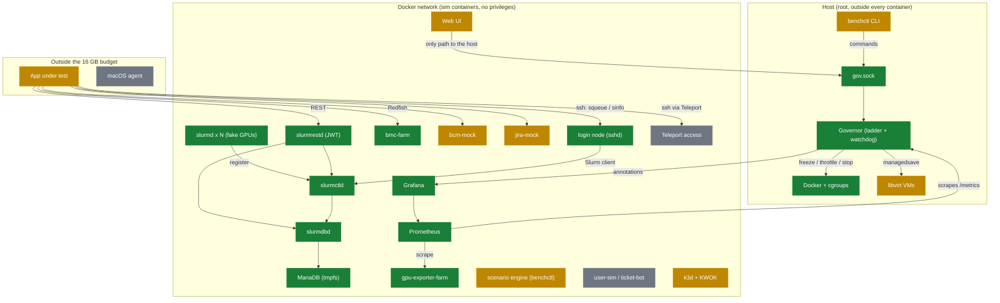

# Progress

<!-- GENERATED from docs/progress.yaml by `python -m benchctl.progress`; do not edit. -->
Last updated 2026-10-29. Legend: ✅ Done 🔍 In review 🟡 Partial ⬜ To do. Mermaid diagrams render on GitHub; for any browser open [progress.html](progress.html).

**77% built** (35 done, 20 in review, 11 partial, 5 to do, 71 items).

## Roadmap

## As built

What exists and how the parts connect. Green is verified, blue is in review, amber is partial, grey is not started.

## Phases

### Baseline (33%)

_Measure real memory so budgets stop being guesses._

| Part | Status | How it is built | Where | PR |
|---|---|---|---|---|
| Measurement tooling | ✅ Done | `benchctl measure run/report` samples host, Docker containers, PSS per process and libvirt domains (read-only), saves JSON, suggests budgets = peak x 1.2. | `benchctl/measure.py` | #28 |
| Host baseline | 🟡 Partial | Idle host and a small Slurm stack were measured (slurmd 5 MiB, slurmctld 13, MariaDB 171). No loaded run with mocks yet. | - | - |
| Budgets replaced by measured values | 🟡 Partial | min measured live (VMs off, 60 queued jobs): 0.17 GB peak across containers, budget set to 1 GB. std/full are still estimates. | `profiles/min.yaml` | #68 |

1/3 done

### Governor (86%)

_A root service that keeps the host alive by escalating through a ladder._

| Part | Status | How it is built | Where | PR |
|---|---|---|---|---|
| Signals and escalation ladder | ✅ Done | MemAvailable, PSI and swap rate feed levels L0-L5. Escalates at once, steps down one level per 60 s calm with a 10 s dwell. | `governor/signals.py`, `governor/ladder.py` | #14 |
| Priority planner | ✅ Done | P0-P6 classes; lowest priority first, reversible actions before destructive ones; undo on de-escalation. | `governor/planner.py` | #14 |
| Executors | ✅ Done | freeze, throttle (memory.high), reclaim, stop (cgroup.kill then docker stop), managedsave for VMs, via cgroup files opened in advance. | `governor/executors.py` | #20 |
| mlockall and pre-allocated mitigation path | ✅ Done | Locks its own pages and pre-opens handles and buffers so L3/L4 performs no allocation (SPEC GV-8). | `governor/memlock.py` | #19 |
| Control socket | ✅ Done | JSON lines on /run/workbench/gov.sock with a fixed allow-list; unknown commands are rejected. | `governor/control.py` | #19 |
| NF-1 memory-hog test | ✅ Done | A real container hog is throttled, frozen then stopped in order; no host OOM. Runs as root via scripts/real-test-root.sh. | `tests/real/test_root.py` | #24 |
| Security watchdog | ✅ Done | Every 15 s flags privileged/capability/unconfined/host-namespace/docker.sock containers, missing limits and live memory.max drift. Report only; skipped from L3 up. | `governor/watchdog.py` | #34 |
| Monitored slurmrestd exception | ✅ Done | slurmrestd runs with two unshare steps disabled (ADR 0004). Any wider SLURMRESTD_SECURITY option is a violation; doctor lists the accepted exception. | `governor/watchdog.py` | #44 |
| Inventory refresh and Grafana annotations | ✅ Done | Re-discovers containers so late starters are governed; posts audit events to Grafana with a token from the environment (SPEC GV-6). | `governor/annotate.py`, `governor/core.py` | #36 |
| systemd unit installed permanently | 🟡 Partial | Unit and slice pass systemd-analyze and ran as a transient service in tests; scripts/install-governor.sh installs it as the standing service (printed unit tested; the sudo install itself is run by the user). | `systemd` | - |
| Admission and real scale / set-profile | ✅ Done | admit command (GV-9): refused at L2+ or if it would breach the floor; scale and set-profile run benchctl in the background at L0-L1 only (GV-8). benchctl up/scale ask first. Verified live through the socket. | `governor/core.py` | #48 |
| Governor /metrics endpoint | ✅ Done | Prometheus text (level, MemAvailable, PSI, swap, groups per priority, actions, admissions) bound to the docker bridge address, rendered once per step so a scrape does no work (GV-8). The Prometheus 'governor' target is up on the live stack. | `governor/metrics.py` | #60 |
| Live ladder test on the real stack | ✅ Done | Dry-run governor against the running containers: L0 to L3 and back, /metrics, Grafana annotations and the planned throttle/freeze/thaw actions. The root variant passes on the dev machine: L3 really freezes a live container's cgroup (cgroup.events frozen 1), keeps P1 services running, and thaws on recovery; it also exposed and fixed the nested-slice cgroup path bug (PR 64). | `tests/real/test_pressure_real.py` | #60 |
| Host tuning script and benchctl top | ⬜ To do | zram, swappiness and THP tuning with confirmation, and a live view of the governor. | - | - |

12/14 done

### Slurm (100%)

_A real scheduler the app can read, built from sim.yaml._

| Part | Status | How it is built | Where | PR |
|---|---|---|---|---|
| Slurm 26.05.5 images | ✅ Done | Built from the SchedMD tarball (pinned and SHA256-checked) because Ubuntu's 23.11 lacks the 2026 security fixes; no extra container privileges (ADR 0002). | `images/node-base/Dockerfile` | #32 |
| Generated Slurm config | ✅ Done | slurm.conf, gres.conf and cgroup.conf derive from sim.yaml so node names match everywhere; fake GPUs use /dev/null-backed device files. | `benchctl/slurmconf.py` | #32 |
| Compose generation | ✅ Done | `benchctl compose --profile X` renders services with mem_limit, cgroup_parent and the workbench.class label from sim.yaml and profiles. | `benchctl/compose.py` | #30 |
| slurmrestd with JWT | ✅ Done | JWT-only REST on the internal network, own user, no privileges; skips two unshare steps instead of loosening seccomp (ADR 0003, ADR 0004). Verified live: no token 401, bad tokens get no data. | `benchctl/compose.py` | #38 |
| Accounting | ✅ Done | MariaDB on a capped tmpfs plus slurmdbd; sacctmgr bootstrap creates cluster, QOS and users from sim.yaml; secrets stay in a gitignored folder. Verified live: a job as alice appears in sacct and the REST slurmdb endpoint. | `benchctl/slurmconf.py` | #38 |
| benchctl up / down / scale | ✅ Done | Pre-flight, staged start (observability, slurm, nodes), skips unbuilt mocks, scale regenerates slurm.conf, Grafana token created once (0600). Verified live with min; scale really stops containers. | `benchctl/stack.py` | #45 |

6/6 done

### Mocks (75%)

_Fake BMC, BCM and Jira so the app's integrations can be exercised._

| Part | Status | How it is built | Where | PR |
|---|---|---|---|---|
| gpu-exporter-farm | ✅ Done | One process serving fake DCGM metrics for every simulated GPU (util, FB used and free, temp, power, XID) with the real exporter labels (Hostname, UUID, modelName), fault injection over /sim/inject. A read-only Grafana token for clients is made by benchctl up. Verified live through Grafana /api/ds/query. | `components/gpu-exporter-farm/exporter.py` | - |
| bmc-farm | ✅ Done | One process serves /<node>/redfish/v1 for every node: Systems, Chassis Thermal/Power, Managers, event log, Reset action, POST /sim/inject (temp, fans, power, events). Also standard Redfish over TLS on 127.0.0.1:8443 (Host picks the node, session login, collections, firmware, accounts; ADR 0012). Verified live in the stack. | `components/bmc-farm/bmc.py` | #52 |
| bcm-mock | 🟡 Partial | CMDaemon-style POST /json (cmdevice, cmstatus, cmpart) over the sim.yaml nodes, power calls and /sim/inject. Call names are an assumed subset (ADR 0005); verified live, 12 MiB. | `components/bcm-mock/bcm.py` | #71 |
| Fake cmsh on the login node | ✅ Done | cmsh -c "device; list" / "device; status" / category, jobqueue and healthchecks lists on the login node (the BCM head node), state read from bcm-mock so a scenario that takes a node down shows DOWN; mutating commands refused; no interactive console (ADR 0013). Verified live: tests/real/test_cmsh_real.py. | `images/login/cmsh.py` | - |
| jira-mock | 🟡 Partial | Mode mock only: REST v2/v3 issues, POST search (/search/jql token paging, /search offset paging), myself, serverInfo, field, project, JQL with OR/NOT/parentheses/text search, comments (read, edit, delete), issue edit, watchers, worklog, assign, user search, workflow transitions with required-field errors, JQL subset, webhooks, 429/503/slow failures, and /sim/tickets for scenarios (ADR 0005, issue 107). Verified live in the container (transitions, JQL, webhook to an outside receiver, 429/503), 15 MiB. cloud/dc modes not built. | `components/jira-mock/jira.py` | #71 |
| SSH login node | ✅ Done | sshd + Slurm client tools on 127.0.0.1:2222, key login only, forwarding on, keys generated by benchctl up (ADR 0011). Verified live: sinfo over SSH, root and password refused, port forward to a mock. | `images/login` | - |
| sshd on compute nodes | ✅ Done | sshd in node-base, started on nodes only (WORKBENCH_SSHD): ssh cn001 from the login node with no prompt (cluster key, shared node host key), a client ProxyJump or execution target to a node, srun and srun --pty. Reached through the login node only (ADR 0014). up builds node-base first. Verified live: tests/real/test_node_ssh_real.py. | `images/node-base` | - |
| Client setup by component | 🔍 In review | One section per client component (SSH, Slurm, Grafana, storage, Jira, BCM, BMC): values, where to get them, what to expect, common failure. Values checked against the live stack; not walked in the client window. Issue 82. | `docs/guides/client-setup-by-component.md` | - |
| Normal shell on nodes | 🔍 In review | Simulated users get bash (useradd default), bash-completion, Slurm tab completion from the Slurm source tree, history, a user@node prompt and Slurm on the login-shell PATH. Verified live: tests/real/test_login_real.py. Issue 81. | `images/node-base/Dockerfile` | - |
| Client key helper | 🔍 In review | benchctl ssh-key install|remove: copies the login key to ~/.ssh/workbench_ed25519 (mode 600) for clients that only read keys under ~/.ssh; refuses to overwrite a foreign file. Issue 80. | `benchctl/stack.py`, `benchctl/cli.py` | - |
| GPU metrics follow Slurm jobs | 🔍 In review | slurmctld serves the GPU indexes running jobs hold (internal :9401); the exporter polls it every 3 s and shows those GPUs busy, the rest idle (last answer kept 30 s if the feed is down). Verified live: tests/real/test_gpu_follows_slurm_real.py. Issue 83. | `components/gpu-exporter-farm/exporter.py`, `images/slurm-ctl/alloc_feed.py` | - |
| Teleport access | ⬜ To do | Issue 39: the app reaches nodes through Teleport (auth + proxy, node access, outage and cert-expiry scenarios). Needs open decisions 6 first; will need sshd in node-base and a Phase 0 budget. | - | - |

5/12 done

### People and chaos (0%)

_Simulated users and engineers, scripted faults._

| Part | Status | How it is built | Where | PR |
|---|---|---|---|---|
| Scenario files | 🟡 Partial | Eleven scenarios: gpu-xid-storm, node-down, fan-failure, jira-429, jira-outage, jira-flap, ticket-lifecycle, drain-ticket and ticket-wave run now; pod-crashloop and k8s-node-notready need k3d/KWOK. | `scenarios` | #73 |
| user-sim and ticket-bot | ⬜ To do | Personas with Poisson arrivals and engineers working tickets. | - | - |
| scenario-engine | 🟡 Partial | `benchctl scenario list|run NAME [--speed N] [--dry-run]`: steps drive bmc-farm, bcm-mock, gpu-exporter, jira-mock, Slurm (scontrol) and the login node's sshd (ssh target: down, hung, up, rotate_host_key, max_sessions, reject_auth, node_sshd + nodes, reset; scenarios ssh-host-key-changed, login-node-down, login-node-hung, ssh-session-limit, ssh-key-refused, ssh-node-sshd-down; tests/real/test_ssh_faults_real.py); ramps; expect (slurm.node_state, jira.issue_created) watched from the start; k8s and ticket-bot steps skipped. Runs in the host CLI, not a container (ADR 0006). Verified live. | `benchctl/scenario.py` | #73 |

0/3 done

### Kubernetes (50%)

_Mixed real and fake K8s nodes._

| Part | Status | How it is built | Where | PR |
|---|---|---|---|---|
| Cluster fixtures | ✅ Done | Namespaces, workloads, failure signals and a read-only RBAC role, applied with apply.sh. | `k8s/fixtures` | - |
| k3d plus KWOK cluster | 🟡 Partial | Design is set but kubectl and k3d are not installed on this host, so it has not been brought up. | - | - |

1/2 done

### Fidelity VM (0%)

_One real Ubuntu VM with Redfish power control._

| Part | Status | How it is built | Where | PR |
|---|---|---|---|---|
| VM scaffold | 🟡 Partial | Vagrantfile, provisioning scripts and up/down helpers exist; not re-verified end to end since the scaffold merge. | `fidelity-vm` | - |

0/1 done

### Web UI and profiles (67%)

_One click from cold start to a busy cluster._

| Part | Status | How it is built | Where | PR |
|---|---|---|---|---|
| Profile pre-flight (CLI) | ✅ Done | `benchctl preflight` refuses a profile when free memory minus its budget is under the safety floor and suggests a smaller one. | `benchctl/checks.py` | #26 |
| Web UI base | 🟡 Partial | `python -m webui` on 127.0.0.1:8088 with a login token: Governor dashboard (level banner, MemAvailable/PSI sparklines, audit log over SSE) and Scenario Orchestrator (list, Play with speed, Stop, per-step timeline). Reads the governor socket only; Slurm steps are skipped in the UI. ~32 MB RSS on Starlette (ADR 0008). Reviewed in headless Chromium (desktop/phone, light/dark; no console errors or overflow; ARIA tabs, keyboard, status not by colour alone). | `webui/` | #76 |
| Help wiki in the web page | 🔍 In review | `/help/` serves the markdown under docs/ (manual, guides, architecture, ADRs) as linked pages with a sidebar, search and images; a stdlib renderer, pages read per request, same login as the UI. A ? Help link sits in the page header. New manual chapters: which command to use, glossary. | `webui/wiki.py`, `docs/manual/11-which-command.md`, `docs/manual/12-glossary.md` | #146 |
| GitHub Wiki from docs | 🔍 In review | `scripts/sync_wiki.py --out DIR` turns docs/manual, guides, architecture and ADRs into wiki pages (Home, sidebar, footer, images, rewritten links); `--push` clones the wiki repository, syncs and pushes without printing the token. docs/ stays the only source. A GitHub Actions workflow (.github/workflows/wiki.yml) runs it after every push to dev that changes the docs (issue 113). | `scripts/sync_wiki.py`, `.github/workflows/wiki.yml`, `tests/test_sync_wiki.py`, `docs/guides/github-wiki.md` | #149 |
| Cluster Canvas | 🟡 Partial | Cluster tab: service reachability chips and a card per sim.yaml node (power, CPU temp, fans, BCM state, GPU XID) refreshed every 3 s, with Power off/on, Overheat, Fan failure, GPU error and Clear actions that go through the mocks. Slurm drain and K8s faults are not offered (UI has no Docker access; K8s not built). Verified live. | `webui/cluster.py`, `webui/static/index.html` | #84 |
| App shell and layout | 🔍 In review | One dashboard page: cluster components in the middle (service chips, traffic dots, node cards), governor in the left panel, needs-attention, scenarios and log in the right panel; panels stack on small screens. A status strip on top (governor level, memory, services, nodes, running scenario, theme), a calm palette with a soft level banner and area sparklines, light/dark/auto theme, skip link and landmarks, 4 px spacing scale. Based on dashboard and navigation guidance from Splunk, Zuora, Grafana and SaaS UX guides (issue 46). | `webui/static/index.html` | #91 |
| Dashboard tabs and connection details | 🔍 In review | Main column has Nodes, Traffic, Connections and Plan tabs; the right rail stays in view and scrolls on its own; scenarios are a compact, filterable list with one speed control. Connections tab lists every part with address, a copyable command and the credential file path (never the secret); node details show the SSH, BMC and IP hints; `benchctl describe node` prints the container IP (issue 115). | `webui/connections.py`, `webui/static/index.html`, `benchctl/describe.py` | #116 |
| Animated workload dots | 🔍 In review | Cluster tab Traffic panel: a dot travels from Clients to a mock each time it serves a real request (the mocks count them at /sim/stats; health checks, /sim calls and the UI's own polls are excluded), a diamond from Fault injector when a fault is applied. SSE at /api/flow opened only while the tab shows; pause button; stops at governor L3+ and for reduced motion. Slurm job dots are not drawn (the UI cannot read the scheduler). ADR 0009. | `webui/flow.py`, `components/*/ (GET /sim/stats)`, `webui/static/index.html` | #89 |
| Budget manager | ⬜ To do | Profile/budget form (W-7). | - | - |

1/9 done

### macOS agent and CI (0%)

_External Mac agent and unattended scenario runs._

| Part | Status | How it is built | Where | PR |
|---|---|---|---|---|
| Mac agent profile and headless CI | ⬜ To do | External agent only (licence); scenario suite with assertions. | - | - |

0/1 done

### Platform and tooling (100%)

_What keeps every change safe and debuggable._

| Part | Status | How it is built | Where | PR |
|---|---|---|---|---|
| validate.sh gate | ✅ Done | Secrets scan, compile, ruff, shellcheck, YAML/JSON, systemd verify, pytest and a governor smoke run before every commit. | `scripts/validate.sh` | #18 |
| Public-repo privacy guard and git hooks | 🔍 In review | check-privacy.sh blocks home paths, the local username, personal emails, tokens and keys, local-only paths (.claude/, graphify-out/) and symlinks that leave the repo, and prints only file:line and the rule. Tracked hooks: pre-commit (no commits on main/dev, privacy, validate.sh), commit-msg (issue reference), pre-push (no push to main/dev, full scan); installed by install-hooks.sh. validate.sh runs the scan too. Issue 54. | `scripts/check-privacy.sh`, `.githooks/`, `scripts/install-hooks.sh`, `SECURITY.md` | #105 |
| Unit-test coverage gate | ✅ Done | validate.sh runs the unit tests under coverage and fails below 90% (override COV_FLOOR). 226 tests, 98% of benchctl, governor, webui and components. Not covered by unit tests, by design: code that needs root, a live Docker stack or a browser (tests/real). | `tests/`, `scripts/validate.sh` | #81 |
| Real-host tests | ✅ Done | User-level tests with cgroups, Docker, libvirt and a live governor; a sudo suite for root-only paths. | `scripts/real-test.sh`, `scripts/real-test-root.sh` | #20, #22 |
| Rootless governor (no sudo) | 🔍 In review | `python -m governor --user-mode` pauses/stops containers through the Docker API, skips memory.high throttle and reclaim, keeps the ladder, admission, watchdog and metrics, listens under $XDG_RUNTIME_DIR. `benchctl start` runs it when no system service is up. Live-tested: freeze/thaw of a real container, no sudo called. ADR 0010. | `governor/executors.py`, `scripts/benchctl-launch`, `benchctl/checks.py` | #98 |
| One controller command (benchctl) | 🔍 In review | `benchctl VERB [RESOURCE] [NAME]` like kubectl: get nodes|services|profiles|scenarios (-o json), exec NODE, logs NODE, start/stop/open (launcher), plus every older command; node-name tab completion; the old command and project names were removed in #111; docs and tests name only benchctl (ADR 0015). Typos get a Did-you-mean hint and are never run; errors go to stderr; docs/guides/benchctl-verbs.md lists each verb's limits (issues 90, 98). | `benchctl/cli.py`, `benchctl/inventory.py`, `scripts/benchctl` | - |
| Logo and README | 🔍 In review | A W of servers on a bench (teal nodes, a dashed amber governed node), as logo.svg, a small cut for 16 to 32 px, favicons and touch icon, all built from one script and checked by validate.sh; the web page header and tab icons use it. The README is now a short five-step guide: wake it up, poke it, build your own, point your app at it, put it back. Issue 89 (logo part; the name decision is still open). | `scripts/make_logo_assets.py`, `docs/assets/`, `docs/guides/brand-assets.md`, `README.md` | - |
| Export workbench as client profile | 🔍 In review | `benchctl export profile [--bmc] [--user] [--name] [--format]` writes the running workbench as a profile file the client imports (SSH, Slurm, Grafana, Jira, storage, optional BMC targets; parts not built are left out; no secrets). The client's format ID is read locally (.git/export-format, env or flag), never written in the repo. Verified: the client's own parser accepts the output (1 cluster, 6 BMC targets). Issue 91. | `benchctl/export.py`, `benchctl/cli.py`, `docs/guides/export-profile.md` | - |
| Describe a node (CLI and page) | 🔍 In review | `benchctl describe node NAME [-o json]` and a Details dialog on each node card show the same text from one gatherer: container (state, image, memory limit, class), Slurm state and jobs, GPUs busy/idle and XID, BMC power/temperature/fans, ssh hint. A source that is down is one note. The page omits Docker and Slurm lines (no Docker access by design). Issue 93. | `benchctl/describe.py`, `benchctl/cli.py`, `webui/app.py`, `webui/static/index.html` | - |
| Choose the workbench (plan and apply) | 🔍 In review | `benchctl plan --cpu-nodes 2 --gpu-nodes 4 --with jira` prints the memory the selection needs against free memory (exit 1 and a hint when it does not fit); `up` with the same flags, or `apply -f FILE`, admits by that estimate and builds it. Parts: jira, bmc, bcm, accounting, scenarios, load; Kubernetes refused until built. The effective sim is written to compose/generated/sim.yaml so slurm.conf, the BMC farm, the GPU exporter, get, describe and export agree. The page has a Plan form (estimate only, W-3). Verified live: 2 cpu + 3 gpu nodes x 4 GPUs. ADR 0016. Issue 92. | `benchctl/workbench.py`, `benchctl/cli.py`, `benchctl/stack.py`, `benchctl/compose.py`, `webui/app.py` | - |
| Tab completion | 🔍 In review | `benchctl completion install|remove|bash|zsh|fish`: no sudo, one rc line, a ~/.local/bin/benchctl link; `start` offers it once in a terminal. Completes resources, nodes and services, --profile, scenario names, --user, --with/--without, -o, -l and --sort-by from files only (no Docker). A wrong profile, node or scenario gets Did you mean plus the valid list, exit 2. | `benchctl/completion.py`, `benchctl/cli.py`, `scripts/benchctl`, `tests/test_completion.py`, `tests/real/test_completion_real.py` | - |
| One-command launcher | 🔍 In review | `./scripts/benchctl start` runs the machine check, creates the venv if missing, notes whether the governor is installed, brings the cluster up and starts the web page in the background, then prints the login link; `stop`, `status`, `open`. Idempotent. Live-tested start, second start, stop. | `scripts/benchctl-launch` | #95 |
| Initial machine check | 🔍 In review | `./scripts/check-machine.sh` (system python3 only, runs before any build) checks OS, cores, RAM, disk, cgroup v2, Docker daemon and compose, free ports, optional tools, and which profiles fit; READY or NOT READY with a fix per problem. Also `benchctl check`. | `benchctl/machine.py`, `scripts/check-machine.sh` | #87 |
| benchctl doctor / status / diag | ✅ Done | Environment checks with fixes, governor state, a masked diagnostics tarball, and the container security check. | `benchctl/checks.py`, `benchctl/diag.py` | #26 |
| Observability stack | ✅ Done | Prometheus (2 d, tmpfs), Grafana with provisioned dashboard, fake GPU exporter. | `compose/observability.yml` | - |
| Decisions as ADRs | ✅ Done | 0001 record decisions, 0002 Slurm from source with no extra privileges, 0003 slurmrestd/JWT and accounting, 0004 slurmrestd keeps its unshare steps disabled, 0011 SSH login node. | `docs/adr` | - |
| Getting-started guide | ✅ Done | Step-by-step use of the app; tests/test_docs.py fails if a documented command disappears. | `docs/guides/getting-started.md` | #52 |
| User manual | 🔍 In review | Ten chapters with screenshots of the web page and real terminal output (concepts, install, using the cluster, nodes and shells, web page, scenarios, governor, configuration, troubleshooting, reference). Commands were run against a live min stack; tests/test_docs.py checks that every command, script and node name it uses exists. The guide gained a step for getting a shell on a node (docker exec; nodes have no sshd). | `docs/manual` | - |
| Verification helpers | ✅ Done | verify.sh runs validate.sh plus real tests (--full adds the live stack lifecycle); tests/real/helpers.py starts a live governor and talks to its socket. | `scripts/verify.sh` | #48 |
| Progress tracker | ✅ Done | This page, generated from docs/progress.yaml (issue 19). | `benchctl/progress.py` | #42 |

9/20 done

## Next up

1. user-sim and ticket-bot (they also give the dots Slurm jobs and Jira tickets to draw).
2. Phase 0 for std/full (16-32 slurmd, k3d) once those profiles are buildable; only min is measured.

## Known gaps

- Only the min budget is measured (0.17 GB loaded with 60 queued jobs, VMs off); std/full budgets are still estimates.
- The governor's own locked memory is about 100-170 MB, slightly over its 0.15 GB budget.
- Host swap is 100% full and kubectl/k3d are missing, which blocks the Kubernetes phase here.
