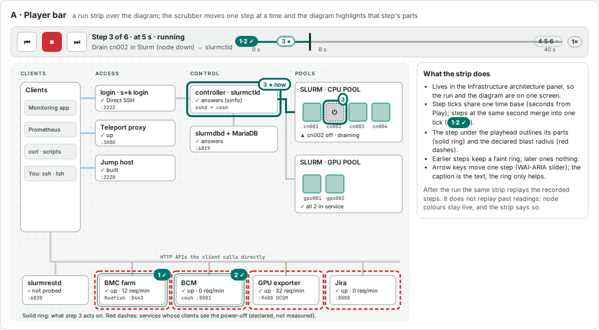
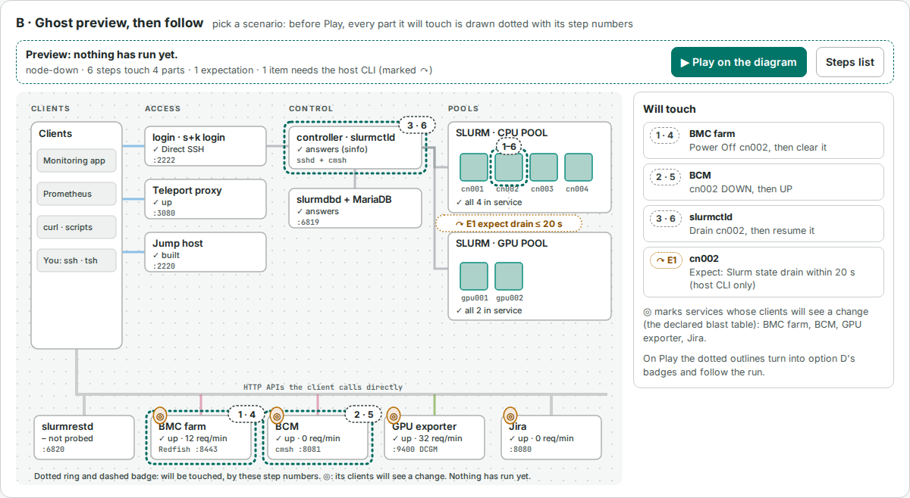
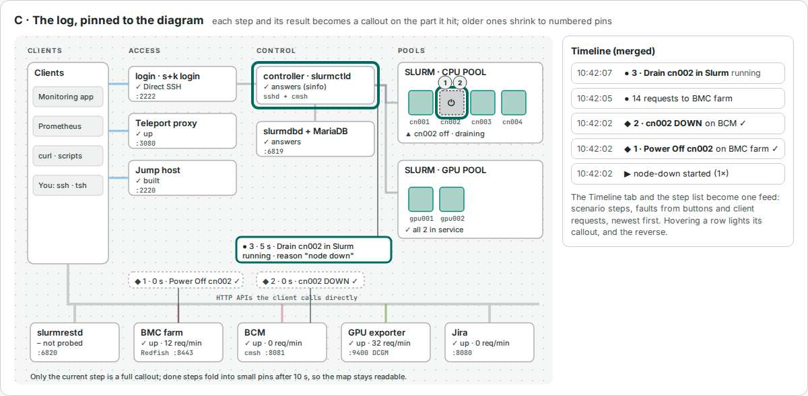
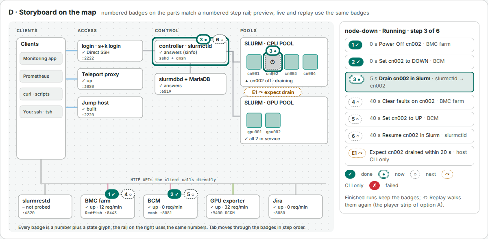
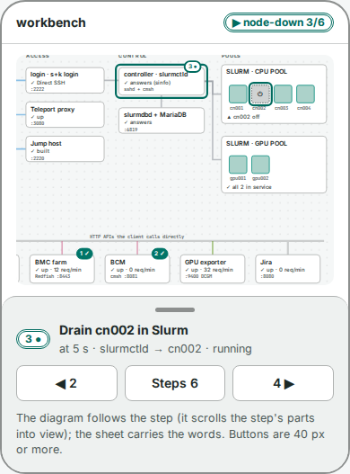

# ADR 0086: Scenario runs on the architecture diagram: a storyboard on the map

Status: **Proposed** (2026-11-15), awaiting the owner's decision. Issue 806. Design only: no code changed. Current state, sources and all mockups (light and dark) are in the research note [Scenario runs on the architecture diagram](../research/scenario-on-the-diagram.md). Builds on [ADR 0006](0006-scenario-engine-runs-in-the-host-cli.md), [ADR 0009](0009-traffic-dots-from-request-counters.md), [ADR 0039](0039-redesign-cluster-level-circuit.md) and [ADR 0069](0069-one-colour-system-from-one-palette-file.md).

## Context

The owner: the scenarios are in a separate tab; the flow can be followed in the log, but not on the diagram. How can the two meet?

**Today a run lives in the Test run tab.** It shows the step list, a progress bar, expectations and the Client's eye. The Infrastructure architecture is in the Topology tab, so the two are never on screen together.

**Most steps never reach the diagram.** Only four targets (`bmc-farm`, `bcm-mock`, `gpu-exporter`, `jira`) make a flow event (`SCENARIO_TARGETS`, `webui/flow.py`). That is 89 of the 202 planned steps in the 46 scenarios. Slurm, Kubernetes, SSH, auth, netem, switch and real-Jira steps make none.

**The default view draws no run marks.** The Circuit view empties the positions the fault diamonds need, so only the blast outline is left. The outline shows the newest event, with no step number, and clears after 45 s.

**Also missing:** expectations on the diagram, a preview before Play, any replay after the run (the run state keeps no times), and runs started with `benchctl scenario run` (another process: the page sees only their side effects).

**What exists to build on.** `scenario.plan` and `scenario.preview` list every step before Play. `webui/graph.py` gives every part a stable id (`data-ent`) that focus, lens and blast already use. `webui/blast.py` declares what clients see per fault. The missing piece is a function from a step to the parts it touches.

## What strong tools do

| Pattern | Seen in | Used here |
|---|---|---|
| One time base and a now marker over the sequence | Steadybit run view, AWS FIS Timeline | Player strip (A), rail (D) |
| Step graph plus one detail pane with that step's logs | Litmus ChaosCenter, GitHub Actions | Rail and step detail (D) |
| Blast radius shown before the run | Gremlin Scenarios | Preview (B) |
| Stepped player over a topology, with an event list | Cisco Packet Tracer simulation mode | Player strip (A) |
| Two linked views: select in one, select in the other | Wireshark Flow Graph | Badges and rail (D) |
| Replay on the graph itself | Kiali graph replay | Replay (phase 3) |
| Skipped is a state of its own, not a pass | AWS FIS action states | Badge states |

Links and quotes are in the research note, section 4.

## Options

All four are drawn for scenario `node-down` at step 3 (research note, section 5).

| | A. Player bar | B. Ghost preview | C. Log callouts | D. Storyboard on the map |
|---|---|---|---|---|
| What the user sees | A strip over the diagram: Back, Stop, Forward, a scrubber with step ticks, the caption; the step's parts ringed | Before Play, dotted rings and step numbers on every part a scenario will touch; expectation pins | Each step a callout on its part; done steps fold into numbered pins; one merged feed | Numbered badges (number and glyph) on parts, matching a numbered step rail; same badges before, during and after |
| Engine must emit | Step time `t`, touched part ids, status | Touched part ids in the preview | Touched ids, time, label, detail | Touched ids, YAML step number, `t`, status, expectation targets |
| Page files | new `runlayer.js`, `index.html` strip, `canvas.css` | `runlayer.js`, `testrun.js` | `flowfeed.js`, new callout layout | new `runlayer.js` and `runlayermodel.js`, inspector tab, `canvas.css` |
| Effort | M | S once ids exist | L (callout placement) | M (MVP), L with replay |
| Main risk | One step at a time hides the story so far | Shows intent, not what happened | Collisions in dense views, worst on a phone | Badge clutter on long scenarios |
| Phone | Strip fits; diagram small | Good: static | Poor: callouts cover the diagram | Good: bottom sheet with Previous and Next |
| README tour | Scrub through the run | Pick, see ghosts, Play | Callouts pop in | Ghost badges, Play, badges tick, replay |

### Mockups

Light theme below; the dark twins are `img/0086-option-*-dark.png`, and all of them are in the research note.

## Decision (proposed)

**D, the storyboard on the map, as the spine.** B is its state before Play and A is its replay control; C is not used on the map (the current step's text goes in the rail and the phone sheet).

Why D:
- **It answers the question directly.** The diagram shows which step did what, where, in what order, and with what result, without leaving the Topology tab.
- **It is static.** It works with reduced motion, in screenshots and on a phone.
- **It is accessible.** Every badge is a number and a glyph (✓ done, ● now, ○ next, ↷ CLI only, ✗ failed) with an `aria-label`. Tab follows step order.
- **One mapping serves all phases:** preview, live and replay.

### Rules

1. **Badge numbers follow the scenario file.** Fault-model and ramp expansions are listed under their YAML step, never numbered on their own.
2. **A part gets one badge**: the newest step on it plus `+N`. The rail lists every step.
3. **The current step** also rings its parts (accent outline). The declared blast radius keeps its red dashes, unchanged.
4. **Expectations** get an `E1`-style pin on the part they assert.
5. **A step with no part on the diagram** is listed in the rail as "not on the diagram" with the reason. Never guessed.
6. **Replay** walks the recorded steps only, and says so: node states stay live.
7. **Tokens and states:** `--accent` and `--accent-fill` for done and now, `--warn` and `--warn-text` for CLI only, `--bad` for failed. Each state also has its glyph and words.

## Phased plan

### Phase 1, MVP: the live run on the map (Circuit view)

| Child item | Files | Size |
|---|---|---|
| `scenario.touches(step)`: the graph ids a step acts on, and the YAML step number, in `preview()` and the run state. A test fails when a step of any scenario maps to nothing without a stated reason | `benchctl/scenario.py`, `webui/app.py`, `tests/test_scenario*.py` | S to M |
| Times in the run state: `t` per step and per expectation, `elapsed`, `started` | `benchctl/scenario.py` (`run`), `webui/app.py` (`Runs`) | S |
| Run layer: badges, current-step ring, a third inspector tab "Run" (the rail), keyboard order, phone bottom sheet; the Topology tab polls the run state while a run is shown | new `webui/static/js/runlayermodel.js`, `runlayer.js`; `index.html`, `canvas.css`, `scenarios.js`, `main.js` | M |
| Tests and docs: Node tests of the model; `ui_shots.py` checks (badges labelled, no overflow, phone sheet, reduced motion); `doc_shots.py` sample run; manual and canvas guide | `webui/tests/js/`, `scripts/ui_shots.py`, `scripts/doc_shots.py`, `docs/manual/`, `docs/guides/web-ui-canvas.md` | S |

### Phase 2: before Play

- Ghost badges and expectation pins when a scenario is selected (option B); a "Show on the diagram" button in the Test run tab.
- A declared blast entry for every target kind, not only the node buttons (`webui/blast.py`).

### Phase 3: after the run

- Replay: the player strip (option A) as a WAI-ARIA slider over the recorded steps.
- The last run's journal kept in memory, and in `compose/generated` if the owner wants it to survive a restart.
- Markdown and JSON export gain the step times.

### Phase 4, needs an owner decision

- **CLI runs on the page.** `benchctl scenario run` posts its step events to the page with the page token, when the page answers; best effort, never blocking the run.

## Testing

- **Python:** every scenario's steps map to parts or a stated reason; preview and run state carry ids and times.
- **Node:** `runlayermodel.test.mjs` covers grouping by YAML step, one badge per part, state glyphs, Tab order and the phone sheet text.
- **Browser:** `ui_shots.py` and `tests/real/test_webui_browser.py` load a sample run: badges present and labelled, rail and badges linked, no overflow at 390 px, no motion with reduced motion.
- **Live (owner-run):** play `node-down` from the page and assert badges reach ✓ and the expectation pin shows ↷.
- **Monitoring client:** not affected; the change is only the page.

## Consequences

- One more inspector tab and one more poll (1 s, only while a run is shown). No new dependency; a few dozen SVG elements; no measurable RSS change expected (not measured).
- The 2.5D classic view keeps its diamonds and gets no badges until it is rebuilt (ADR 0039).
- `SCENARIO_TARGETS` in `webui/flow.py` stays as is: badges come from the run state, not from flow events.
- The Test run tab stays the place for the library, reports and the Client's eye; its step list and the rail share one model (`testrunmodel.js`).

## Rejected

- **C as the main view.** Callouts collide in the Circuit view and cover the diagram on a phone. Its merged feed idea stays in the rail.
- **A alone.** One step at a time hides the order of the whole run.
- **Moving the diagram into the Test run tab.** Two copies of the diagram to keep in step; the Topology tab already has focus, lens and blast.

## Open questions for the owner

1. "The diagram in Actions": is it the Infrastructure architecture of the Topology tab (where the node Actions are)? This ADR assumes so.
2. Circuit view only, or the 2.5D classic view too?
3. Should CLI runs appear on the page (phase 4)?
4. Should the last run survive a page restart (a file in `compose/generated`)?
5. On Play, should the page switch to the Topology tab, or stay where the user is?

## References

- Research note and mockups: [Scenario runs on the architecture diagram](../research/scenario-on-the-diagram.md), [mockup page](../research/scenario-on-the-diagram-mockups.html).
- Code read: `benchctl/scenario.py`, `benchctl/faultmodel.py`, `webui/app.py` (`Runs`), `webui/flow.py`, `webui/blast.py`, `webui/static/js/` (`scenarios.js`, `testrun.js`, `testrunmodel.js`, `flowfeed.js`, `blast.js`, `circuit.js`, `lens.js`).
