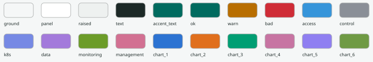
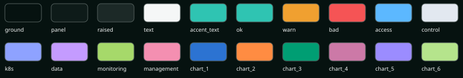
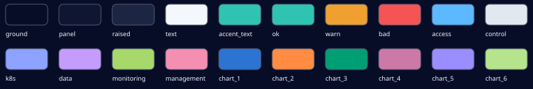
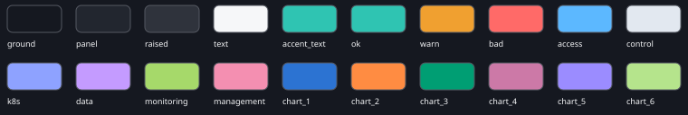

<!-- Generated by scripts/make_palette.py from docs/assets/palette.yaml. Do not edit: change the palette and regenerate. -->
# Colour system

One palette file, `docs/assets/palette.yaml`, defines every colour of the web page, the canvases, the in-page help, the logo,
the documentation art and the Grafana thresholds. `python scripts/make_palette.py` writes `webui/static/tokens.css` and this guide from it;
`validate.sh` fails when they are stale. Design record: ADR 0069.

## Add or change a colour

1. Edit `docs/assets/palette.yaml` (a value is a literal, a ramp step such as `teal.700`, `anchor.teal`, `@other_token`, a `mix`, an `alpha` or a `tune`).
2. Run `python scripts/make_palette.py`.
3. Run `./scripts/validate.sh`: the contrast, colour-blind, line-type and state tests say whether the change is readable.

Code uses tokens only: a CSS variable such as `var(--accent)`, or a `data-plane` / `data-state` attribute that `tokens.css` paints. Never a hex value;
`tests/test_stylesheet_colours.py` enforces it. The page's CSP blocks inline styles, so colour always arrives through the stylesheet.

## Rules

- **Teal** is the brand, interaction and good (`ok`, always with a check mark). **Amber** means attention only. **Red** means error only (always with a triangle or cross); a node that is down is grey with a cross.
- **Planes** have six hues and six line types, the same in every view; plane colours appear only on lines and labelled chips, never on status dots or node squares.
- **Real and simulated** differ by outline (solid and dashed) and a label, not by hue. Selection is a ring, never only a hue change.
- The three logo colours are fixed. They are for fills, the logo and large graphics; text and buttons use `accent_text`, `accent_fill` and `warn_text`, tuned to 5.5:1.
- Canvases (Circuit, fleet, pool, analysis) follow the page theme: their `--cv-*` names are aliases of the theme's own tokens, so a light page has a light canvas.

## Themes

### light

### dark

### midnight

### dim

## Planes

| Plane | Dark | Light | Line type (dash) |
|---|---|---|---|
| access | `#5cb8ff` | `#3695da` | solid |
| control | `#e2e8f0` | `#8a8f97` | 12 6 |
| k8s | `#8ea2ff` | `#7689e4` | 12 4 1 4 |
| data | `#c49bff` | `#a37adb` | 1 5 |
| monitoring | `#a6d96a` | `#6c9c29` | 5 5 |
| management | `#f48fb1` | `#d27092` | 12 4 1 4 1 4 |

## Contrast

WCAG 2 ratios of the pairs the tests check (text 4.5:1, graphics 3:1).

| Pair | light | dark | midnight | dim |
|---|---|---|---|---|
| text on ground | 13.99 | 17.73 | 17.85 | 16.55 |
| text on panel | 15.04 | 16.42 | 16.58 | 14.13 |
| text_2 on panel | 10.31 | 11.17 | 11.28 | 9.61 |
| muted on panel | 7.06 | 8.26 | 8.30 | 7.06 |
| accent_text on panel | 6.43 | 8.12 | 8.19 | 6.97 |
| accent_text on ground | 5.98 | 8.77 | 8.81 | 8.16 |
| warn_text on panel | 6.32 | 8.22 | 8.29 | 7.05 |
| bad on panel | 5.14 | 5.28 | 5.33 | 5.42 |
| on_accent on accent_fill | 5.61 | 8.77 | 8.81 | 8.16 |
| on_accent on accent_hover | 6.98 | 10.41 | 10.46 | 9.69 |
| focus on panel | 4.00 | 8.12 | 8.19 | 6.97 |
| focus on ground | 3.72 | 8.77 | 8.81 | 8.16 |
| attention on panel | 3.99 | 8.22 | 8.29 | 7.05 |

## Tokens

| Token | light | dark | midnight | dim | Use for, never for |
|---|---|---|---|---|---|
| `ground` | `#f5f7f7` | `#061210` | `#070d27` | `#151820` | The page background. Never for text. |
| `panel` | `#ffffff` | `#0e1b19` | `#0f1631` | `#22262f` | Cards, panels and dialogs. Never as the page background. |
| `raised` | `#eef1f0` | `#1c2927` | `#1c2541` | `#2f333c` | Surfaces above a panel (menus, popovers). |
| `line` | `#cccece` | `#364341` | `#353e5a` | `#3b4049` | Hairlines and dividers. Never for text. |
| `line_2` | `#afb2b1` | `#4f5b59` | `#4f5771` | `#545861` | Stronger dividers and input outlines. |
| `line_strong` | `#8c8f8e` | `#5b6866` | `#5b647e` | `#6c7079` | Borders that must reach 3:1 (high-contrast mode). |
| `dot` | `#cccece` | `#364341` | `#353e5a` | `#3b4049` | The dot grid of a canvas. |
| `text` | `#1c2927` | `#f5f7f7` | `#f4f7fc` | `#f6f7f9` | Body text. |
| `text_2` | `#364341` | `#cccece` | `#cbced3` | `#cdcecf` | Secondary text. |
| `muted` | `#4f5b59` | `#afb2b1` | `#afb1b6` | `#b0b1b4` | Captions and units. Never the only copy of important information. |
| `accent` | `#006b5f` | `#2fc4b2` | `#2fc4b2` | `#2fc4b2` | Links and interactive text (the tuned teal). Never for large fills. |
| `accent_text` | `#006b5f` | `#2fc4b2` | `#2fc4b2` | `#2fc4b2` | Teal text on any surface (5.5:1 or better). |
| `accent_fill` | `#007568` | `#2fc4b2` | `#2fc4b2` | `#2fc4b2` | Primary button fill; on_accent text on it passes 4.5:1. |
| `accent_hover` | `#00655a` | `#47d4c2` | `#47d4c2` | `#47d4c2` | Primary button fill on hover or press. |
| `on_accent` | `#ffffff` | `#061210` | `#070d27` | `#151820` | Text on accent_fill. |
| `brand` | `#0b8f80` | `#2fc4b2` | `#2fc4b2` | `#2fc4b2` | The logo teal: fills and large graphics. Never text on a light ground (about 4:1). |
| `focus` | `#0b8f80` | `#2fc4b2` | `#2fc4b2` | `#2fc4b2` | The keyboard focus outline (own offset ring, 3:1). |
| `select_bg` | `#dfebe8` | `#152f2b` | `#152b42` | `#293a40` | Fill of a selected row or chip. |
| `select_ring` | `#006b5f` | `#2fc4b2` | `#2fc4b2` | `#2fc4b2` | The ring of a selected item, as wide as --ring-w (2 px, 3 px in high-contrast mode). Selection is never only a hue change. |
| `sel` | `rgb(0 117 104 / 0.12)` | `rgb(47 196 178 / 0.12)` | `rgb(47 196 178 / 0.12)` | `rgb(47 196 178 / 0.12)` | Transparent wash for selection overlays. Never under text that must keep its contrast. |
| `shadow` | `rgb(20 33 31 / 0.08)` | `rgb(0 0 0 / 0)` | `rgb(0 0 0 / 0)` | `rgb(0 0 0 / 0)` | Shadow colour (clear in dark themes: depth there comes from lighter surfaces). |
| `on_solid` | `#ffffff` | `#ffffff` | `#ffffff` | `#ffffff` | Marks on a solid status or plane fill; always white. |
| `ok` | `#006b5f` | `#2fc4b2` | `#2fc4b2` | `#2fc4b2` | Good, healthy, running. Always shown with a check mark. |
| `warn` | `#b86e00` | `#f0a030` | `#f0a030` | `#f0a030` | Warnings (graphic use). |
| `warn_text` | `#8c5200` | `#f0a030` | `#f0a030` | `#f0a030` | Warning text (5.5:1 or better). |
| `bad` | `#cf2d37` | `#f55455` | `#f55455` | `#ff6a68` | Errors and failed checks. Always with a triangle or a cross. Never for a node that is simply down. |
| `pending` | `#4f5b59` | `#afb2b1` | `#afb1b6` | `#b0b1b4` | Waiting, not yet known. |
| `unknown` | `#4f5b59` | `#afb2b1` | `#afb1b6` | `#b0b1b4` | No data. |
| `attention` | `#b86e00` | `#f0a030` | `#f0a030` | `#f0a030` | The governor holds something back, or a part needs you. Never a plane colour. |
| `error` | `#cf2d37` | `#f55455` | `#f55455` | `#ff6a68` | Same as bad, for error answers. |
| `no_current` | `#888f8e` | `#8d9493` | `#8e929d` | `#8f9298` | A wire with no traffic. |
| `wire_base` | `#cccece` | `#364341` | `#353e5a` | `#3b4049` | The dark base of a wire. |
| `L0` | `#006b5f` | `#2fc4b2` | `#2fc4b2` | `#2fc4b2` | Governor level 0 (calm). Levels run teal, amber (L2, L3), red (L4, L5) and are always labelled. |
| `L1` | `#757045` | `#abb67e` | `#abb67e` | `#abb67e` | Governor level 1. |
| `L2` | `#b86e00` | `#f0a030` | `#f0a030` | `#f0a030` | Governor level 2. |
| `L3` | `#c25922` | `#f38544` | `#f38544` | `#f78c4d` | Governor level 3. |
| `L4` | `#ca4330` | `#f56a4f` | `#f56a4f` | `#fc795e` | Governor level 4. |
| `L5` | `#cf2d37` | `#f55455` | `#f55455` | `#ff6a68` | Governor level 5. |
| `plane_access` | `#3695da` | `#5cb8ff` | `#5cb8ff` | `#5cb8ff` | Lines and labelled chips of the access plane (solid). Never status dots or node squares. |
| `plane_control` | `#8a8f97` | `#e2e8f0` | `#e2e8f0` | `#e2e8f0` | The Slurm control plane (long dash). |
| `plane_k8s` | `#7689e4` | `#8ea2ff` | `#8ea2ff` | `#8ea2ff` | The Kubernetes control plane (dash-dot). |
| `plane_data` | `#a37adb` | `#c49bff` | `#c49bff` | `#c49bff` | The data plane (dotted). |
| `plane_monitoring` | `#6c9c29` | `#a6d96a` | `#a6d96a` | `#a6d96a` | The monitoring plane (short dash). |
| `plane_management` | `#d27092` | `#f48fb1` | `#f48fb1` | `#f48fb1` | The management plane (dash-dot-dot). |
| `real_outline` | `#1c2927` | `#f5f7f7` | `#f4f7fc` | `#f6f7f9` | Outline of a real part (solid), in the neutral text colour with the word real. |
| `sim_outline` | `#364341` | `#cccece` | `#cbced3` | `#cdcecf` | Outline of a simulated part (dashed), neutral, with the word sim. Never a hue. |
| `node_healthy` | `#0b8f80` | `#2fc4b2` | `#2fc4b2` | `#2fc4b2` | A healthy node square, with a check mark. |
| `node_attention` | `#b86e00` | `#f0a030` | `#f0a030` | `#f0a030` | A node square that needs attention. |
| `node_down` | `#4f5b59` | `#afb2b1` | `#afb1b6` | `#b0b1b4` | A node square that is down: grey with a cross. Never red. |
| `hover` | `#f0f1f0` | `#192624` | `#1a213c` | `#2d3139` | Surface of a hovered control. |
| `active` | `#e0e2e2` | `#25312f` | `#252d47` | `#373b44` | Surface of a pressed control. |
| `visited` | `#815ab5` | `#a27bd9` | `#a27bd9` | `#b089e8` | Visited links only. |
| `disabled` | `#808987` | `#7a807f` | `#7a7f8c` | `#828489` | Disabled text; still 3:1, and the control also says why. |
| `row_hover` | `#f0f1f0` | `#192624` | `#1a213c` | `#2d3139` | A hovered table or list row. |
| `row_selected` | `#dfebe8` | `#152f2b` | `#152b42` | `#293a40` | A selected table or list row. |
| `chart_1` | `#2c73d2` | `#2c73d2` | `#2c73d2` | `#2c73d2` | Chart series 1. Series colours are colour-blind checked and never status colours. |
| `chart_2` | `#e06f1d` | `#ff8c42` | `#ff8c42` | `#ff8c42` | Chart series 2. |
| `chart_3` | `#009e73` | `#009e73` | `#009e73` | `#009e73` | Chart series 3. |
| `chart_4` | `#c774a2` | `#cc79a7` | `#cc79a7` | `#cc79a7` | Chart series 4. |
| `chart_5` | `#8f7ff1` | `#9b8cff` | `#9b8cff` | `#9b8cff` | Chart series 5. |
| `chart_6` | `#6f9a44` | `#b5e48c` | `#b5e48c` | `#b5e48c` | Chart series 6. More than six series need direct labels or small multiples. |
| `grafana_ok` | `#006b5f` | `#2fc4b2` | `#2fc4b2` | `#2fc4b2` | Dashboard threshold: good. |
| `grafana_warn` | `#b86e00` | `#f0a030` | `#f0a030` | `#f0a030` | Dashboard threshold: warning. |
| `grafana_bad` | `#cf2d37` | `#f55455` | `#f55455` | `#ff6a68` | Dashboard threshold: bad. |
