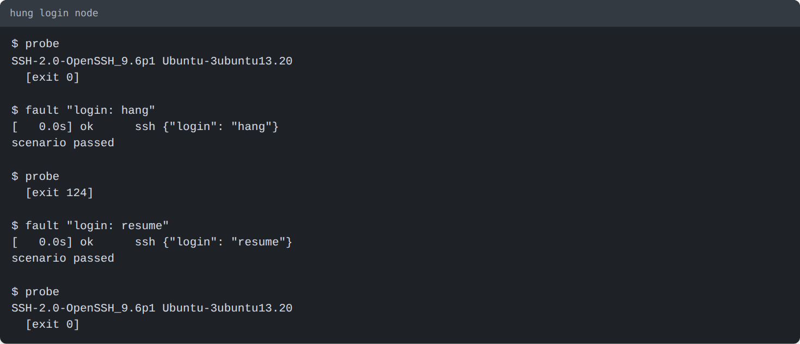
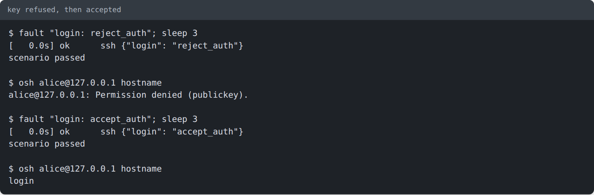
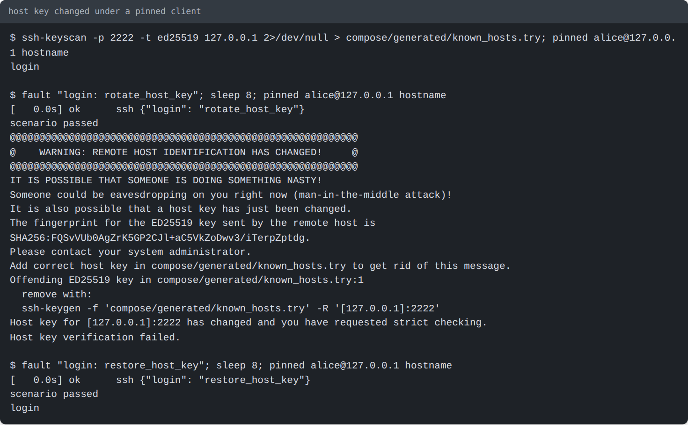
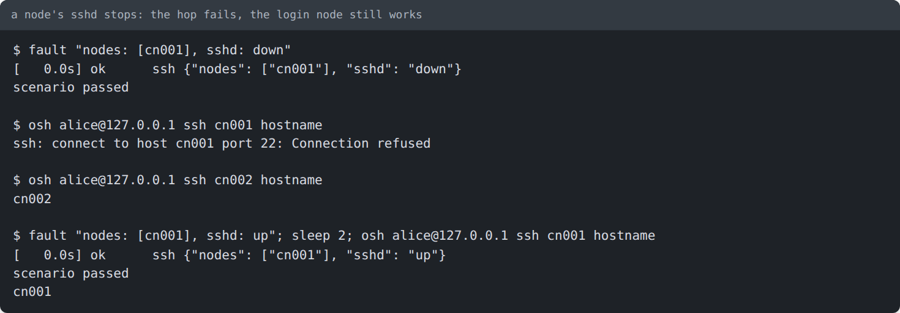
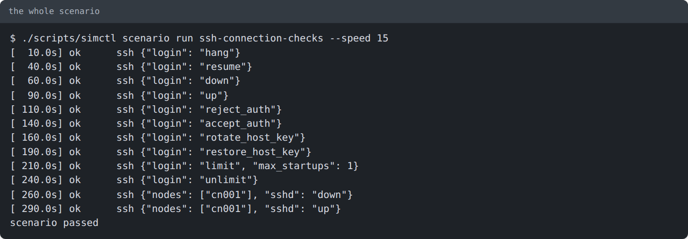

# Testing SSH connections step by step

A walkthrough for checking how a desktop HPC monitoring client handles SSH: reaching the login node, hopping to a
node, and what it shows when the connection misbehaves. Every screenshot is the real output of the command above it
(made with `scripts/term_shot.py`). For the full list of endpoints see [client-testing.md](client-testing.md); for the
design see [ADR 0014](../adr/0014-node-sshd-and-ssh-fault-scenarios.md).

You need: the repository set up as in [getting-started.md](getting-started.md), and about 1 GB of free memory.

## 1. Start the cluster

```bash
./scripts/simctl up --profile min
```


The `ssh:` line is what you give your client: host `127.0.0.1`, port `2222`, user `alice` (or `bob`), and the private
key `compose/generated/secrets/ssh/id_ed25519`. If `up` says it is **REFUSED**, the host is short of memory: close
something and run it again.

## 2. Make the commands short

The next steps use three small shell functions. Paste them into your terminal once (they last until you close it):

```bash
osh() { ssh -i compose/generated/secrets/ssh/id_ed25519 -p 2222 -o IdentitiesOnly=yes \
        -o StrictHostKeyChecking=no -o UserKnownHostsFile=/dev/null -o LogLevel=ERROR -o BatchMode=yes \
        -o ConnectTimeout=5 "$@"; }
probe() { timeout 3 bash -c 'head -n1 </dev/tcp/127.0.0.1/2222' 2>&1; echo "  [exit $?]"; }
fault() { printf 'name: ssh-try\ndescription: one SSH fault\nsteps:\n  - {at: 0s, target: ssh, do: {%s}}\n' "$1" \
          > scenarios/ssh-try.yaml; ./scripts/simctl scenario run ssh-try; }
```

- `osh` is `ssh` with the lab key and no host-key prompt (your client decides that for itself).
- `probe` does what a client's reachability check does: connect and read the first line the server sends.
- `fault "<do body>"` writes a one-step scenario and plays it; it is how you break and mend one thing at a time.

## 3. Check the working path

```bash
osh alice@127.0.0.1 sinfo                      # Slurm over SSH
osh alice@127.0.0.1 ssh cn001 hostname         # the login node hops to a compute node
osh alice@127.0.0.1 srun -N1 -w cn001 hostname # Slurm runs a command on the node
```


Now point your client at the same host, port, user and key. If it has a "run Slurm on a different node" setting, set it
to `cn001`: the client then runs `ssh cn001 <command>` from the login node with no prompt. Confirm that its node list
and jobs view fill in before you break anything.

## 4. Look at the scenario before you play it

```bash
./scripts/simctl scenario run ssh-connection-checks --dry-run
```


`ssh-connection-checks` plays every fault in this guide in turn, about five minutes long. The steps below do the same
one at a time, so you can watch your client between them. SSH steps need the host terminal; the web page skips them.

## 5. Break one thing at a time

After each fault, look at your client, then undo the fault. Expected behaviour is in the last column of the table in
[client-testing.md](client-testing.md#check-the-ssh-connection-handling).

### The login node hangs (a timeout)

```bash
probe
fault "login: hang"
probe
fault "login: resume"
probe
```



While hung, the port accepts the connection but no `SSH-` banner arrives. Your client should report a timeout, not a
refusal, and recover after `resume`. Waiting before `resume` gives you a slow banner.

### The login node is down (refused)

```bash
fault "login: down"
probe
fault "login: up"; sleep 6; probe
```


Your client should report the endpoint as refused, and reconnect on its own after `up`. Open sessions end when the
login node stops.

### The key is refused

```bash
fault "login: reject_auth"; sleep 3
osh alice@127.0.0.1 hostname
fault "login: accept_auth"; sleep 3
osh alice@127.0.0.1 hostname
```



The server is reachable but refuses the key. Your client should show an authentication error, not "offline".

### The host key changes

```bash
ssh-keyscan -p 2222 -t ed25519 127.0.0.1 > compose/generated/known_hosts.try 2>/dev/null
pinned() { ssh -i compose/generated/secrets/ssh/id_ed25519 -p 2222 -o IdentitiesOnly=yes -o BatchMode=yes \
           -o StrictHostKeyChecking=yes -o UserKnownHostsFile=compose/generated/known_hosts.try "$@"; }
pinned alice@127.0.0.1 hostname
fault "login: rotate_host_key"; sleep 8; pinned alice@127.0.0.1 hostname
fault "login: restore_host_key"; sleep 8; pinned alice@127.0.0.1 hostname
```



`pinned` stands in for a client that saved the host key on first use. After `rotate_host_key` it must refuse; your
client should block the connection and warn about the changed key rather than reconnect quietly. `restore_host_key`
puts the original key back, so the saved one is valid again. Remove `compose/generated/known_hosts.try` when done.

### A node's sshd stops

```bash
fault "nodes: [cn001], sshd: down"
osh alice@127.0.0.1 ssh cn001 hostname
osh alice@127.0.0.1 ssh cn002 hostname
fault "nodes: [cn001], sshd: up"; sleep 2; osh alice@127.0.0.1 ssh cn001 hostname
```



The login node still works; only the hop to `cn001` fails, with the real `ssh` error. If your client runs Slurm on
`cn001`, it should say it cannot reach that host rather than that the login node is down.

Two more faults are in the scenario and have no screenshot: `login: limit` (with `max_startups: N`, `max_sessions: M`;
a connection beyond the limit is dropped) and `login: unlimit`.

## 6. Play the whole thing

```bash
./scripts/simctl scenario run ssh-connection-checks --speed 15
```



At `--speed 15` each fault lasts only a couple of seconds; use `--speed 1` (or no flag) while watching a client.

## 7. Clean up

```bash
rm -f scenarios/ssh-try.yaml compose/generated/known_hosts.try
./scripts/simctl down
```

If you stopped a run halfway, undo what it left with the matching step first: `fault "login: up"`, `resume`,
`accept_auth`, `unlimit` or `restore_host_key`, and `fault "nodes: [cn001], sshd: up"`. A rotated host key survives
`simctl down` and `up`; only `restore_host_key` puts the original back.

## If something does not match

| You see | Why | What to do |
|---|---|---|
| `up` says REFUSED | the host is short of memory (governor) | free RAM, run `./scripts/simctl status`, rerun |
| `Connection refused` on port 2222 right after `up` | the login node is still starting | wait a few seconds; `./scripts/simctl status` |
| `fault` says the step was skipped or failed | no Docker access, or the stack is down | run it from the host terminal with the stack up |
| `Permission denied` with no fault applied | an earlier `reject_auth` is still active | `fault "login: accept_auth"` |
| a hop to `cn001` is refused with no fault applied | an earlier `sshd: down` is still active | `fault "nodes: [cn001], sshd: up"` |
