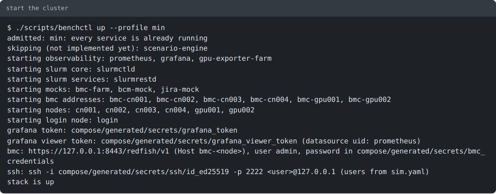
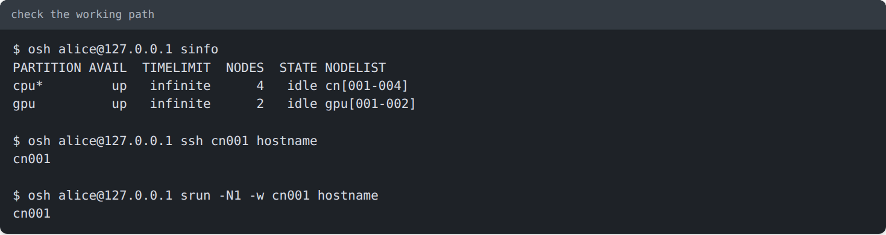
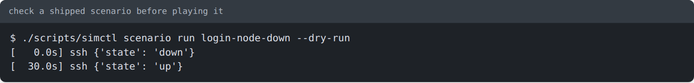
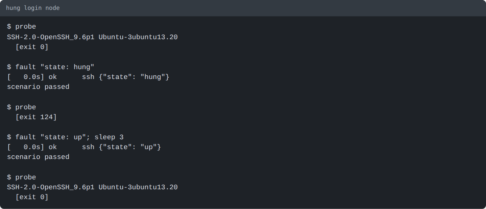
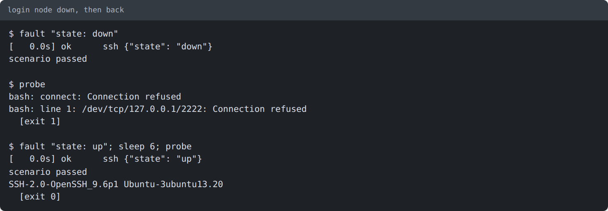
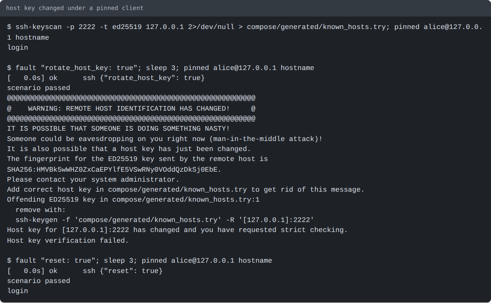
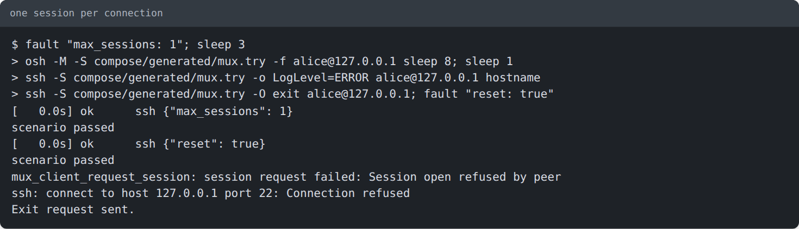
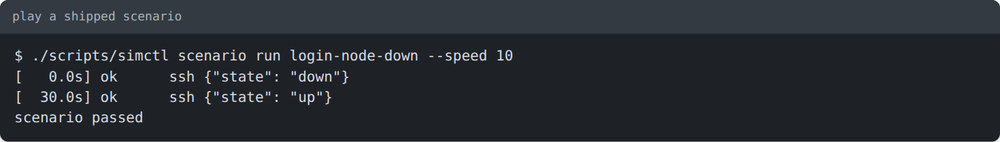

# Testing SSH connections step by step

A walkthrough for checking how a desktop HPC monitoring client handles SSH: reaching the login node, running Slurm on
a node through it, and what the client shows when the connection misbehaves. Every screenshot is the real output of
the command above it (made with `scripts/term_shot.py`). For the list of endpoints see
[client-testing.md](client-testing.md); for the design see [ADR 0011](../adr/0011-ssh-login-node.md) (login node) and
[ADR 0014](../adr/0014-sshd-on-compute-nodes.md) (sshd on the nodes).

You need: the repository set up as in [getting-started.md](getting-started.md), and about 1 GB of free memory.

## 1. Start the cluster

```bash
./scripts/simctl up --profile min
```



The `ssh:` line is what you give your client: host `127.0.0.1`, port `2222`, user `alice` (or `bob`), and the private
key `compose/generated/secrets/ssh/id_ed25519`. If `up` says it is **REFUSED**, the host is short of memory: close
something and run it again.

## 2. Make the commands short

The next steps use three small shell functions. Paste them into your terminal once (they last until you close it):

```bash
osh() { ssh -i compose/generated/secrets/ssh/id_ed25519 -p 2222 -o IdentitiesOnly=yes \
        -o StrictHostKeyChecking=no -o UserKnownHostsFile=/dev/null -o LogLevel=ERROR -o BatchMode=yes \
        -o ConnectTimeout=5 "$@"; }
probe() { timeout 3 bash -c 'head -n1 </dev/tcp/127.0.0.1/2222' 2>&1; echo "  [exit $?]"; }
fault() { printf 'name: ssh-try\ndescription: one SSH fault\nsteps:\n  - {at: 0s, target: ssh, do: {%s}}\n' "$1" \
          > scenarios/ssh-try.yaml; ./scripts/simctl scenario run ssh-try; }
```

- `osh` is `ssh` with the lab key and no host-key prompt (your client decides that for itself).
- `probe` does what a client's reachability check does: connect and read the first line the server sends.
- `fault "<do body>"` writes a one-step scenario and plays it; it is how you break and mend one thing at a time.

## 3. Check the working path

```bash
osh alice@127.0.0.1 sinfo                      # Slurm over SSH
osh alice@127.0.0.1 ssh cn001 hostname         # the login node hops to a compute node
osh alice@127.0.0.1 srun -N1 -w cn001 hostname # Slurm runs a command on the node
```



Now point your client at the same host, port, user and key. If it has an execution-target setting for Slurm, set it to
`cn001`: the client then runs `ssh cn001 <command>` from the login node, with no keys to set up. Confirm that its node
list and jobs view fill in before you break anything.

## 4. See what is shipped

Four scenarios ship for the SSH path (see [scenarios](../manual/06-scenarios.md)); check one before playing it:

```bash
./scripts/simctl scenario run login-node-down --dry-run
```



| Scenario | What happens |
|---|---|
| `login-node-down` | connections are refused for 30 s, then the login node returns with the same host key |
| `login-node-hung` | connections hang with no refusal for 30 s |
| `ssh-host-key-changed` | a different host key for 60 s |
| `ssh-session-limit` | one session per connection for 60 s |

SSH steps need the host terminal; the web page skips them. To watch your client between steps, break and mend one
thing by hand as below. The `do:` keys are `state: down|hung|up`, `rotate_host_key: true`, `max_sessions: N` and
`reset: true` (undoes the key, the session limit, a hang and a stop).

## 5. Break one thing at a time

After each fault, look at your client, then undo the fault.

### The login node hangs (a timeout)

```bash
probe
fault "state: hung"
probe
fault "state: up"
probe
```



While hung, the port accepts the connection but no `SSH-` banner arrives. Your client should report a timeout, not a
refusal, and recover after `state: up`. Waiting longer before `state: up` gives you a slow banner.

### The login node is down (refused)

```bash
fault "state: down"
probe
fault "state: up"; sleep 6; probe
```



Your client should report the endpoint as refused, and reconnect on its own after `state: up`. Open sessions end when
the login node stops.

### The host key changes

```bash
ssh-keyscan -p 2222 -t ed25519 127.0.0.1 > compose/generated/known_hosts.try 2>/dev/null
pinned() { ssh -i compose/generated/secrets/ssh/id_ed25519 -p 2222 -o IdentitiesOnly=yes -o BatchMode=yes \
           -o StrictHostKeyChecking=yes -o UserKnownHostsFile=compose/generated/known_hosts.try "$@"; }
pinned alice@127.0.0.1 hostname
fault "rotate_host_key: true"; sleep 3; pinned alice@127.0.0.1 hostname
fault "reset: true"; sleep 3; pinned alice@127.0.0.1 hostname
```



`pinned` stands in for a client that saved the host key on first use. After the rotation it must refuse; your client
should block the connection and warn about the changed key rather than reconnect quietly. `reset: true` puts the
original key back, so the saved one is valid again.

### One session per connection

```bash
fault "max_sessions: 1"; sleep 3
osh -M -S compose/generated/mux.try -f alice@127.0.0.1 sleep 8       # the first session stays open
ssh -S compose/generated/mux.try alice@127.0.0.1 hostname            # a second one on the same connection
ssh -S compose/generated/mux.try -O exit alice@127.0.0.1; fault "reset: true"
```



Run the three commands together (the shared connection ends with the first session). The second line of output is ssh
trying a new direct connection after the shared one refused it; ignore it. A client that opens several channels on one SSH connection (one for `squeue`, one for `sinfo`, a terminal) is refused the
extra ones. Your client should queue or retry them, not fail the whole connection.

## 6. Play a shipped scenario

```bash
./scripts/simctl scenario run login-node-down --speed 10
```



At `--speed 10` the outage lasts 3 seconds; leave the flag off (30 s) while watching a client.

## 7. Clean up

```bash
rm -f scenarios/ssh-try.yaml compose/generated/known_hosts.try compose/generated/mux.try
fault "reset: true"          # only if you stopped halfway; this also starts a stopped login node
./scripts/simctl down
```

## If something does not match

| You see | Why | What to do |
|---|---|---|
| `up` says REFUSED | the host is short of memory (governor) | free RAM, run `./scripts/simctl status`, rerun |
| `Connection refused` on port 2222 right after `up` | the login node is still starting | wait a few seconds; `./scripts/simctl status` |
| `fault` says failed, "No such container" | the stack is down | `./scripts/simctl up --profile min` |
| the connection hangs or is refused with no fault applied | an earlier `state: hung` or `down` is still active | `fault "reset: true"` |
| `Permission denied` or a host-key warning with no fault applied | an earlier `rotate_host_key` is still active | `fault "reset: true"` |
| a second session is refused with no fault applied | an earlier `max_sessions` is still active | `fault "reset: true"` |
