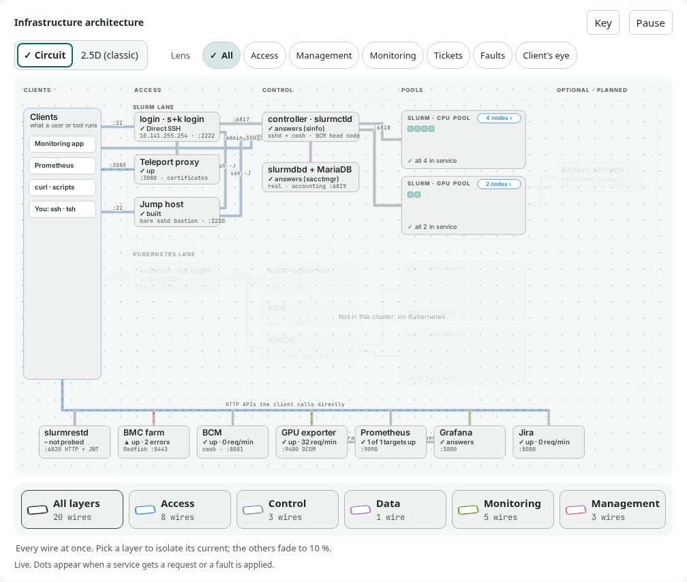
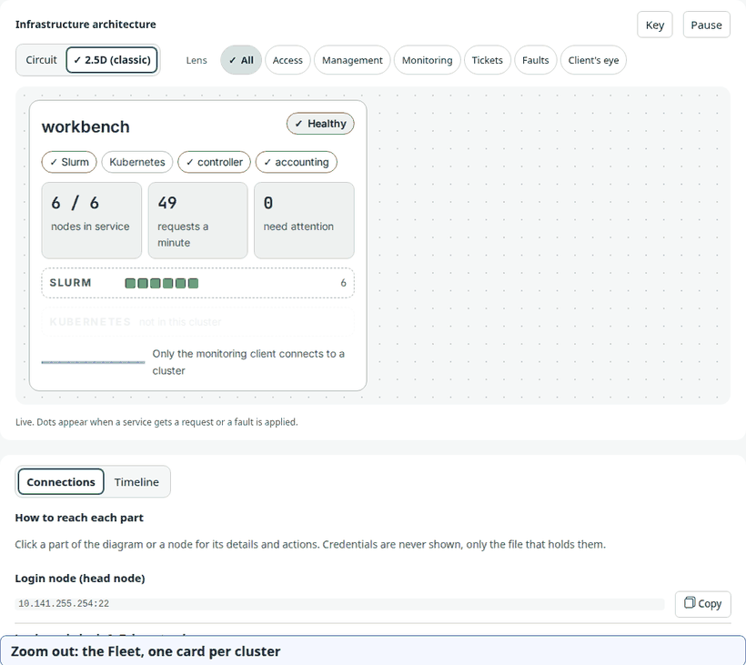
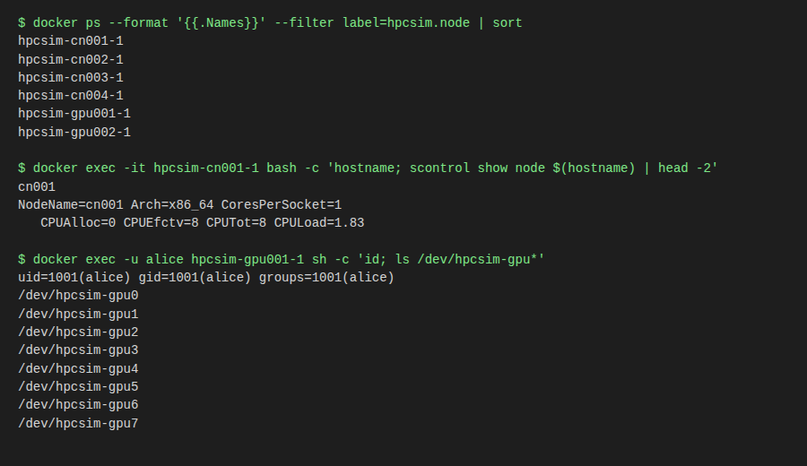
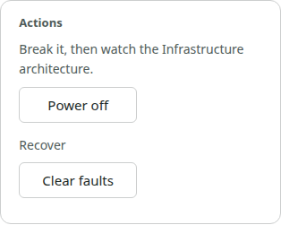
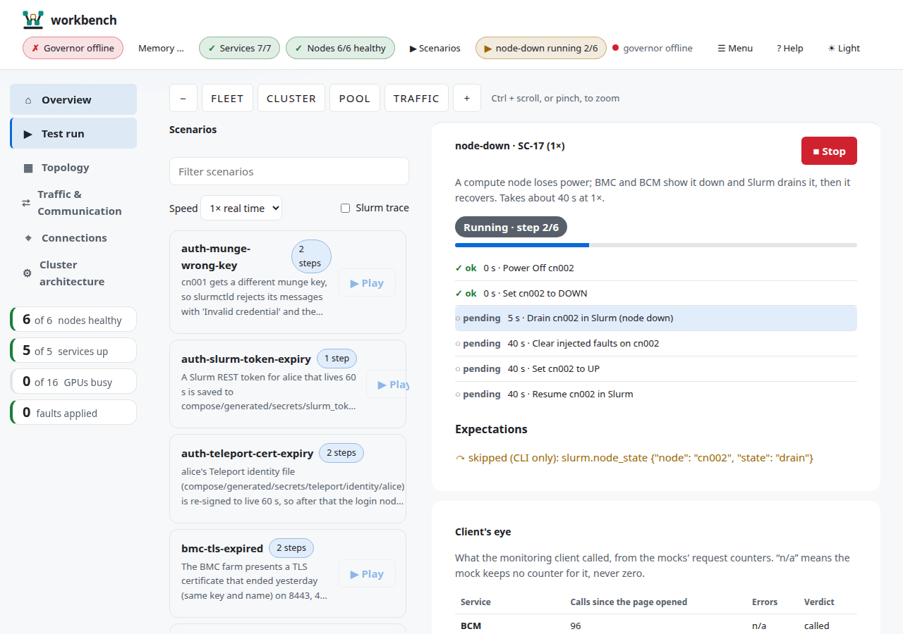

<p align="center"></p>

# The Tour

**In 30 seconds:** eight stops, about five minutes, one picture each. You see what workbench fakes, start it, look at it, open a shell on a node, meet the governor, break a node and watch it come back. Every stop links to the chapter that goes deeper.

## Do it

### 1. The idea

Most of what a monitoring app talks to is an API, not a machine. workbench fakes the APIs, runs real Slurm in small containers, and keeps a governor outside everything.


*Deeper: [What workbench is](01-what-it-is.md).*

### 2. Start it

```bash
./scripts/benchctl start          # checks your machine, builds, starts, prints a link
```

The first run builds images, so it takes a while. Nothing here needs `sudo`.

*Deeper: [Install and start](02-install-and-start.md).*

### 3. Look at the page

Open the link `start` printed. The circuit is the default view: every way into the cluster is a labelled line, dots are requests and the colour of a line says which plane it belongs to.



*Deeper: [The web page](05-web-page.md).*

### 4. Zoom and layers

Zoom out to the Fleet (one card per cluster), in to the Cluster, in to a Pool (one card per node). Layers show one plane at a time: Access, Management or Monitoring.



*Deeper: [The web page](05-web-page.md).*

### 5. A shell on a node

```bash
./scripts/benchctl get nodes                 # who is alive
./scripts/benchctl describe node gpu001      # everything about one node
./scripts/benchctl exec gpu001 -u alice      # a shell on it, tab completion included
```



*Deeper: [Nodes and shells](04-nodes-and-shells.md).*

### 6. The governor

The governor runs on your machine, outside the cluster. When free memory shrinks it pauses, then stops, the least important containers first, so the laptop keeps working. `./scripts/benchctl plan` tells you what a cluster will cost before you start it.


*Deeper: [The governor](07-governor.md).*

### 7. Break something

```bash
./scripts/benchctl scenario run node-down      # a compute node loses power
```

Or in the page: click a node, press **Power off** under *Actions*.



*Deeper: [Scenarios and faults](06-scenarios.md).*

### 8. Watch it heal

The `node-down` scenario powers `cn002` off, marks it down in the BMC and BCM mocks, drains it in Slurm after 5 seconds, then powers it on and resumes it at 40 seconds. In the page the node turns grey, then comes back. If you broke something by hand, **Clear faults** undoes it.



*Deeper: [Troubleshooting](09-troubleshooting.md) if it does not come back.*

## What you will see

The pictures above are from sample data, so yours will differ in the numbers and match in the shapes.

## Under the hood

> [!HOOD]
> `benchctl start` is one launcher over the same `up` that builds and starts the compose project, and the web page only ever talks to the governor's socket, never to Docker. A scenario is a YAML timeline of steps against targets (`bmc-farm`, `bcm-mock`, `slurm`), so one name runs the same faults every time.

Source: `scripts/benchctl-launch`, `benchctl/stack.py`, `scenarios/node-down.yaml`, SPEC W-3, ADR 0006, ADR 0010.

## Learn more

[User manual](README.md) · [Getting started](../guides/getting-started.md) · [Which command do I use?](11-which-command.md)
