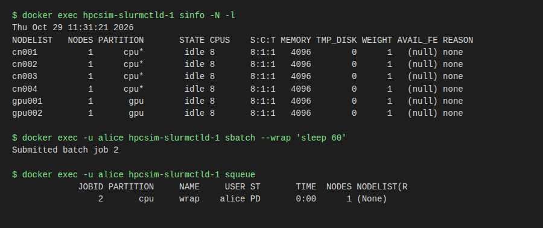

# 3. Using the cluster

## Start, resize, stop

```bash
./scripts/benchctl up --profile min      # pre-flight, governor admission, ordered start
./scripts/benchctl scale 8               # compute nodes: slurm.conf regenerated, slurmd started or stopped
./scripts/benchctl down                  # stop and remove the hpcsim project
```

`up` and `scale` ask the governor first and are **refused from level L2 up** (memory pressure); the message says why.
That is the design, not a fault: free memory and retry. `scale` keeps the profile `up` last started unless you add
`--profile`. Components that are not built yet are skipped with a note.

## Slurm

The nodes have Slurm's commands on the `PATH`. Run them on the controller:

```bash
docker exec hpcsim-slurmctld-1 sinfo
docker exec hpcsim-slurmctld-1 squeue
docker exec -u alice hpcsim-slurmctld-1 sbatch --wrap "sleep 60"     # submit as a simulated user
docker exec hpcsim-slurmctld-1 scontrol show node cn001
```

Jobs are synthetic; GPUs are count-based GRES (`gpu:h200:8` per GPU node, fake device files). Partitions are `cpu` and `gpu`.

GPU metrics follow the scheduler: the GPUs a running job holds (for example `sbatch --gres=gpu:2 -p gpu ...`) read busy in Grafana (utilization 70-100%, high memory and power), every other GPU reads idle, and they go idle again when the job ends. The change shows within about 20 seconds (a 3 s feed plus Prometheus's 15 s scrape).


*Real output from the `min` profile: six idle nodes, a job submitted as `alice`, and the queue.*

For an interactive session see [chapter 4](04-nodes-and-shells.md).

**Slurm REST** goes through `slurmrestd` with a JWT, not root:

```bash
docker exec hpcsim-slurmctld-1 scontrol token username=alice     # prints SLURM_JWT=...
```

Details and the accounting setup: [ADR 0003](../adr/0003-slurmrestd-jwt-and-accounting.md).

## The mock services

| Service | Try it |
|---|---|
| Fake BMCs (Redfish) | `curl http://127.0.0.1:8000/cn001/redfish/v1/Systems/1` |
| Fake BCM (CMDaemon JSON) | `curl -X POST http://127.0.0.1:8081/json -d '{"service": "cmdevice", "call": "getDevices"}'` |
| Fake Jira | `curl -X POST http://127.0.0.1:8080/rest/api/2/issue -d '{"fields": {"project": {"key": "OPS"}, "summary": "hi"}}'` |
| Jira failures | `curl -X POST http://127.0.0.1:8080/sim/failure -d '{"mode": "429", "count": 3}'`; clear with `{"mode": null}` |
| GPU metrics | `curl http://127.0.0.1:9400/metrics` |

What each mock implements, and what it does not, is in [ADR 0005](../adr/0005-bcm-and-jira-mock-surface.md). Each mock
also counts client requests at `GET /sim/stats`, which feeds the traffic dots on the web page.

## Fault injection by hand

```bash
curl -X POST http://127.0.0.1:8000/sim/inject -d '{"node": "gpu001", "temp": 95, "fan_fail": 2}'
curl http://127.0.0.1:8000/gpu001/redfish/v1/Chassis/1/Thermal
curl -X POST http://127.0.0.1:8000/sim/inject -d '{"node": "gpu001", "clear": true}'
```

Timed, repeatable faults are [scenarios](06-scenarios.md).

## Observability

- **Grafana** http://127.0.0.1:3000, user `admin`, password `admin` (a closed local lab). Dashboards are
  file-provisioned; the governor posts an annotation for every action it takes.
- **Prometheus** http://127.0.0.1:9090, about two days of retention. The `governor` job scrapes the governor's
  `/metrics` (`hpcsim_governor_level`, `hpcsim_host_mem_available_bytes`, and more).

## Progress and diagrams

`docs/progress.html` (open the file in a browser) and [PROGRESS.md](../PROGRESS.md) show what is built and how the parts connect.
