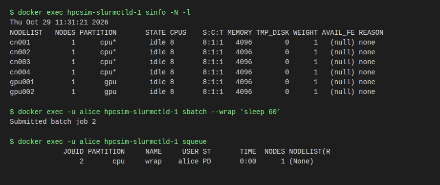

<p align="center"></p>

# 3. Using the cluster

**In 30 seconds:** start, resize and stop the cluster, run Slurm commands, try the mock services, inject a fault by hand and open Grafana. Each is a copy-paste command below.

## Do it

The cluster is already up if you ran `./scripts/benchctl start`. Everything below runs from the repository root.

## Start, resize, stop

```bash
./scripts/benchctl up --profile min      # pre-flight, governor admission, ordered start
./scripts/benchctl scale 8               # compute nodes: slurm.conf regenerated, slurmd started or stopped
./scripts/benchctl down                  # stop and remove the workbench project
```

`up` and `scale` ask the governor first and are **refused from level L2 up** (memory pressure); the message says why.
That is the design, not a fault: free memory and retry. `scale` keeps the profile `up` last started unless you add
`--profile`. Components that are not built yet are skipped with a note.

## Slurm

The nodes have Slurm's commands on the `PATH`. Run them on the controller:

```bash
docker exec workbench-slurmctld-1 sinfo
docker exec workbench-slurmctld-1 squeue
docker exec -u alice workbench-slurmctld-1 sbatch --wrap "sleep 60"     # submit as a simulated user
docker exec workbench-slurmctld-1 scontrol show node cn001
```

Jobs are synthetic; GPUs are count-based GRES (`gpu:h200:8` per GPU node, fake device files). Partitions are `cpu` and `gpu`.

GPU metrics follow the scheduler: the GPUs a running job holds (for example `sbatch --gres=gpu:2 -p gpu ...`) read busy in Grafana (utilization 70-100%, high memory and power), every other GPU reads idle, and they go idle again when the job ends. The change shows within about 20 seconds (a 3 s feed plus Prometheus's 15 s scrape).


*Real output from the `min` profile: six idle nodes, a job submitted as `alice`, and the queue.*

For an interactive session see [chapter 4](04-nodes-and-shells.md).

**Slurm REST** goes through `slurmrestd` with a JWT, not root:

```bash
docker exec workbench-slurmctld-1 scontrol token username=alice     # prints SLURM_JWT=...
```

Details and the accounting setup: [ADR 0003](../adr/0003-slurmrestd-jwt-and-accounting.md).

## The mock services

| Service | Try it |
|---|---|
| Fake BMCs (Redfish) | `curl http://127.0.0.1:8000/cn001/redfish/v1/Systems/1` |
| Fake BCM (CMDaemon JSON) | `curl -X POST http://127.0.0.1:8081/json -d '{"service": "cmdevice", "call": "getDevices"}'` |
| Fake Jira | `curl -X POST http://127.0.0.1:8080/rest/api/2/issue -d '{"fields": {"project": {"key": "OPS"}, "summary": "hi"}}'` |
| Jira failures | `curl -X POST http://127.0.0.1:8080/sim/failure -d '{"mode": "429", "count": 3}'`; clear with `{"mode": null}` |
| GPU metrics | `curl http://127.0.0.1:9400/metrics` |

What each mock implements, and what it does not, is in [ADR 0005](../adr/0005-bcm-and-jira-mock-surface.md). Each mock
also counts client requests at `GET /sim/stats`, which feeds the dots in the page's Infrastructure architecture.

## Fault injection by hand

```bash
curl -X POST http://127.0.0.1:8000/sim/inject -d '{"node": "gpu001", "temp": 95, "fan_fail": 2}'
curl http://127.0.0.1:8000/gpu001/redfish/v1/Chassis/1/Thermal
curl -X POST http://127.0.0.1:8000/sim/inject -d '{"node": "gpu001", "clear": true}'
```

Timed, repeatable faults are [scenarios](06-scenarios.md).

## Observability

- **Grafana** http://127.0.0.1:3000, user `admin`, password `admin` (a closed local lab). Dashboards are
  file-provisioned; the governor posts an annotation for every action it takes.
- **Prometheus** http://127.0.0.1:9090, about two days of retention. The `governor` job scrapes the governor's
  `/metrics` (`workbench_governor_level`, `workbench_host_mem_available_bytes`, and more).
- **Alertmanager** http://127.0.0.1:9093. Prometheus evaluates six default rules (GPU XID, GPU temperature, an InfiniBand port
  down, a node that stopped publishing, the exporter not answering, Jira errors) and Alertmanager sends each alert to the Jira
  mock, which opens one ticket per alert and comments when it fires again or resolves. Read them with `./scripts/benchctl get alerts`.

## Progress and diagrams

`docs/progress.html` (open the file in a browser) and [PROGRESS.md](../PROGRESS.md) show what is built and how the parts connect.

## What you will see

The terminal block above shows `sinfo` listing six idle nodes. In Grafana the GPU dashboards follow the jobs you submit.

## Under the hood

`benchctl up` turns `sim.yaml` and a profile into one generated compose file and never reads anything you edited in it. Containers get fixed private addresses (compute nodes `10.141.0.N`, GPU nodes `10.141.100.N`, the login node `10.141.255.254`), so a node keeps its address between starts.

A job goes from `sbatch` to `slurmctld`, which schedules it on a node's `slurmd` container. The nodes are real Slurm daemons; the job itself is synthetic.

> [!HOOD]
> `up` and `scale` ask the governor first, so they are refused from level L2 up. That is the design: free memory and retry.

Source: `benchctl/compose.py`, `benchctl/addressing.py`, `benchctl/stack.py`, ADR 0018, ADR 0025.

## Tips and gotchas

> [!TIP]
> `./scripts/benchctl scale 8` keeps the profile `up` last started; add `--profile` to change it.

> [!WARNING]
> Never edit `compose/generated/`: the next `up` overwrites it. Change `sim.yaml` or a profile instead ([chapter 8](08-configuration.md)).

## If it goes wrong

| You see | Why | Do this |
|---|---|---|
| `up` or `scale` refused | the governor is at level L2 or higher | free memory and retry |
| a component is skipped with a note | it is not built yet | see [PROGRESS.md](../PROGRESS.md) |

## Learn more

[Nodes and shells](04-nodes-and-shells.md) · [Scenarios and faults](06-scenarios.md) · [Web page](05-web-page.md) · [ADR 0005](../adr/0005-bcm-and-jira-mock-surface.md)
