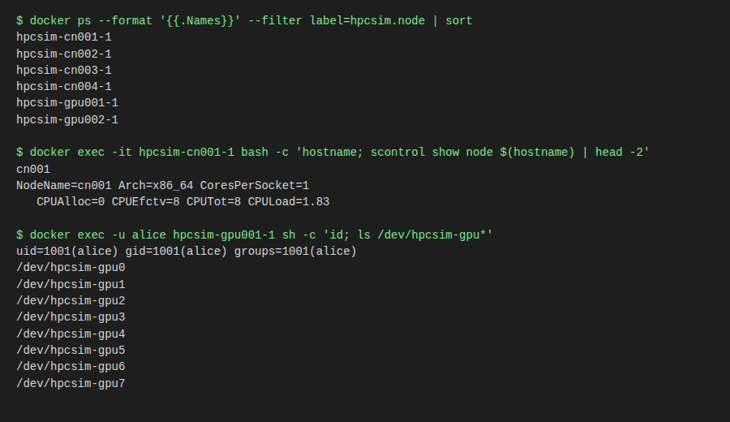

# 4. Nodes and shells

**There is no `ssh` into a simulated node.** The nodes are unprivileged containers without an SSH server. You open a shell
with `docker exec`. The only machine with a real `sshd` is the optional [fidelity VM](#the-fidelity-vm).

## Find the nodes

Node names come from [sim.yaml](../../sim.yaml): compute nodes `cn001`, `cn002`, ... and GPU nodes `gpu001`, `gpu002`, ...
Each container is named `hpcsim-<name>-1`.

```bash
docker ps --format '{{.Names}}' --filter label=hpcsim.class      # every opti-sim container
docker ps --format '{{.Names}}' --filter label=hpcsim.node       # only compute and GPU nodes
docker exec hpcsim-slurmctld-1 sinfo -N -l                       # Slurm's view of the nodes
```



*Real output from the `min` profile: the six node containers, a command run inside `cn001`, and the simulated user `alice` on `gpu001` with its eight fake GPU device files.*

## Open a shell

```bash
docker exec -it hpcsim-slurmctld-1 bash        # the controller
docker exec -it hpcsim-cn001-1 bash            # a compute node
docker exec -it hpcsim-gpu001-1 bash           # a GPU node (fake GPU device files /dev/hpcsim-gpu0..7)
docker exec -u alice -it hpcsim-cn001-1 bash   # the same node as a simulated user
docker exec hpcsim-cn001-1 hostname            # one command, no shell
```

The shell starts as root *inside the container*; that is not root on your host. Simulated users (`alice`, `bob`, from
`sim.yaml`) exist with the same UID on the controller and every node. Exit with `exit` or Ctrl-D.

The simulated users' login shell is `bash`, so a terminal session (a client's terminal, `ssh -p 2222 alice@127.0.0.1`, or
`docker exec -u alice -it ... bash`) has Tab completion for commands, paths and Slurm tools (`squeue`, `sbatch`, `scontrol`...),
the up arrow and Ctrl-R for history, and a `user@node:dir$` prompt. Commands a client runs without a terminal are unaffected.

Useful things to run inside:

```bash
scontrol show node $(hostname)     # this node as Slurm sees it
sbatch --wrap "sleep 60"           # from the controller, as a user: docker exec -u alice ...
ls /dev/hpcsim-gpu*                # the fake GPUs (GPU nodes only)
```

## Limits to know

- **Nodes can freeze or stop under memory pressure.** The governor pauses (L3) then stops (L4) low-priority containers,
  compute nodes among the first (class P4). A shell that hangs may be a paused container: check
  `./scripts/simctl status`. Un-pausing happens by itself after 60 s calm, and a stopped node comes back with the
  governor's `start` command or `simctl up`.
- Nodes are small: each is capped at 60 MB and runs `slurmd` and `munge`, not a full set of system services.
- Scaling down (`simctl scale 2`) removes nodes, and a shell open on one ends.
- Nodes run `sshd`, reachable only through the login node (`ssh cn001` there, ADR 0014). There is no real NFS or Lustre; storage is faked with metrics only.
- Do not add `--privileged`, extra capabilities or the Docker socket to a container; `simctl doctor` fails the stack if
  you do, and the governor's watchdog flags it.

## The fidelity VM

One real Ubuntu VM (libvirt/KVM, 2 vCPU, hard cap 2 GB), for what containers cannot prove: real kernel counters, systemd,
`sshd`, real `node_exporter`. It is on demand and is class P6, the first thing the governor saves under pressure.
It needs `vagrant` with the `vagrant-libvirt` plugin.

```bash
cd fidelity-vm
./bin/up.sh                        # memory pre-check, then vagrant up (retries); prints the VM's IP and key path
vagrant ssh fidelity               # a shell, from inside fidelity-vm/
ssh -i .vagrant/machines/fidelity/libvirt/private_key vagrant@<IP>      # plain ssh with the printed IP
./bin/down.sh                      # destroy it
```

## Not built: SSH or Teleport to the simulated nodes

The application under test is meant to reach nodes through Teleport (issue #77). That needs decisions that are still
open (which access types, real Teleport or a mock) and an `sshd` in the node image. Until then, `docker exec` from the
host is the way to reach a node; the application under test reaches the cluster through Slurm REST, Redfish and the
other APIs in [chapter 3](03-using-the-cluster.md).
