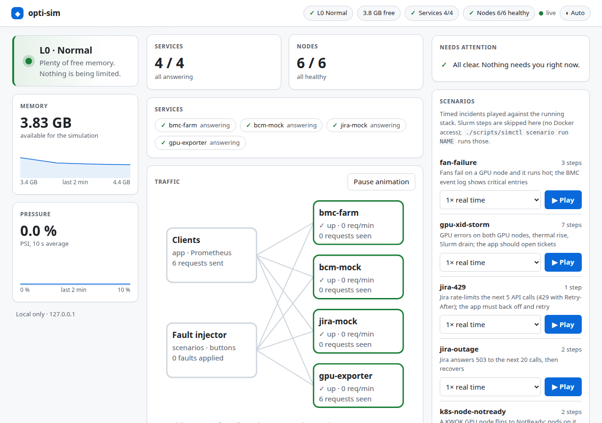
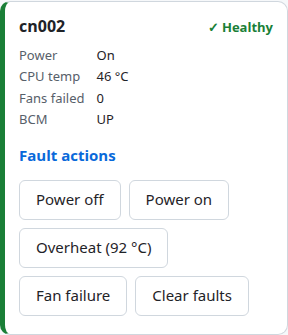
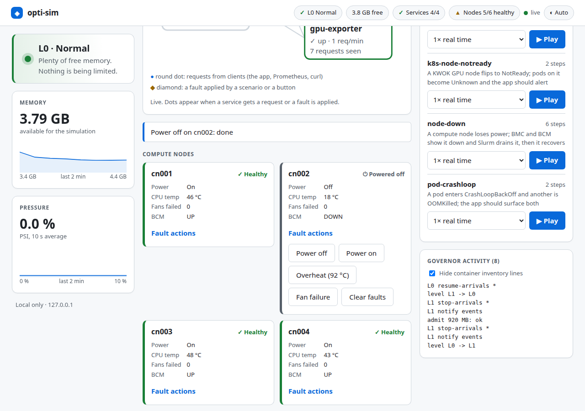
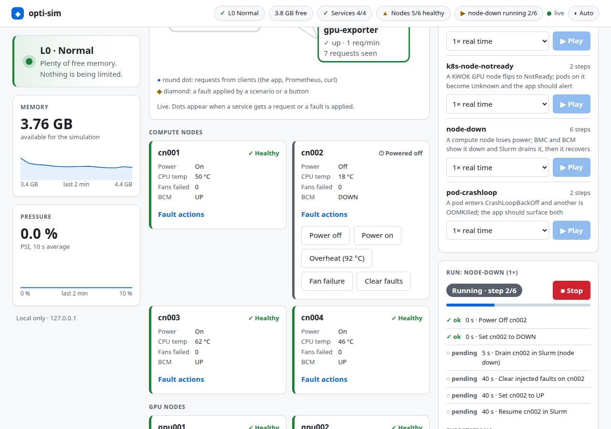
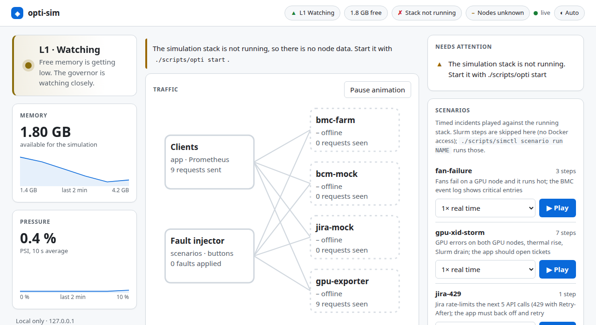
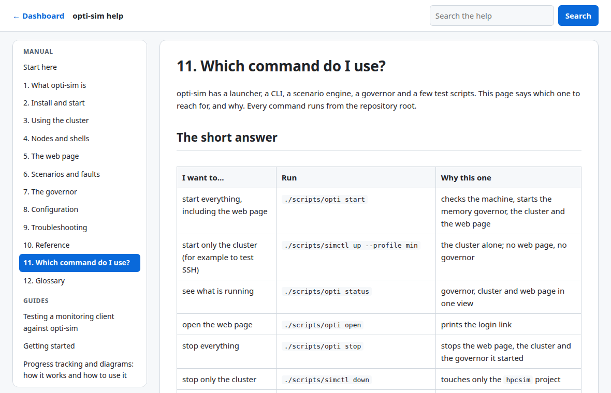

# 5. The web page

One dashboard over everything: governor, cluster, scenarios.

```bash
./scripts/benchctl start                     # starts it with the cluster; or by hand:
.venv/bin/python -m webui [port]         # default 127.0.0.1:8088; prints http://127.0.0.1:8088/login?token=...
./scripts/benchctl open                      # print the login link again
```

Open the link once: it sets a cookie. The token lives in `compose/generated/secrets/ui_token`; anyone with the link on
this machine can use the page, so keep it private. The page listens on `127.0.0.1` only.



*The dashboard with a healthy cluster: L0 Normal, 4 of 4 services answering, 6 of 6 nodes healthy, "All clear" under Needs attention.*

## Layout

| Area | Shows |
|---|---|
| **Top strip** | governor level, free memory, healthy services and nodes, the running scenario, then three buttons that open a panel on the same page: **▶ Scenarios**, **⚙ Plan** and the level or memory chip for the **Governor** panel (level and meaning, memory and pressure trends, the governor's log), plus help and the theme switch |
| **Needs attention** | one slim bar under the tabs, next to *Nodes* and *Connections*: every item that needs you, or "All clear" |
| **Stage** | the traffic diagram on the left and a plain list on the right: *Compute nodes*, *GPU nodes* and *Services*, one card per line with its status and quick facts (GPU nodes: utilisation meter, busy GPUs, temperature, BCM state; compute nodes: temperature and BCM state; services: requests per minute and total seen). Healthy cards are quiet; warning, fault and off cards are highlighted. Slurm node states and CPU load are not shown here (the page has no Docker access); use `benchctl describe node`. Both fit one screen at 1280 × 800 with six nodes; a long tree scrolls inside its own panel |

On a phone the panels stack (see the [phone view](img/web-phone.png)). The page has a skip link and landmarks, and honours reduced motion.

## Traffic diagram

The **Traffic** panel sits with the nodes on the **Nodes** tab (above them on a normal screen, beside them on a wide
one). It draws the *Clients* (monitoring app, Prometheus, curl), the *Faults* box (scenarios and buttons) and the
*Cluster*: the four mock services and **every node as a tile** with its state (✓ healthy, ▲ warning, ✗ fault, ⏻ off,
? unknown). A round dot travels from the clients to a service for each real request; a diamond travels from *Faults*
to the **node it hits** and a ring flashes on that tile. Lines light up while a service is being used, and each
service shows requests per minute. *Pause animation* stops the dots. They stop by themselves at governor L3 and under
reduced motion, and the live feed runs only while the page is visible and the Nodes tab is open.

## Node cells and fault actions

Click a node cell to open its details, which hold the *Fault actions*:  **Power off**, **Power on**, **Overheat (92 °C)**, **Fan failure**, **GPU error
(XID 79)** (GPU nodes only) or **Clear faults**. The card changes state and a diamond shows the injection. Nothing here
opens a shell on a node; use [`docker exec`](04-nodes-and-shells.md).



*The fault actions (screenshot from before the node cells; they are now in the details dialog).*

The same dialog shows everything known about that node (state of its BMC, GPUs busy and idle, how to `ssh` in): the same text as `benchctl describe node NAME`, minus the Docker and Slurm lines because this page has no Docker access.

**⚙ Plan** in the top bar opens a panel on the same page. It takes node counts and parts and shows the memory they need against what is free, with the `benchctl up ...` command to build it. Editing only estimates; **Apply to the running workbench** rebuilds it through the governor (the page itself still has no Docker access); see [choose the workbench](../guides/choose-workbench.md).



*After Power off on cn002: the card is marked "Powered off" in words as well as colour, BCM shows DOWN, and the strip counts 5 of 6 nodes healthy. Press Clear faults to undo.*

## Scenarios

Press **▶ Scenarios** in the top strip, pick a scenario and a speed, press **Play**, and watch each step turn ok, skipped or failed. **Stop**
aborts. Steps that need Docker (the `slurm` target: drain and resume) are **skipped on this page**, because the page has no
Docker access by design; run those with `./scripts/benchctl scenario run NAME`.



*A scenario playing (node-down, step 2 of 6). The strip at the top also shows it running; Stop aborts.*

## One message per condition

If the cluster is down the page shows one notice and one *Needs attention* entry, hides data that cannot exist and names
the recovery command, which never needs `sudo`. If the governor is down it says so the same way.



*The cluster is stopped: one notice with the command to start it, services shown offline with dashed outlines, and no node cards. The memory figures are the host's, taken at the time of the screenshot.*

## Help inside the page

**? Help** in the header opens this manual (and the guides, the architecture notes and the decisions) as linked pages at
`/help/`: a sidebar to jump between pages, a search box, and **← Dashboard** to go back. It needs the same login as the
page. Start with [Which command do I use?](11-which-command.md) when the commands are new.



## Tabs, scenarios and how to connect

The middle column has two tabs: **Nodes** (services, traffic and the node cells) and **Connections**. **⚙ Plan** in the top bar opens the plan panel. The right
panel stays in view while you scroll and scrolls on its own, so the nodes never move away. **Scenarios** is a short list:
type in *Filter scenarios*, pick one speed for all, press **▶ Play**.

**Connections** lists every part (login node, nodes, BMC, BCM, Jira, Slurm REST, GPU exporter, Prometheus, Grafana, this page)
with its address, a command you can copy, and the **file that holds its credential**. The page shows paths, never secrets.
A node's details dialog (click its cell) shows its SSH command, key file and BMC login; the container IP needs Docker, so
run `./scripts/benchctl describe node cn001` (it prints an `IP:` line).

## Limits

- The Profile and Budget manager (edit `sim.yaml` in the page) is **not built**; edit the file ([chapter 8](08-configuration.md)).
- Backend memory stays under 50 MB. Starlette and one static page, no framework, no CDN.
- Browser debugging for developers: `.venv/bin/python scripts/ui_shots.py` ([reference](10-reference.md)).
