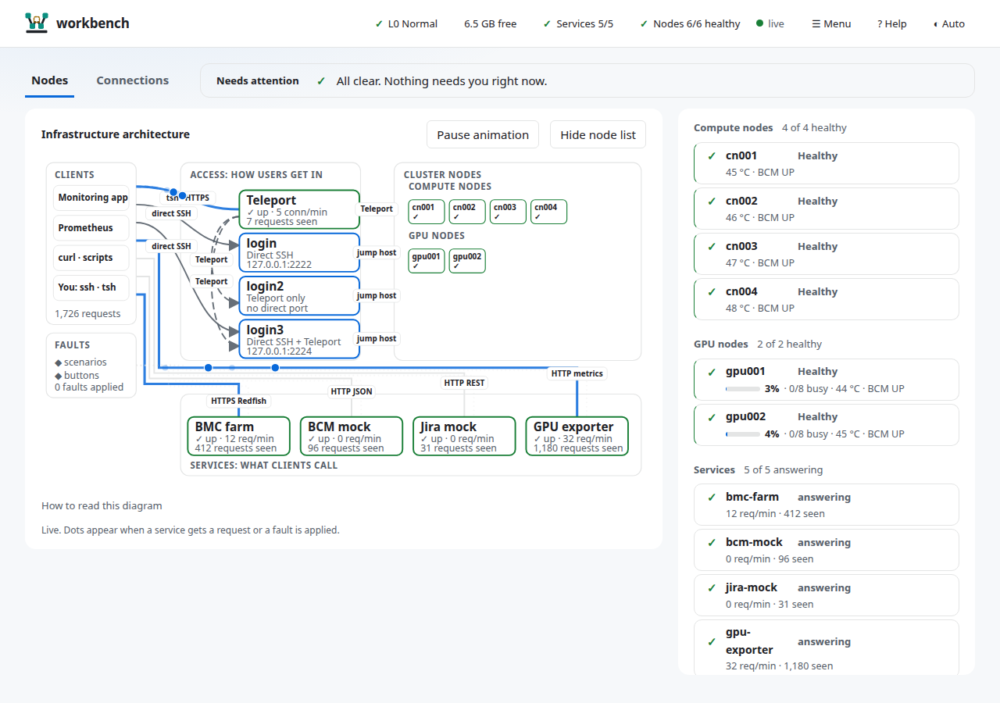
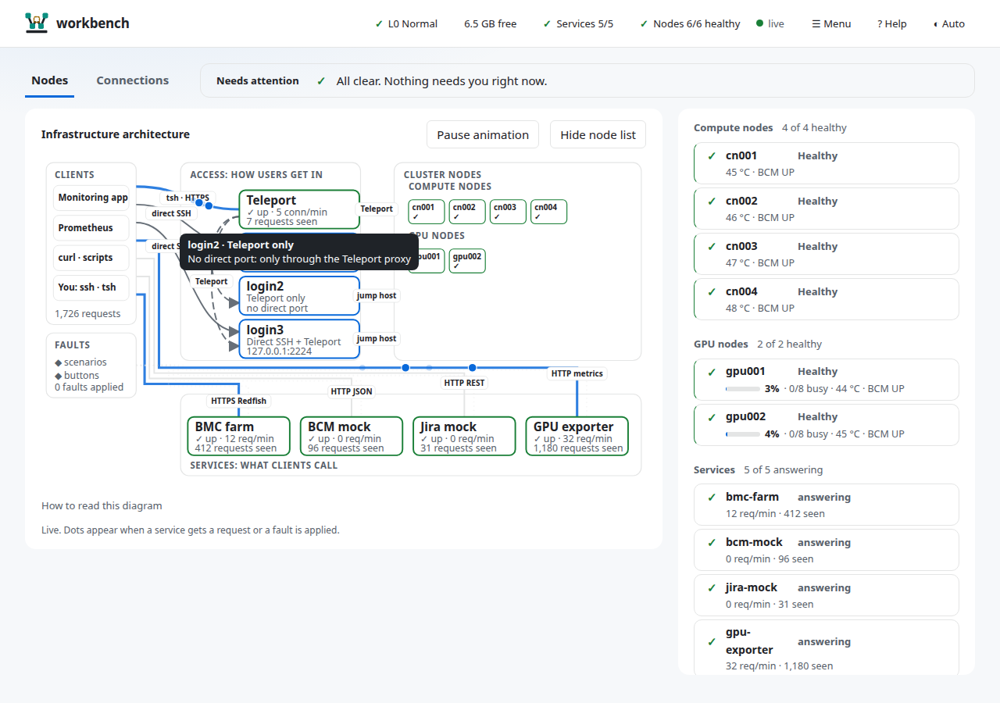
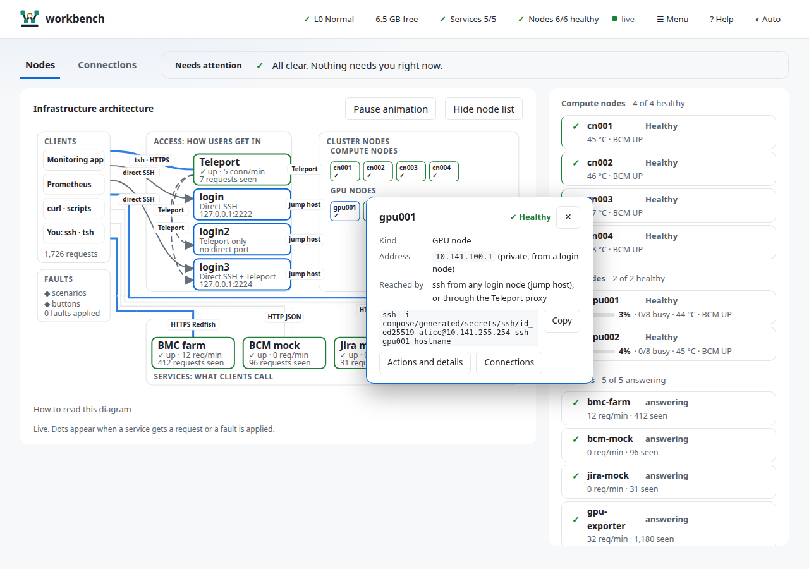
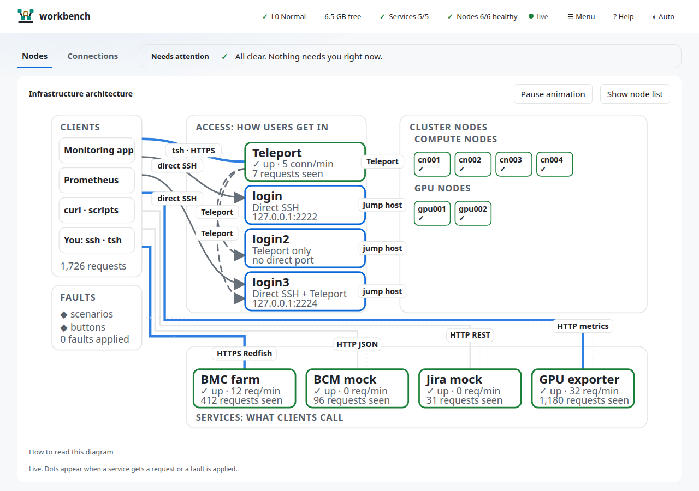
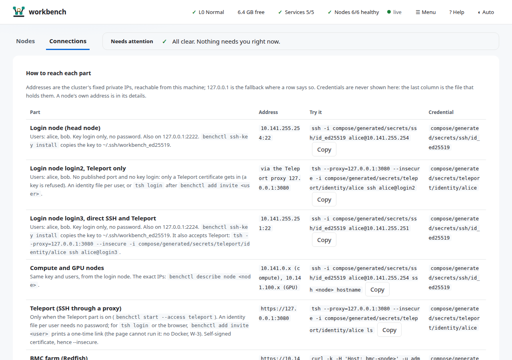
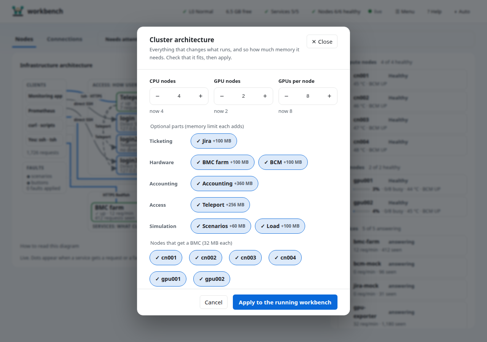

# 5. The web page

One dashboard over everything: governor, cluster, scenarios. It fits one screen (1280 × 800 and up) with no page scrolling.

```bash
./scripts/benchctl start                     # starts it with the cluster; or by hand:
.venv/bin/python -m webui [port]         # default 127.0.0.1:8088; prints http://127.0.0.1:8088/login?token=...
./scripts/benchctl open                      # print the login link again
```

Open the link once: it sets a cookie. The token lives in `compose/generated/secrets/ui_token`; anyone with the link on
this machine can use the page, so keep it private. The page listens on `127.0.0.1` only.



*A healthy cluster with Teleport on: L0 Normal, 5 of 5 services answering, 6 of 6 nodes healthy, "All clear" under Needs attention (sample data; the numbers on your page are live). Some older screenshots further down predate the redesign; `scripts/ui_shots.py` regenerates fresh ones.*

## Layout

| Area | Shows |
|---|---|
| **Top strip** | governor level, free memory, healthy services and nodes, the running scenario; then **☰ Menu**, help and the theme switch. The strip is for status only. **☰ Menu** lists the actions in three groups, each with a one-line hint: *Run* (**▶ Scenarios**), *Configure* (**▦ Cluster architecture**: nodes, GPUs per node, optional parts and the plan; **✚ Health checks**) and *Share* (**⇩ Export**). Esc closes it. Pressing the level or memory chip opens the **Governor** panel |
| **Tabs and Needs attention** | the tabs *Nodes* and *Connections*, and one slim bar next to them with every item that needs you, or "All clear" |
| **Stage** (Nodes tab) | the **Infrastructure architecture** on the left and the **node list** on the right (its three groups, Compute, GPU and Services, stacked one under the other). **Hide node list** folds the list away and gives the diagram the whole width; the choice is remembered |

Three panels open on top of the page from the top strip or its **☰ Menu** and close with **✕ Close**, Esc or a click outside: **Scenarios**,
**Plan** and **Governor**. A node is different: it opens *in place of the list* (below), so the Infrastructure architecture stays in view.

On a phone, and under 1100 px, the Infrastructure architecture and the list stack in one column. The page has a skip link and
landmarks, and honours reduced motion.


## The entity list

A plain list, one card per line, in three groups: *Compute nodes*, *GPU nodes* and *Services*. Each heading counts what
is healthy ("4 of 4 healthy"). A card shows the status in words and an icon (✓ healthy, ▲ warning, ✗ fault, ⏻ off) and
the quick facts:

| Card | Quick facts |
|---|---|
| GPU node | a utilisation meter, the percent, busy GPUs out of total, temperature, BCM state |
| Compute node | temperature, BCM state |
| Service | requests per minute and the total seen |

Healthy cards are quiet; warning, fault and off cards are tinted and bold, so what needs you stands out. Slurm node
states and CPU load are not shown, because the page has no Docker access by design; use `benchctl describe node NAME`.

## Infrastructure architecture

The **Infrastructure architecture** is the main view: everything on it is a part you can point at.


Read it from left to right:

| Box | What it is |
|---|---|
| **Clients** | the monitoring app, Prometheus, curl and scripts, and *You: ssh · tsh* (a terminal) |
| **Faults** | scenarios and buttons; a diamond travels from here to the node it hits |
| **Access: how users get in** | the **login nodes** (one box each, with how it authenticates: *Direct SSH*, *Teleport only* or *Direct SSH + Teleport*) and the **Teleport proxy** when that part is on |
| **Cluster nodes** | every compute and GPU node as a tile with its state |
| **Services: what clients call** | BMC farm, BCM mock, Jira mock, GPU exporter |

Every line says **how** it connects:

| Line | Meaning |
|---|---|
| `direct SSH` (solid, arrow) | a client with the cluster key connects to a login node on its published port (login nodes set to *Direct SSH* or *both*) |
| `Teleport` between the Teleport box and a login node (long dashes) | the login node is reached through the Teleport proxy (*Teleport only* or *both*) |
| `jump host` (short dashes) | from a login node you `ssh` on to the nodes: the login node is the jump host |
| `Teleport` from the Teleport box to the nodes (long dashes) | the nodes are also reachable through the proxy (agentless OpenSSH) |
| `HTTP …` and `tsh · HTTPS` (thin) | an API call from a client to a service, or the `tsh` connection to the proxy |

A round dot travels along a line for each real request; a diamond travels from *Faults* to the node it hits and a ring flashes on that
tile. *Pause animation* stops the dots; they also stop at governor L3 and under reduced motion, and the live feed runs only while
the page is visible and the Nodes tab is open. **How to read this diagram** (under the picture) repeats the legend.

**Hover** a part for a one-line tip (its state and how it is reached). **Click** it (or Tab to it and press Enter) for a pop-up window
next to it with its address, the credential file, a command to copy, and buttons for the details:





Esc closes the pop-up and returns the focus to the part. For a node, **Actions and details** opens its panel (below); **Connections**
opens the row for that part in the Connections tab.

**Fold the list away.** The list beside the diagram is a second way to the same parts. **Hide node list** gives the diagram the
whole width, which is the best view when the diagram is your main way in:



On a phone the diagram scrolls sideways inside its panel and the list sits below it.

**Teleport in the diagram.** The Teleport box and the Teleport lines appear only when the Teleport part is built, and the node list
gets a `teleport` card with it (`answering` or `not answering`). Its rate is **connections per minute**: every `tsh ssh` or web
terminal session makes the proxy connect to a node, and Teleport counts that (`teleport_connect_to_node_attempts_total` on its
diagnostics port, 127.0.0.1:3434). Nothing is invented: with no connections there are no dots. The login nodes come from the saved
workbench (`benchctl start --login ssh,teleport,both`, or the Login nodes rows of the sheet).

## Teleport from the page

Teleport is a part like the others, so you control it from **☰ Menu → ▦ Cluster architecture**:

1. Open **☰ Menu → ▦ Cluster architecture**.
2. Under **Access**, tick **Teleport** (+256 MB). The memory bar shows whether it fits.
3. Press **Apply to the running workbench**, then press it again to confirm.
4. When the apply finishes, the `teleport` card appears in the list and the box in the diagram. Open **Connections**: the
   **Teleport (SSH through a proxy)** row has the address, a copy-ready `tsh` command and the identity file to use.



To turn it off, untick it and apply again. Two things stay in a terminal because the page has no Docker access by design
(SPEC W-3): creating the one-time link for a `tsh login` password and code (`./scripts/benchctl add invite alice`), and the
`tsh` commands themselves. The full walk-through is in [Nodes and shells](04-nodes-and-shells.md#teleport-tsh-to-the-login-node-and-the-nodes).

## A node: actions and info

Click a node card, or a node tile in the diagram and then **Actions and details**. Its panel **replaces the list in place** (it is not a pop-up), so you can watch the Infrastructure architecture
while you act. The panel has two cards and a header with **← All nodes** (Esc does the same), the node's name and its
live state.

- **Actions**: the faults first, **Power off**, **Overheat (92 °C)**, **Fan failure** and **GPU error (XID 79)** (GPU
  nodes only), then **Recover**: **Power on** and **Clear faults**. The result appears under the buttons, the card
  changes state and a diamond shows the injection. Nothing here opens a shell on a node; use
  [`docker exec`](04-nodes-and-shells.md).
- **Info**: how to reach the node (SSH command, key file, BMC login, how to get its IP) and everything known about it
  (BMC state, GPUs busy and idle): the same text as `benchctl describe node NAME`, minus the Docker and Slurm lines
  because this page has no Docker access. The container IP needs Docker, so run `./scripts/benchctl describe node cn001`
  (it prints an `IP:` line).


*The same actions, from before the node panel.*


*After Power off on cn002: the node is marked "Powered off" in words as well as colour, BCM shows DOWN, and the strip counts
5 of 6 nodes healthy. Press Clear faults to undo.*

## Plan: change the workbench



**▦ Cluster architecture** opens a panel with steppers for CPU nodes, GPU nodes and GPUs per node, toggles for the optional parts, grouped by category as in the `--ticketing`, `--hardware` flags (accounting, Jira, BMC, BCM, Teleport, scenarios, load; each shows the memory limit it adds, and the toggles show what is built now), and a
memory bar ("1.7 GB needed of 4.5 GB free"). It shows the change against what runs now ("GPU nodes 2 → 3 (+1)") and the
`benchctl up ...` command for a terminal. Editing the numbers only estimates. **Apply to the running workbench** (press
twice: the second press confirms) asks the governor to rebuild it; new nodes start and nodes you no longer want are
removed. See [choose the workbench](../guides/choose-workbench.md).

**If the sheet says "Could not load the options".** The page and the process behind it are different versions (the page was updated
while an older one kept running). Restart it and reload:

```bash
./scripts/benchctl stop
./scripts/benchctl start
```

## Scenarios

Press **▶ Scenarios**, type in *Filter scenarios* if the list is long, pick a speed (one setting for all), press
**▶ Play**, and watch each step turn ok, skipped or failed. **Stop** aborts. While one runs, the top strip shows it and
pressing that chip reopens the sheet. Steps that need Docker (the `slurm` target: drain and resume) are **skipped on this
page**, because the page has no Docker access by design; run those with `./scripts/benchctl scenario run NAME`.


*A scenario playing (node-down, step 2 of 6). Stop aborts.*

## Governor

Press the level chip (for example **✓ L0 Normal**) or the memory chip. The panel shows the level and what it means, free
memory and pressure with two-minute trends, and the governor's log (*Governor activity*, newest first). If the governor
is offline, or memory is tight (L2 and up), the same is also listed under *Needs attention*.

## Connections

The **Connections** tab lists every part (login node, nodes, BMC, BCM, Jira, Slurm REST, GPU exporter, Prometheus,
Grafana, this page) with its address, a command you can copy, and the **file that holds its credential**. The page shows
paths, never secrets.

## One message per condition

If the cluster is down the page shows one notice and one *Needs attention* entry, hides data that cannot exist (the entity
list) and names the recovery command, which never needs `sudo`. If the governor is down it says so the same way.


*The cluster is stopped: one notice with the command to start it, services shown offline with dashed outlines, and no node
list. The memory figures are the host's, taken at the time of the screenshot.*

## Help inside the page

**? Help** in the header opens this manual (and the guides, the architecture notes and the decisions) as linked pages at
`/help/`: a sidebar to jump between pages, a search box, and **← Dashboard** to go back. It needs the same login as the
page. Start with [Which command do I use?](11-which-command.md) when the commands are new.


## Limits

- The Profile and Budget manager (edit `sim.yaml` in the page) is **not built**; edit the file ([chapter 8](08-configuration.md)).
- Backend memory stays under 50 MB. Starlette and one static page, no framework, no CDN.
- Browser debugging for developers: `.venv/bin/python scripts/ui_shots.py` ([reference](10-reference.md)).

## Health checks: what drains a node

**☰ Menu → Configure → ✚ Health checks** opens the list of checks every node's health check runs, in run order. Drag a block by its handle to
reorder it (the ↑ ↓ buttons do the same from the keyboard), tick it to switch the check on or off, edit a parameter and
leave the field to save it, ✕ removes it. To add one, drag a template (`metric-above`, `metric-below`) into the list or press
it, then name it and fill in its parameters. Each change is checked before it is saved (syntax, parameters, a run on healthy
sample metrics); a refusal shows one line and the list returns to what was saved. Nodes use the change within 30 s, with no
rebuild. The page adds checks from templates only; your own script goes in with `benchctl add check NAME --script FILE`. See
[NHC checks](../guides/nhc-checks.md).

## Export: a profile file for the monitoring client

**☰ Menu → Share → ⇩ Export** downloads `bench-profile.json` for the cluster on disk (the workbench last built, else the
profile `up` started); tick *One BMC target per node* to include the BMC farm. The file never holds secrets, so after a
successful download the sheet lists what to set by hand: the SSH key (`benchctl ssh-key install`), the Grafana token
(`compose/generated/secrets/grafana_viewer_token`), the BMC password if asked for, and that Jira needs no token. It also
warns when Slurm accounting is missing (`sacct` would fail). See [export a profile](../guides/export-profile.md).

**Power off and Slurm.** Power off sets the BMC and BCM state, makes the GPU exporter stop publishing the node (its GPU series vanish from Grafana), and
asks the governor to **freeze the node's container**. Its `slurmd` then stops answering, exactly as on a dead host, and
`slurmctld` notices by itself: `sinfo` shows the node `down*` (reason *Not responding*) after about 30 s (`SlurmdTimeout=15`, `MessageTimeout=5`).
Power on thaws it, and with `ReturnToService=1` Slurm returns it on its own after its next answer. This needs the governor
started with `--workdir` (the launcher does) and level L0-L1; otherwise the page says the node was not frozen and names
`benchctl set node NAME off`. The fault buttons include **InfiniBand port down** and **NIC flapping**; the node card shows them as a warning and the health check drains the node. The node panel also has a **Workload** card: *Run 1 CPU, 5 min* (GPU nodes: 1 GPU or all GPUs, 5 or 30 min) submits a job on that node through the governor (`benchctl submit`), so `squeue` lists it, the node shows allocated and a GPU job shows its GPUs busy. `benchctl set node NAME down|resume` sets the Slurm state by hand instead.

A node set `down` by hand (`benchctl set node NAME down`) stays down until `resume`; one that went down by not answering returns
by itself (`ReturnToService=1`). A cluster built before this setting keeps the old behaviour until its `slurm.conf` is regenerated
and reloaded: `./scripts/benchctl up`, then `./scripts/benchctl exec slurmctld -- scontrol reconfigure`.

**The Infrastructure architecture is clickable.** Every box, tile and chip opens a pop-up with the part's details (see above); its
**Connections** button opens that part's row in the Connections tab. Tab to a shape and press Enter or Space for the same.

**BMCs per node.** In **▦ Cluster architecture**, switching *BMC* on shows the nodes that get a BMC address (all by default). Each
BMC is its own small container with its own address (`10.148.x.y:443`) and costs about 32 MB, shown in the memory bar; switch off
the nodes you do not need. A node panel shows its BMC address, or "none for this node". Apply rebuilds as usual and removes
the BMCs you switched off.
