# 5. The web page

One dashboard over everything: governor, cluster, scenarios. It fits one screen (1280 × 800 and up) with no page scrolling.

```bash
./scripts/benchctl start                     # starts it with the cluster; or by hand:
.venv/bin/python -m webui [port]         # default 127.0.0.1:8088; prints http://127.0.0.1:8088/login?token=...
./scripts/benchctl open                      # print the login link again
```

Open the link once: it sets a cookie. The token lives in `compose/generated/secrets/ui_token`; anyone with the link on
this machine can use the page, so keep it private. The page listens on `127.0.0.1` only.

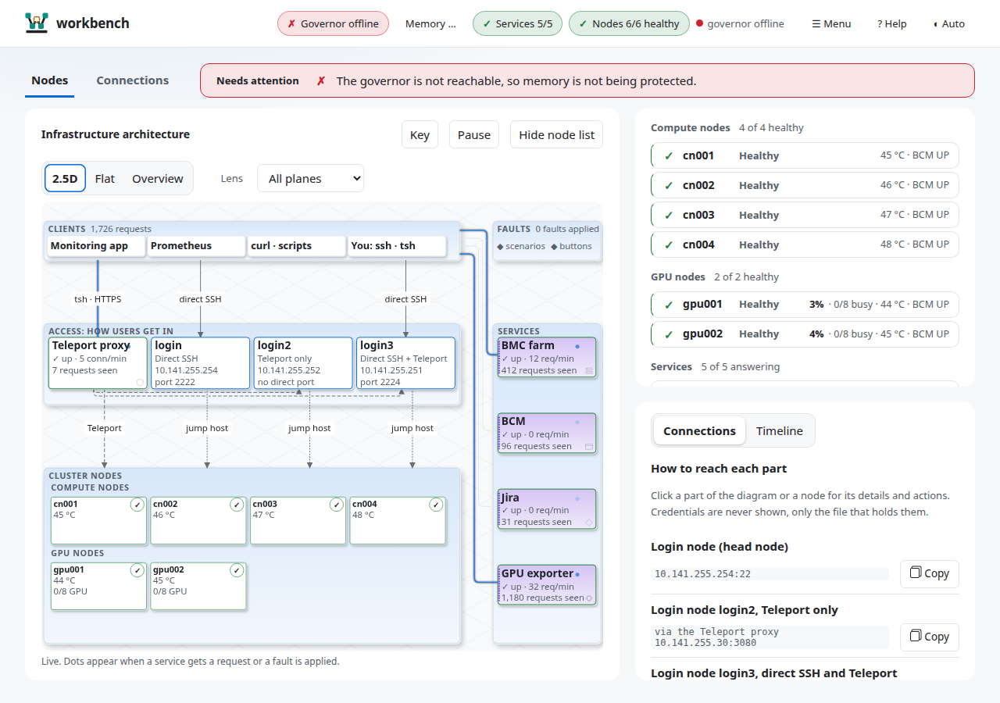

*A healthy cluster with Teleport on: L0 Normal, 5 of 5 services answering, 6 of 6 nodes healthy, "All clear" under Needs attention (sample data; the numbers on your page are live). Some older screenshots further down predate the redesign; `scripts/ui_shots.py` regenerates fresh ones.*

## Layout

| Area | Shows |
|---|---|
| **Overview cards** | in the left rail: nodes healthy, services up, GPUs busy (only with GPU nodes) and faults applied, all counted from the cluster data the page already reads |
| **View choice** | under the nav on Infrastructure: **All** (diagram and node list), **Topology** (diagram only, wider) or **Nodes** (list and details only); remembered in this browser |
| **Left nav** | the workspaces: **Infrastructure**, **Traffic & Communication** (the documented links: protocol, port, real or simulated, observed or configured, the measured probe latency, above the table slurmctld's own request counts from `sdiag`, slurmdbd's answer to one `sacctmgr` query, and Prometheus's scrape links). The links are also drawn as a diagram (the plane is the line's colour and dash pattern). The page opens in the dark Midnight theme until you pick another with the theme button. Filter by plane, software or evidence, click a link's source to open its inspector; a toolbar of plane chips with zoom, Fit and full screen; below the diagram, a **Traffic activity timeline** (requests and faults this page was told about, 1 m to 1 h, kept only while the page is open); the diagram is one fixed architecture (every group always drawn; a part this cluster lacks, the page cannot read yet (slurmdbd, until it answers a query), or that is planned and not built (shared storage), is grayed, never dropped) and clicking a part shows what it is, whether it answers and its links; the node parts (`nodes`, `slurmd`, and `kwok` for Kubernetes) show how many nodes are in service (`▲ nodes 5/6`) and follow a drain, power-off, GPU or Kubernetes fault within about 5 seconds without a reload (Slurm's states come from one `sinfo` through the governor, the rest from the cluster poll), the links to them say `▲ up, 1 of 6 nodes out`, and every change is a line in the activity timeline; the parts inside a group can be reordered (drag a part up or down, press Alt+Up / Alt+Down, or use the **▲ Up** / **▼ Down** buttons in its inspector, which also work with a finger; a press that barely moves is a click), a group can be dragged (or moved with the arrow keys; on a touch screen turn on the **Move** button first, otherwise a finger scrolls the page) with the lines re-routing, kept in the browser, **Reset layout** undoes it, and press **Follow the path** to see the chain it belongs to, **Connections**, then **Scenarios** and **Cluster architecture**. **Top strip** | governor level, free memory, healthy services and nodes, the running scenario; then **☰ Menu** (Health checks, Export), help and the theme switch (press it to cycle Auto, Light, Dark, **Midnight** with deep navy and neon accents, and **Dim** with soft slate and low glare; the choice is remembered). The strip is for status only. **☰ Menu** lists the actions in three groups, each with a one-line hint: *Run* (**▶ Scenarios**), *Configure* (**▦ Cluster architecture**: nodes, GPUs per node, optional parts and the plan; **✚ Health checks**) and *Share* (**⇩ Export**). Esc closes it. Pressing the level or memory chip opens the **Governor** panel |
| **Tabs and Needs attention** | the tabs *Nodes* and *Connections*, and one slim bar next to them with every item that needs you, or "All clear" |
| **Stage** (Infrastructure) | three areas that fill the window. **Left:** the **Infrastructure architecture**, drawn to the shape of its panel (clients across the top, the access layer under them, the cluster nodes below that, the services in a column at the right). **Top right:** the **node list** (Compute, GPU and Services). **Bottom right:** **Connections**, how to reach each part (address and a Copy button), which shows the selected part instead when you click one, and a **Timeline** tab of recent traffic and faults. **Topology** (left rail) gives the right column to Connections; the choice is remembered |

Two panels open on top of the page from the top strip or its **☰ Menu** and close with **✕ Close**, Esc or a click outside: **Cluster architecture** and **Governor**. **Scenarios** is different: it is a panel docked on the right that you switch on and off with the **▶ Scenarios** button in the top strip, so the diagram stays visible and live while a scenario runs. A node is different: it opens in the **Connections** area (below), so the Infrastructure architecture and the node list stay in view.

On a phone, and under 1100 px, the Infrastructure architecture, the list and the Connections area stack in one column and the diagram keeps its natural shape. The page has a skip link and
landmarks, and honours reduced motion.

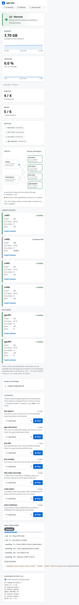

## The entity list

A plain list, one card per line, in three groups: *Compute nodes*, *GPU nodes* and *Services*. Each heading counts what
is healthy ("4 of 4 healthy"). A card shows the status in words and an icon (✓ healthy, ▲ warning, ✗ fault, ⏻ off) and
the quick facts:

| Card | Quick facts |
|---|---|
| GPU node | a utilisation meter, the percent, busy GPUs out of total, temperature, BCM state |
| Compute node | temperature, BCM state |
| Service | requests per minute and the total seen |

Healthy cards are quiet; warning, fault and off cards are tinted and bold, so what needs you stands out. Slurm node
states and CPU load are not shown, because the page has no Docker access by design; use `benchctl describe node NAME`.

## Infrastructure architecture

The **Infrastructure architecture** is the main view: everything on it is a part you can point at.


Read it from left to right:

| Box | What it is |
|---|---|
| **Clients** | the monitoring app, Prometheus, curl and scripts, and *You: ssh · tsh* (a terminal) |
| **Faults** | scenarios and buttons; a diamond travels from here to the node it hits |
| **Access: how users get in** | the **login nodes** (one box each, with how it authenticates: *Direct SSH*, *Teleport only* or *Direct SSH + Teleport*) and the **Teleport proxy** when that part is on |
| **Cluster nodes** | every compute and GPU node as a tile with its state |
| **Services: what clients call** | BMC farm, BCM, Jira, GPU exporter (all simulated) and, when the real Jira is on, **Jira DC** |

A login node that is in the selection but not running (never built, or stopped) is drawn **dashed with "✗ not running"**: the page checks whether anything answers on its port 22, so the diagram shows what runs, not only what you picked. With the whole stack down they all look dim instead.

**Colours.** The boxes do not say *mock*; colour does, and the **Key** button above the diagram repeats it (it opens a small panel with every colour, mark and line style). Violet with a dashed stripe is simulated,
blue with a solid stripe is real. The **border** is the state (green up, red dashed not reachable, grey dotted off). Two overlays sit on top and
combine with everything else: a pulsing blue dot means traffic now (on a node tile: GPU work running), a red ring with a red triangle means a fault
was applied in the last 30 seconds. So one box can be up, busy and faulted at the same time. The real Jira has no request counter, so it shows up or down only.

Every line says **how** it connects:

| Line | Meaning |
|---|---|
| `direct SSH` (solid, arrow) | a client with the cluster key connects to a login node on its published port (login nodes set to *Direct SSH* or *both*) |
| `Teleport` between the Teleport box and a login node (long dashes) | the login node is reached through the Teleport proxy (*Teleport only* or *both*) |
| `jump host` (short dashes) | from a login node you `ssh` on to the nodes: the login node is the jump host |
| `ssh` from Clients to the **Jump host** or **Controller** box | a key login to the bastion (`--access jump`) or to the controller (`--controller`); each box is drawn only when it is built, shows `✓ up`, `✗ not reachable` or `– offline` in words, and opens a pop-up with its address and command |
| `ssh -J` (dashes) from the Jump host to a login node or the Controller | the bastion forwards to key-login nodes and the controller; Teleport-only logins get no such line |
| **DCGM (real)** box in Services, and `dcgm-exporter` in Monitoring on the Traffic & Communication diagram | the opt-in real exporter (`--with dcgm`, port 9402): up or down only, no request counter, so its line is declared wiring, never drawn as traffic. Each box appears only when the part is built |
| **GPU card** box in Services, and `real-gpu` in Monitoring | the host's own NVIDIA card with the real exporter (`--with real-gpu`, port 9403): up or down only, declared wiring like the DCGM (real) box; drawn only when built; the node `rgpu001` sits with the GPU nodes and its state comes from the card's exporter |
| `ssh` (short dashes) from a login node to the Controller | an admin hops on to the controller; sshd lets only whitelisted users in |
| `Teleport` from the Teleport box to the nodes (long dashes) | the nodes are also reachable through the proxy (agentless OpenSSH) |
| `HTTP …` and `tsh · HTTPS` (thin) | an API call from a client to a service, or the `tsh` connection to the proxy |

A round dot travels along a line for each real request (a **triangle** for an answer the mock counted as an error, such as a 404 or an injected 503; the service box and the Timeline also say "2 errors", and a service that keeps no error counter shows none); a diamond travels from *Faults* to the node it hits and a ring flashes on that
tile. *Pause* stops the dots; they also stop at governor L3 and under reduced motion, and the live feed runs only while
the page is visible and the Infrastructure workspace is open. **Key** (top right of the diagram) opens the legend: kinds, states, the dot, diamond and ring, the node marks, and a sample of each line style. The **view switcher** under the title (*2.5D*, *Flat*, *Overview*) picks how the diagram is drawn and at what level; the focus, selection and node list stay as they are when you switch. *Overview* is the level of detail: The *overview* condenses the cluster to one card (clients, access, the node groups with a health bar, the services and the fault count); above 24 nodes the page opens there. Hover the card (or Tab to it) to see the design underneath, double-click it, press Enter or use **Open full design** to enter, and use the **All clusters** link or Esc to go back. With several clusters the overview is a grid of cards (the cluster's name, nodes healthy, services and faults, and a condensed *access → nodes* picture when the card is big enough); a card with a failing part is marked with ▲. Entering one shows that cluster's diagram and node list. On a phone, tap the card. A table of clusters is in the page for screen readers.

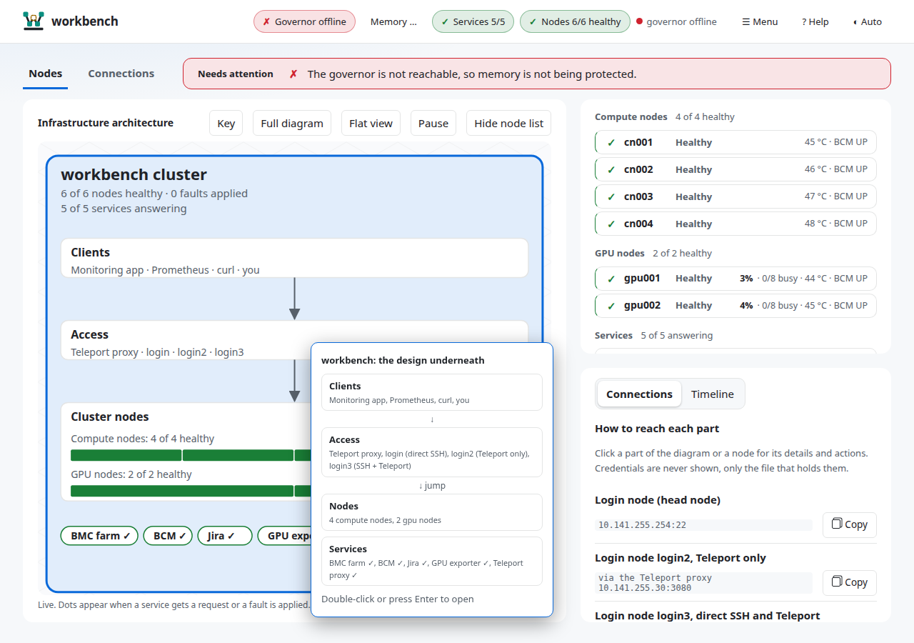

*2.5D* and *Flat* are the drawing styles (in 2.5D a lens also lifts its plane: parts in it get a deeper side face and a glow; see ADR 0030): 2.5D (the default) draws the same diagram as raised slabs on a tiled floor with glowing lines; flat is the plain baseline and is the default under reduced motion and on a phone. The choice is remembered in the browser.

**Focus.** Double-click a part (or Tab to it and press **F**) to focus it: the part and its direct neighbours stay lit, everything else dims, faulted parts stay visible, and nothing moves. Connections then lists what it connects to (plane, kind, and whether the link is *measured* by a counter or only *declared*). Double-click it again, press Esc, or use the breadcrumb under the diagram to leave.

**Blast radius.** When a fault is applied (a node button or a scenario step), the parts a client reads that the fault changes get a **dashed** outline (shape, not only colour), and Connections shows one plain sentence of what a client would observe, for example *the BMC reports the node Off, the BCM marks it down and its GPU metric series stop*. Every caption says it is **declared from the simulator's rules, not measured**. It clears after 45 seconds or with **Dismiss**. The table behind it is `webui/blast.py`, checked against the edge model by `tests/test_graph.py`.

**Lenses.** The **Lens** menu next to the view switcher restyles the same layout by plane: *Access* (how users get in), *Management* (BMC and BCM), *Telemetry* (GPU metrics), *Tickets* (Jira) and *Faults*; everything outside the plane dims and nothing moves. **Client's eye** shows, for every service a client should call, how many calls the mocks counted, how many were errors, the rate per minute and a verdict (*called*, *not called yet*, *not reachable*), and says *not measured* where nothing counts (the real Jira, a service with no error counter). It is built only from the per-mock counters, so it tells you whether the client is reading everything, not which endpoint it used. With the stack down it shows one message instead.

**Hover** a part for a one-line tip (its state and how it is reached). **Click** it (or Tab to it and press Enter) for a pop-up window
next to it with its address, the credential file, a command to copy, and buttons for the details:

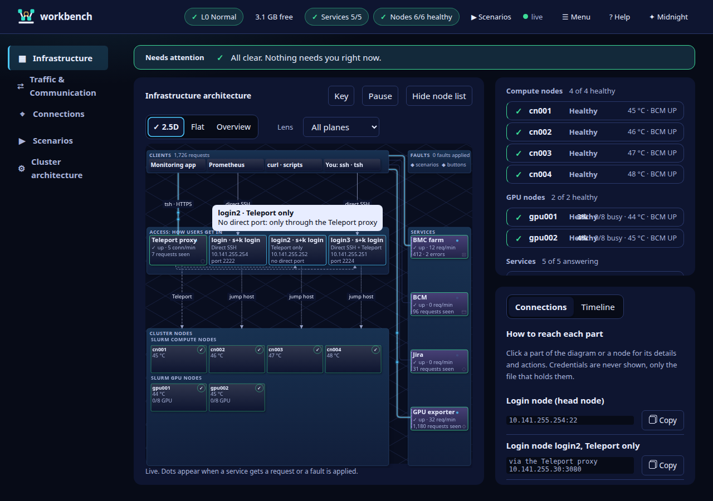

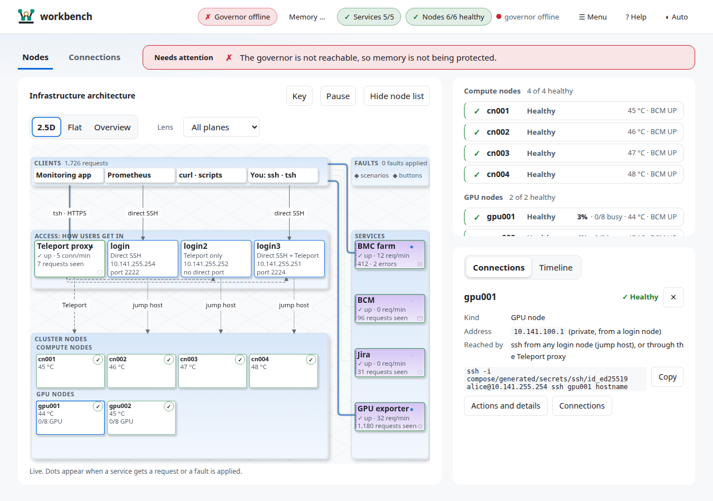

Esc closes the pop-up and returns the focus to the part. For a node, **Actions and details** opens its panel (below); **Connections**
opens the row for that part in the Connections tab.

**Fold the list away.** The list is a second way to the same parts. **Topology** in the view choice (left rail, under the nav) hides the list and gives the whole right column to Connections and the selected part:

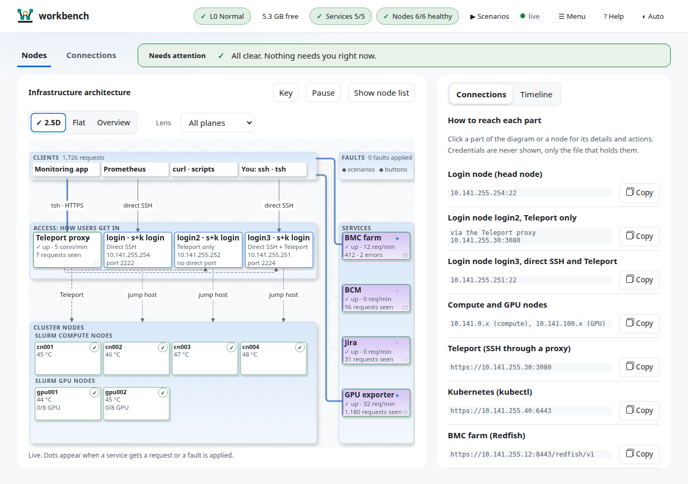

On a phone the diagram scrolls sideways inside its panel and the list sits below it.

**Teleport in the diagram.** The Teleport box and the Teleport lines appear only when the Teleport part is built, and the node list
gets a `teleport` card with it (`answering` or `not answering`). Its rate is **connections per minute**: every `tsh ssh` or web
terminal session makes the proxy connect to a node, and Teleport counts that (`teleport_connect_to_node_attempts_total` on its
diagnostics port, 127.0.0.1:3434). Nothing is invented: with no connections there are no dots. The login nodes come from the saved
workbench (`benchctl start --login ssh,teleport,both`, or the Login nodes rows of the sheet).

## Teleport from the page

Teleport is a part like the others, so you control it from **left nav → ⚙ Cluster architecture**:

1. Open **left nav → ⚙ Cluster architecture**.
2. Under **Access**, tick **Teleport** (+256 MB). The memory bar shows whether it fits.
3. Press **Apply to the running workbench**, then press it again to confirm.
4. When the apply finishes, the `teleport` card appears in the list and the box in the diagram. Open **Connections**: the
   **Teleport (SSH through a proxy)** row has the address, a copy-ready `tsh` command and the identity file to use.

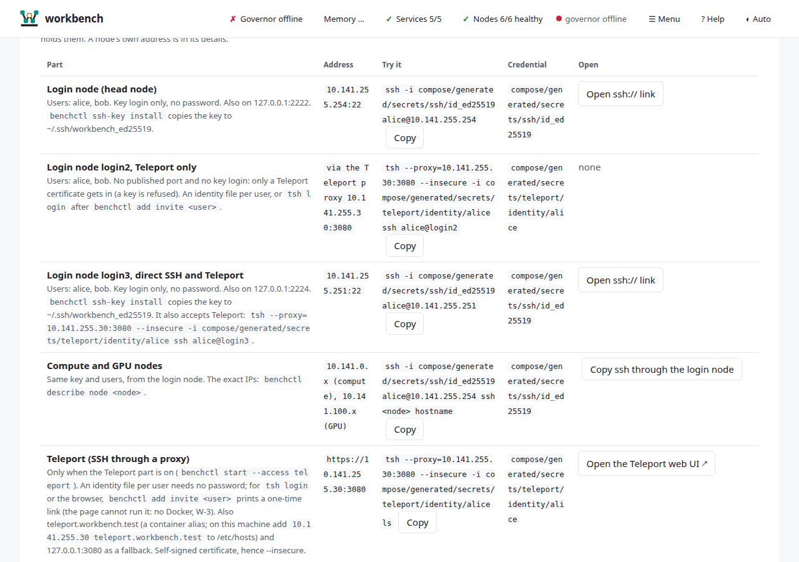

To turn it off, untick it and apply again. Two things stay in a terminal because the page has no Docker access by design
(SPEC W-3): creating the one-time link for a `tsh login` password and code (`./scripts/benchctl add invite alice`), and the
`tsh` commands themselves. The full walk-through is in [Nodes and shells](04-nodes-and-shells.md#teleport-tsh-to-the-login-node-and-the-nodes).

## A node: actions and info

Click a node card, or a node tile in the diagram and then **Actions and details**. Its panel opens in the **Connections** area (it is not a pop-up) and that area grows to make room, so you can watch the Infrastructure architecture and the list
while you act. The selected node is outlined in the list. The panel has two cards and a header with **← All nodes** (Esc does the same), the node's name and its
live state.

- **Actions**: the faults first, **Power off**, **Overheat (92 °C)**, **Fan failure** and **GPU error (XID 79)** (GPU
  nodes only), then **Recover**: **Power on** and **Clear faults**. The result appears under the buttons, the card
  changes state and a diamond shows the injection. Nothing here opens a shell on a node; use
  [`docker exec`](04-nodes-and-shells.md).
- **Info**: how to reach the node (SSH command, key file, BMC login, how to get its IP) and everything known about it
  (BMC state, GPUs busy and idle): the same text as `benchctl describe node NAME`, minus the Docker and Slurm lines
  because this page has no Docker access. The container IP needs Docker, so run `./scripts/benchctl describe node cn001`
  (it prints an `IP:` line).

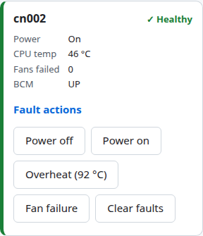

*The same actions, from before the node panel.*

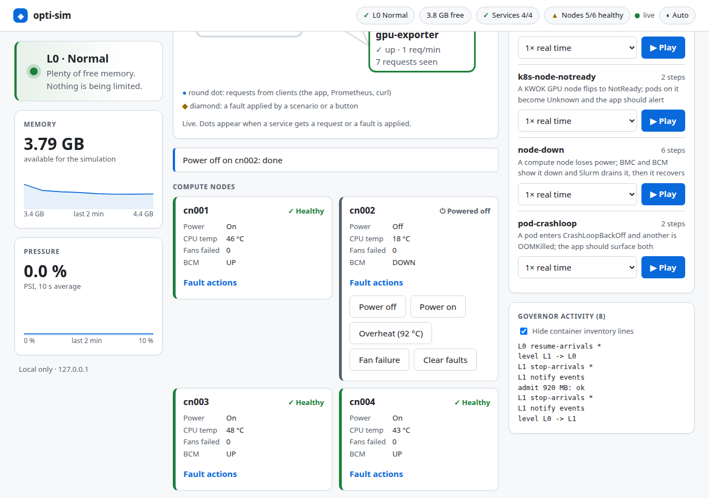

*After Power off on cn002: the node is marked "Powered off" in words as well as colour, BCM shows DOWN, and the strip counts
5 of 6 nodes healthy. Press Clear faults to undo.*

## Plan: change the workbench

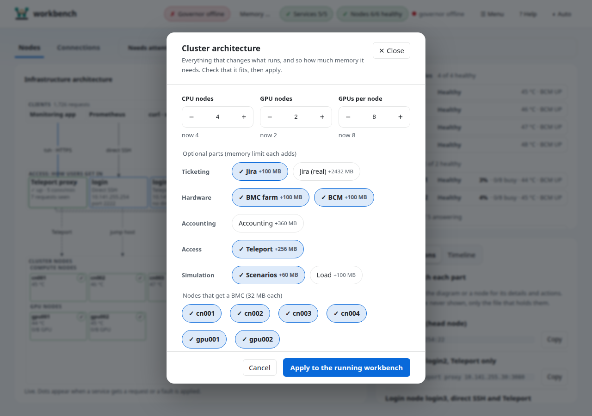

**▦ Cluster architecture** opens a wide sheet with one card per concern and a summary beside it that stays in view. **Slurm cluster**: steppers for CPU nodes, GPU nodes and GPUs per node, each with what one node is (for example 8 CPUs, 4 GB; H200). **Kubernetes cluster**: an Enabled switch and steppers for its own CPU and GPU nodes (KWOK), separate from the Slurm nodes. **Login nodes**: one card per login node with two choices, *Way in* (SSH, Teleport, Both) and *Serves* (Slurm, Kubernetes, Both: an s-login, a k-login or a shared login), and two presets, *One shared login* and *Separate s-login and k-login*. **Optional parts**: toggles grouped by category as in the `--ticketing`, `--hardware` flags (accounting, Jira, BMC, BCM, Teleport, scenarios, load; each shows the memory limit it adds, and the toggles show what is built now). The summary lists the node counts per scheduler, the logins, the memory it needs against free memory, and the command for a terminal; on a phone it stacks under the cards. The memory bar reads like "1.7 GB needed of 4.5 GB free". The sheet shows the change against what runs now ("GPU nodes 2 → 3 (+1)") and the
`benchctl up ...` command for a terminal. Editing the numbers only estimates. **Apply to the running workbench** (press
twice: the second press confirms) asks the governor to rebuild it; new nodes start and nodes you no longer want are
removed. See [choose the workbench](../guides/choose-workbench.md).

**If the sheet says "Could not load the options".** The page and the process behind it are different versions (the page was updated
while an older one kept running). Restart it and reload:

```bash
./scripts/benchctl stop
./scripts/benchctl start
```

## Scenarios

Press **▶ Scenarios** in the top strip: a panel docks on the right and the diagram stays in view. The run card is at the top (status, a progress bar, **Stop**, and the steps with the current one highlighted); below it is the library (type in *Filter scenarios*, pick a speed that applies to all, press **▶ Play** on a card; the running scenario's card is highlighted). Press the button again, or **✕ Close**, to hide it; it stays open across a reload. While one runs, the top strip also shows it, and pressing that chip opens the panel. The page has no Docker access by design, so its `slurm` steps (drain, resume, job and daemon steps)
are done by the governor; one it refuses (memory level L2 and above) or cannot do (started without `--workdir`) shows **skipped** with the reason, and
`./scripts/benchctl scenario run NAME` does it from the terminal. Tick **Slurm trace** before **▶ Play** to see, under the timeline, what the
jobs and Slurm's logs did around each step ([Slurm resilience](../guides/slurm-resilience.md)).

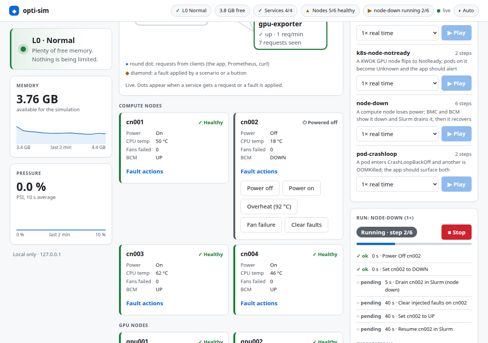

*A scenario playing (node-down, step 2 of 6). Stop aborts.*

## Governor

Press the level chip (for example **✓ L0 Normal**) or the memory chip. The panel shows the level and what it means, free
memory and pressure with two-minute trends, and the governor's log (*Governor activity*, newest first). A change the page asked for ends with a line such as `apply-plan=4cpu+2gpu: done (#3 14:50:12)`; the number and time make every change's line unique, which is how the sheet knows *this* apply finished (an older build wrote the same line for the same selection, and the sheet then waited forever). If the governor
is offline, or memory is tight (L2 and up), the same is also listed under *Needs attention*.

## Connections

The **Connections** tab lists every part (login node, nodes, BMC, BCM, Jira, Slurm REST, GPU exporter, Prometheus,
Grafana, this page) with its address, a command you can copy, and the **file that holds its credential**. The page shows
paths, never secrets.

The last column, **Open**, has one-click actions for the parts that have one:

- **Open ... ↗** opens a web page in a new tab: Grafana, Prometheus, jira-mock, the GPU metrics, the Teleport web UI, the
  Redfish endpoint and this page. Links to an API say so (**Open jira-mock API (JSON)**, **Open Redfish API (JSON, certificate
  warning)**): you get raw JSON, not a page, and the browser warns about the Redfish self-signed certificate; both are expected. The links use the
  ports published on `127.0.0.1`, so they work without the Docker network route.
- **Open in SSH app (needs a handler)** on a login node that takes a key hands the address to the terminal your desktop
  registered for `ssh://`. Not every desktop has one (the browser then asks which app to use): **Copy benchctl ssh**, the
  first action of the row, works everywhere.
- **Copy benchctl ssh** gives `benchctl ssh alice@<node>`, a real SSH login as that user through the login node (`benchctl ssh <node>`
  without a user is a root shell). A node's panel has the same command with the node filled in. The button says "Copied" and the page announces it to screen readers.

The page never opens a terminal itself (it has no Docker or root access, W-3). A part with nothing to open shows "none".

## One message per condition

If the cluster is down the page shows one notice and one *Needs attention* entry, hides data that cannot exist (the entity
list) and names the recovery command, which never needs `sudo`. If the governor is down it says so the same way.

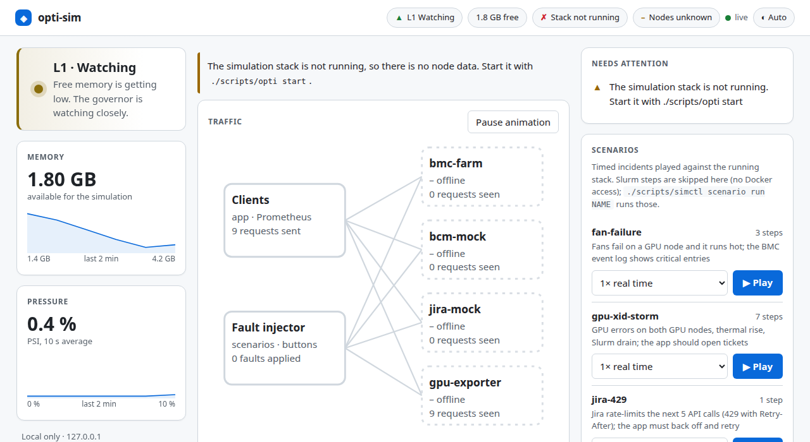

*The cluster is stopped: one notice with the command to start it, services shown offline with dashed outlines, and no node
list. The memory figures are the host's, taken at the time of the screenshot.*

## Help inside the page

**? Help** in the header opens this manual (and the guides, the architecture notes and the decisions) as linked pages at
`/help/`: a sidebar to jump between pages, a search box, and **← Dashboard** to go back. It needs the same login as the
page. Start with [Which command do I use?](11-which-command.md) when the commands are new.

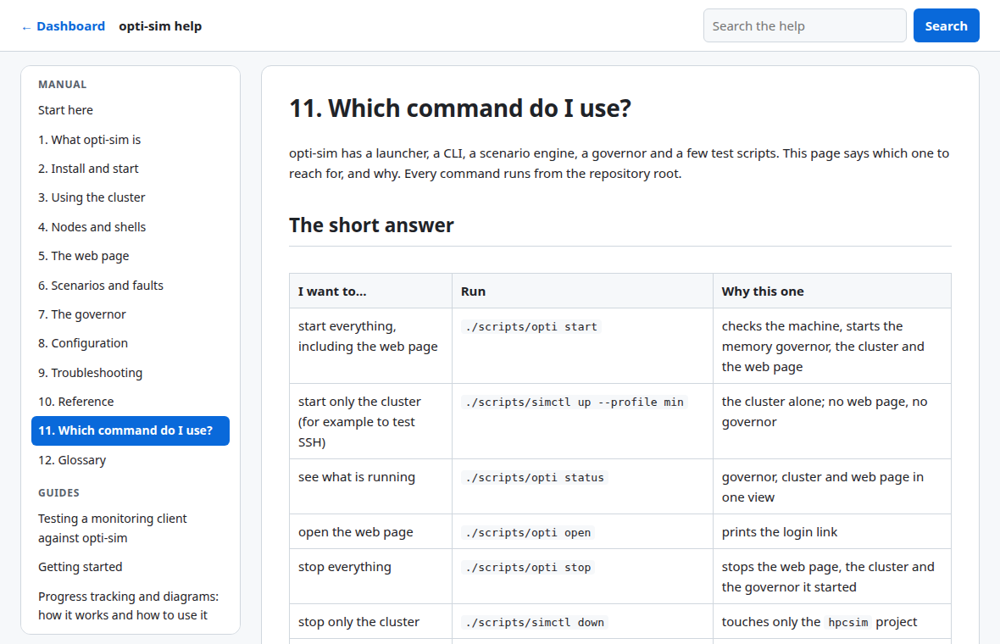

## Limits

- The Profile and Budget manager (edit `sim.yaml` in the page) is **not built**; edit the file ([chapter 8](08-configuration.md)).
- Backend memory stays under 50 MB. Starlette and one static page, no framework, no CDN.
- Browser debugging for developers: `.venv/bin/python scripts/ui_shots.py` ([reference](10-reference.md)).

## Health checks: what drains a node

**☰ Menu → Configure → ✚ Health checks** opens the list of checks every node's health check runs, in run order. Drag a block by its handle to
reorder it (the ↑ ↓ buttons do the same from the keyboard), tick it to switch the check on or off, edit a parameter and
leave the field to save it, ✕ removes it. To add one, drag a template (`metric-above`, `metric-below`) into the list or press
it, then name it and fill in its parameters. Each change is checked before it is saved (syntax, parameters, a run on healthy
sample metrics); a refusal shows one line and the list returns to what was saved. Nodes use the change within 30 s, with no
rebuild. The page adds checks from templates only; your own script goes in with `benchctl add check NAME --script FILE`. See
[NHC checks](../guides/nhc-checks.md).

## Export: a profile file for the monitoring client

**☰ Menu → Share → ⇩ Export** downloads `bench-profile.json` for the cluster on disk (the workbench last built, else the
profile `up` started); tick *One BMC target per node* to include the BMC farm. The file never holds secrets, so after a
successful download the sheet lists what to set by hand: the SSH key (`benchctl ssh-key install`), the Grafana token
(`compose/generated/secrets/grafana_viewer_token`), the BMC password if asked for, and that Jira needs no token. It also
warns when Slurm accounting is missing (`sacct` would fail). See [export a profile](../guides/export-profile.md).

**Power off and Slurm.** Power off sets the BMC and BCM state, makes the GPU exporter stop publishing the node (its GPU series vanish from Grafana), and
asks the governor to **freeze the node's container**. Its `slurmd` then stops answering, exactly as on a dead host, and
`slurmctld` notices by itself: `sinfo` shows the node `down*` (reason *Not responding*) after about 30 s (`SlurmdTimeout=15`, `MessageTimeout=5`).
Power on thaws it, and with `ReturnToService=1` Slurm returns it on its own after its next answer. This needs the governor
started with `--workdir` (the launcher does) and level L0-L1; otherwise the page says the node was not frozen and names
`benchctl set node NAME off`. The fault buttons include **InfiniBand port down** and **NIC flapping**; the node card shows them as a warning and the health check drains the node. The node panel also has a **Workload** card: *Run 1 CPU, 5 min* (GPU nodes: 1 GPU or all GPUs, 5 or 30 min) submits a job on that node through the governor (`benchctl submit`), so `squeue` lists it, the node shows allocated and a GPU job shows its GPUs busy. `benchctl set node NAME down|resume` sets the Slurm state by hand instead.

A node set `down` by hand (`benchctl set node NAME down`) stays down until `resume`; one that went down by not answering returns
by itself (`ReturnToService=1`). A cluster built before this setting keeps the old behaviour until its `slurm.conf` is regenerated
and reloaded: `./scripts/benchctl up`, then `./scripts/benchctl exec slurmctld -- scontrol reconfigure`.

**The Infrastructure architecture is clickable.** Every box, tile and chip opens a pop-up with the part's details (see above); its
**Connections** button opens that part's row in the Connections tab. Tab to a shape and press Enter or Space for the same.

**BMCs per node.** In **▦ Cluster architecture**, switching *BMC* on shows the nodes that get a BMC address (all by default). Each
BMC is its own small container with its own address (`10.148.x.y:443`) and costs about 32 MB, shown in the memory bar; switch off
the nodes you do not need. A node panel shows its BMC address, or "none for this node". Apply rebuilds as usual and removes
the BMCs you switched off.
