<p align="center"></p>

# 5. The web page

**In 30 seconds:** one dashboard over the governor, the cluster and the scenarios, on `127.0.0.1:8088`. It shows what is happening as a circuit you can zoom, lets you break a node and recover it, and never touches Docker itself.

## Do it

```bash
./scripts/benchctl start     # starts the page with the cluster; prints a one-time login link
./scripts/benchctl open      # prints a new link (valid 60 s, works once; the token is never in the URL)
```

By hand: `.venv/bin/python -m webui [port]` serves the page on `127.0.0.1:8088` by default. Sign in with `benchctl open`.

1. Open the link once. It sets a cookie.
2. The page fits one screen (1280 × 800 and up) with no page scrolling.

**Good to know**
- The token lives in `compose/generated/secrets/ui_token`.
- Anyone with the link on this machine can use the page, so keep it private.
- The page listens on `127.0.0.1` only.

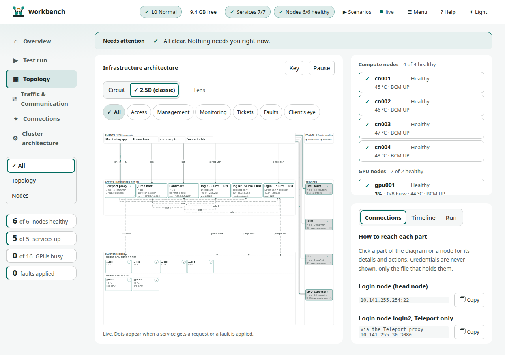

*A healthy cluster with Teleport on: L0 Normal, 5 of 5 services answering, 6 of 6 nodes healthy, "All clear" under Needs attention (sample data; the numbers on your page are live).*

## Layout

| Area | Shows |
|---|---|
| **Overview cards** | in the left rail on **Overview** only: nodes healthy, services up, GPUs busy (only with GPU nodes), faults applied. Every other workspace has the same counts in the top strip |
| **Services count** | one definition everywhere (top strip `Services 7/7`, the Overview tile, the header line, the Services list): it counts every part the page draws, each with its own reachability test (the four mocks, the real Jira, Kubernetes API, DCGM and GPU exporters, Teleport, the jump host and the controller, when built). 7/7 means all seven drawn parts answer |
| **View choice** | under the nav on Infrastructure: **All** (diagram and node list), **Topology** (diagram only, wider) or **Nodes** (list and details only); remembered in this browser |
| **Left nav** | the workspaces: **Overview**, **Test run**, **Topology** (the Infrastructure diagram), **Traffic & Communication** |
| **Top strip** | governor level, free memory, healthy services and nodes, the running scenario; then **☰ Menu**, help and the theme switch |
| **Tabs and Needs attention** | the tabs *Nodes* and *Connections*, and one slim bar with every item that needs you. When nothing needs you there is no bar: the top strip shows a **✓ All clear** chip |

The **stage** on Infrastructure has three areas that fill the window:
- **Left:** the **Infrastructure architecture**. Clients are across the top, the access layer under them, the cluster nodes below that and the services in a column at the right.
- **Top right:** the **node list** (Compute, GPU and Services).
- **Bottom right:** **Connections**, which shows how to reach each part (address and a Copy button). Click a part and it shows that part instead. A **Timeline** tab lists recent traffic and faults. A **Run** tab lists the steps of a scenario run ([a scenario run on the diagram](#a-scenario-run-on-the-diagram)).

**Topology** in the left rail gives the whole right column to Connections. The choice is remembered.

### The top strip and the menu

- The strip is for status only. Its **All clear** chip appears only when the Needs attention bar would be empty.
- The icons in the left navigation and the menu are drawn by the page (inline SVG, one size, the text colour), so they look the same on every machine. This manual writes them as the old symbols (⌂ ▶ ▦ ⇄ ⌖ ⚙ ✚ ⇩) to point at them.
- The theme switch cycles Auto, Light, Dark, **Midnight** (deep navy and neon accents) and **Dim** (soft slate, low glare). The choice is remembered.
- **☰ Menu** has two groups, each item with a one-line hint. Esc closes it. Scenarios are not a chip or a menu item: open **▶ Test run** in the left navigation.
  - *Configure:* **▦ Cluster architecture** (nodes, GPUs per node, optional parts, the plan) and **✚ Health checks**
  - *Share:* **⇩ Export**
- Press the level or memory chip to open the **Governor** panel.

**Cluster architecture** and **Governor** open on top of the page. Close them with **✕ Close**, Esc or a click outside. A node opens in the **Connections** area instead, so the diagram and the list stay in view.

On a phone, and under 1100 px, the diagram, the list and Connections stack in one column. The page has a skip link and landmarks, and it honours reduced motion.

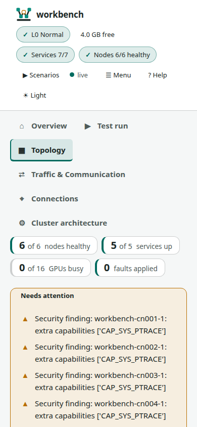

## Overview: where the page opens

Overview answers four questions without a click:
- **Is everything up?** **Needs attention** is the same list as the top strip, or "All clear".
- **What do I want to do?** Three cards: **Run a test** opens Scenarios, **Break one thing** opens Topology to choose a node, **Connect your client** opens Export.
- **How is each node?** A card shows its state as an icon and words. A load bar appears only where the GPU exporter measured one. A node with no reading says "no live reading".
- **Which services answer?** Each is tagged real or simulated.

Press a node card, or **Open gpu001** in an attention line, to open that node in **Topology**. Overview adds no polling of its own.

## The entity list

A plain list in three groups: *Compute nodes*, *GPU nodes* and *Services*. Each heading counts what is healthy ("4 of 4 healthy").

A card shows the status in words and an icon: ✓ healthy, ▲ warning, ✗ fault, ⏻ off.

| Card | Quick facts |
|---|---|
| GPU node | a utilisation meter, the percent, busy GPUs out of total, temperature, BCM state |
| Compute node | temperature, BCM state |
| Service | requests per minute and the total seen |

Healthy cards are quiet. Warning, fault and off cards are tinted and bold.

Slurm node states and CPU load are not shown, because the page has no Docker access by design. Use `benchctl describe node NAME`.

## Infrastructure architecture

The main view. Everything on it is a part you can point at.


Read it from left to right:

| Box | What it is |
|---|---|
| **Clients** | the monitoring app, Prometheus, curl and scripts, and *You: ssh · tsh* (a terminal) |
| **Faults** | scenarios and buttons; a diamond travels from here to the node it hits |
| **Access: how users get in** | the **login nodes** (one box each, with how it authenticates: *Direct SSH*, *Teleport only* or *Direct SSH + Teleport*) and the **Teleport proxy** when that part is on |
| **Cluster nodes** | every compute and GPU node as a tile with its state |
| **Services: what clients call** | BMC farm, BCM, Jira, GPU exporter (all simulated) and, when the real Jira is on, **Jira DC** |

A login node that is selected but not running is drawn **dashed with "✗ not running"**. The page checks whether anything answers on its port 22, so the diagram shows what runs, not only what you picked.

With the whole stack down, every part shows one word, **– offline**, and no tick. Only the **Needs attention** entry says why and gives the command to start it.

### Colours and marks

The boxes do not say *mock*; colour does. The **Key** button above the diagram opens a panel with every colour, mark and line style.

- A **dashed outline** marked *sim* is simulated. A **solid outline** marked *real* is real (a neutral colour, never a hue).
- The **border** is the state: teal with a ✓ is up, red dashed is not reachable, grey dotted is off.
- Two overlays combine with everything else:
  - A pulsing dot means traffic now (on a node tile: GPU work running).
  - A red ring with a red triangle means a fault was applied in the last 30 seconds.
- Amber means a part needs attention, never a plane.
- The real Jira has no request counter, so it shows up or down only.

Lines follow their **plane**. Each plane has one colour and one line type in every view, so they stay apart without colour. All colours are in the [colour system](../guides/colour-system.md).

| Plane | Line |
|---|---|
| access | solid |
| control | long dash |
| Kubernetes | dash-dot |
| data | dotted |
| monitoring | short dash |
| management | dash-dot-dot |

Every line says **how** it connects:

| Line | Meaning |
|---|---|
| `direct SSH` (solid, arrow) | a client with the cluster key connects to a login node on its published port (login nodes set to *Direct SSH* or *both*) |
| `Teleport` between the Teleport box and a login node (long dashes) | the login node is reached through the Teleport proxy (*Teleport only* or *both*) |
| `jump host` (short dashes) | from a login node you `ssh` on to the nodes: the login node is the jump host |
| `ssh` from Clients to the **Jump host** or **Controller** box | a key login to the bastion (`--access jump`) or to the controller (`--controller`); each box is drawn only when it is built, shows `✓ up`, `✗ not reachable` or `– offline` in words, and opens a pop-up with its address and command |
| `ssh -J` (dashes) from the Jump host to a login node or the Controller | the bastion forwards to key-login nodes and the controller; Teleport-only logins get no such line. The lines to a login node, and the direct SSH lines, light and carry dots when their counter sees sessions (see *SSH sessions in the diagram*) |
| **DCGM (real)** box in Services, and `dcgm-exporter` in Monitoring on the Traffic & Communication diagram | the opt-in real exporter (`--with dcgm`, port 9402): up or down only, no request counter, so its line is declared wiring, never drawn as traffic; each box appears only when the part is built |
| **GPU card** box in Services, and `real-gpu` in Monitoring | the host's own NVIDIA card with the real exporter (`--with real-gpu`, port 9403): up or down only, declared wiring like DCGM (real); drawn only when built; the node `rgpu001` sits with the GPU nodes and its state comes from the card's exporter |
| `ssh` (short dashes) from a login node to the Controller | an admin hops on to the controller; sshd lets only whitelisted users in |
| `Teleport` from the Teleport box to the nodes (long dashes) | the nodes are also reachable through the proxy (agentless OpenSSH) |
| `HTTP …` and `tsh · HTTPS` (thin) | an API call from a client to a service, or the `tsh` connection to the proxy |

### Dots, diamonds and the Key

- A round dot travels along a line for each real request.
- A **triangle** is an answer the mock counted as an error, such as a 404 or an injected 503. The service box and the Timeline also say "2 errors". A service that keeps no error counter shows none.
- A diamond travels from *Faults* to the node it hits, and a ring flashes on that tile.
- **Pause** stops the dots. They also stop at governor L3 and under reduced motion.
- The live feed runs only while the page is visible and the Infrastructure workspace is open.
- **Key** (top right of the diagram) opens the legend: kinds, states, the dot, diamond and ring, the node marks, and a sample of each line style.

### Point at a part

- **Hover** (or Tab to it) for a one-line tip: its state and how it is reached.
- **Click** (or press Enter or Space) for a pop-up with its address, the credential file, a command to copy, and buttons for details.
- Esc closes the pop-up and returns the focus to the part.
- For a node, **Actions and details** opens its panel. **Connections** opens that part's row in the Connections tab.

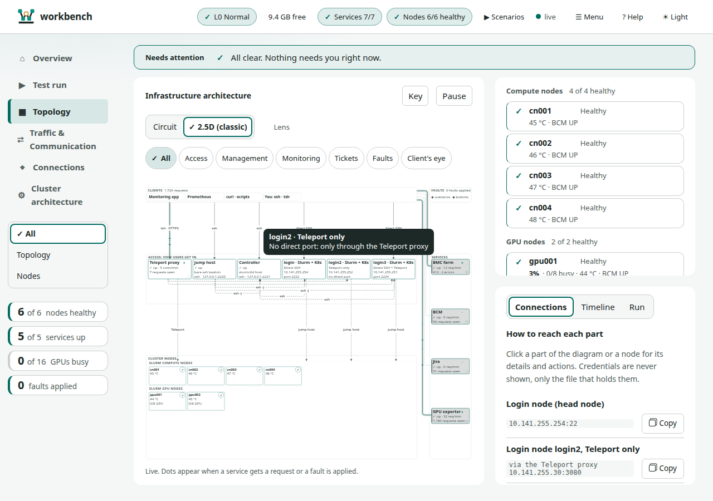

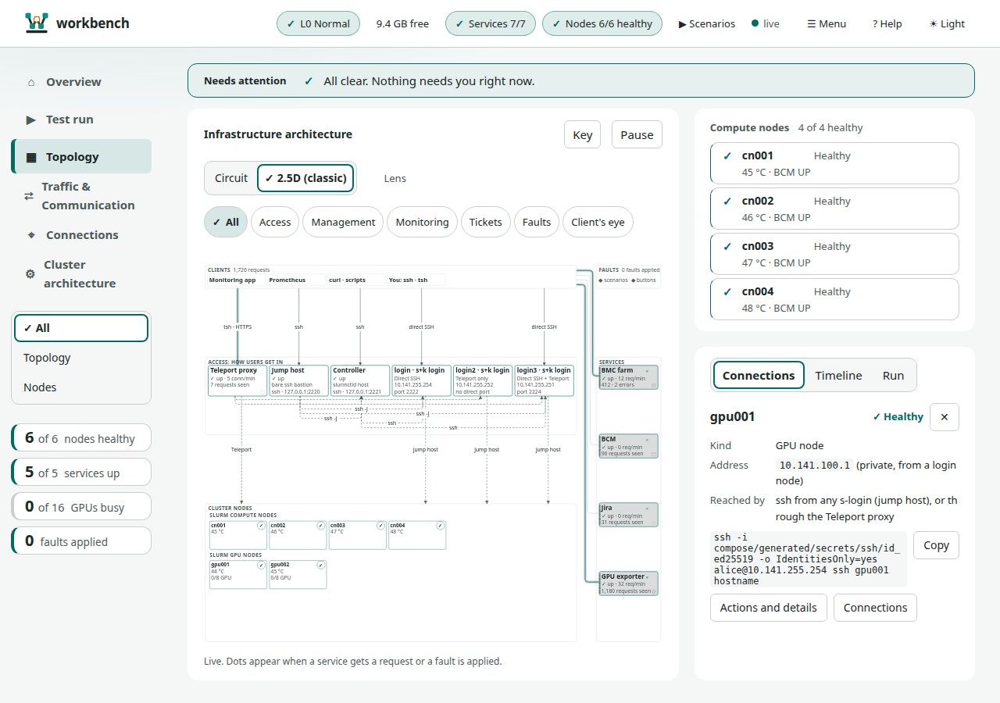

### Focus, blast radius and lenses

**Focus**
1. Double-click a part, or Tab to it and press **F**.
2. The part and its direct neighbours stay lit. Everything else dims. Faulted parts stay visible. Nothing moves.
3. Connections lists what it connects to: plane, kind, and whether the link is *measured* by a counter or only *declared*.
4. To leave, double-click it again, press Esc, or use the breadcrumb under the diagram.

**Blast radius**
- When a fault is applied (a node button or a scenario step), the parts a client reads that the fault changes get a **dashed** outline.
- Connections shows one plain sentence of what a client would observe. Example: *the BMC reports the node Off, the BCM marks it down and its GPU metric series stop*.
- Every caption says it is **declared from the simulator's rules, not measured**.
- It clears after 45 seconds or with **Dismiss**.
- The table behind it is `webui/blast.py`, checked against the edge model by `tests/test_graph.py`.

**Lenses**
- The **Lens** chips sit in a row under the view switcher. One is pressed at a time, with a ✓.
- They restyle the same layout by plane: *All*, *Access* (how users get in), *Management* (BMC and BCM), *Monitoring* (GPU metrics), *Tickets* (Jira) and *Faults*.
- Everything outside the plane dims. Nothing moves.

**Client's eye** shows, for every service a client should call:
- how many calls the mocks counted;
- how many were errors;
- the rate per minute;
- a verdict: *called*, *not called yet* or *not reachable*.

It says *not measured* where nothing counts (the real Jira, a service with no error counter). It is built only from the per-mock counters, so it tells you whether the client is reading everything, not which endpoint it used. With the stack down it shows one message instead.

### The view switcher

The switcher under the title (*2.5D*, *Flat*, *Overview*) picks how the diagram is drawn and at what level. Focus, selection and the node list stay as they are when you switch.

*Overview* condenses the cluster to one card: clients, access, the node groups with a health bar, the services and the fault count. Above 24 nodes the page opens there.
- Hover the card (or Tab to it) to see the design underneath.
- To enter: double-click it, press Enter or use **Open full design**.
- To go back: use the **All clusters** link or Esc.
- With several clusters, the overview is a grid of cards. Each shows the cluster's name, nodes healthy, services and faults, and a condensed *access → nodes* picture when the card is big enough. A card with a failing part is marked with ▲.
- On a phone, tap the card. A table of clusters is in the page for screen readers.

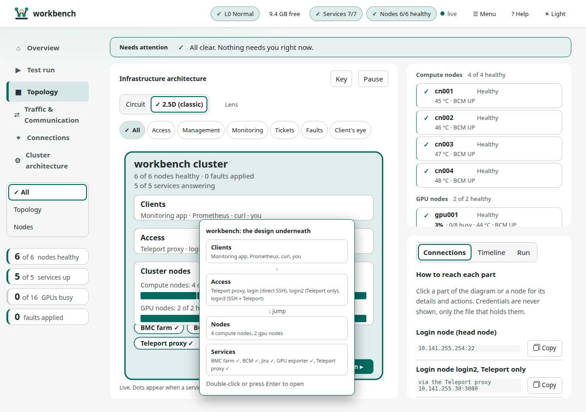

*2.5D* and *Flat* are drawing styles. Flat is the plain baseline and the default on every device. 2.5D draws the same diagram as raised slabs on a tiled floor with glowing lines, and a lens also lifts its plane (ADR 0030). Choosing 2.5D is remembered in the browser and then wins over the default.

### Fold the list away

The list is a second way to the same parts. **Topology** in the view choice hides it and gives the whole right column to Connections and the selected part.

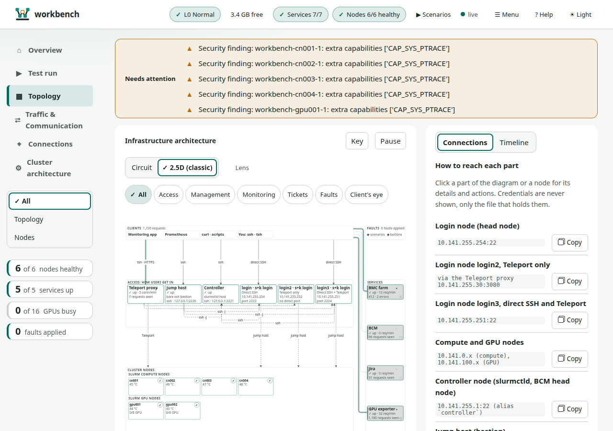

On a phone the diagram scrolls sideways inside its panel and the list sits below it.

### A hidden tab does nothing

While the browser tab is hidden or minimised, the page:
- closes its governor feed;
- stops polling the cluster;
- pauses every animation.

Showing the tab again reopens the feed and reads the cluster at once. Status text that a screen reader announces is rewritten only when its content changes. After an applied plan finishes, the Connections table and node panels read again, so new parts and nodes show without a reload.

### Teleport in the diagram

The Teleport box and lines appear only when the Teleport part is built. The node list gets a `teleport` card with it (`answering` or `not answering`).

Its rate is **connections per minute**. Every `tsh ssh` or web terminal session makes the proxy connect to a node, and Teleport counts that (`teleport_connect_to_node_attempts_total` on its diagnostics port, 127.0.0.1:3434). With no connections there are no dots.

### SSH sessions in the diagram

The direct SSH lines (Clients to a login node), the line to the **Jump host** and the jump host's `ssh -J` line to a login node show real traffic too.

Each login container and the jump container run a small counter (`images/login/ssh_counter.py`, ADR 0088). It counts the **authenticated key logins** sshd accepts, per source address, and serves the number on 127.0.0.1: the jump host on 2320, the login nodes on 2322 and up (the sshd port plus 100). The page polls it like a mock's counter.

- A dot runs along the line for each new session, and the line lights while sessions were seen in the last minute; the Timeline says "1 SSH session to login". The rate is **sessions per minute**.
- A login that arrives from the jump host (`ssh -J`) lights the jump host's line to that login node, not the direct line.
- Not counted: a bare TCP connect (a port check never logs in), a refused login, and a Teleport login (the Teleport box counts those). Nothing is read from a session: no user name, no command, only a number per source address.
- With no counter answering (a cluster started before this change, the container stopped) the lines stay still and say *declared*: no counter, no dots. The controller's SSH line and the hops to compute nodes have no counter and stay declared.

The login nodes come from the saved workbench: `benchctl start --login ssh,teleport,both`, or the Login nodes rows of the sheet.

### The Circuit view

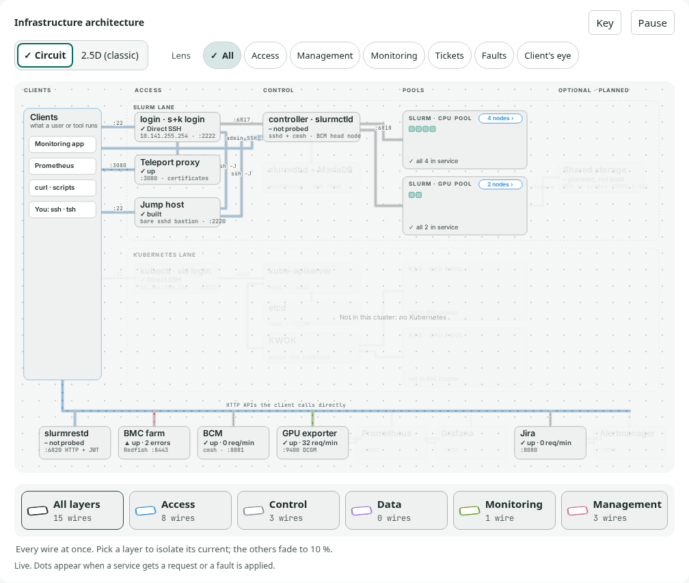

**Circuit** is the default view. **2.5D (classic)** is the other choice in the view switch, and it lasts for that visit.

It draws the cluster as a live circuit:
- a Slurm lane: login, slurmctld or the controller, slurmdbd, CPU and GPU racks;
- a Kubernetes lane: kubectl, kube-apiserver, etcd, KWOK, racks;
- the services under an HTTP bus.

One square in a rack is one node (one per 8 nodes above 64). A square that needs attention carries a ▲, and the rack says why in words.

- **A wire that pulses is a wire something counted.** The pulse speed follows requests a minute, and a red dash marks errors. A wire that is lit but still is wiring nothing counts ("declared wiring, not measured"). A dark dashed wire carries nothing. Hover or focus a wire for its words.
- **A part the cluster lacks stays where it is, faded.** A lane gets a note such as "Not in this cluster: no Kubernetes".
- **With a controller node,** the controller chip says so and an admin SSH wire is drawn. Without one, the login node wears **HEAD NODE · cmsh**.
- **Layers** (the row under the drawing) show one plane at a time: Access, Control, Data, Monitoring or Management. The other wires fade to 10 %.
- **Click** a part or a square for its details. Focus (double-click or **F**), the lens and the blast radius work here too.
- **The node list folds away** while Circuit is on, so the drawing has the width. Choosing another view brings it back.

#### Zoom: Fleet, Cluster, Pool

One **zoom rail** above the panels (− FLEET CLUSTER POOL TRAFFIC REQUESTS +) is the way up and down. It shows on **Topology** and **Traffic & Communication** only; Overview and Test run have nothing to zoom. On a phone it shows the current level with **−** and **+**.

- **Traffic** is the fourth stop: the Traffic & Communication page of the cluster you are in. **Back to the cluster** returns.
- **Requests** is one stop deeper: the request analysis (below). **Back to the links** returns. The two are never stacked on one page.
- The left bar still opens the same pages.

Other ways to move:
- **Ctrl + scroll** (or a pinch on a trackpad) zooms in on the card or rack under the pointer, and out from anywhere.
- **+** and **-** step a level.
- **Escape** steps out of a pool or Traffic.

Each move takes about 0.7 s (none under reduced motion). The old level is gone afterwards.

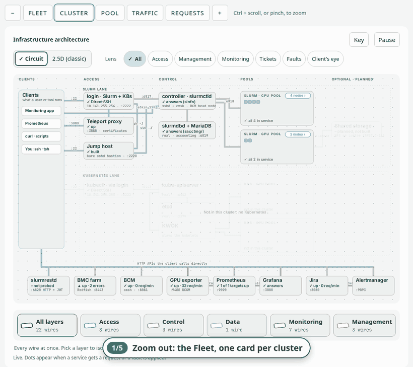

*The zoom and the layers in turn (sample data).*

**Pool.** Click a rack's **N nodes ›** button.
- The side panel says what feeds the pool, how many nodes are in service, the average GPU use and a bar of node states.
- Filters show All, Busy, Idle or Needs attention. A CPU pool has no Busy or Idle filter.
- Tiles (16 a page) show the node's state in words, its busy GPUs and temperature, and a heartbeat wire.
- What the page cannot measure says "not measured".
- **Wire in Traffic ↗** opens the Traffic tab.

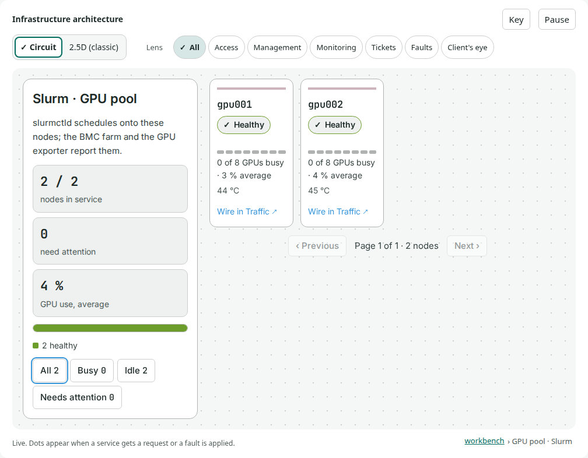

**Fleet.** One card per cluster.
- Each card shows health, what the cluster has (Slurm, Kubernetes, controller, accounting), nodes in service, requests a minute, a square per node for each lane, and a footer: only the monitoring client connects to a cluster.
- Click a card to open it.
- Only the running cluster has a request rate.

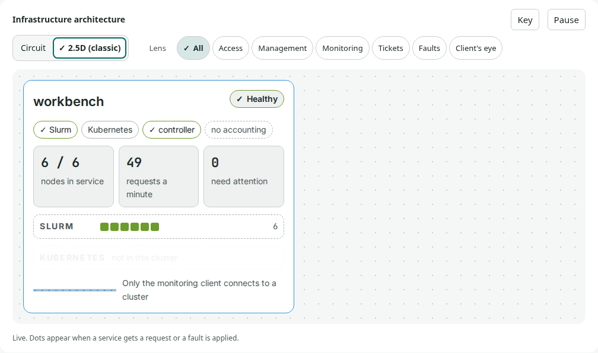

### A scenario run on the diagram

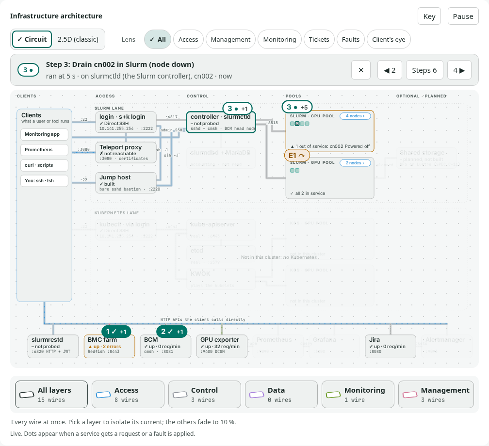

Press **Watch on the diagram** in Test run, during or after a run. The Topology tab opens on the Circuit view with the run drawn on it. Pressing **Play** keeps you in Test run.

- **Badges.** Each part a step acted on gets a badge: the step number and a glyph. ✓ done, ● now, ◐ in progress, ○ next, ↷ CLI only or skipped, ✗ failed. Badge text stays at least 14 px on screen however small the diagram is drawn, and each badge is a 40 px tap target.
- **+N.** A part that several steps touch shows the newest step and **+N** for the others.
- **The ring.** The current step's parts (or the step you picked) get an outline. The blast radius keeps its red dashes.
- **Pins.** An expectation gets a pin such as **E1 ↷** on the part it checks.
- **The strip** over the diagram says the step in words, with **◀ Previous**, **Steps** and **Next ▶**. On a phone it is a sheet at the bottom of the screen, and the diagram scrolls to the step's parts.
- **The Run tab** in the inspector lists every step in order: what it does in one sentence (for example *Freeze the login node (SSH hangs)* or *Add 200 ms delay and 5% packet loss on cn001 for 60 s*), its time, its parts and its state in words. A step that lands on no part says why.
- **Keyboard.** Tab goes through the badges in step order. Enter or Space picks that step.
- **Take off the diagram** removes a finished run's badges. The run itself lives in the page's memory until the next Play or a page restart.
- **Stop.** Pressing **■ Stop** in Test run ends the run and leaves the plain diagram. The Run tab then offers **Replay the last run** ([replay](#after-the-run-replay)); **Watch on the diagram** brings the stopped run back as it ended.

Badges are drawn on the Circuit view only; the 2.5D view keeps its diamonds. A run started with `benchctl scenario run` is drawn too ([a run from the CLI](#a-run-from-the-cli)).

#### Before Play: where a scenario will act

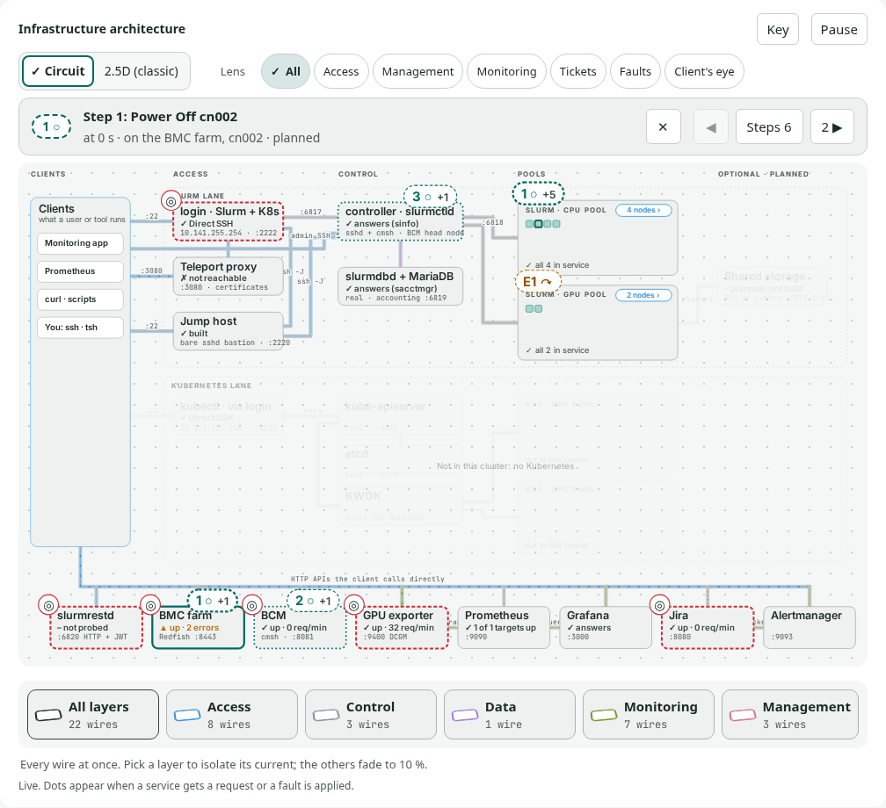

Pick a scenario in Test run and press **Show on the diagram**. The Topology tab opens on the Circuit view with the scenario drawn as a preview. Nothing has run yet. Picking a scenario alone keeps you in Test run.

- **Dashed badges** (○, said as *planned*) sit on every part a step will act on: the first step there, and **+N** for the others. A part that only CLI steps reach shows **↷**.
- **Dotted rings** outline every part the scenario will touch.
- **Pins** such as **E1 ↷** mark the expectations; ↷ means only `benchctl scenario run` can check it.
- **◎** marks a part whose clients may see a change during the scenario. This is the declared blast radius, not a measurement.
- **The strip and the Run tab** walk the steps with **◀ Previous** and **Next ▶**. The step you pick gets a solid ring, and the parts its clients read get the blast radius's red dashes. The Run tab says, for each step, *Clients may see a change on ...* and why.
- **Play** turns the dashed badges into the live badges on the same parts, with no jump. **Take the preview off the diagram** leaves the plain diagram.

#### After the run: replay

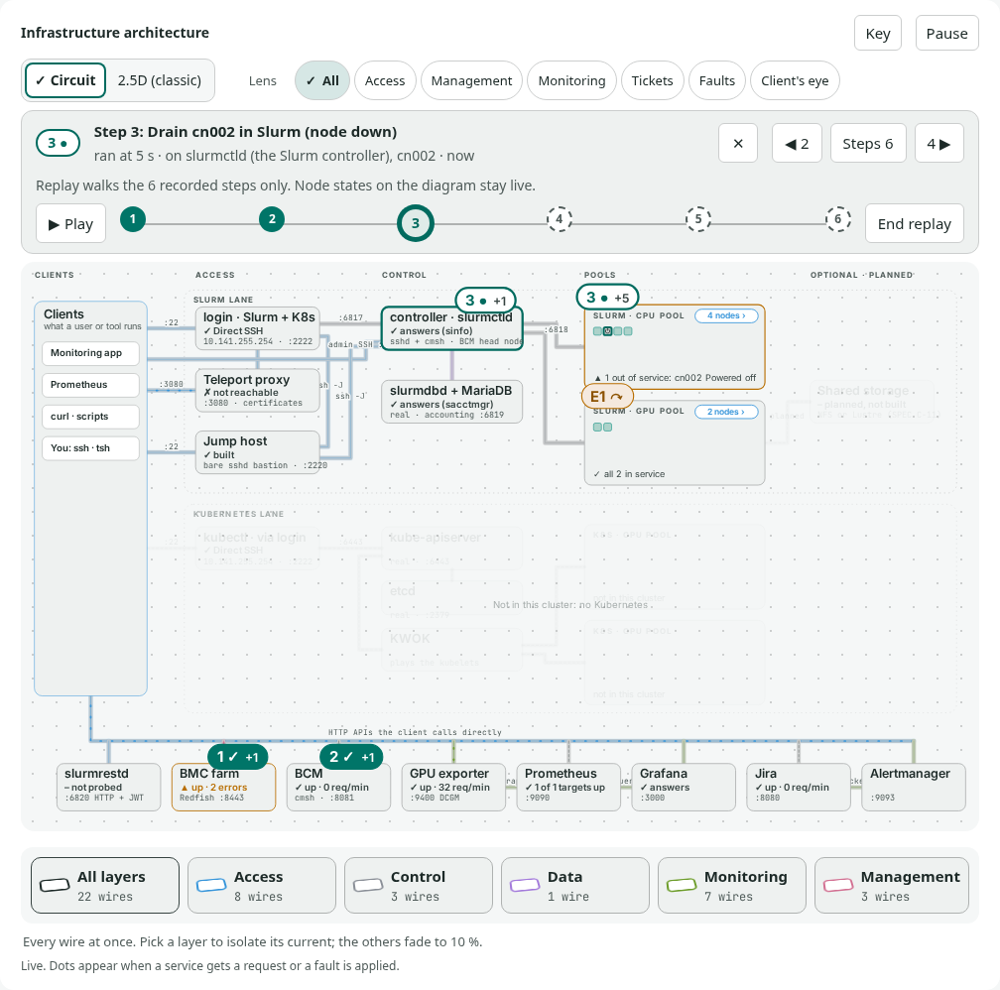

When a run has ended (passed, failed or stopped), press **Replay the run** in the Run tab. After **■ Stop** the diagram is plain, and the Run tab offers **Replay the last run**. The strip over the diagram becomes a player.

- **The slider** has one tick per recorded step, in the order they ran. Drag it, click a tick, or use the keys: ← → (or ↑ ↓) one step, Home the first, End the last. A screen reader hears the step, its result and when it ran.
- **What moves.** The badges, the ring, the pins and the Run tab's selection go back to that step. Earlier steps keep their result, this step is ● now, later ones are ○ next. Picking a recorded step in the Run tab moves the slider too.
- **What does not.** Replay walks the recorded steps only, and the strip says so. Node states on the diagram stay live. Steps a stopped run never reached are not on the slider.
- **▶ Play** moves one step every 1.2 s; **⏸ Pause** stops it. With reduced motion there is no Play: each step changes in place.
- **End replay**, or ✕, shows the run as it ended. On a phone the player is the sheet at the bottom of the screen.
- **Memory only.** The last run lives in the page's process until the next Play or a page restart. Export the report to keep it.

#### A run from the CLI

`./scripts/benchctl scenario run NAME` sends each step's result to the page while the page runs. The page draws it like its own runs: badges, strip, Run tab, Test run and replay. Each of them says **run from the CLI**.

- **Real results.** The CLI runs every step on the host. A step the page marks ↷ CLI only shows its real result: ✓ done, ✗ failed or ↷ skipped.
- **One run at a time.** While the page plays a scenario, it refuses the CLI's run. The CLI says so once and plays on.
- **Stop** it with Ctrl+C in its terminal; the page has no Stop for it. A CLI run that sends nothing for 30 s ends on the page as *No word from the CLI*.
- **Best effort.** With no page running, the command does and prints exactly what it did before. A page that does not answer within 1 s gets one notice, and the rest of the run is not shown there.
- **Nothing on disk.** The page keeps the run in memory, like its own runs. The post carries step results only; the page token goes in a header.

### Traffic & Communication

This workspace lists the documented links: protocol, port, real or simulated, observed or configured, and the measured probe latency.

Above the table:
- slurmctld's own request counts from `sdiag`;
- slurmdbd's answer to one `sacctmgr` query;
- Prometheus's scrape links.

The links are also drawn as a diagram, where the plane is the line's colour and dash pattern. The page opens in the dark Midnight theme until you pick another.

- Filter by plane, software or evidence. Click a link's source to open its inspector.
- A toolbar has plane chips, zoom, Fit and full screen.
- Below the diagram, a **Traffic activity timeline** shows requests and faults this page was told about, from 1 m to 1 h. It is kept only while the page is open.
- **The Kubernetes API box counts requests per user** (issue 384, ADR 0087):
  - The box shows `N req/min · nodes and pods only`; its pop-up lists each user and the last requests.
  - The count comes from the API server's audit log, read by the governor (the page never reads Docker).
  - It covers only what the audit policy records: **nodes and pods only** (nodes, pods and their status, leases). Secrets, config maps and other objects are not counted.
  - A request made through Teleport counts for the Teleport user.
  - It covers the last 60 seconds, polled every 5 seconds, at memory levels L0-L1 only.
  - From L2 up, with the governor down, or with a governor service not restarted since this feature, the pop-up says "not measured" and why, never 0.
  - The "Seen" figure in the same pop-up is still the API server's own total for all callers.
- The diagram is one fixed architecture, so every group is always drawn. A part is grayed, never dropped, when:
  - this cluster lacks it;
  - the page cannot read it yet (slurmdbd, until it answers a query);
  - it is planned and not built (shared storage).
- Click a part to see what it is, whether it answers and its links.
- The node parts (`nodes`, `slurmd`, and `kwok` for Kubernetes) show how many nodes are in service (`▲ nodes 5/6`). They follow a drain, power-off, GPU or Kubernetes fault within about 5 seconds, without a reload.
  - Slurm's states come from one `sinfo` through the governor. The rest come from the cluster poll.
  - The links to them say `▲ up, 1 of 6 nodes out`, and every change is a line in the activity timeline.

**Rearrange the diagram**
- **Reorder the parts inside a group:** drag a part up or down, press Alt+Up or Alt+Down, or use **▲ Up** and **▼ Down** in its inspector. These work with a finger too. A press that barely moves is a click.
- **Move a group:** drag it, or use the arrow keys. On a touch screen turn on **Move** first, otherwise a finger scrolls the page. The lines re-route.
- **Undo:** the layout is kept in the browser. **Reset layout** undoes it.
- **Follow the path** shows the chain a part belongs to. Then use **Connections**, **Scenarios** and **Cluster architecture**.

## Traffic analysis: who asks the mocks, and how it ends

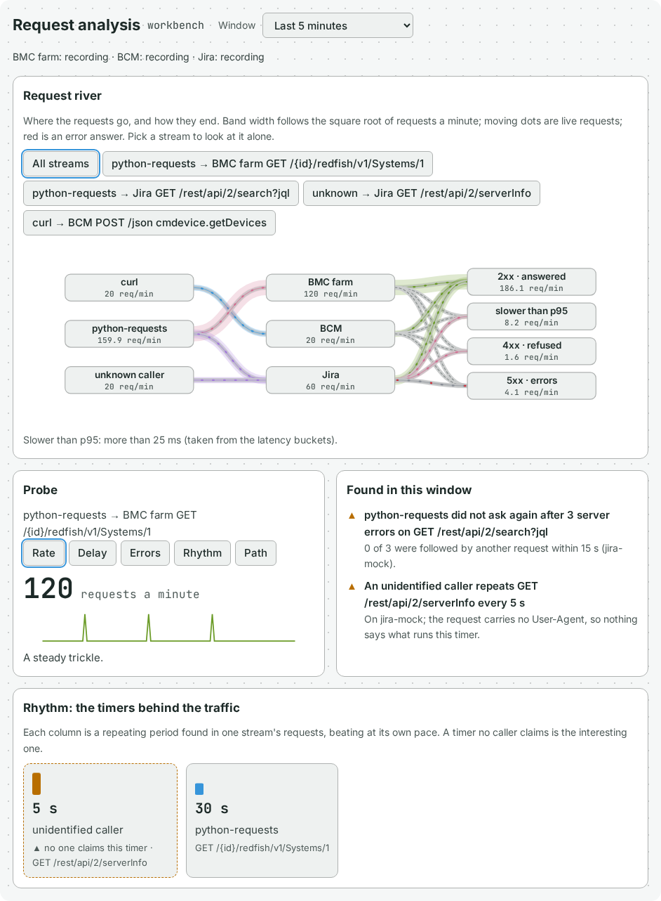

At the **Requests** stop, the page reads the mocks' own record of client requests from `/api/traffic`.
- It reads every 3 seconds, on every screen while the page is visible and never while it is hidden. A rate therefore exists when you open the tab. Only the Traffic tab draws it.
- It records only **who asked** (the User-Agent's product token, for example `curl`), the method and path shape, how it ended and how long it took.
- It never records a value, a header or a secret.

The analysis has these parts:
- **Request river:** callers on the left, the service that answered in the middle, how it ended on the right (2xx, slower than the 95th percentile, 4xx, 5xx).
  - A band's width follows the square root of requests a minute. Moving dots are live requests. Red is an error.
  - A rate needs two readings 5 seconds apart, so the first seconds say "not measured", never 0.
  - Pick a stream chip to look at one alone. A hidden table repeats the numbers for screen readers.
- **Probe:** Rate, Delay, Errors, Rhythm and Path for the chosen stream. It has a big reading, the last two minutes as a trace, and a one-line verdict. Delay shows the edge of a latency bucket ("10 ms or less"), not an exact figure.
- **Found in this window:**
  - a caller that did not ask again after server errors;
  - several calls fired in the same half second;
  - a repeating request whose caller sent no User-Agent (nothing says what runs that timer).
- **Rhythm:** the repeating periods found per stream (at least eight requests and three repeats). Each column beats at its own pace and is labelled with who runs it.
- **Window:** last minute, last 5 minutes, or since the page opened.

### Focused wire and message capture

Open a node's wire in one of two ways:
- press a pool tile's **Wire in Traffic ↗**;
- follow a link such as `http://127.0.0.1:8088/#workbench-gpu003` (`#<cluster>-<node>`).

The panel shows the node's declared wiring (BMC farm and slurmctld for a Slurm node, KWOK for a Kubernetes node), **Back to the pool**, **Clear focus**, and a **capture of its messages**.

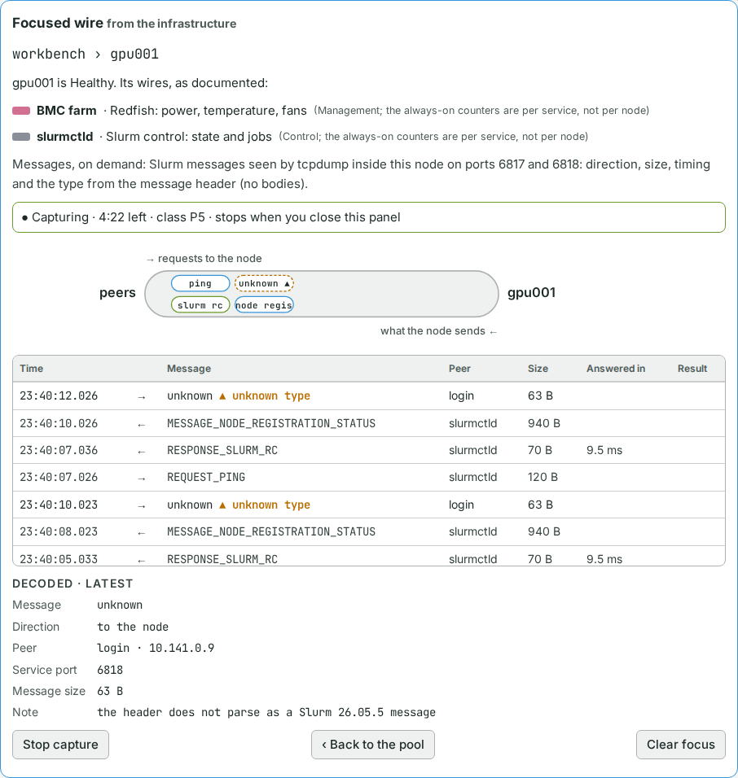

The capture is **off unless the panel is open**.
- It starts when the panel opens.
- It stops when you close the panel, switch tab, or after 5 minutes. A bar says how long is left.
- It is a class P5 job of the governor, one wire at a time, and starts only at L0 to L1. At L2 or above the panel says "paused: memory pressure".
- The always-on counters stay masked. The capture tells nodes apart by their fixed IP address instead.

What is captured:
- **A Slurm node:** `tcpdump` inside the node's container, on ports 6817 and 6818, limited by time and packet count. The message type comes from the Slurm message header (decoded for the pinned Slurm release). A header that does not parse shows as **▲ unknown type** with only its direction, size and timing, never a guess.
- **A Kubernetes node:** the API server's audit log, narrowed to the node's lease and node object and its pods (who asked, what, the answer code and time). The policy is metadata only, so it holds no request or response body.

Reading it:
- The **tube** shows the newest messages. Requests to the node are on the upper lane, what the node sends on the lower one.
- Click a row of the **log** for its decoded view: type, direction, peer, protocol version, flags, length, answer time.

**Good to know**
- Messages stay in the page's memory. Nothing is written to disk, and nothing from a message body is read.
- Run one by hand: `./scripts/benchctl get capture gpu001 --seconds 30`.

## Teleport from the page

Teleport is a part like the others, so you control it from the **Cluster architecture** sheet.

1. Open **left nav → ⚙ Cluster architecture**.
2. Under **Access**, tick **Teleport** (+256 MB). The memory bar shows whether it fits.
3. Press **Apply to the running workbench**, then press it again to confirm.
4. When the apply finishes, the `teleport` card appears in the list and the box in the diagram.
5. Open **Connections**. The **Teleport (SSH through a proxy)** row has the address, a copy-ready `tsh` command and the identity file to use.

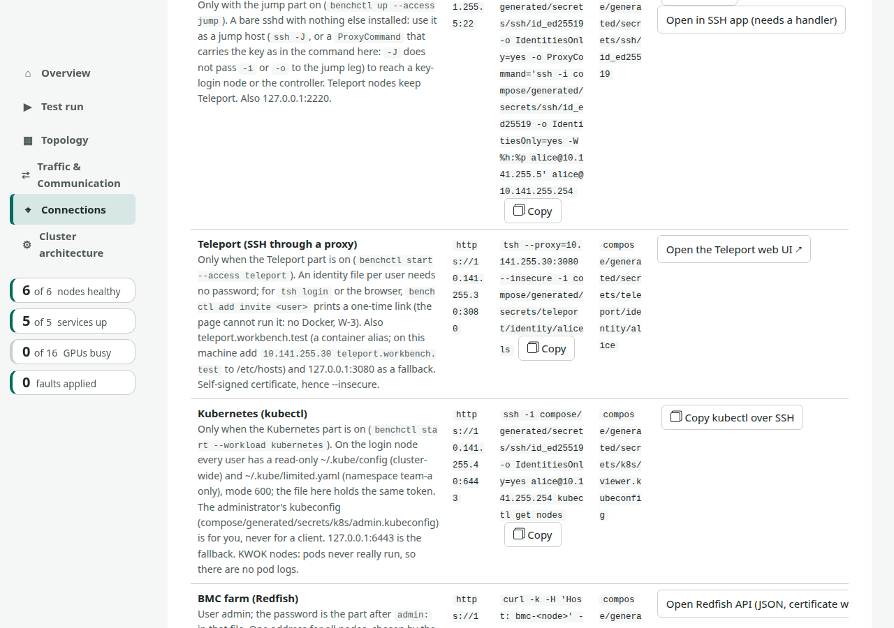

To turn it off, untick it and apply again.

Two things stay in a terminal, because the page has no Docker access by design (SPEC W-3):
- the one-time link for a `tsh login` password and code: `./scripts/benchctl add invite alice`;
- the `tsh` commands themselves.

The full walk-through is in [Nodes and shells](04-nodes-and-shells.md#teleport-tsh-to-the-login-node-and-the-nodes).

## A node: actions and info

Click a node card, or a node tile in the diagram and then **Actions and details**. The panel opens in the **Connections** area, not as a pop-up. That area grows to make room, so you can watch the diagram and the list while you act.

The selected node is outlined in the list. The header has **← All nodes** (Esc does the same), the node's name and its live state.

### Summary

The first card gives the state in words, then what the page can read:

| Row | Shows |
|---|---|
| *Reason* | Slurm's own reason for a drained or down node, from `sinfo`, or "none (healthy)" |
| *Jobs* | the running job ids and their users, from `squeue`, or "none running" |
| *Hardware* | GPUs, CPU temperature, fans |
| *Faults* | GPU XID, InfiniBand ports down, NIC flapping; only when there are some |
| *Power*, *Address*, *BMC* | as named |
| *Tickets* | the Jira mock's tickets for the node: key, status and priority in words, and the summary |

The card also has the **ssh command** with **Copy command**.

- *Reason* and *Jobs* come through the governor's read-only `slurm-stats` and refresh every few seconds while the panel is open.
- When the stats are unavailable, the stack or governor is down, or the governor is at L3 or above, the page shows one notice in the Reason row and no Jobs row. `benchctl describe node NAME` still has the reason.
- A value it cannot read says "not measured", never zero.
- A Kubernetes node has a shorter summary: no address, no SSH, no Slurm job.
- It shows the Kubernetes state, power, temperature and BCM state, and has the BMC fault buttons (the GPU error on a GPU node).
- The card is the worse of the API's state and the machine's, and names both: `NotReady (Overheating (92 °C))`.
- The NotReady half of a power-off or overheat goes through the governor, which has the Docker the page lacks (`benchctl start` runs one with `--workdir`; refused at L2 and above).
- *Tickets* is a search for the label `node-NAME`, which is how the mock's ops integration labels the tickets it files. It says "none" when there are none, and shows one notice when the mock does not answer.
- *Tickets* reads the mock only. Whether a real Jira labels tickets that way is not known, so the row is not shown for it.

### Actions

- **Faults:** **Power off**, **Overheat (92 °C)**, **Fan failure**, **GPU error (XID 79)** (GPU nodes only), **InfiniBand port down** and **NIC flapping**.
- **Recover:** **Power on** and **Clear faults**.
- **Workload:** *Run 1 CPU, 5 min*. GPU nodes also offer 1 GPU or all GPUs, for 5 or 30 min.

The result appears under the buttons, the card changes state and a diamond shows the injection. Nothing here opens a shell on a node. Use [`docker exec`](04-nodes-and-shells.md).

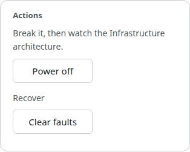

*The Actions card of a powered-off node.*

**Power off and Slurm.** Power off does four things:
1. It sets the BMC and BCM state.
2. It makes the GPU exporter stop publishing the node, so its GPU series vanish from Grafana.
3. It asks the governor to **freeze the node's container**, so its `slurmd` stops answering, as on a dead host.
4. `slurmctld` notices by itself. `sinfo` shows the node `down*` (reason *Not responding*) after about 30 s (`SlurmdTimeout=15`, `MessageTimeout=5`).

Power on thaws it. With `ReturnToService=1`, Slurm returns it on its own after its next answer.

**If the node was not frozen.** Freezing needs the governor started with `--workdir` (the launcher does) and level L0-L1. Otherwise the page says the node was not frozen and names `benchctl set node NAME off`.

**IB port down and NIC flapping** show on the node card as a warning, and the health check drains the node.

**The Workload card** submits a job on that node through the governor (`benchctl submit`).
- `squeue` lists it.
- The node shows allocated.
- A GPU job shows its GPUs busy.
- `benchctl set node NAME down|resume` sets the Slurm state by hand instead.

A node set `down` by hand stays down until `resume`. One that went down by not answering returns by itself.

**A cluster built before `ReturnToService=1` was set** keeps the old behaviour until its `slurm.conf` is regenerated and reloaded:

```bash
./scripts/benchctl up
./scripts/benchctl exec slurmctld -- scontrol reconfigure
```

### Info

- **How to reach the node:** SSH command, key file, BMC login.
- **What is known about it:** BMC state, GPUs busy and idle.

It is the same text as `benchctl describe node NAME`, minus the Docker and Slurm lines, because this page has no Docker access. The container IP needs Docker, so run `./scripts/benchctl describe node cn001`. It prints an `IP:` line.

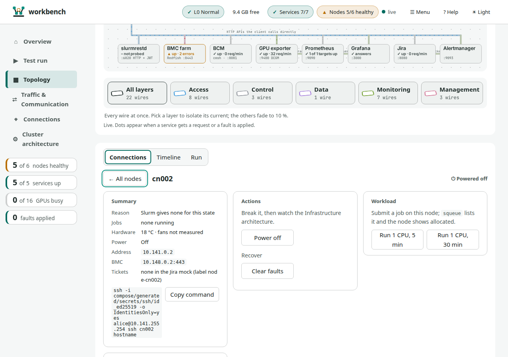

*After Power off on cn002: the node is marked "Powered off" in words as well as colour, BCM shows DOWN, and the strip counts 5 of 6 nodes healthy. Press Clear faults to undo.*

## Plan: change the workbench

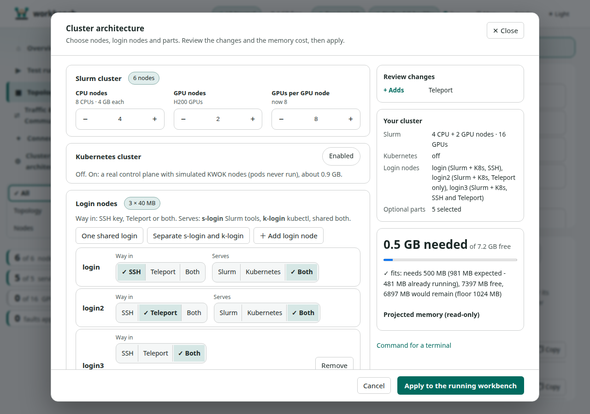

**▦ Cluster architecture** opens a wide sheet with one card per concern. A summary beside it stays in view (on a phone it stacks under the cards).

| Card | What you set |
|---|---|
| **Slurm cluster** | steppers for CPU nodes, GPU nodes and GPUs per node, each with what one node is (for example 8 CPUs, 4 GB; H200) |
| **Kubernetes cluster** | an Enabled switch and steppers for its own CPU and GPU nodes (KWOK), separate from the Slurm nodes; the card collapses to one line while it is off |
| **Login nodes** | one card per login node: *Way in* (SSH, Teleport, Both) and *Serves* (Slurm, Kubernetes, Both); two presets, *One shared login* and *Separate s-login and k-login* |
| **Optional parts** | toggles grouped by category as in the `--ticketing` and `--hardware` flags (accounting, Jira, BMC, BCM, Teleport, scenarios, load); each shows the memory limit it adds, and the toggles show what is built now |

**BMCs per node.** Switch *BMC* on to see the nodes that get a BMC address (all by default).
- Each BMC is its own small container with its own address (`10.148.x.y:443`).
- It costs 16 MB at most (about 3 MB used), shown in the memory bar.
- Switch off the nodes you do not need. Apply removes their BMCs.
- A node panel shows its BMC address, or "none for this node".

### Read the summary

- It lists the node counts per scheduler, the logins, and the memory it needs against free memory (for example "1.7 GB needed of 4.5 GB free").
- It shows the `benchctl up ...` command for a terminal.
- It shows the change against what runs now ("GPU nodes 2 → 3 (+1)"). Editing the numbers only estimates.
- **Projected memory** (under the memory bar, read-only) states the budget (free memory minus the 1 GB safety floor), the projected need and what is left. A table gives the expected use and cap per part.
- When the selection needs more than the budget, a **▲ Over budget** notice says by how much, in words and an icon.
- The page only shows the projection. The governor still refuses an over-budget Apply (GV-9).

### Review, then apply

1. Read **Review changes** at the top of the summary. It says what Apply will do:
   - **+ Adds:** nodes, parts, login nodes;
   - **− Removes:** the same;
   - **↻ Restarts:** slurmctld, only when the Slurm node list changed or accounting was added.
2. If a node to be removed is `allocated` or `mixed` in Slurm, the sheet says jobs will stop. **Apply** stays disabled until you tick **I understand**.
3. Press **Apply to the running workbench**, then press it again to confirm. The governor rebuilds the workbench: new nodes start and unwanted nodes are removed.
4. Watch the **Progress** list. It shows the governor's stages (Build images, each start stage, Restart slurmctld) as waiting, running, done with seconds, or failed. The sheet names the job, for example `Job #7: nodes (1 of 3 stages done)`.

**Good to know**
- Slurm's states are read once with `sinfo` when the sheet opens. If they cannot be read, the sheet says so. It does not guess, and it does not list job ids.
- The stages come from the governor, not from the log text. If an older governor reports no stages, the sheet says so and points to Governor activity.

See [choose the workbench](../guides/choose-workbench.md).

**If the sheet says "Could not load the options".** The page and the process behind it are different versions. Restart it and reload:

```bash
./scripts/benchctl stop
./scripts/benchctl start
```

## Test run

**▶ Test run** opens one workspace for a whole test, with the library on the left and the chosen scenario on the right. Open it from the left nav, or with **Open Test run** on Overview. While a scenario runs, its chip in the top strip (name and step count) also opens it. A long scenario name wraps inside its card, so **▶ Play** is always whole.

1. **Pick.** Click a scenario's name. You see its description, its length and every step as it will play, **before anything starts**. **Show on the diagram** shows where each step will act ([before Play](#before-play-where-a-scenario-will-act)).
2. **Play.**
   1. Pick a group chip (**Auth**, **Kubernetes**, **Jira**, **SSH**, **Network**, **Hardware**, **Slurm**; each shows how many scenarios it holds) and type in *Filter scenarios*. A scenario sits in the first of those groups, in that order, that one of its steps targets; the card shows the first sentence of its description, and the full text is in the detail pane.
   2. Pick a speed. It applies to all.
   3. Tick **Slurm trace** if you want what the jobs and Slurm's logs did around each step ([Slurm resilience](../guides/slurm-resilience.md)).
   4. Press **▶ Play**.
3. **Watch.** The steps, a progress bar, **Stop**, the expectations (pending, then passed or failed) and **Client's eye** update live. **Watch on the diagram** shows the same run on the Infrastructure architecture ([a scenario run on the diagram](#a-scenario-run-on-the-diagram)).
4. **Read Client's eye.** For each service it shows the calls the mock counted during the run, and the errors where the mock counts them.
5. **Export.** When the run ends, **Markdown** or **JSON** downloads a report built in the browser.
   - It has the run's start, end and length.
   - For each step it has the planned time and when it ran (seconds after Play).
   - Each expectation has its result, its time and its words.
   - A similar report is on the command line after the run, with no browser: `./scripts/benchctl export test-report last` (Markdown, or `--json`).
   - The command adds the node states, faults and alerts as at export ([guide](../guides/client-testing.md#attach-a-test-report-to-a-bug-report)).
   - The page's own buttons count the calls from the tab's reading at Play; the command uses the counters the page process keeps from Play to the end, so it does not depend on a tab being open.

**Steps the page cannot run**
- An expectation that only the CLI can check says **skipped (CLI only)** and, under the list, gives the command with a **Copy** button.
- They are marked **↷ CLI only**, with the reason. A notice gives the command that runs everything: `./scripts/benchctl scenario run NAME` (**Copy** puts it on the clipboard).
- The page has no Docker by design. Only its `slurm` steps (drain, resume, job and daemon steps, done by the governor) and the mocks' own steps run here.
- The rest, and the expectations that need the host, are skipped.
- A skip is not a pass. The result says **Passed, with skipped steps** when there were any.
- A step the governor refuses (memory level L2 and above) or cannot do (started without `--workdir`) shows **skipped** with the reason.

**Client's eye**
- **n/a** means the mock keeps no counter. It is never zero.
- The basis is counters, not a trace of which endpoint was used.

**The report** holds what was injected and what each step did, the expectations, and what the client called during the run. Nothing is stored on the server or in the repository. It holds no hostnames, tokens or paths.

While a scenario runs, the top strip shows it. Press that chip to open Test run. A run started from the CLI or another tab is shown too.

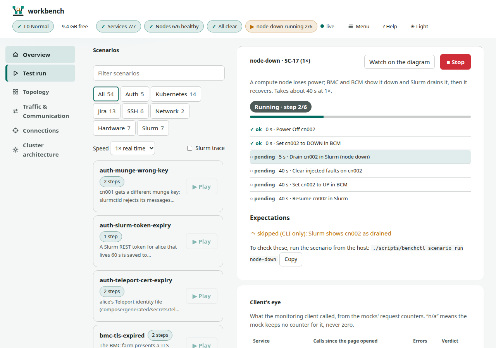

*A scenario playing (node-down, step 2 of 6). Stop aborts.*

## Governor

Press the level chip (for example **✓ L0 Normal**) or the memory chip. The panel shows:
- the level and what it means;
- free memory and pressure, with two-minute trends;
- the governor's log (*Governor activity*, newest first).

A change the page asked for ends with a line such as `apply-plan=4cpu+2gpu: done (#3 14:50:12)`. The number and time make every line unique, which is how the sheet knows *this* apply finished.

If the governor is offline, or memory is tight (L2 and up), the same is also listed under *Needs attention*.

## Connections

The **Connections** tab lists every part with its address, a command you can copy, and the **file that holds its credential**. The parts are the login node, nodes, BMC, BCM, Jira, Slurm REST, GPU exporter, Prometheus, Grafana and this page. The page shows paths, never secrets.

The last column, **Open**, has one-click actions for the parts that have one:
- **Open ... ↗** opens a web page in a new tab: Grafana, Prometheus, jira-mock, the GPU metrics, the Teleport web UI, the Redfish endpoint and this page. The links use the ports published on `127.0.0.1`, so they work without the Docker network route.
- **Open in SSH app (needs a handler)** is on a login node that takes a key. It hands the address to the terminal your desktop registered for `ssh://`.
- **Copy benchctl ssh** gives `benchctl ssh alice@<node>`, a real SSH login as that user through the login node. The button says "Copied" and the page announces it to screen readers.

**Good to know**
- Links to an API say so (**Open jira-mock API (JSON)**, **Open Redfish API (JSON, certificate warning)**). You get raw JSON, not a page. The browser warns about the Redfish self-signed certificate. Both are expected.
- Not every desktop has an `ssh://` handler, so the browser may ask which app to use. **Copy benchctl ssh**, the first action of the row, works everywhere.
- `benchctl ssh <node>` without a user is a root shell. A node's panel has the same command with the node filled in.
- The page never opens a terminal itself (it has no Docker or root access, W-3). A part with nothing to open shows "none".

## Health checks: what drains a node

Open **☰ Menu → Configure → ✚ Health checks** for the list of checks every node's health check runs, in run order.
- **Reorder:** drag a block by its handle, or use the ↑ ↓ buttons.
- **Switch a check on or off:** tick it.
- **Edit a parameter:** change it and leave the field.
- **Remove:** press ✕.
- **Add:** drag a template (`metric-above`, `metric-below`) into the list, or press it. Then name it and fill in its parameters.

Each change is checked before it is saved: syntax, parameters, and a run on healthy sample metrics. A refusal shows one line, and the list returns to what was saved. Nodes use the change within 30 s, with no rebuild.

The page adds checks from templates only. Your own script goes in with `benchctl add check NAME --script FILE`. See [NHC checks](../guides/nhc-checks.md).

## Export: a profile file for the monitoring client

**☰ Menu → Share → ⇩ Export** downloads `bench-profile.json` for the cluster on disk. That is the workbench last built, else the profile `up` started. Tick *One BMC target per node* to include the BMC farm.

The file never holds secrets. After a successful download, the sheet lists what to set by hand:
- the SSH key: `benchctl ssh-key install`;
- the Grafana token: `compose/generated/secrets/grafana_viewer_token`;
- the BMC password, if asked for;
- Jira needs no token.

It also warns when Slurm accounting is missing, because `sacct` would fail. See [export a profile](../guides/export-profile.md).

## One message per condition

If the cluster is down, the page shows one notice and one *Needs attention* entry. It hides data that cannot exist (the entity list) and names the recovery command, which never needs `sudo`. If the governor is down, it says so the same way.

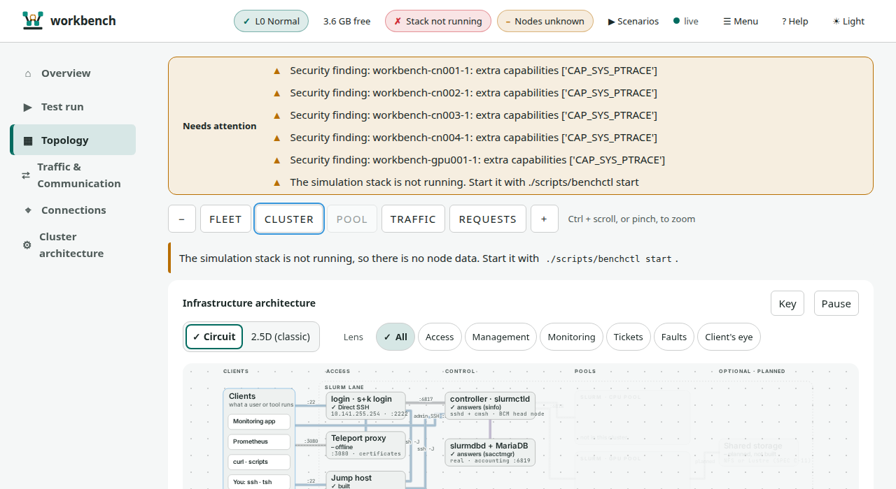

*The cluster is stopped: one notice with the command to start it, services shown offline with dashed outlines, and no node list. The memory figures are the host's, taken at the time of the screenshot.*

## Help inside the page

**? Help** in the header opens this manual, the guides, the architecture notes and the decisions as linked pages at `/help/`. It has a sidebar, a search box and **← Dashboard** to go back. It needs the same login as the page.

Start with [Which command do I use?](11-which-command.md) when the commands are new.

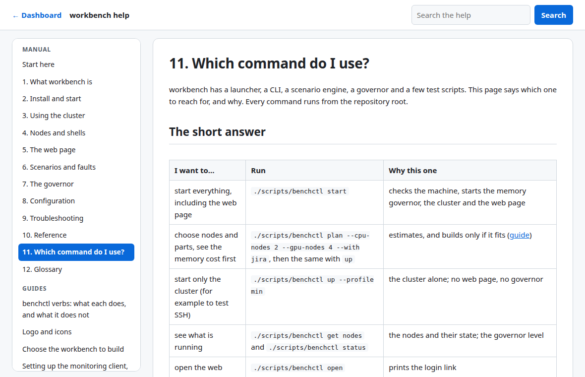

## Text size and security

- **Text size:** text is sized in `rem`, so the browser's own font-size setting (and zoom) scales it. Running text is at least 14 px at the default setting. The diagrams' labels are drawn in fixed units inside the picture and scale with the picture.
- **Content-Security-Policy:** the page, its files and the help pages (`/help`, stylesheet `static/help.css`) are served with a strict policy. Scripts and styles come only from the page's own origin. There is no inline script or style, no framing, no objects.
- **If you add a template:** set sizes through classes or the `data-w`, `data-flex`, `data-p` and `data-bg` attributes (`paintDyn` applies them). A `style="..."` attribute is blocked, and a test fails.

## Limits

- The Profile and Budget manager (edit `sim.yaml` in the page) is **not built**. Edit the file ([chapter 8](08-configuration.md)).
- Backend memory stays under 50 MB. Starlette and one static page, no framework, no CDN.
- Browser debugging for developers: `.venv/bin/python scripts/ui_shots.py` ([reference](10-reference.md)). The page is plain ES modules under `webui/static/js/` with no build step. `node --test "webui/tests/js/*.test.mjs"` runs its logic tests.

## What you will see

The screenshots in this chapter come from sample data, so the numbers differ from your cluster and the shapes match.

## Under the hood

The page is a small Starlette server (`webui/app.py`) and static ES modules, with no build step. It never gets Docker or root. It talks to the governor's Unix socket (`/run/workbench/gov.sock`) and to the mocks' HTTP endpoints. Scenarios it plays run with `host=False`, so steps that need Docker are skipped, not failed.

> [!HOOD]
> The traffic dots come from the mocks' request counters and the login and jump containers' SSH session counters (ADR 0088), not from packet capture, and the live feed (server-sent events) is open only while the tab is visible; animation stops at governor level L3 and under reduced motion.

Source: `webui/app.py`, `webui/flow.py`, `webui/cluster.py`, SPEC W-3 and W-11, ADR 0007, ADR 0009, ADR 0088.

## Tips and gotchas

> [!TIP]
> Press Esc to leave a node's panel; **Clear faults** undoes every fault you injected.

> [!WARNING]
> Anyone with the login link on this machine can use the page, so keep it private. The page listens on `127.0.0.1` only.

## If it goes wrong

| You see | Why | Do this |
|---|---|---|
| one notice that the stack is down | the cluster is stopped | run the command the notice names; it never needs `sudo` |
| a notice that the governor is down | no governor is running | `./scripts/benchctl start` |

## Learn more

[Scenarios and faults](06-scenarios.md) · [The governor](07-governor.md) · [Web UI canvas](../guides/web-ui-canvas.md) · [ADR 0009](../adr/0009-traffic-dots-from-request-counters.md)
