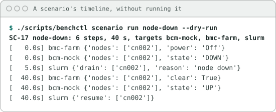

<p align="center"></p>

# 6. Scenarios and faults

**In 30 seconds:** a scenario is a named, repeatable timeline of faults, a small stunt your monitoring client has to notice. Run one with one command, or play it from the web page.

## Do it

```bash
./scripts/benchctl scenario list
./scripts/benchctl scenario run node-down --dry-run     # print the timeline, change nothing
./scripts/benchctl scenario run node-down
```

Scenarios live in `scenarios/*.yaml`.

## Run one

```bash
./scripts/benchctl scenario list                          # reference (SC-nn), name, step count, description
./scripts/benchctl scenario run node-down --dry-run       # validate and print the timeline, change nothing
./scripts/benchctl scenario run node-down --speed 10      # play it ten times faster
./scripts/benchctl scenario run slurmd-restart-mid-job --trace   # after each step: job states and the new Slurm log lines
./scripts/benchctl scenario run SC-02 --dry-run          # the reference works instead of the name
```

The command exits 1 when a step errors or an `expect` line does not hold.

`--dry-run` shows what a scenario will do before it does it. For `node-down`, a node is powered off, marked down and drained, then everything is put back at 40 s:

<picture>
  <source media="(prefers-color-scheme: dark)" srcset="../assets/snapshots/scenario-node-down-dark.svg">
  
</picture>

*A scenario's timeline, without running it*

- Steps the caller cannot run are reported as **skipped**, not failed.
- From the web page ([chapter 5](05-web-page.md)) the `slurm` steps go through the governor.
- Tick **Slurm trace** there for the same trace (see the [resilience guide](../guides/slurm-resilience.md)).
- On the page, **Watch on the diagram** puts each step's number on the parts it touches ([a scenario run on the diagram](05-web-page.md#a-scenario-run-on-the-diagram)).
- Before Play, **Show on the diagram** draws where each step will act and whose clients may see a change ([before Play](05-web-page.md#before-play-where-a-scenario-will-act)).
- While the web page runs, `scenario run` also shows its steps there, marked *run from the CLI* ([a run from the CLI](05-web-page.md#a-run-from-the-cli)). With no page it does exactly what it did before.

## The scenarios shipped

| Ref | Name | What happens |
|---|---|---|
| SC-17 | `node-down` | a compute node loses power; BMC and BCM show it down, Slurm drains it, then it recovers |
| SC-05 | `fan-failure` | fans fail on a GPU node and it runs hot (fault model); the BMC event log shows critical entries and a ticket is filed |
| SC-07 | `ib-port-down` | an InfiniBand port goes down on the first GPU node, the second one's NIC flaps (fault model); the health check drains the node, tickets open, then both recover |
| SC-01 | `client-stress` | five minutes of everything at once (job floods, GPU errors, heat, a node off and drained, 12 tickets, Jira mock 429/slow/503); run it while the client is open and measure the client ([how](../guides/client-testing.md)) |
| SC-02 | `client-stress-real` | `client-stress` for a client connected to the **real** Jira: the same nodes, GPUs, heat and jobs, with Jira's own rate limit (about 75 to 180 s), a CAPTCHA lock and a 30 s hang instead of the mock's faults, and the 12-ticket wave filed on the real Jira (needs `jira-real` up) |
| SC-06 | `gpu-xid-storm` | the GPUs of both GPU nodes fall off the bus (XID 79); only the cause is injected, the health check drains the nodes and a ticket is filed, and the scenario asserts both; the app should open tickets too |
| SC-08 | `jira-429` | Jira rate-limits the next 5 calls (429 with Retry-After); the app must back off |
| SC-10 | `jira-outage` | Jira answers 503 to the next 20 calls, then recovers |
| SC-09 | `jira-flap` | Jira is refused, rate limited and unavailable in turn, each time healthy again, with tickets before and after |
| SC-13 | `jira-real-outage` | the **real** Jira (`jira-real`, part must be running) hangs for 60 s (container paused, calls time out), then answers again |
| SC-11 | `jira-real-429` | the real Jira's own rate limiting (3 requests, refill 1 per second) turns on, so bursts get a real 429 with `X-RateLimit-*` headers, then off at 120 s; each change shows up to a minute late |
| SC-28 | `jira-real-slow-503` | the real Jira answers slowly (8 s), then 503, then 429 with `Retry-After: 30`, through the fault proxy: **point the client at `127.0.0.1:8084`** |
| SC-29 | `jira-real-token-revoked` | alice's personal access token is revoked (a real 401 for a client using it), then a new one is written to `jira-real.env` at 90 s |
| SC-46 | `netem-slow-link` | the first compute node's network gets 200 ms delay and 5 % loss for 60 s (`tc netem`, **root governor service only**, L0-L1; CLI and scenarios only, the page skips it; [guide](../guides/network-faults.md)) |
| SC-37 | `preempt-burst` | a scavenger job holds 2 GPUs of the first GPU node (the example `max_gpus_per_user`); at 20 s an `urgent` job asks for all 8 and Slurm requeues the scavenger job; needs the accounting part and `qos:` in `sim.yaml` ([guide](../guides/qos-and-preemption.md)) |
| SC-36 | `reboot-asap` | Slurm reboots the second compute node (`scontrol reboot ASAP`): BMC `Reset ForceOff` then `Reset On`, slurmd restarts, the node resumes; then the third compute node is powered down through Slurm (`POWERED_DOWN`, BMC Off) and up at 90 s ([guide](../guides/power-and-reboot.md)) |
| SC-35 | `switch-leaf-down` | one leaf switch goes down: exactly its nodes drain (`switch leaf1 down`), and only those resume at 90 s; needs `topology:` in `sim.yaml` ([guide](../guides/topology.md)) |
| SC-30 | `auth-slurm-token-expiry` | a Slurm REST token for alice that lives 60 s is saved to `compose/generated/secrets/slurm_token`; after that slurmrestd refuses it (HTTP 511; a request with no token gets 401) |
| SC-31 | `auth-teleport-cert-expiry` | alice's Teleport identity file lives 60 s, then the login node refuses it as expired; signed again at 180 s (`--with teleport`) |
| SC-32 | `auth-munge-wrong-key` | `cn001` gets another munge key (slurmctld: `Invalid credential`; the node shows `idle*`, not `down`), its own key is back at 120 s |
| SC-33 | `bmc-tls-expired` | the BMC farm presents an expired certificate (it ended a day before the image was built) for 60 s: `certificate has expired` on 8443, 443 and each node's BMC address |
| SC-34 | `k8s-cert-expired` | the API server serves a certificate that ended yesterday for 90 s (`--with k8s`): `certificate has expired` from kubectl |
| SC-12 | `jira-real-captcha` | six wrong-password logins make the real Jira answer 401 then 403 `CAPTCHA_CHALLENGE` (what an integration meets after a bad password), cleared after 60 s |
| SC-26 | `ticket-lifecycle` | one ticket: Open, In Progress, a note, Resolved, Closed |
| SC-04 | `drain-ticket` | Slurm drains `cn003`; a ticket naming the cluster and the node is filed, worked, and resolved when the node resumes |
| SC-27 | `ticket-wave` | twelve tickets at once in every status and priority (see the [tickets guide](../guides/jira-tickets.md)) |
| SC-22 | `ssh-host-key-changed` | the login node presents a different host key for 60 s; a client that pinned the old one must refuse it |
| SC-15 | `login-node-down` | the login node refuses connections for 30 s, then returns with the same host key |
| SC-16 | `login-node-hung` | the login node freezes (connections time out, nothing refuses) for 30 s |
| SC-25 | `ssh-session-limit` | one session per connection for 60 s: a client opening several channels is refused the extra ones |
| SC-23 | `ssh-key-refused` | the login node rejects the client's key for 60 s: `Permission denied (publickey)` |
| SC-24 | `ssh-node-sshd-down` | sshd on `cn001` stops for 60 s: the hop `ssh cn001` is refused, the login node and other nodes work |
| SC-21 | `slurmd-restart-mid-job` | `slurmd` restarts under a running job; does `slurmstepd` survive ([guide](../guides/slurm-resilience.md); use `--trace`) |
| SC-20 | `slurmd-disabled-mid-job` | `slurmd` stays down 45 s under a running job, then returns |
| SC-19 | `slurmctld-restart-mid-job` | `slurmctld` restarts with a real and a simulated GPU job running |
| SC-03 | `drain-mid-job` | a node is drained under a running job; the job finishes, the node ends drained |
| SC-14 | `k8s-node-notready` | a Kubernetes GPU node reports NotReady, then recovers (needs the `k8s` part) |
| SC-41 | `disk-full` | `/scratch` fills to 99 % of bytes and 90 % of inodes; `df`, `lfs df` and the `node_filesystem` series show it ([guide](../guides/storage.md)) |
| SC-42 | `quota-exceeded` | alice is over her quota on `/scratch`; `lfs quota -u alice` shows `*` and a grace time |
| SC-43 | `stale-mount` | `cn002` loses `/scratch`: `df` fails there, its series go, `node_filesystem_device_error` is 1 |
| SC-38 | `k8s-preempt` | filler pods hold GPUs of `kgpu001`; an inference pod needs more than are free and the real scheduler preempts them (needs the `k8s` part; [ADR 0077](../adr/0077-k8s-policy-objects-and-api-throttling.md)) |
| SC-39 | `k8s-drain-blocked` | `kgpu001` is drained while it holds an `inference` pod whose disruption budget allows no eviction; the drain blocks and the pod stays; only `inference` pods are evicted, other pods on the node stay (needs `k8s`) |
| SC-40 | `k8s-api-throttled` | the API server throttles the client's user (`viewer`) to about three seats and no queue, so a burst gets 429; removed after 2 minutes (needs `k8s`) |
| SC-45 | `k8s-queue-inactive` | the `gpu-training` Kueue queue and its local queues go inactive with a growing backlog, then recover (needs `k8s`; no controller, the step writes the status) |
| SC-47 | `k8s-metrics-down` | metrics-server stops: the metrics API answers 503 and node and pod usage disappear, the rest of the API answers; it starts again after 2 minutes (needs `k8s`, issue 382) |
| SC-50 | `k8s-gpu-unadvertised` | the first Kubernetes GPU node stops advertising GPUs (labels still say it has them, allocatable 0), then advertises them again (needs `k8s`, issue 766) |
| SC-51 | `k8s-mig-single` | the first Kubernetes GPU node becomes a MIG node (`mig.strategy` single, product `...-MIG-1g.18gb`, 7 devices as `nvidia.com/gpu`), then a normal node again (needs `k8s`, issue 766) |
| SC-52 | `k8s-mig-mixed` | the first Kubernetes GPU node serves 7 `nvidia.com/mig-1g.18gb` devices and one fewer whole GPU (`mixed`), then goes back (needs `k8s`, issue 766) |
| SC-53 | `k8s-kubelet-skew` | the first Kubernetes GPU node reports a kubelet newer than the API server, then one four minors older, then the API server's version (needs `k8s`, issue 766) |
| SC-54 | `k8s-gpu-fragmentation` | two pods take 4 GPUs on each GPU node, then a pod asking for 5 waits: the free GPUs add up to enough but no single node has them (needs `k8s` with two GPU nodes, issue 766) |
| SC-58 | `teleport-outage` | the Teleport proxy stops for 60 s: `tsh` and the web terminal are refused, direct SSH to a key login node keeps working; then it starts again with its users and identities (needs `teleport`, issue 209) |
| SC-55 | `kube-binding-missing` | the Kubernetes binding of the viewer tier's group is deleted for 90 s: through Teleport a viewer is let in, kubectl answers `forbidden` from Kubernetes (needs `teleport` and `k8s`, issue 756) |
| SC-56 | `kube-impersonation-revoked` | Teleport's `teleport` user may not impersonate for 90 s: every `tsh kube` request fails upstream with `cannot impersonate` (needs `teleport` and `k8s`, issue 756) |
| SC-57 | `kube-identity-expired` | alice's identity file lives 60 s, then `tsh kube login` and `tsh kube credentials` fail as expired; signed again at 180 s (needs `teleport` and `k8s`, issue 756) |
| SC-49 | `k8s-volcano-queue-closed` | the Volcano queue `gpu-batch` is closed and the PodGroup `train-wait` stays Pending, then the queue opens again (needs `k8s`; no controller, the step writes the status, issue 765) |
| SC-48 | `k8s-hpa-max` | the autoscaler `hpa-below` is pushed to its maximum replicas by a rise in per-pod CPU use, then back; the real HPA controller reacts through metrics-server (needs `k8s`, issue 764) |
| SC-18 | `pod-crashloop` | a pod crash-loops and another is OOMKilled (needs the `k8s` part) |

## Write your own

```yaml
name: my-scenario
description: One line that says what the app should notice
steps:
  - {at: 0s,  target: bmc-farm, do: {nodes: [second cpu node], power: "Off"}}
  - {at: 5s,  target: slurm,    do: {drain: [second cpu node], reason: "node down"}}
  - {at: 40s, target: bmc-farm, do: {nodes: [second cpu node], clear: true}}
  - {at: 40s, target: slurm,    do: {resume: [second cpu node]}}
expect:
  - slurm.node_state: {node: second cpu node, state: drain, within: 20s}
```

### Name nodes by selector, never by hand

`second cpu node` is a selector. It becomes `cn002` on this `sim.yaml`, and whatever the second compute node is called on yours. A scenario then runs on any cluster.

The form is `first|second|third|fourth|last|any|all [N] gpu|cpu|k8s gpu|k8s cpu node(s)`:
- `first gpu node`
- `first 2 cpu nodes`
- `any 2 gpu nodes` (the first two, so a run is repeatable)
- `all gpu nodes`

`gpu` and `cpu` are the Slurm nodes. `k8s gpu` and `k8s cpu` are the Kubernetes ones. Inside a longer text, put the selector in braces: `summary: "xid on {first gpu node}"`.

**Good to know**
- `--dry-run` tells you when the cluster has too few nodes of that kind (`invalid: ... sim.yaml has only 2`).
- A test fails when a shipped scenario writes `cn001` or `gpu001` in its steps or `expect`.

### Inject the cause, assert the reaction

A `fault` step stands for every physical effect of one fault, applied together. You do not script what the cluster does about it.

```yaml
steps:
  - {at: 0s, target: fault, do: {inject: gpu-fell-off-bus, nodes: [first gpu node]}}
  - {at: 3m, target: fault, do: {clear: gpu-fell-off-bus, nodes: [first gpu node]}}
expect:
  - slurm.node_state: {node: first gpu node, state: drain, within: 2m}   # NHC drains it
```

| Fault | Effects of `inject` | Settings (default) |
|---|---|---|
| `gpu-fell-off-bus` | XID 79 in DCGM and the exporter, a critical Redfish event | none |
| `fan-failure` | failed fans, then the CPU temperature climbs | `fans` (3), `to` (88), `over` (60s) |
| `ib-port-down` | InfiniBand ports down on the exporter | `ports` (1) |
| `nic-flap` | the Ethernet link flaps | none |

- `clear` undoes the effects.
- `--dry-run` prints the effects as steps.
- The BCM mock only has a device state (UP, DOWN), so no fault writes a BCM health check.
- New faults go in `benchctl/faultmodel.py`.

### The fields of a step

| Field | Meaning |
|---|---|
| `at` | when the step runs, as `10s` or `2m`; `--speed` and `time_dilation` in `sim.yaml` compress it |
| `target` | `fault` (the fault model, above), `bmc-farm`, `bcm-mock`, `gpu-exporter`, `jira`, `slurm`, `ssh`, `k8s` |
| `do` | the body for that target (see below); `nodes: [...]` fans out one request per node and must name nodes by selector or from `sim.yaml` |
| `expect` | assertions checked after the steps |

`expect` lines that need the app under test (such as `jira.issue_created`) hold only when the app does its part.

### When an `expect` is looked at

An `expect` is one assertion with arguments. Each is polled until it holds (it passes the first time it does) or its `within` runs out (it fails). By default it is watched from the start of the run, which is too early for a check that something *survived* a fault: it holds before the fault is injected.

| Argument | Meaning |
|---|---|
| `within` | how long it may take to hold, from the moment it starts to be watched (default `0s`: one look) |
| `after: 30s` | not looked at before then; `within` counts from then. `after: 30s` alone is one look at 30 s |
| `at_end: true` | not looked at until every step has been applied; `within` counts from then. Not with `after` |
| `exact: true` | `slurm.node_state` only: the state must equal the one given (`draining`, `drained`, `down*`). Without it the state is a substring, so `drain` also matches `draining` and `drained` |

```yaml
steps:
  - {at: 0s,  target: slurm, do: {submit: {node: first cpu node, duration: 600}}}
  - {at: 15s, target: slurm, do: {slurmd_restart: [first cpu node]}}
  - {at: 60s, target: slurm, do: {cancel: true}}
expect:
  - slurm.job_state: {node: first cpu node, state: RUNNING, within: 14s}   # before the fault: the job is up
  - slurm.job_state: {node: first cpu node, state: RUNNING, after: 30s}    # after it: still running
```

- Put `after` after the fault has settled and before a later step undoes the state (here the cancel at 60 s). `after` and `within` are scaled by `--speed` like step times.
- `benchctl scenario run NAME` (also with `--dry-run`) and the page reject a bad duration, `at_end` or `exact` that is not true or false, `after` with `at_end`, and `exact` on another assertion.
- A look at one moment cannot tell a job that kept running from one that was requeued and started again.

**Jira expectations count only this run's tickets.** Nothing to write in the scenario.
- `jira.issue_count`, `jira.issue_status` and `jira.issue_created` ignore every ticket that existed when the run started.
- The mock keeps its tickets until reset, so a second run of `ticket-wave` still sees 12, not 24.
- A Resolved ticket of the first run does not satisfy `ticket-lifecycle`.
- The run lists the tickets before its first step. A Jira that cannot be read then counts every ticket it shows later.
- A ticket is recognised by its key and creation time, not by a clock. A skewed clock, or the minute resolution of a JQL `created >= -10m`, cannot let an old ticket through.
Every scenario carries an `expect`, or is listed with its reason in `NO_EXPECT` in `tests/test_scenario.py`. The test fails otherwise.

### What `do` takes, by target

| Target | Keys |
|---|---|
| `slurm` | `drain` and `resume` (node lists); the job and daemon steps of the [resilience guide](../guides/slurm-resilience.md): `submit: {node, gpus, duration}`, `cancel: true` (cancels the jobs of every simulated user in `sim.yaml`, not only alice's), `slurmd_restart`, `slurmd_stop`, `slurmd_start`, `slurmctld_restart` |
| `jira` | `failure: {mode: "429"\|"503"\|null, count: N}` |
| `bmc-farm` | `power`, `temp`, `fan_fail`, `ramp: {to, over}`, `clear` |
| `ssh` (the login node) | `state: down\|hung\|up` (stop, freeze, restore), `rotate_host_key: true`, `max_sessions: N` (OpenSSH MaxSessions), `reset: true` (original key, default limit, node up) |
| `gpu-exporter` | `storage: {mount, used_pct, inodes_used_pct, stale, user, used_gb, reset}` |
| `k8s` | see below |

`k8s` needs the part and Docker, so the page skips it. It takes:
- `down: [node]` (the node reports NotReady, `KubeletNotReady`) and `up: [node]` (Ready again)
- `cordon` and `uncordon` (node lists)
- `pod: {namespace, name, fault: crashloop|oom|imagepull|jobfail, gpus: N, priority_class, node}`
- `delete_pod: {namespace, name}`
- `scale: {namespace, deploy, replicas}`
- `apply` and `remove: [path under k8s/]`
- `drain: {node, selector, timeout}` (eviction through the API, so a disruption budget can block it; with a `selector` such as `app=inference` only those pods are evicted and the node's other pods stay)
- `metrics_server: stop|start` (stops or starts the metrics-server container: the metrics API answers 503 while it is stopped)

### Expectations by target

| Expectation | Holds when |
|---|---|
| `slurm.node_state: {node, state, within}` | the node reaches that Slurm state in time |
| `k8s.node_ready: {node, ready, within}` | the node's Ready condition matches |
| `k8s.pod_status: {namespace, name, reason, within}` | the pod's phase, or a container's waiting or terminated reason, matches |
| `k8s.pods_on_node: {node, namespace, selector, min, within}` | enough matching pods run on the node |
| `k8s.node_gpus: {node, allocatable, resource, within}` | the node's allocatable `resource` (default `nvidia.com/gpu`) equals `allocatable` (0 for a node that advertises no GPUs, issue 766) |
| `k8s.node_kubelet: {node, skew, within}` | the node's kubelet is `newer` than, `older` (four minors) than, or the `same` as the API server (issue 766) |
| `k8s.metrics_api: {served, within}` | the metrics API answers (`served: true`) or does not (`false`, 503 while metrics-server is stopped) |
| `storage.mount: {node, mount, min_used_pct, min_inodes_used_pct, quota_exceeded, stale, within}` | the mount shows that storage state |

Run `--dry-run` first: it rejects unknown targets and unknown nodes. Design: [ADR 0006](../adr/0006-scenario-engine-runs-in-the-host-cli.md).

## Faults reach the whole cluster

A `bmc-farm` step with `power: "Off"` is a power loss for the node. Besides the BMC, it:
1. sets the BCM state `DOWN`;
2. makes the GPU exporter stop publishing the node;
3. freezes the node's container.

`slurmctld` then marks the node `down*` (Not responding) by itself after about 30-40 s.

`power: "On"` and `clear: true` undo all of that. You write one step. Separate BCM, exporter and Slurm steps are not needed (they are harmless if present).

**Played from the page**
- The Slurm part (`drain`, `down`, `resume`, `power_off`, `power_on`) goes through the governor, at calm levels only (L0-L1).
- When the governor refuses, the step still runs and says why in its detail.
- `ssh` steps still need `benchctl scenario run`.

## What you will see

`run` prints each step as it fires and then the result of every `expect` line. The command exits 1 when a step errors or an `expect` line does not hold; steps the caller cannot run are reported as skipped.

## Under the hood

A scenario is a YAML file in `scenarios/` with `steps` (each has a time, a target and a body) and optional `expect` assertions. The engine runs in the host command line and turns each step into a request to the target: a mock, the Slurm controller through the governor, or `ssh` on the login node. `--speed` and `time_dilation` in `sim.yaml` compress the clock.

> [!HOOD]
> Which steps run depends on who plays the scenario. From `benchctl` on your host everything runs. From the web page (no Docker) the Slurm steps go through the governor at calm levels only, `ssh` steps and Kubernetes steps are skipped, and the step still says why.

Source: `benchctl/scenario.py`, `scenarios/*.yaml`, `webui/cluster.py`, ADR 0006.

## Tips and gotchas

> [!TIP]
> Always run `--dry-run` first: it rejects unknown targets and unknown nodes.

> [!WARNING]
> `nodes: [...]` must name nodes by selector or from `sim.yaml`; an unknown node is rejected.

## If it goes wrong

| You see | Why | Do this |
|---|---|---|
| a step is skipped | the caller cannot run that target (for example `k8s` from the page) | run it with `benchctl scenario run` |
| `web page: this run is not shown there: ...` | the page plays its own run, has another token, or reads another copy of the scenario (the reason follows) | nothing: the run goes on in the terminal; restart the page after changing the cluster |
| an `expect` line fails | the app under test must do its part for some assertions, or the step did not take effect | read the step's detail, then re-run with `--trace` |

## Learn more

[Web page](05-web-page.md) · [The governor](07-governor.md) · [Slurm resilience](../guides/slurm-resilience.md) · [ADR 0006](../adr/0006-scenario-engine-runs-in-the-host-cli.md)
