# Scenario runs on the architecture diagram: research note

Research for [ADR 0086](../adr/0086-scenario-runs-on-the-architecture-diagram.md), issue 806. Design only: no code was changed, nothing was run against a cluster. Facts about the page come from the code on `dev` (version 0.9.2) and the committed manual screenshots; facts about other products come from their own documentation, linked in section 4.

The owner's question: the scenarios live in a separate tab. The flow can be followed in the log lines, but not on the diagram. How can the two meet, in a creative way?

## 1. What the page does today

### Where a run is shown

| Place | What it shows during a run | File |
|---|---|---|
| Test run tab | Library, step list with status (ok, pending, skipped, failed), progress bar, expectations, Client's eye counters, export | `webui/static/js/testrun.js`, `scenarios.js` |
| Top strip | A chip `node-down running 2/6` that opens the Test run tab | `scenarios.js` (`runChip`, every 3 s) |
| Topology tab, 2.5D (classic) view | A diamond flies from the Faults frame to the node tile, a red ring for 1.2 s, the blast outline | `flowfeed.js`, `blast.js` |
| Topology tab, Circuit view (the default) | The blast outline only; no diamond | `circuit.js`, `canvas.css` |
| Inspector, Timeline tab | One text line per fault, `Fault <label> on <node>`, newest first, at most 40 | `flowfeed.js` (`paintFeed`) |

The Test run tab and the Topology tab are two tab panels of one tablist, so the step list and the diagram are never on screen together.

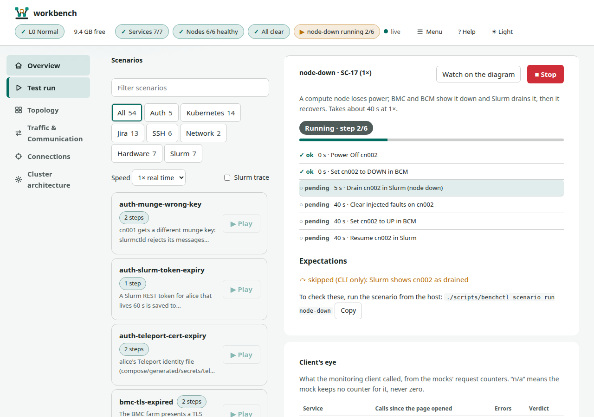

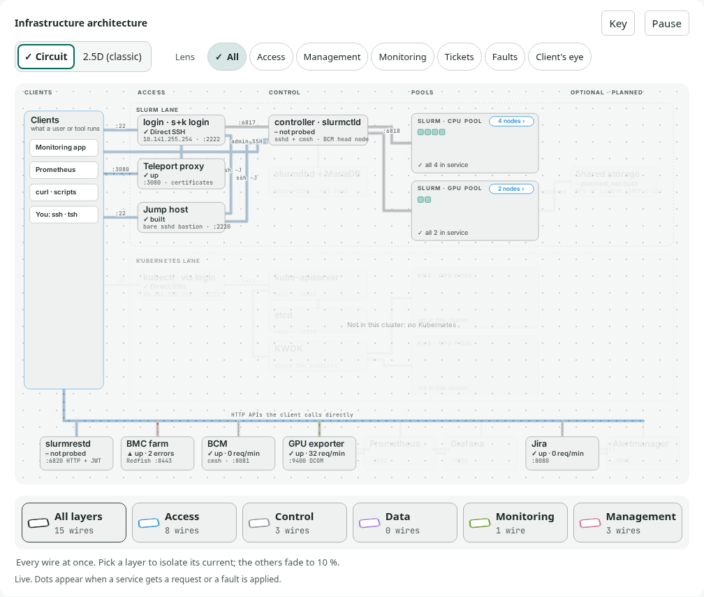

### How a run reaches the page

1. `POST /api/scenarios/{name}/run` starts `Runs.start` in `webui/app.py`: one run at a time, in a thread, with `host=False` (no Docker, SPEC W-3).
2. `scenario.run` (`benchctl/scenario.py`) waits for each planned step's `at`, applies it, and calls `on_step(step, outcome)`.
3. `Runs._play.on_step` writes the outcome into `Runs.state.steps[i]` (status, detail) and, for an `ok` step, calls `flow.note(target, label, nodes)`.
4. The page polls `GET /api/scenarios/run` every second while a run is on, and draws the Test run tab from it.
5. `flow.note` adds an `injector` event to the `/api/flow` stream (ADR 0009). The page turns the newest one into a blast outline (`blastFor`, 45 s) and, in the classic view only, into diamonds.

### What is lost on the way

- **Only four targets reach the diagram.** `SCENARIO_TARGETS` in `webui/flow.py` maps `bmc-farm`, `bcm-mock`, `gpu-exporter` and `jira`. Steps on `slurm`, `k8s`, `ssh`, `auth`, `netem`, `switch`, `jira-real` and `slurm-upgrade` make no event.
- **By count**, 89 of the 202 planned steps in the 46 scenarios (44 %) can make an event; the other 113 never appear on the diagram as a step.
- **The default view draws no fault marker.** `circuit.js` empties `S.svcPos` and `S.tiles`, so `launch()` in `flowfeed.js` returns at once. Only the blast outline is left.
- **No step identity.** A diamond or an outline does not say "step 3 of 6". The blast pane shows the newest event only and clears itself after 45 s.
- **Expectations are not on the diagram.** `expect` entries (node drained, ticket created) appear only as text in the Test run tab; most are "skipped (CLI only)" in the page.
- **No preview.** `GET /api/scenarios/{name}` (`scenario.preview`) already lists every planned step before Play, but nothing draws it on the diagram.
- **No replay.** The run state keeps no times; after the run the Timeline lines are only text and disappear on reload.
- **CLI runs are invisible as runs.** `benchctl scenario run` calls `scenario.run` in its own process; the page sees only the consequences (node states, counters).

### The data that is already there

- `scenario.plan(sc)` gives every step with `at`, `target` and `do`, after fault-model and ramp expansion (`benchctl/faultmodel.py`).
- `scenario.preview(sc)` adds whether the page can run each step (`page`, `why`) and lists the expectations.
- `webui/blast.py` declares, per page fault, which client-facing services change and one caption.
- `webui/graph.py` gives every diagram part a stable entity id (`data-ent`), which focus, lens and blast already use.

### The missing piece: which part does a step touch?

A step names its nodes under different keys: `nodes`, `drain`, `resume`, `submit.node`, `slurmd_restart` and others, `drain.node` for Kubernetes. The target name is not a diagram id (`jira` is `jira-mock`, `slurm` is the controller). No function today turns a step into the parts it acts on.

## 2. The gap in one table

| A run has | The diagram shows |
|---|---|
| Steps 1..N in order, with a time | Nothing numbered |
| A target per step (13 kinds) | Events for 4 kinds, markers in the classic view only |
| Nodes per step | A ring on a tile for 1.2 s (classic view) |
| Expectations (what should follow) | Nothing |
| A preview before Play | Nothing |
| A finished run to look back on | Nothing but text in the Timeline |
| CLI runs | Only side effects |

## 3. Requirements any option must meet

- Native ES modules, no framework, no build step; under 50 MB RSS (SPEC W-1).
- Colours from tokens only (`docs/assets/palette.yaml`, ADR 0069); status by a glyph and words, never colour alone; text contrast 4.5:1 in both themes.
- Keyboard: every badge or step reachable with Tab in step order; a scrubber is a WAI-ARIA slider (arrows, Home, End, `aria-valuetext`).
- Reduced motion: no travelling marks; states change in place.
- Phone: no horizontal page scroll, tap targets 40 px, the words carry the meaning.
- Honesty (`docs/guides/web-ui-canvas.md`): a mark only where data backs it; a replay shows recorded steps, not past readings.

## 4. How other tools show a scripted run on a topology

| Product | What it does | Lesson for workbench | Source |
|---|---|---|---|
| Steadybit | The run view shows the designed sequence at the top; "a special marker indicates the current point in time"; clicking a step shows "the exact targets" it affected | One time base, a now marker, and step to target links | [docs: run an experiment](https://docs.steadybit.com/use-steadybit/experiments/run) |
| Litmus ChaosCenter | "a realtime graph of the chaos experiment"; a side pane shows "the node details, results (once the execution is complete), and the logs" | Step graph plus one detail pane; logs belong to a step | [docs: visualize experiment](https://docs.litmuschaos.io/docs/concepts/visualize-experiment) |
| Gremlin Scenarios | A sequence of attacks "with increasing blast radius and magnitude"; the UI shows how many hosts a scenario will hit before it runs | Show the blast radius before Run, not only after | [blog: introducing Scenarios](https://www.gremlin.com/blog/introducing-scenarios) |
| AWS Fault Injection Service | A Timeline tab gives "a visual representation of the actions based on their start and end times"; action states include pending, running, completed, skipped, failed | Distinct skipped and failed states; start and end times per action | [docs: view your experiments](https://docs.aws.amazon.com/fis/latest/userguide/view-experiment-progress.html) |
| Chaos Mesh | Workflows listed and opened in the dashboard; per-node status through `kubectl describe workflownode` | Status per step, readable as text too | [docs: check workflow status](https://chaos-mesh.org/docs/check-workflow-status/) |
| Cisco Packet Tracer (simulation mode) | An Event List plus Back, Play, Forward and a speed slider; packets animate on the topology; clicking one opens it | The closest model: a stepped player over a topology, with a list beside it | [help: Simulation Mode](https://tutorials.ptnetacad.net/help/default/mode_simulation.htm) |
| GitHub Actions | "Every workflow run generates a real-time graph"; an icon left of each job gives its status; click a job for its log | A status icon per node, not colour alone; click to the log | [docs: visualization graph](https://docs.github.com/en/actions/how-tos/monitor-workflows/use-the-visualization-graph) |
| Grafana annotations | Annotations "are visualized as vertical lines and icons on all graph panels"; a region annotation covers "a period of time" | Steps as marks on one time axis; a span for "fault active". The governor already posts audit events as annotations (`--grafana-url`) | [docs: annotate visualizations (Grafana 13, AWS copy)](https://docs.aws.amazon.com/grafana/latest/userguide/v13-dash-annotations.html) |
| Datadog Watchdog | A dependency map "shows the service where the issue originated and the downstream dependencies that were affected" | Cause and consequence drawn on the same map | [blog: Watchdog](https://www.datadoghq.com/blog/watchdog-enhanced-visibility/) |
| Kiali (Istio) | "Graph replay allows you to replay traffic from a selected past time-period"; replay is bookmarkable (read through a search result: the page did not load here) | Replay belongs on the graph itself, with a time control | [docs: topology](https://kiali.io/docs/features/topology/) |
| Wireshark Flow Graph | Hosts as vertical lines, one row per packet with its time; "Left-click a row to select a corresponding packet in the packet list" | Two linked views: selecting in one selects in the other | [user guide: Flow Graph](https://www.wireshark.org/docs/wsug_html_chunked/ChStatFlowGraph.html) |
| Game replay viewers | Clickable event icons on the timebar; one viewer seeks "a few seconds before the corresponding event"; one bug report shows markers drifting when two time bases mix | Seek to just before a step; one time base for every mark | [Replayit release notes](https://replayit.gg/release-notes), [Deadlock forum](https://forums.playdeadlock.com/threads/replay-event-markers-are-offset-from-when-the-event-happened.66955/latest) |
| WAI-ARIA slider pattern | Arrows move one step, Home and End jump, `aria-valuetext` for a readable value | The scrubber is a slider whose value text is the step, not a number | [APG: slider](https://www.w3.org/WAI/ARIA/apg/patterns/slider/) |

**What the strong tools share.** One time base for every mark. A now marker. Numbered or iconised steps that link both ways to a list. A preview of what will be hit. Logs attached to the step that made them. Skipped is not passed.

## 5. The options, drawn

All four mockups show scenario **node-down** (SC-17, six steps) at step 3 on the Circuit view. They use the page's real tokens. Open [the mockup page](scenario-on-the-diagram-mockups.html) from a clone to see them live; add `?theme=dark` for the dark theme.

### A. Player bar

A run strip on top of the diagram: Back, Stop, Forward, a scrubber with one tick per step time and the caption of the step under the playhead. The step's parts get a solid ring; the declared blast radius gets red dashes.

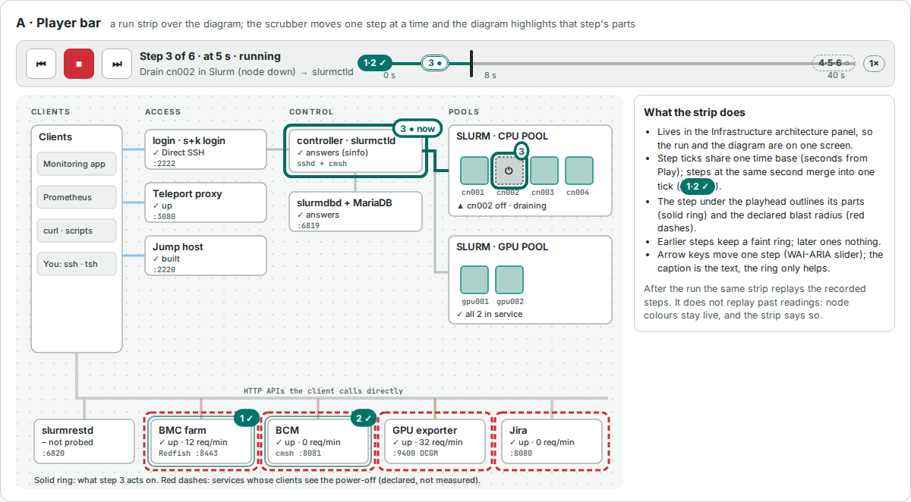

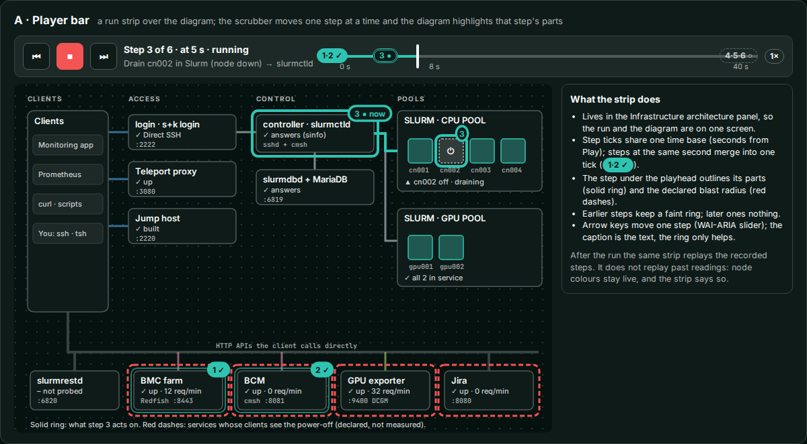

### B. Ghost preview, then follow

Selecting a scenario draws, before Play, a dotted ring and the step numbers on every part it will touch. Expectations get a pin; CLI-only items are marked ↷. On Play the dotted marks become live badges.

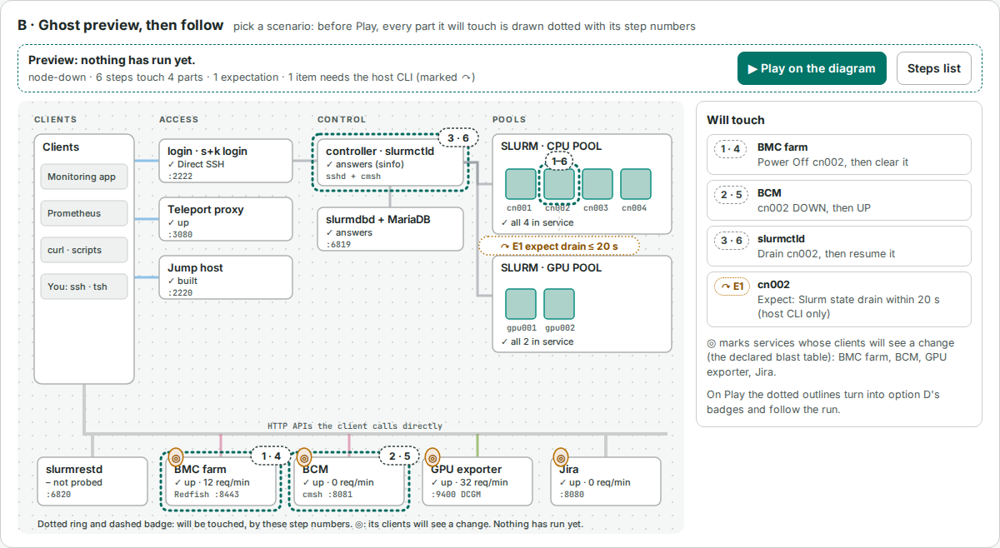

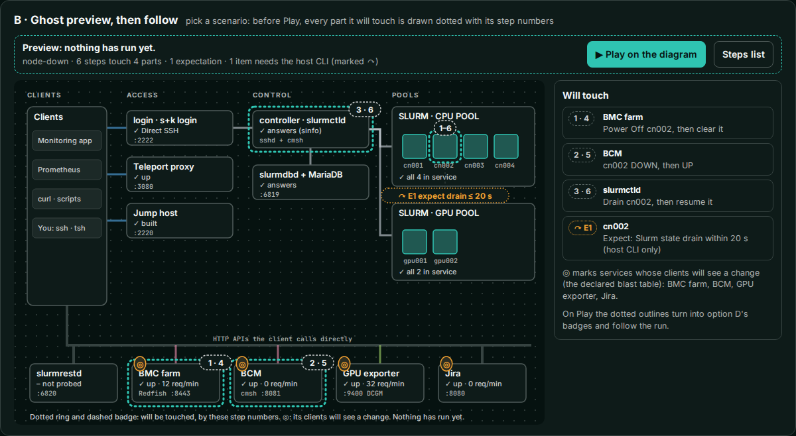

### C. The log, pinned to the diagram

The Timeline and the step list become one feed. Each step becomes a callout with a leader line to its part; done steps shrink to numbered pins.

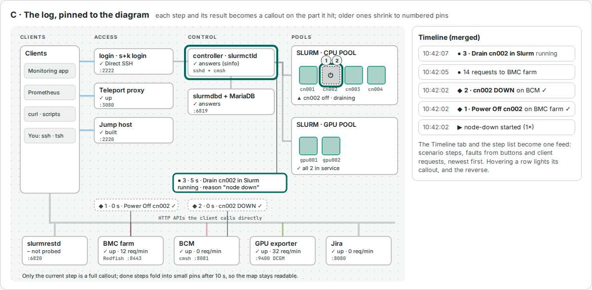

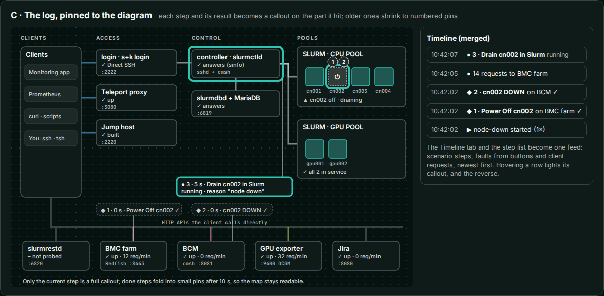

### D. Storyboard on the map

Numbered badges on the parts (number plus state glyph) match a numbered step rail beside the diagram. Preview, live and replay use the same badges.

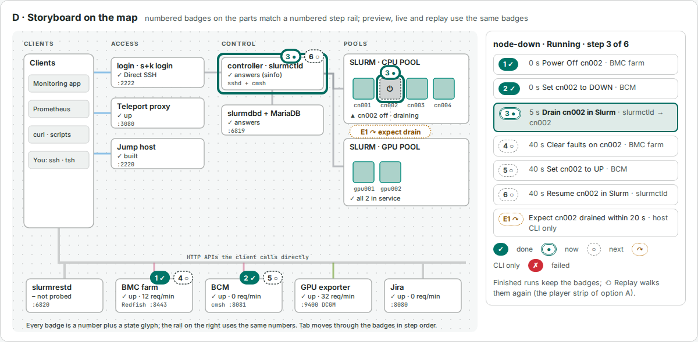

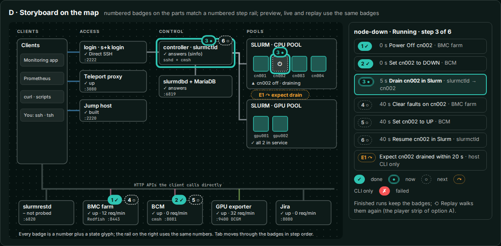

### D on a phone

The diagram scrolls to the current step's parts; a bottom sheet carries the words and Previous, Steps and Next buttons.

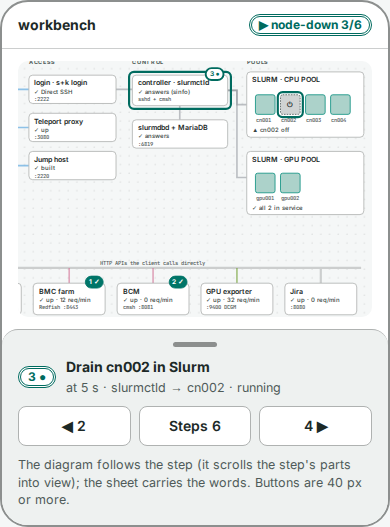

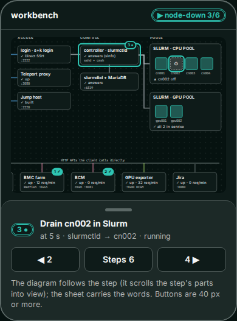

## 6. Notes for the build

- **Group by the scenario's own steps.** Fault-model and ramp expansions (`plan`) can turn 26 YAML steps into 34; badges should follow the YAML step number, with the expansion listed under it.
- **Big pools.** A pool rack draws one square per node only when there is room; otherwise the badge goes on the rack and names the node.
- **Long scenarios.** A part gets one badge: the latest step on it, plus `+N` for the others. The rail lists all.
- **The 2.5D classic view** keeps its diamonds; the run layer is drawn on the Circuit view first (ADR 0039 keeps the old view until it is rebuilt).
- **Rendering the mockups again.** Open the mockup page with `?only=a&theme=light` (a, b, c, d, phone; light, dark) and take an element screenshot of `#m-a` with Playwright at device scale 1; copy the PNGs to `docs/adr/img/`.
